# Current architecture

[Documentation hub](README.md) | [Product](PRODUCT.md) | [Developer guide](DEVELOPER-GUIDE.md)

This page describes the implementation, not the target design in [PLAN.md](PLAN.md).
The [security model](SECURITY.md) owns the precise controls and open gaps; these diagrams do not imply stronger
network isolation than the implementation provides.

## System overview

| Component | Owns | Source |
| --- | --- | --- |
| `agent-api` | Caller authentication, admission, job queries/mutations, SSE, approvals, static console | [API server](../src/agent-api/src/server.ts), [shared admission](../src/service-defaults/src/admission.ts) |
| `job-dispatcher` | Executor eligibility, attempt claims/heartbeats/completion, capability minting/introspection/usage, lease recovery | [Dispatcher](../src/job-dispatcher/src/server.ts), [startup/reaper](../src/job-dispatcher/src/main.ts) |
| PostgreSQL + `job-store` | Durable jobs, attempts, events, input requests, capability state, transactional transitions | [Store](../src/job-store/src/store.ts), [migrations](../src/job-store/src/migrate.ts) |
| `agent-executor` | Polling slots, runner uid/workspace isolation, protocol validation, deadlines/cancellation, result validation | [Main](../src/agent-executor/src/main.ts), [attempt](../src/agent-executor/src/attempt.ts), [isolation](../src/agent-executor/src/isolation.ts) |
| `agent-host` (opt-in, experimental) | Long-lived SDK owner, AHP transports, retained conversations/workspace, execution-grant renewal | [Supervisor](../src/agent-host/src/main.ts), [owner](../src/agent-host/src/owner.ts) |
| `session-host` (local hybrid opt-in) | One in-process runtime serving many shared harnesses: harness admission, protected session provisioning, per-harness turn scheduling, the shared base tools, approval modes, provider-backed files, eviction and completion delivery | [Service](../src/session-host/src/service.ts), [admission](../src/session-host/src/admission.ts), [tools](../src/session-host/src/toolkit.ts), [permissions](../src/session-host/src/permissions.ts), [scheduler](../src/session-host/src/scheduler.ts) |
| `connection-broker` (local hybrid opt-in) | One stable WebSocket path per session, ticket consumption through the dispatcher, byte forwarding to the session's current placement (shared worker or session container), "moved" closes | [Broker](../src/connection-broker/src/broker.ts), [session routes](../src/connection-broker/src/sessions.ts), [placement contract](../contracts/src/placement.ts) |
| `execution-controller` (local hybrid opt-in) | Durable allocation admission, operator-owned Docker lifecycle for one-shot job and resumable session containers, volumes, orphan reconciliation and teardown | [Controller](../src/execution-controller/src/controller.ts), [allocation store](../src/job-store/src/allocations.ts) |
| Session container (local hybrid opt-in) | One isolated conversation session per container: root supervisor with an allocation credential, unprivileged agent loop on a retained volume, broker-only AHP ingress | [Supervisor](../src/session-container/src/supervisor.ts), [owner](../src/session-container/src/owner.ts) |
| Runner | One SDK attempt with harness tools, skills, sub-agents, and permission handlers | [TypeScript](../src/harness-hosting/src/runner.ts), [Python](../execution-profiles/python-agent/runner.py) |
| `inference-gateway` | Approved chat-completions route, capability checks, upstream identity, token-usage reporting | [Gateway](../src/inference-gateway/src/server.ts), [routes](../src/inference-gateway/src/routes.ts) |
| Configurator | Customer-workspace authoring, optional server-side Copilot drafting, plus platform build/run/deploy controls; not part of the deployed request path | [Companion server](../configurator/server/app.ts), [draft service](../configurator/server/authoring.ts) |
| Aspire AppHost | Resource placement, endpoint references, service secrets, Azure identities and roles | [AppHost](../apphost.mts) |

The API and dispatcher both access PostgreSQL through the shared store. The dispatcher controls attempt execution;
the API writes caller actions directly to the ledger. There is no separate message broker: executors poll the
dispatcher for work, and the API reads persisted events with database notifications plus polling for SSE delivery.

Configuration has two explicit ownership roots. `CONFIG_ROOT` supplies customer-authored harnesses and policy from
`.copilot-agent-workspace/` locally or `/config` in images. `PLATFORM_ROOT` supplies immutable execution profiles
and profile `{root}` entrypoints from the source checkout or `/app` in executor images. The configurator reads
profiles/examples from the platform root but writes only the customer workspace. Image builds package the current
workspace; they do not silently deploy the shipped examples.

### Local assisted authoring

The optional draft path is separate from all deployed execution paths. GitHub credentials stay server-side;
the model receives only the description and configuration catalog. It cannot inspect or modify the checkout.
Generated configuration returns to the existing unsaved editor; code proposals remain inert downloads.
See [workflow and authentication](CONFIGURATOR.md#copilot-assisted-authoring) and
[precise boundaries](SECURITY.md#local-authoring-boundaries).

## Local and Azure topology

Locally, the gateway uses the developer's Azure CLI identity. In Azure, its managed identity receives model
access on an existing Foundry account. The deployed API and dispatcher use Entra-authenticated PostgreSQL access.
By default, only `agent-api` has external service ingress; the executor always has no ingress.
Enabling the experimental host's direct transport adds an authenticated WebSocket ingress.
GitHub-only hosting uses outbound Mission Control/WPS connections, not public host ingress.

The executor is always a Linux container, including during local development. In default pool mode it launches each concurrent slot's
runner under a separate unprivileged uid, with a private workspace and minimal environment. It is **not** one
Container App or virtual machine per job. See [Deployment](DEPLOYMENT.md) for supporting resources and costs.
The opt-in local hybrid mode instead starts one-shot Linux containers under a separate host-side controller;
it does not deploy that Docker controller to Azure. Publishing with hybrid mode enabled is rejected.

## Concurrency and durability

A harness definition is reusable configuration, not a permanently running bot. Separate jobs can invoke one
version concurrently; each active attempt has its own runner and root SDK session. Sub-agents operate inside
that runtime and share the parent attempt's lifetime and inference budget, not separate job scheduling or retries.

Executor slots provide bounded parallelism. More replicas add potential slots, not guaranteed throughput or model
quota, and the AppHost does not configure queue-driven executor autoscaling. Human waits still occupy a slot.
The [product assessment](PRODUCT-OVERVIEW.md#current-configured-limits) records the configured limits and their
source; [`main.ts`](../src/agent-executor/src/main.ts) implements the slot lifecycle.

PostgreSQL preserves job disposition and history independently of a browser or worker. SDK context and workspace
are ephemeral: reconnecting to a job view does not restore an ended conversation. Attempt duration is capped at
one hour by the contracts; queueing and retries can extend total job lifetime without providing continuous
multi-hour execution. Checkpointed sessions, suspended waits, retained files, and cross-job workflows are proposed
product layers, not properties of the current lease mechanism.
The experimental shared conversation and bounded on-demand artifact lifecycle below are separate from
this default batch-session behavior.

## Local hybrid hosting

`Parameters:hybrid-hosting=true` adds a shared worker, a connection broker, and an execution controller
while removing the always-on executor pool. Existing direct-container `agent-host` remains separately selectable.
The local AppHost runs these services as Node processes; a separately packaged Linux shared-worker
image uses the same code and qualified native runtime. Neither arrangement creates a runtime process per user.

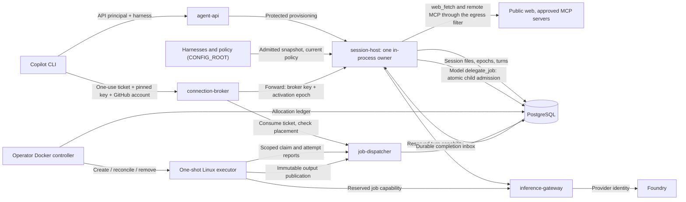

The shared worker owns one SDK connection, a provider namespace and storage lease per active conversation,
and a small account/workspace-scoped AHP listener per resident session. Empty native directories anchor AHP
paths; content/history stays in PostgreSQL. Lease epochs fence writes and grants. FIFO turn admission limits
global, principal, and per-harness concurrency, with one active turn per conversation; per-harness resident and
queued-turn ceilings keep one harness from taking every slot. Idle eviction retains the conversation;
interrupted work is not automatically replayed.

Each shared conversation runs one published harness whose mode is `shared`. Creation evaluates the harness against the
deployment and its effective policy, then stores the admitted snapshot (the harness definition, its digest, the
policy digest, the admitted model, limits, and any delegation targets) in the session row. Every activation
re-checks that snapshot's integrity and the current policy, so a narrowed policy stops an existing session without
changing its harness. The worker re-reads harnesses and policy at most every five seconds, keeping the last valid
configuration if a reload fails. The session's instructions, prompt mode, model options, skills (served from
the snapshot), sub-agents, limits, and permissions come from the harness. Its tools are the shared base set the
harness requests: workspace file tools (read, write, edit, list, search) over the PostgreSQL-backed session files,
a task list kept in session storage, the filtered `web_fetch`, approved remote MCP tools, `ask_user` when the
harness enables questions, and the delegation bindings that the conversation profile lists in `inProcessBindings`.
Each harness's remote MCP sessions open on activation and close with it; the server credential stays in the worker.
Every tool keeps its result within 16 KiB, with a note on how to read on, because with a client attached the runtime
would move a larger result into a file that no shared tool can read.

Clients attach only through the connection broker, which gives each session one stable path
(`/sessions/{id}`). The API asks the shared worker to activate the session and issue a one-use ticket, then
returns the broker's URL. The broker consumes that ticket through an internal dispatcher route and forwards
bytes to the session's current placement with its own service key and the activation epoch the ticket was
issued for. The shared worker accepts only such forwarded connections and maps them to the resident session's
private listener. The broker does not interpret AHP. Because it is a separate process, restarting `agent-api`,
as the configurator's **Reload harnesses** does, leaves attached CLI connections up.

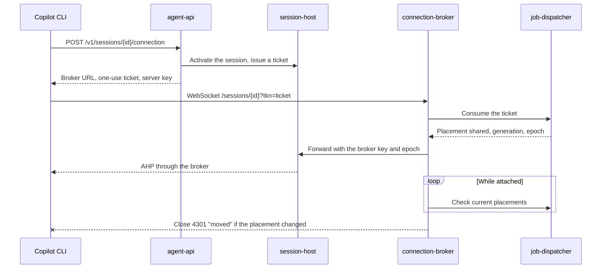

A request that the harness's rules send to a person follows the session's approval mode
([security](SECURITY.md#shared-conversation-approvals)):

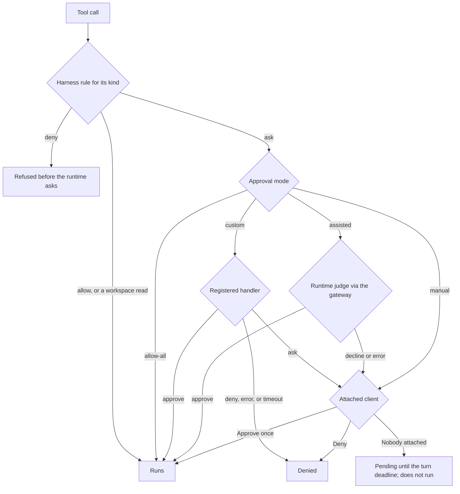

A judge approval runs without a prompt: the AHP host participant acts on it while a client has the session open, and
the worker's handler follows it through the SDK's `followAssistedApproval` while none does. Both need runtime
`d89cfe45b29` (host `006b030`) or later; see the
[qualification record](HOSTING-MODES-PLAN.md#stage-2-harness-driven-shared-mode). The runtime offers assisted
approval only behind its experimental `AUTO_APPROVAL` flag, which the worker sets in its own process. Each activation
applies the session's mode before the AHP host publishes it (for a resumed session, the mode its history last
recorded) and confirms it. If the runtime will not hold the mode, activation fails with `409 hosting_unavailable` and
the lifecycle event `session.approval_mode_refused` instead of running in another mode
([follow-up record](HOSTING-MODES-PLAN.md#follow-up-assisted-approvals-without-host-injected-flags)).

Each session records a placement in the ledger: its kind (`shared`, or `container` for
[session containers](#session-containers)) and a generation that increases on every change
([contract](../contracts/src/placement.ts)). Tickets bind to the generation. When it changes, the broker ends
attached clients with WebSocket close code `4301` (`moved`) after any frame in flight, and an upstream close is
replaced with `moved` when the placement changed underneath it. [Promotion](#promotion) moves a session one way from
`shared` to `container`; while it moves, the ledger marks the placement `moving` and the broker closes shared routes the
same way. A [handoff](API.md#handoffs) also changes it: the target's segment starts at the next generation, on the
shared worker or, for a target that runs in its own session container, after the same one-way move with the target's
harness ([plan](HOSTING-MODES-PLAN.md#75-handoffs-and-crafted-harnesses)).

Delegation records, child jobs, input snapshots and aggregate budget reservations commit atomically.
SDK tool-call identity deduplicates acceptance. Completion-driven turns cannot create nested delegations.
The controller persists allocation identity before Docker calls, uses deterministic names and immutable
image IDs, counts starting/running/retiring allocations, and only removes containers with its namespace labels.
A replacement controller reconciles existing allocations. Each container receives only its allocation
credential and can claim one assigned job, not arbitrary queued work. Runner uid isolation and existing
policy/output validation are preserved for TypeScript and Python.

Inputs are selected copies, never a shared writable session mount. Linux directory-descriptor-relative
output collection rejects symlinks, hard links, nonregular files, aliases and oversized trees. Successful
artifacts commit before job completion; one-use containers can then disappear without losing results.
The completion inbox delivers a bounded system message to the original conversation. Durable history
markers suppress repeated accepted notifications; ambiguous delivery goes to review rather than blindly
replaying a model turn. Closing prevents continuations and optionally requests child cancellation.

This is local demonstrator evidence, not hostile multi-customer isolation, transparent failover, or exact
spending enforcement. See [Security](SECURITY.md#local-hybrid-boundaries), [API](API.md#experimental-shared-conversations),
and [local deployment](DEPLOYMENT.md#experimental-local-hybrid-deployment).

### Session containers

With `Parameters:session-containers=true`, a session created through `POST /v1/sessions` with a conversation
harness whose hosting mode is `isolated` (the default) runs in its own resumable container, started by the same
controller. This is per-session mode 1 of the [hosting modes plan](HOSTING-MODES-PLAN.md#71-mode-1-isolated-container);
other modes still need their hosts and are rejected with the [hosting errors](API.md#errors-and-retry-decisions).

Container sessions share the application-session record, view, and routes with shared sessions. The session
definition holds the admitted model, limits, and harness reference (mode `isolated`, with the policy digest);
the admitted harness snapshot stays with the container placement, and the shared worker refuses to activate or
authorize container-placed sessions. `pnpm host:connect --harness` takes this path when session containers offer
the requested transport.

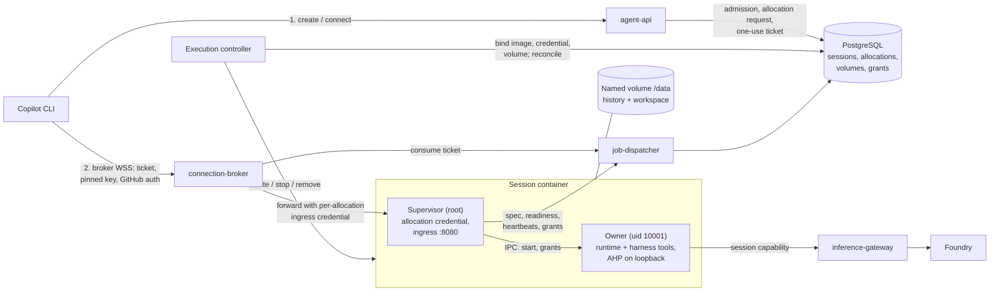

Connecting requests a session allocation if the session has none: one transaction checks the deployment and
per-principal container limits, which job allocations share, and records an unbound row. The controller binds it
to the immutable session image, an HMAC-derived allocation credential and ingress credential, and the session's
named volume (labeled with the controller namespace), then creates the container with the size the effective
policy's catalog resolved at creation, `no-new-privileges`, and only the capabilities needed to start the
unprivileged owner. The supervisor fetches its session's admitted harness snapshot, starts the owner, reads the
AHP server key over loopback, and reports readiness. The API then issues a 60-second one-use ticket bound to that
allocation and the session's placement generation, and returns the connection broker's `/sessions/{id}` URL with
the server key. The broker consumes the ticket through the dispatcher, which routes the `container` placement to
the allocation's ingress, and forwards the connection with the per-allocation ingress credential; the container
accepts nothing else.

The owner runs the agent loop in-process with the locally built runtime, using
`buildSessionOptions(..., "conversation")`, packaged tool bindings, skills, sub-agents, and the hosted
permission policy, on the real filesystem under `/data/execution`. The application provisions the session: the
first allocation creates it, later allocations resume it from the volume, and the AHP host publishes it for the
expected GitHub account. Inference uses two-minute session grants fenced by the allocation, and usage is charged
once per gateway request to the session budget.

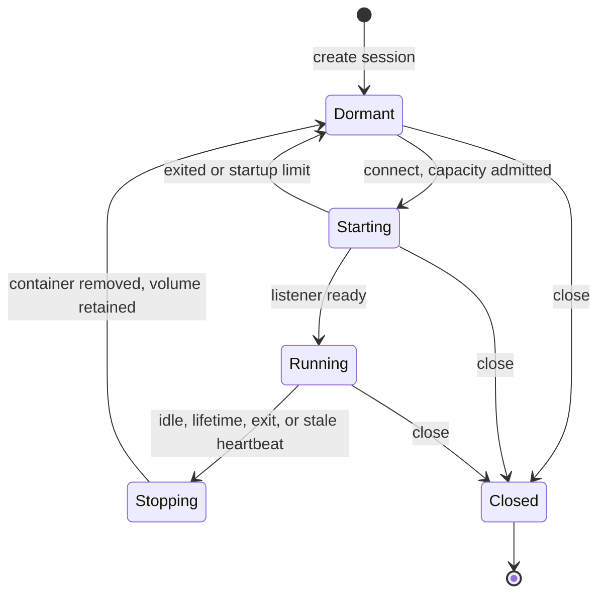

Idle means no turn, session event, or new connection for the session's idle period; an attached but silent CLI is
disconnected, as with shared eviction. Stopping is graceful so the runtime flushes its history before removal.
Interrupted turns are not replayed. A replacement controller adopts running containers, removes labeled
containers without a ledger allocation, and retires allocations whose container vanished. Volumes are never
deleted automatically: closing marks them released for operator retention, and unknown labeled volumes are only
reported.

Locally the broker reaches the container's ingress on its host-loopback published port. The Azure direction, an
outbound tunnel from the container (plan D14), is not implemented.

### Orchestrator workers

With `Parameters:orchestrator-workers=true` (which needs session containers), a conversation created from an
`orchestrator` harness runs as a shared session on the shared worker with worker tools added: mode 4 of the
[hosting modes plan](HOSTING-MODES-PLAN.md#74-mode-4-orchestrator-shared-brain-container-workers). Each worker it
starts is a child application session with its own harness, size, and session container, and reports back through
the coordinator's durable inbox. Clients attach only to the coordinator.

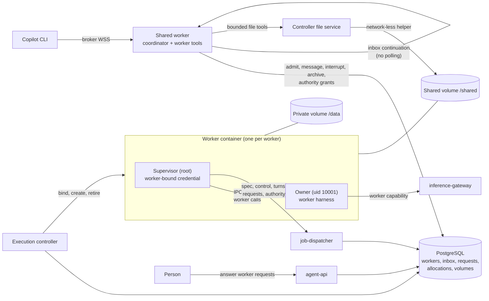

`create_worker` rechecks the coordinator's current effective policy, then plans a listed worker harness (which must
use `isolated` hosting) or a crafted one from an operator template, through the `HarnessDefinition` schema, hosted
admission against the features worker containers implement, and policy intersection. One ledger transaction admits
the worker within the per-conversation, per-principal, and deployment ceilings, reserves part of the conversation's
aggregate token budget while leaving the coordinator one turn's budget, records its first task as message 1, and
requests its allocation (purpose `worker`, counted against the same container limits as jobs and sessions), with a
private volume at `/data` and, with `sharedStorage: "session"`, the conversation's shared volume at `/shared`,
read-write or read-only. The tool returns at once. Workers cannot create workers, delegate jobs, or hand off.

The controller binds and starts a worker container like a session container, with a worker label alongside the
coordinator's session label. Its supervisor holds an allocation credential bound to the worker and serves the
owner's calls to the dispatcher's `/internal/workers/*` routes: the spec, durable messages, turn and result reports,
requests for a person, authority grants, and two-minute inference grants charged to the worker's reservation. The
owner runs the worker's harness on the private volume and delivers each coordinator message with the source
`agent-<coordinatorId>`, so the runtime never treats it as the person's words: `enqueue` messages wait for the
current turn, and `immediate` ones steer it. An interrupt aborts the turn.

Worker completions, turns without a result, requests for a person, failures, and backstop stops go to the
coordinator's inbox. The shared worker's inbox pump delivers them as bounded system continuations when the
coordinator is idle, with a runtime-history marker per batch so a retried batch is recognized; failed deliveries
retry after a growing delay and go to review after five attempts or when continuations or the aggregate budget run
out. The same loop applies the backstops (idle time, lifetime, the worker's reservation, and a closed coordinator)
and returns a worker's capacity, settling its reservation, once the controller has retired its allocation. A worker
whose container stops while it runs has failed. Container time is recorded per worker.

A worker's [approval mode](HOSTING-MODES-PLAN.md#approval-modes) decides its requests after its harness's per-kind
rules, and nobody but a person approves: `manual` requests and the requests an `assisted` worker's judge declines go
to a principal-scoped request queue ([API](API.md#orchestrator-workers)); the coordinator is told that a person must
answer and can answer only questions, and only when policy sets `hosting.workers.allowCoordinatorAnswers`. With
[inherited human authority](HOSTING-MODES-PLAN.md#inherited-human-authority), the shared worker reads the person's
own messages from the coordinator's runtime history (root user messages without an agent or system source),
records them as a grant for each inheriting worker when it is created, before each coordinator message, and after
each new message from the person, and the worker applies the newest grant with the runtime's
`setInheritedHumanAuthority`. The judge then sees those exact messages as the person's words, while the
coordinator's tasks stay data. Grants and what the runtime accepted are recorded for audit.

The coordinator has no filesystem of its own. Its file tools reach the shared volume only through the execution
controller's file service (plan D10), which runs one bounded operation per short-lived helper container from the
session image, with no network and only that volume mounted; writes are atomic and replacing a file needs its
current etag. Volumes are retained: a stopped worker's private volume and a closed coordinator's shared volume are
released, not deleted.

### Promotion

A conversation of a `promotable` harness runs on the shared worker like a `shared` one, with one more tool,
`promote_session`. When the agent calls it, or the owner calls `POST /v1/sessions/{id}/promote`
([API](API.md#promotion)), the session moves one way into its own [session container](#session-containers) and
continues there as the same application session. The AppHost gives the shared worker the session-container settings
whenever session containers are enabled; only then does its hosting offer include the `promotion` feature.

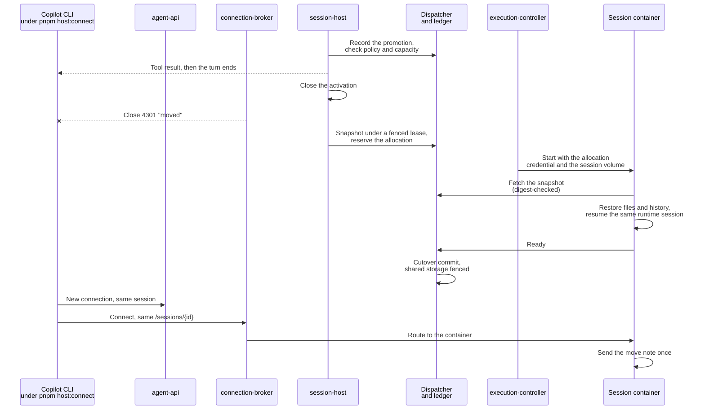

The ledger ([`promotions.ts`](../src/job-store/src/promotions.ts)) drives each promotion through `requested`,
`moving`, `starting`, and then `committed` or `failed`:

- **Request.** The tool call or API request is recorded once per tool call or idempotency key, after the harness's
  current effective policy (`promotable`, its size and approval) and the deployment's container capacity are
  checked. A session has at most one open promotion and at most one committed one. From the request on, the session
  admits no new turns.
- **Move.** When the requesting turn ends (at once for an API request with no turn running), the shared worker closes
  the activation and the ledger marks the placement `moving`, so the broker closes attached clients with `moved`. The
  worker reads the snapshot under a fresh storage lease in one transaction that holds the namespace lock, then
  reserves a session allocation with the session's volume in the same admission transaction as other containers.
- **Restore.** The controller starts the container as for any session allocation. Its supervisor fetches the snapshot
  through its allocation credential (no other allocation can read it, and nothing can after the promotion settles),
  restores it onto the volume, and starts the owner, which resumes the same runtime session with
  `continuePendingWork: false` in the container's workspace.
- **Cutover.** The container's readiness commits the cutover in one transaction: placement `container` at the next
  generation, the shared storage lease epoch replaced and pinned (the shared namespace stays read-only), outstanding
  shared tickets and the activation removed, and a new segment recorded. A storage epoch that changed after the
  snapshot, or a closed session, refuses the commit and fails the promotion. After the cutover the container is
  authoritative and later allocations resume from its volume. The owner sends one system note that names the move and
  maps the shared worker's workspace path, which the history still names, to the container's.
- **Failure.** Any failure before the cutover (policy, capacity, snapshot, allocation, startup, restore, or no
  readiness within the container's startup limit plus a minute) fails the promotion: the session stays shared and
  accepts turns again, the allocation is retired, and an agent that asked through the tool is told why once. A ledger
  trigger refuses any return to `shared` placement and any generation decrease, and no route demotes a session.

The snapshot holds the runtime's session state (history, checkpoints, and session files), leaving out the
provider-scoped consent files (`permissions.json`, `settings.json`, `config.json`) and spilled tool output (`temp/`),
plus the conversation's workspace files. Names keep the spelling they were created with, including on a Windows shared
worker whose storage keys are case-folded. Snapshots are bounded by the session storage limits (64 MiB, 2,048
entries), stored in the ledger with per-file SHA-256 digests and a manifest digest, and restored with exclusive
creates into fresh directories owned by the container's unprivileged user. The runtime resumes the session at the
container's path and on Linux even when the shared worker ran on Windows; its history keeps the old paths, which
the move note maps.

An application session is a sequence of segments: one harness snapshot at one placement, with the runtime session
it runs. The first segment is implicit; each move records the next with its generation, placement, harness reference,
runtime session, and start time, and the session view reports the current one. A [handoff](API.md#handoffs) to a
target that runs in its own container reuses the same move with the target's harness and definition, a new runtime
session unless it carries full history, and the handoff notice as the opening note.

`pnpm host:connect` keeps the person's terminal attached across the move: it runs the CLI under a supervisor
([`cli-supervisor.ts`](../configurator/server/cli-supervisor.ts)) whose loopback relay spends one broker ticket per CLI
connection. On a `moved` close, or when a new ticket carries another server key (a replacement container after a
crash), the supervisor stops the CLI, provisions the same session again through the launcher's routing (retrying
while a move completes), and restarts the CLI with `--resume` and the new server key in the same terminal. Without
the launcher, a client sees the `moved` close and must reconnect itself.

## Optional demo agent host

Agent hosts are separate, disabled-by-default integrations for `interaction: "conversation"` harnesses, not
attachment to a batch attempt. Each is an always-on container serving one harness for one owner. The deployment-wide
demo host (`demo-host-*` parameters, resource `agent-host`) is the one-harness case and the only shape that
publishes to Azure. Local runs can add a **per-harness owner host** for each listed `isolated` harness
(`owner-hosts`, resource `host-<harness>`), each with its own lease, host key, retained volume, size, and, when the
relay is enabled, its own Mission Control environment.

On the demo host, `github` selects GitHub-native sessions through Mission Control, using the released CLI server
and Copilot inference. `direct` and `both` select managed hosting, which requires the
[runtime prerequisites](DEPLOYMENT.md#demo-host-compatibility-gate). Owner hosts are always managed; their transport
is `direct`, `github` (the relay only), or `both`. Managed hosting reuses the shared tool/skill/prompt mapping without
`submit_result`, on the locally built runtime and its matching SDK. Python batch behavior is unchanged.

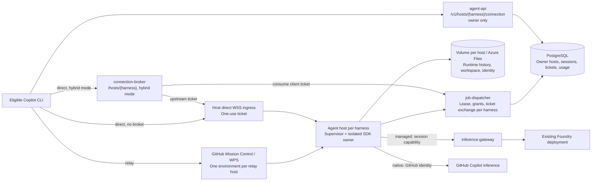

Ownership, leases, connection tickets, and session grants are keyed by harness (`owner_hosts`, migration 010). Each
host authenticates to the dispatcher with its own service key, and its lease binds the durable host to one immutable
GitHub user ID and the compute identity recorded on its volume, so a volume never serves another owner or harness.
Migration 010 keeps the previous singleton `demo_host` row, and the dispatcher adopts it as the host of the configured
`demo-host-harness`. Only the host's owner principal receives connection material: a 60-second, single-use ticket
bound to the harness's host and its current epoch, the host's public key, and the endpoint, or the host's
environment ID for the relay. With hybrid mode's connection broker, the direct endpoint is the broker's
`/hosts/{harness}`: the broker consumes the client's ticket through the dispatcher, which issues, in the same
transaction, a one-use upstream ticket for the same epoch, and forwards to the host's own ticket-checked ingress. A
relay-enabled host registers its own environment, `Aspire <harness> (<owner>)`, under the owner's GitHub account.
The runtime mints its own session IDs; the host records the client-visible AHP session ID from its session catalog so
clients resume with it over either transport.

The supervisor keeps its service credential outside the execution uid and passes bounded control messages
to an unprivileged SDK owner process. The owner keeps one runtime alive, exposes its in-process AHP server,
and, for managed sessions, renews capabilities through the supervisor. It does not hold a Foundry or database credential.
GitHub hosting introduces a GitHub identity credential; that is a different boundary from the credential-free
batch runners.

The PostgreSQL host lease fences grant issuance and binds the durable host to an immutable GitHub user ID.
The runtime catalog also permits only one writer. The deployment pins the host to one replica per revision;
operators must still stop the old revision before starting a replacement because Single revision mode can overlap
replicas during rollout and can reactivate a previously stopped revision. Inspect/deactivate old revisions after
deployment as well. The Azure Files mount is owned by execution uid 10001 with private file/directory modes
and byte-range locking enabled; see [storage qualification](DEPLOYMENT.md#storage-and-revision-requirements).
Each managed host permits at most ten open retained conversations and
one active inference session; additional sessions must wait or the active turn must be aborted. Usage survives
grant renewal and host restart. These are operational bounds, not exact billing reservations.

Managed sessions use application creation/resume factories. GitHub-native sessions are host-owned and do not
invoke those factories or consume app-managed inference grants. Native state lives under `/data/github-native`;
managed state under `/data/execution`. Runtime history and workspace are retained on
the host volume; PostgreSQL stores admitted snapshots and cumulative usage, not a replacement AHP transcript.
Client disconnection is distinct from stopping the owner. Restart recovery must re-register application tools and
callbacks, and interrupted side effects must not be retried automatically. Closing through the API revokes future
inference and signals the owner on its next heartbeat; it does not delete retained data. Native lifecycle
operations belong to the connected Copilot client rather than the managed-session API.

The native Azure relay and conversation resume after replacement have been exercised, but the synthetic SQLite
WAL probe failed on Azure Files and Single mode required manual old-revision deactivation. See the
[dated qualification evidence](DEPLOYMENT.md#native-qualification-evidence); these storage/revision gates remain
open. This implementation is not a multi-customer host or a general runtime
administration authorization layer. [Security](SECURITY.md#experimental-host-boundaries) owns those limits.

## Job execution

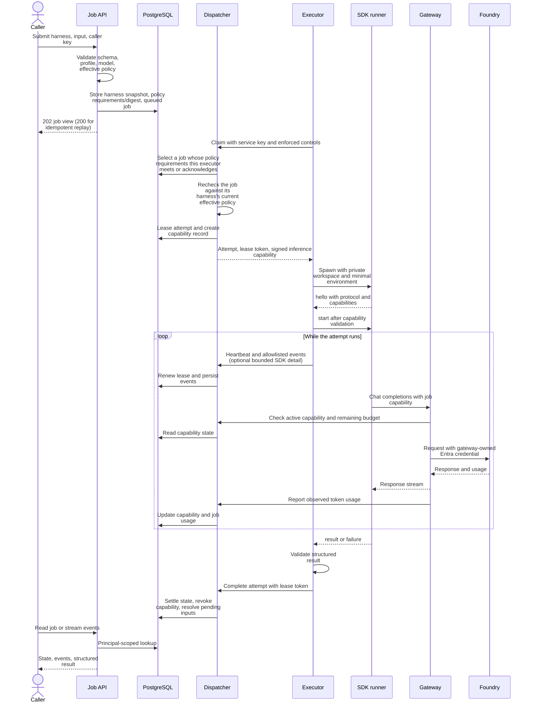

This is the successful claim/authorized inference path; event streaming may run concurrently with execution.
Failed admission never creates a job. An executor claims only jobs whose effective policy it satisfies or whose
missing controls that policy acknowledges; a job no polling executor can run stays queued and records
`job.waiting_for_eligible_executor` once. A job that a narrowed policy no longer allows fails with `policy_revoked`
at claim time. The executor checks `hello` before sending job input, and a stale attempt owner cannot decide the
next job state.

The gateway caches capability introspection for up to two seconds. Usage is reported from completed provider
responses; it is not a pre-reserved, exact billing cap for every in-flight token. Capability revocation is recorded
when an attempt ends or cancellation is requested, but it does not promise instantaneous termination of an
already forwarded request. See [gateway implementation](../src/inference-gateway/src/server.ts) and
[dispatcher client](../src/inference-gateway/src/dispatcher-client.ts).

## Job state transitions

Automatic processing:

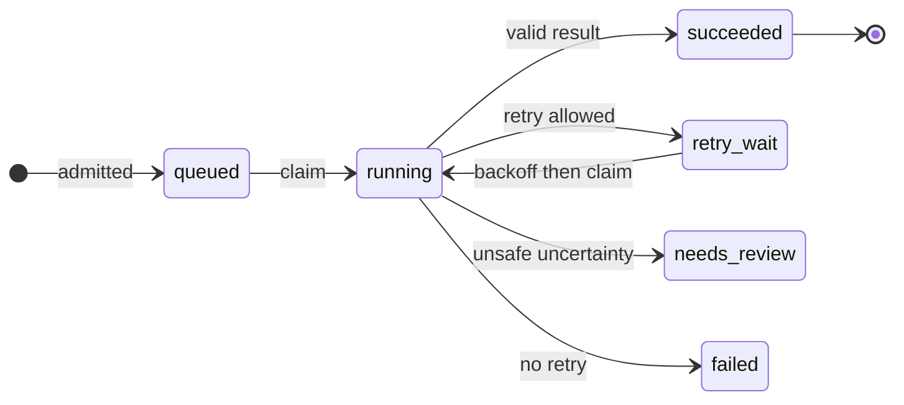

Cancellation and explicit retry add these transitions (grouped labels represent either of the named states):

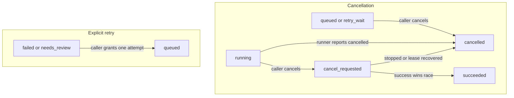

`failed` and `needs_review` are terminal for automatic processing and SSE, even though an explicit retry can
requeue them. There is no intermediate `queued` transition when claiming from `retry_wait`, and no separate
"waiting for approval" job state.

Automatic retry requires a retryable failure, remaining attempts, and either a read-only/safe-to-retry job or a
failure reporting no uncertain external effects. Backoff is exponential. Lost leases and runner exits without
a terminal message are uncertain outcomes, not proof that nothing happened.

The effective duration is per attempt. The token budget is job-wide and accounts for prior attempts.
Manual retry keeps the admitted input/harness, grants exactly one additional attempt, and does not reset usage.
Cancellation does not roll back external effects; successful completion can win a cancellation race.

**Source:** [`JobState`](../contracts/src/jobs.ts), `requestCancel`, `retryJob`, `claimNext`, and `#settle` in
[`store.ts`](../src/job-store/src/store.ts). Update both state-flow diagrams when those transitions change.

## Approvals and questions

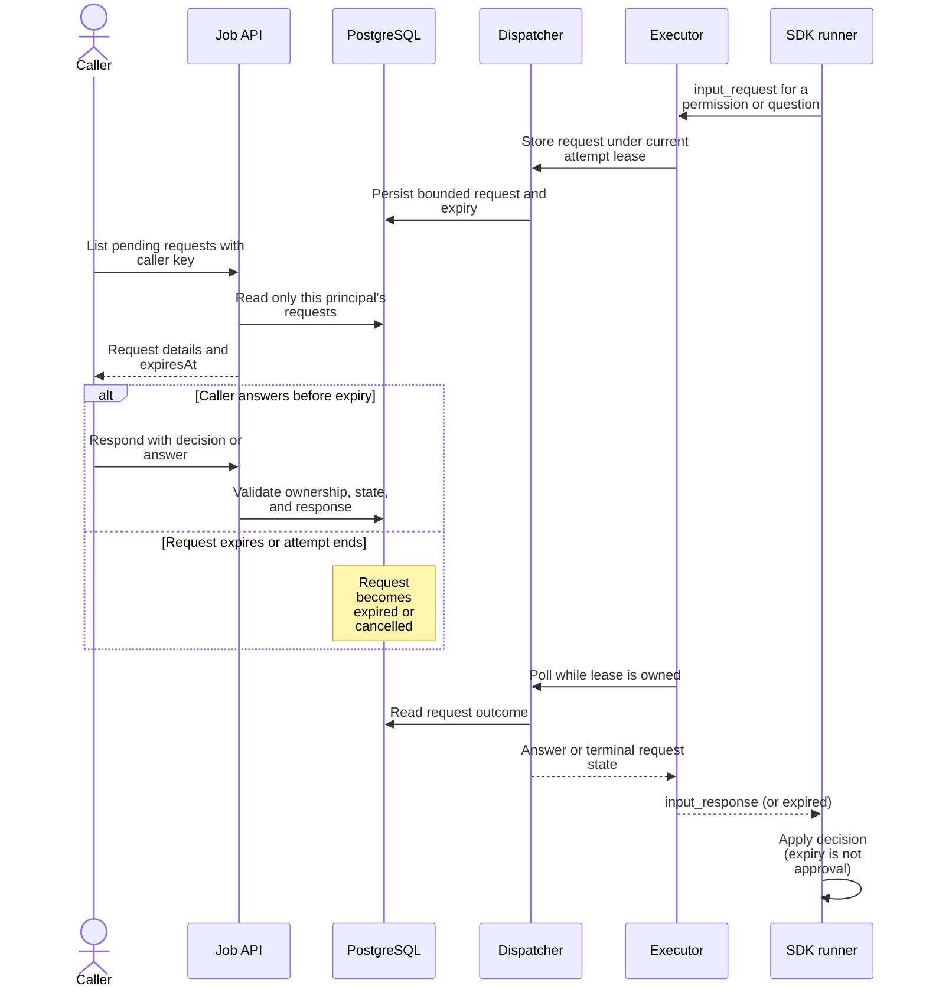

The API does not call the runner directly, and the executor needs no incoming connection. A request can expire
without the whole job failing. Pending requests are cancelled when the attempt settles; waiting still consumes
the attempt deadline and an executor slot. The [protocol](RUNNER-PROTOCOL.md) owns message shapes and bounds;
the [API](API.md) owns caller response semantics.

## Configuration and code publication

The local configurator writes repository files. Runtime services load their configuration at startup;
deployments bake it into images. At admission the API resolves a harness's instructions/skills, validates the
definition, computes a digest, and stores that harness snapshot with the job. A runner receives this snapshot
rather than reopening the harness directory.

Profiles and tool implementations belong to the executor image, while operator policy — the base
`policy/execution-policy.json` plus optional per-harness overrides in `policy/harnesses/` — is loaded by the API and
dispatcher. A harness-only reload is not a policy or runner upgrade. Follow
[Configuration publication](DEVELOPER-GUIDE.md#configuration-publication) for activation and versioning.

## Trust boundaries and non-guarantees

Caller keys authenticate principals to the API. Executor and gateway service keys authenticate their respective
internal dispatcher operations. The runner receives neither kind of service key: it receives only a scoped
inference capability. The gateway replaces that capability with its own upstream credential.

The drawings show the intended model route, **not enforced network egress**. Uid separation is not a per-job
network sandbox, API principal isolation is not cross-customer infrastructure isolation, and the configurator is
not a hosted control plane. Read [Security](SECURITY.md) for the complete boundary/gap register.

The two SVGs are hand-maintained source files. Flow diagrams are Mermaid fences in this page; see
[diagram maintenance](MAINTAINING-DOCS.md#diagrams-and-screenshots) before editing.
