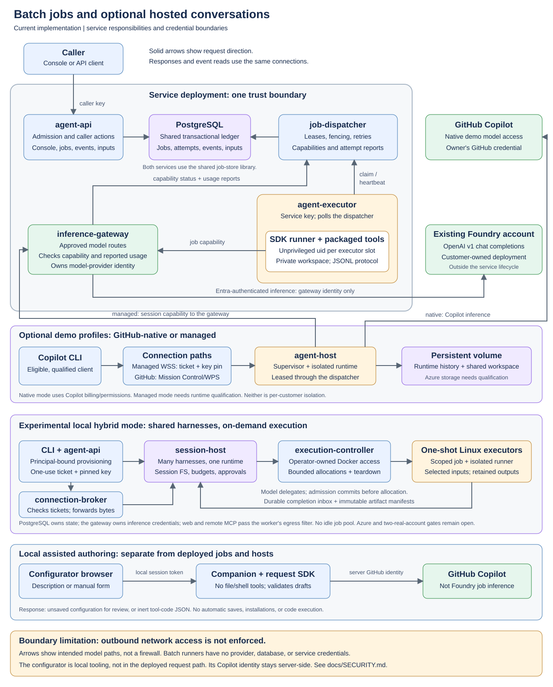
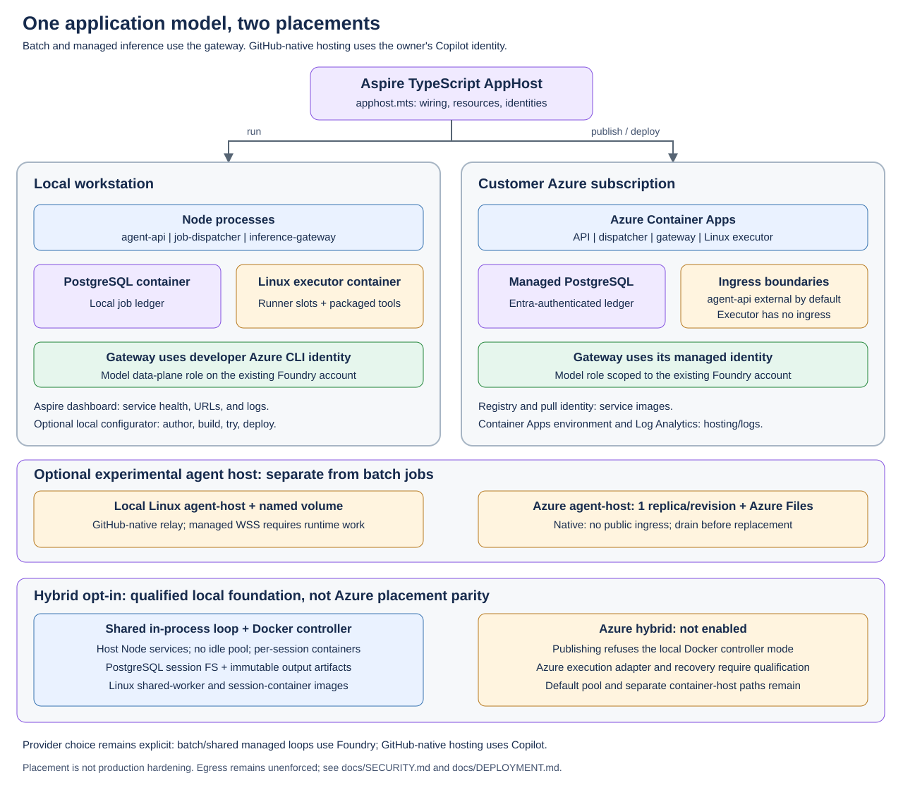
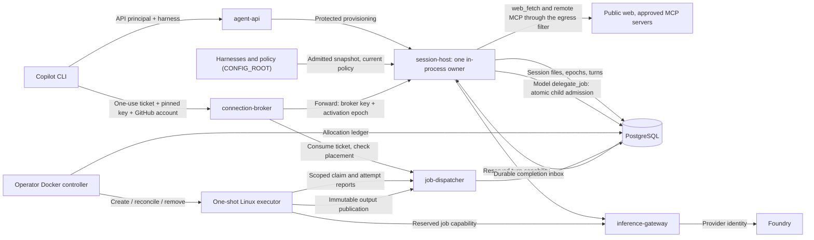
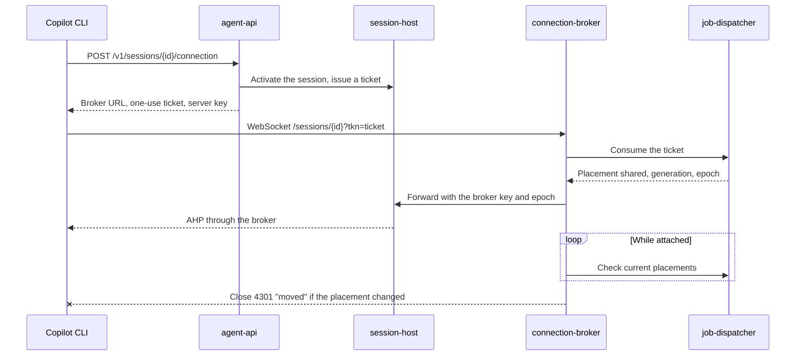
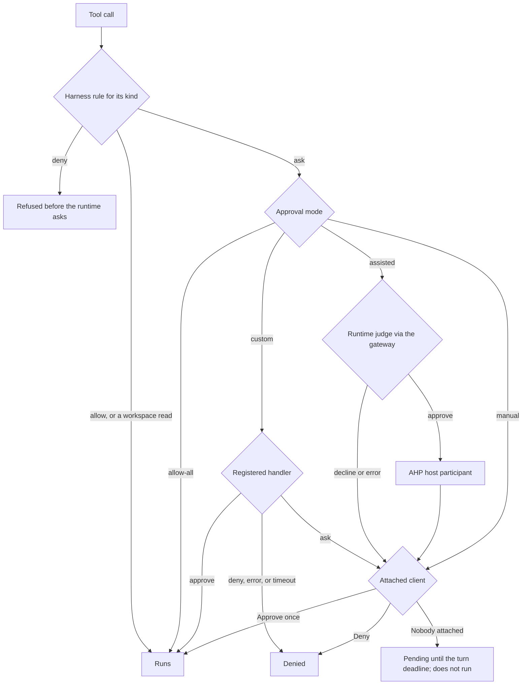
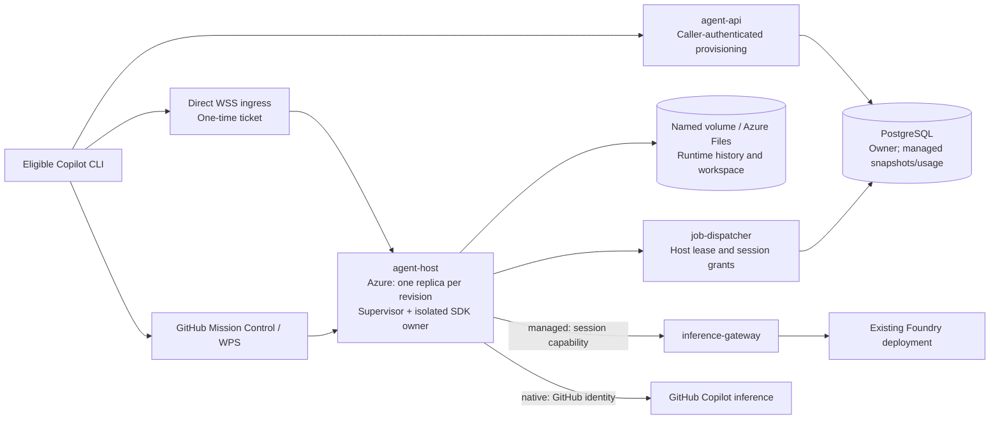
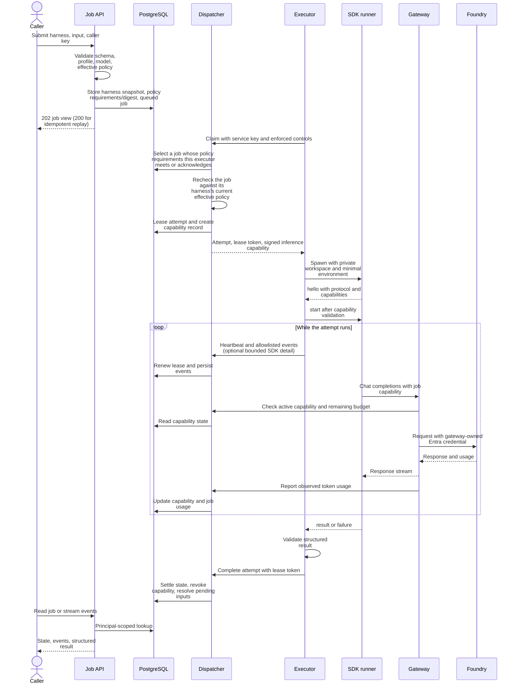
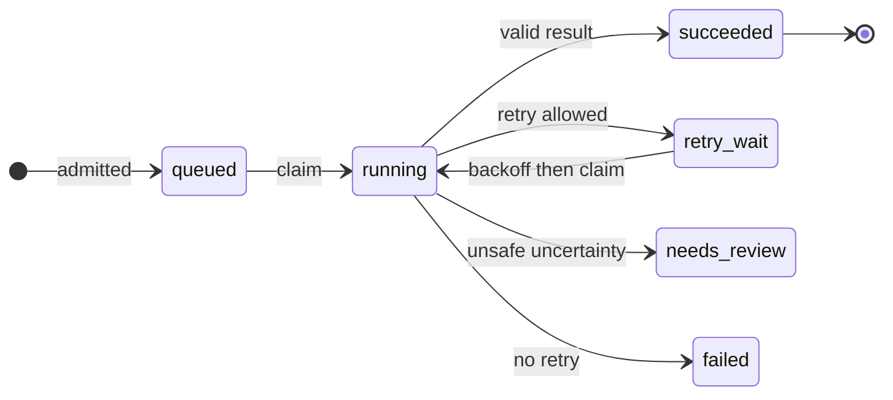
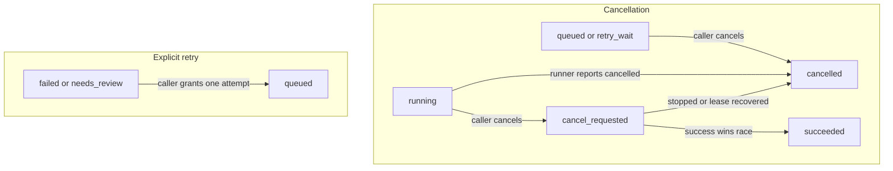
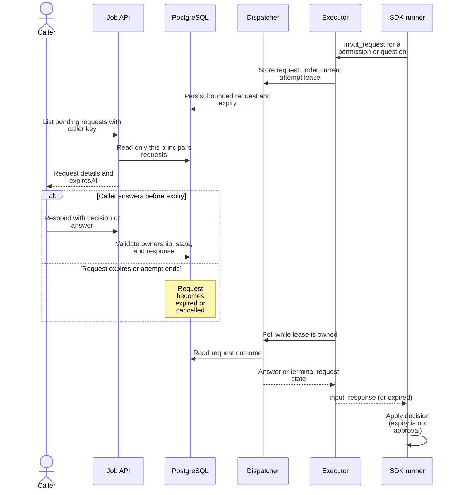

# Current architecture

[Documentation hub](README.md) | [Product](PRODUCT.md) | [Developer guide](DEVELOPER-GUIDE.md)

This page describes the implementation, not the target design in [PLAN.md](PLAN.md).
The [security model](SECURITY.md) owns the precise controls and open gaps; these diagrams do not imply stronger
network isolation than the implementation provides.

## System overview

| Component | Owns | Source |
| --- | --- | --- |
| `agent-api` | Caller authentication, admission, job queries/mutations, SSE, approvals, static console | [API server](../src/agent-api/src/server.ts), [shared admission](../src/service-defaults/src/admission.ts) |
| `job-dispatcher` | Executor eligibility, attempt claims/heartbeats/completion, capability minting/introspection/usage, lease recovery | [Dispatcher](../src/job-dispatcher/src/server.ts), [startup/reaper](../src/job-dispatcher/src/main.ts) |
| PostgreSQL + `job-store` | Durable jobs, attempts, events, input requests, capability state, transactional transitions | [Store](../src/job-store/src/store.ts), [migrations](../src/job-store/src/migrate.ts) |
| `agent-executor` | Polling slots, runner uid/workspace isolation, protocol validation, deadlines/cancellation, result validation | [Main](../src/agent-executor/src/main.ts), [attempt](../src/agent-executor/src/attempt.ts), [isolation](../src/agent-executor/src/isolation.ts) |
| `agent-host` (opt-in, experimental) | Long-lived SDK owner, AHP transports, retained conversations/workspace, execution-grant renewal | [Supervisor](../src/agent-host/src/main.ts), [owner](../src/agent-host/src/owner.ts) |
| `session-host` (local hybrid opt-in) | One in-process runtime serving many shared harnesses: harness admission, protected session provisioning, per-harness turn scheduling, the shared base tools, approval modes, provider-backed files, eviction and completion delivery | [Service](../src/session-host/src/service.ts), [admission](../src/session-host/src/admission.ts), [tools](../src/session-host/src/toolkit.ts), [permissions](../src/session-host/src/permissions.ts), [scheduler](../src/session-host/src/scheduler.ts) |
| `connection-broker` (local hybrid opt-in) | One stable WebSocket path per session, ticket consumption through the dispatcher, byte forwarding to the session's current placement, "moved" closes | [Broker](../src/connection-broker/src/broker.ts), [session routes](../src/connection-broker/src/sessions.ts), [placement contract](../contracts/src/placement.ts) |
| `execution-controller` (local hybrid opt-in) | Durable allocation admission, operator-owned Docker lifecycle, orphan reconciliation and teardown | [Controller](../src/execution-controller/src/controller.ts), [allocation store](../src/job-store/src/allocations.ts) |
| Runner | One SDK attempt with harness tools, skills, sub-agents, and permission handlers | [TypeScript](../src/harness-hosting/src/runner.ts), [Python](../execution-profiles/python-agent/runner.py) |
| `inference-gateway` | Approved chat-completions route, capability checks, upstream identity, token-usage reporting | [Gateway](../src/inference-gateway/src/server.ts), [routes](../src/inference-gateway/src/routes.ts) |
| Configurator | Customer-workspace authoring, optional server-side Copilot drafting, plus platform build/run/deploy controls; not part of the deployed request path | [Companion server](../configurator/server/app.ts), [draft service](../configurator/server/authoring.ts) |
| Aspire AppHost | Resource placement, endpoint references, service secrets, Azure identities and roles | [AppHost](../apphost.mts) |

The API and dispatcher both access PostgreSQL through the shared store. The dispatcher controls attempt execution;
the API writes caller actions directly to the ledger. There is no separate message broker: executors poll the
dispatcher for work, and the API reads persisted events with database notifications plus polling for SSE delivery.

Configuration has two explicit ownership roots. `CONFIG_ROOT` supplies customer-authored harnesses and policy from
`.copilot-agent-workspace/` locally or `/config` in images. `PLATFORM_ROOT` supplies immutable execution profiles
and profile `{root}` entrypoints from the source checkout or `/app` in executor images. The configurator reads
profiles/examples from the platform root but writes only the customer workspace. Image builds package the current
workspace; they do not silently deploy the shipped examples.

### Local assisted authoring

The optional draft path is separate from all deployed execution paths. GitHub credentials stay server-side;
the model receives only the description and configuration catalog. It cannot inspect or modify the checkout.
Generated configuration returns to the existing unsaved editor; code proposals remain inert downloads.
See [workflow and authentication](CONFIGURATOR.md#copilot-assisted-authoring) and
[precise boundaries](SECURITY.md#local-authoring-boundaries).

## Local and Azure topology

Locally, the gateway uses the developer's Azure CLI identity. In Azure, its managed identity receives model
access on an existing Foundry account. The deployed API and dispatcher use Entra-authenticated PostgreSQL access.
By default, only `agent-api` has external service ingress; the executor always has no ingress.
Enabling the experimental host's direct transport adds an authenticated WebSocket ingress.
GitHub-only hosting uses outbound Mission Control/WPS connections, not public host ingress.

The executor is always a Linux container, including during local development. In default pool mode it launches each concurrent slot's
runner under a separate unprivileged uid, with a private workspace and minimal environment. It is **not** one
Container App or virtual machine per job. See [Deployment](DEPLOYMENT.md) for supporting resources and costs.
The opt-in local hybrid mode instead starts one-shot Linux containers under a separate host-side controller;
it does not deploy that Docker controller to Azure. Publishing with hybrid mode enabled is rejected.

## Concurrency and durability

A harness definition is reusable configuration, not a permanently running bot. Separate jobs can invoke one
version concurrently; each active attempt has its own runner and root SDK session. Sub-agents operate inside
that runtime and share the parent attempt's lifetime and inference budget, not separate job scheduling or retries.

Executor slots provide bounded parallelism. More replicas add potential slots, not guaranteed throughput or model
quota, and the AppHost does not configure queue-driven executor autoscaling. Human waits still occupy a slot.
The [product assessment](PRODUCT-OVERVIEW.md#current-configured-limits) records the configured limits and their
source; [`main.ts`](../src/agent-executor/src/main.ts) implements the slot lifecycle.

PostgreSQL preserves job disposition and history independently of a browser or worker. SDK context and workspace
are ephemeral: reconnecting to a job view does not restore an ended conversation. Attempt duration is capped at
one hour by the contracts; queueing and retries can extend total job lifetime without providing continuous
multi-hour execution. Checkpointed sessions, suspended waits, retained files, and cross-job workflows are proposed
product layers, not properties of the current lease mechanism.
The experimental shared conversation and bounded on-demand artifact lifecycle below are separate from
this default batch-session behavior.

## Local hybrid hosting

`Parameters:hybrid-hosting=true` adds a shared worker, a connection broker, and an execution controller
while removing the always-on executor pool. Existing direct-container `agent-host` remains separately selectable.
The local AppHost runs these services as Node processes; a separately packaged Linux shared-worker
image uses the same code and qualified native runtime. Neither arrangement creates a runtime process per user.

The shared worker owns one SDK connection, a provider namespace and storage lease per active conversation,
and a small account/workspace-scoped AHP listener per resident session. Empty native directories anchor AHP
paths; content/history stays in PostgreSQL. Lease epochs fence writes and grants. FIFO turn admission limits
global, principal, and per-harness concurrency, with one active turn per conversation; per-harness resident and
queued-turn ceilings keep one harness from taking every slot. Idle eviction retains the conversation;
interrupted work is not automatically replayed.

Each conversation runs one published harness whose mode is `shared`. Creation evaluates the harness against the
deployment and its effective policy, then stores the admitted snapshot (the harness definition, its digest, the
policy digest, the admitted model, limits, and any delegation targets) in the session row. Every activation
re-checks that snapshot's integrity and the current policy, so a narrowed policy stops an existing session without
changing its harness. The worker re-reads harnesses and policy at most every five seconds, keeping the last valid
configuration if a reload fails. The session's instructions, prompt mode, model options, skills (served from
the snapshot), sub-agents, limits, and permissions come from the harness. Its tools are the shared base set the
harness requests: workspace file tools (read, write, edit, list, search) over the PostgreSQL-backed session files,
a task list kept in session storage, the filtered `web_fetch`, approved remote MCP tools, `ask_user` when the
harness enables questions, and the delegation bindings that the conversation profile lists in `inProcessBindings`.
Each harness's remote MCP sessions open on activation and close with it; the server credential stays in the worker.

Clients attach only through the connection broker, which gives each session one stable path
(`/sessions/{id}`). The API asks the shared worker to activate the session and issue a one-use ticket, then
returns the broker's URL. The broker consumes that ticket through an internal dispatcher route and forwards
bytes to the session's current placement with its own service key and the activation epoch the ticket was
issued for. The shared worker accepts only such forwarded connections and maps them to the resident session's
private listener. The broker does not interpret AHP. Because it is a separate process, restarting `agent-api`,
as the configurator's **Reload harnesses** does, leaves attached CLI connections up.

A request that the harness's rules send to a person follows the session's approval mode
([security](SECURITY.md#shared-conversation-approvals)):

With the qualified runtime the host participant still prompts after a judge approval; the runtime work recorded in
the [hosting modes plan](HOSTING-MODES-PLAN.md#stage-2-harness-driven-shared-mode) lets it approve.

Each session records a placement in the ledger: its kind (only `shared` exists today) and a generation that
increases on every change ([contract](../contracts/src/placement.ts)). Tickets bind to the generation. When it
changes, the broker ends attached clients with WebSocket close code `4301` (`moved`) after any frame in flight,
and an upstream close is replaced with `moved` when the placement changed underneath it. No current code path
changes a placement; promotion and session containers are proposed in the
[hosting modes plan](HOSTING-MODES-PLAN.md#4-proposed-topology).

Delegation records, child jobs, input snapshots and aggregate budget reservations commit atomically.
SDK tool-call identity deduplicates acceptance. Completion-driven turns cannot create nested delegations.
The controller persists allocation identity before Docker calls, uses deterministic names and immutable
image IDs, counts starting/running/retiring allocations, and only removes containers with its namespace labels.
A replacement controller reconciles existing allocations. Each container receives only its allocation
credential and can claim one assigned job, not arbitrary queued work. Runner uid isolation and existing
policy/output validation are preserved for TypeScript and Python.

Inputs are selected copies, never a shared writable session mount. Linux directory-descriptor-relative
output collection rejects symlinks, hard links, nonregular files, aliases and oversized trees. Successful
artifacts commit before job completion; one-use containers can then disappear without losing results.
The completion inbox delivers a bounded system message to the original conversation. Durable history
markers suppress repeated accepted notifications; ambiguous delivery goes to review rather than blindly
replaying a model turn. Closing prevents continuations and optionally requests child cancellation.

This is local demonstrator evidence, not hostile multi-customer isolation, transparent failover, or exact
spending enforcement. See [Security](SECURITY.md#local-hybrid-boundaries), [API](API.md#experimental-shared-conversations),
and [local deployment](DEPLOYMENT.md#experimental-local-hybrid-deployment).

## Optional demo agent host

This is a separate, disabled-by-default integration, not attachment to a batch attempt. `github` selects
GitHub-native sessions through Mission Control, using the released CLI server and Copilot inference.
`direct` and `both` select managed hosting and require an `interaction: "conversation"` harness plus the
[runtime prerequisites](DEPLOYMENT.md#demo-host-compatibility-gate). Managed hosting reuses the shared
tool/skill/prompt mapping without `submit_result`. Python batch behavior is unchanged.

The supervisor keeps its service credential outside the execution uid and passes bounded control messages
to an unprivileged SDK owner process. The owner keeps one runtime alive, exposes its in-process AHP server,
and, for managed sessions, renews capabilities through the supervisor. It does not hold a Foundry or database credential.
GitHub hosting introduces a GitHub identity credential; that is a different boundary from the credential-free
batch runners.

The PostgreSQL host lease fences grant issuance and binds the durable host to an immutable GitHub user ID.
The runtime catalog also permits only one writer. The deployment pins the host to one replica per revision;
operators must still stop the old revision before starting a replacement because Single revision mode can overlap
replicas during rollout and can reactivate a previously stopped revision. Inspect/deactivate old revisions after
deployment as well. The Azure Files mount is owned by execution uid 10001 with private file/directory modes
and byte-range locking enabled; see [storage qualification](DEPLOYMENT.md#storage-and-revision-requirements).
Managed hosting permits at most ten open retained conversations and
one active inference session; additional sessions must wait or the active turn must be aborted. Usage survives
grant renewal and host restart. These are operational bounds, not exact billing reservations.

Managed sessions use application creation/resume factories. GitHub-native sessions are host-owned and do not
invoke those factories or consume app-managed inference grants. Native state lives under `/data/github-native`;
managed state under `/data/execution`. Runtime history and workspace are retained on
the host volume; PostgreSQL stores admitted snapshots and cumulative usage, not a replacement AHP transcript.
Client disconnection is distinct from stopping the owner. Restart recovery must re-register application tools and
callbacks, and interrupted side effects must not be retried automatically. Closing through the API revokes future
inference and signals the owner on its next heartbeat; it does not delete retained data. Native lifecycle
operations belong to the connected Copilot client rather than the managed-session API.

The native Azure relay and conversation resume after replacement have been exercised, but the synthetic SQLite
WAL probe failed on Azure Files and Single mode required manual old-revision deactivation. See the
[dated qualification evidence](DEPLOYMENT.md#native-qualification-evidence); these storage/revision gates remain
open. This implementation is not a multi-customer host or a general runtime
administration authorization layer. [Security](SECURITY.md#experimental-host-boundaries) owns those limits.

## Job execution

This is the successful claim/authorized inference path; event streaming may run concurrently with execution.
Failed admission never creates a job. An executor claims only jobs whose effective policy it satisfies or whose
missing controls that policy acknowledges; a job no polling executor can run stays queued and records
`job.waiting_for_eligible_executor` once. A job that a narrowed policy no longer allows fails with `policy_revoked`
at claim time. The executor checks `hello` before sending job input, and a stale attempt owner cannot decide the
next job state.

The gateway caches capability introspection for up to two seconds. Usage is reported from completed provider
responses; it is not a pre-reserved, exact billing cap for every in-flight token. Capability revocation is recorded
when an attempt ends or cancellation is requested, but it does not promise instantaneous termination of an
already forwarded request. See [gateway implementation](../src/inference-gateway/src/server.ts) and
[dispatcher client](../src/inference-gateway/src/dispatcher-client.ts).

## Job state transitions

Automatic processing:

Cancellation and explicit retry add these transitions (grouped labels represent either of the named states):

`failed` and `needs_review` are terminal for automatic processing and SSE, even though an explicit retry can
requeue them. There is no intermediate `queued` transition when claiming from `retry_wait`, and no separate
"waiting for approval" job state.

Automatic retry requires a retryable failure, remaining attempts, and either a read-only/safe-to-retry job or a
failure reporting no uncertain external effects. Backoff is exponential. Lost leases and runner exits without
a terminal message are uncertain outcomes, not proof that nothing happened.

The effective duration is per attempt. The token budget is job-wide and accounts for prior attempts.
Manual retry keeps the admitted input/harness, grants exactly one additional attempt, and does not reset usage.
Cancellation does not roll back external effects; successful completion can win a cancellation race.

**Source:** [`JobState`](../contracts/src/jobs.ts), `requestCancel`, `retryJob`, `claimNext`, and `#settle` in
[`store.ts`](../src/job-store/src/store.ts). Update both state-flow diagrams when those transitions change.

## Approvals and questions

The API does not call the runner directly, and the executor needs no incoming connection. A request can expire
without the whole job failing. Pending requests are cancelled when the attempt settles; waiting still consumes
the attempt deadline and an executor slot. The [protocol](RUNNER-PROTOCOL.md) owns message shapes and bounds;
the [API](API.md) owns caller response semantics.

## Configuration and code publication

The local configurator writes repository files. Runtime services load their configuration at startup;
deployments bake it into images. At admission the API resolves a harness's instructions/skills, validates the
definition, computes a digest, and stores that harness snapshot with the job. A runner receives this snapshot
rather than reopening the harness directory.

Profiles and tool implementations belong to the executor image, while operator policy — the base
`policy/execution-policy.json` plus optional per-harness overrides in `policy/harnesses/` — is loaded by the API and
dispatcher. A harness-only reload is not a policy or runner upgrade. Follow
[Configuration publication](DEVELOPER-GUIDE.md#configuration-publication) for activation and versioning.

## Trust boundaries and non-guarantees

Caller keys authenticate principals to the API. Executor and gateway service keys authenticate their respective
internal dispatcher operations. The runner receives neither kind of service key: it receives only a scoped
inference capability. The gateway replaces that capability with its own upstream credential.

The drawings show the intended model route, **not enforced network egress**. Uid separation is not a per-job
network sandbox, API principal isolation is not cross-customer infrastructure isolation, and the configurator is
not a hosted control plane. Read [Security](SECURITY.md) for the complete boundary/gap register.

The two SVGs are hand-maintained source files. Flow diagrams are Mermaid fences in this page; see
[diagram maintenance](MAINTAINING-DOCS.md#diagrams-and-screenshots) before editing.
