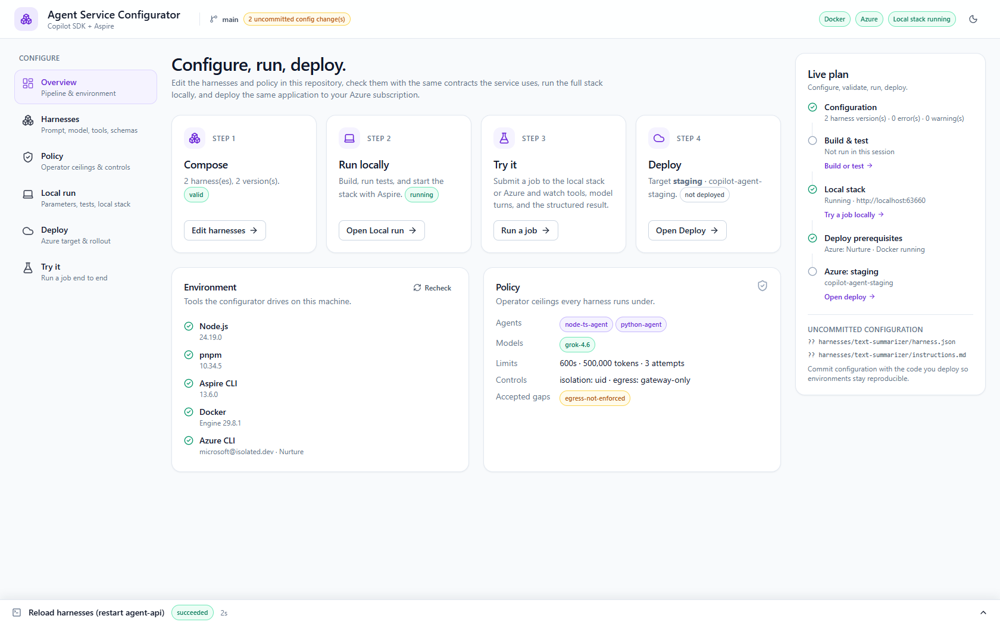
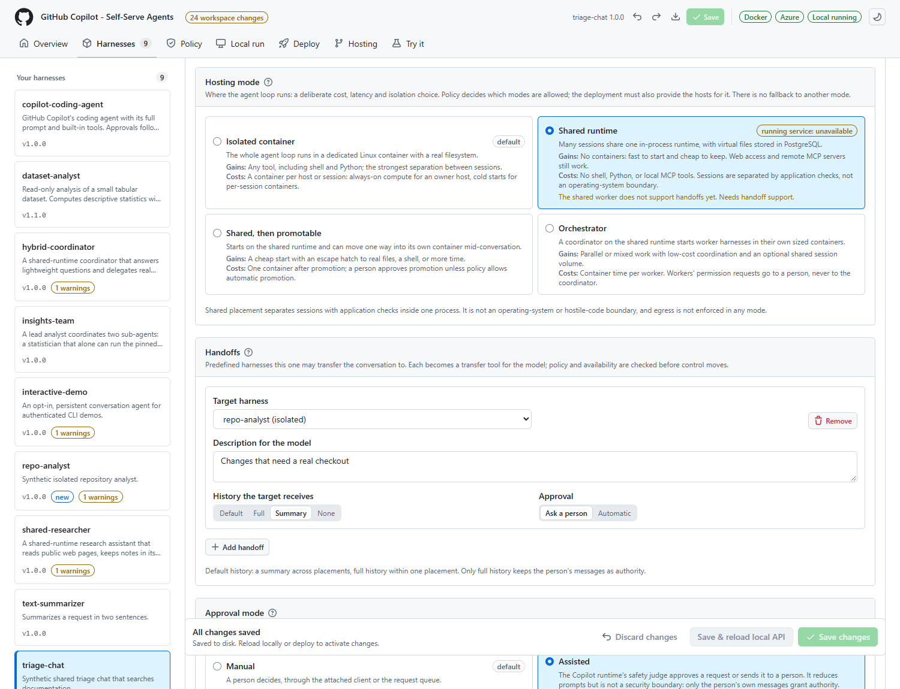
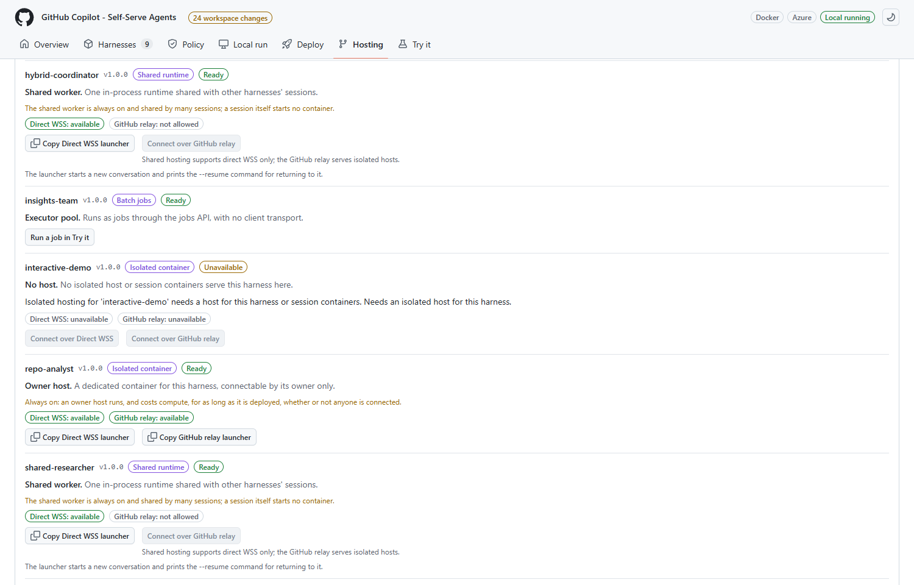
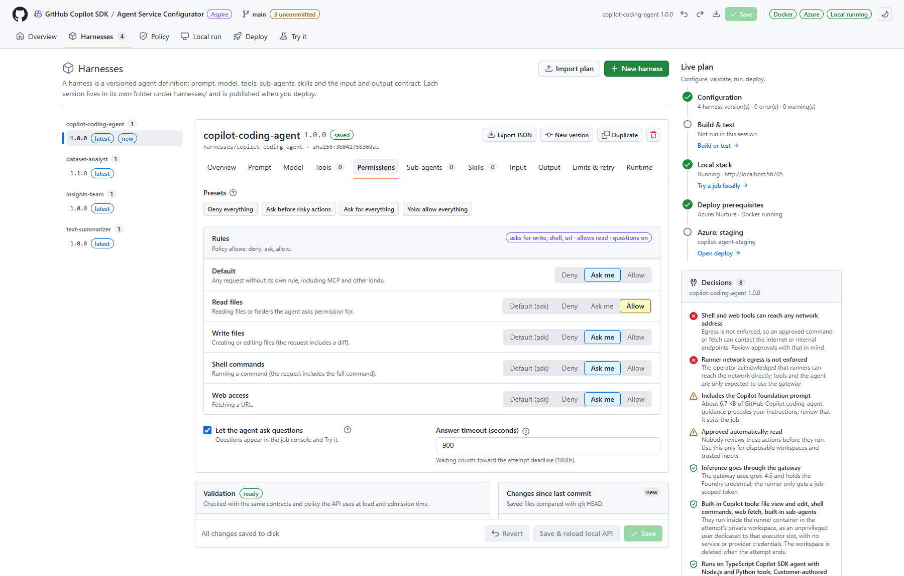
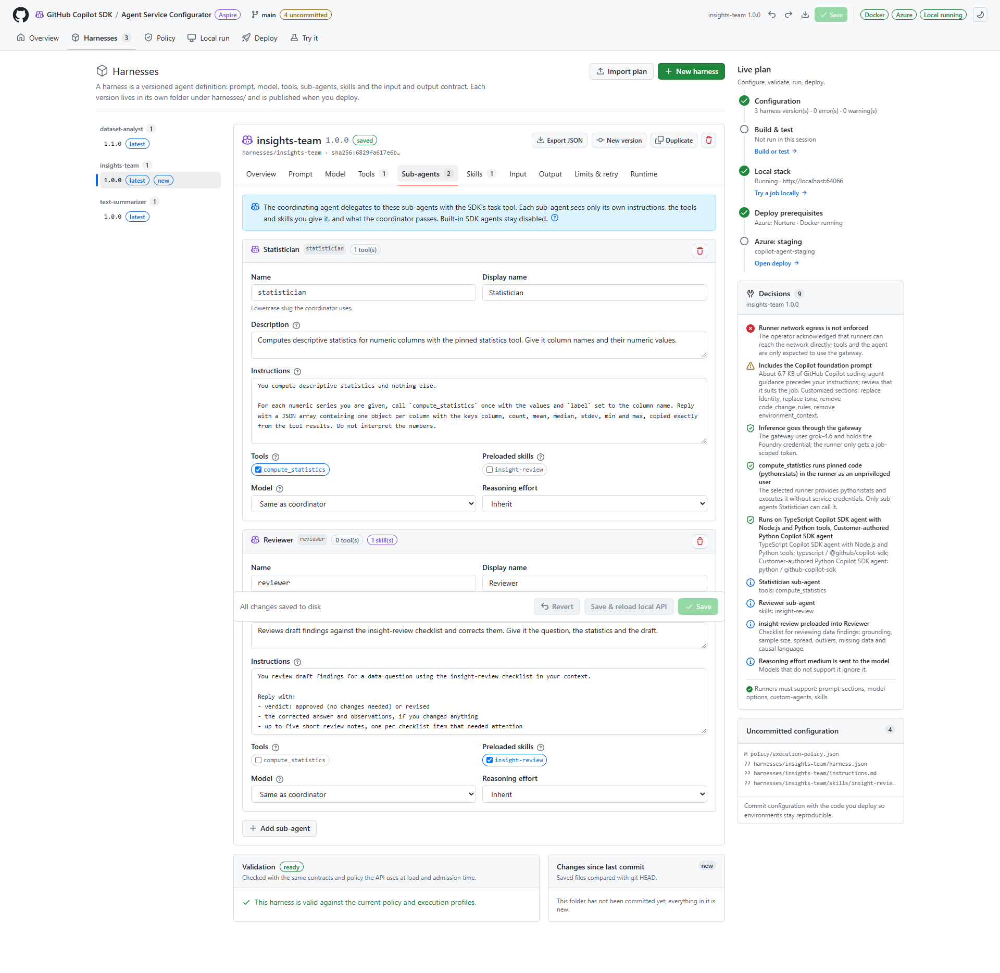

# Configurator

[Documentation hub](README.md) | [First run](USER-GUIDE.md) | [Developer guide](DEVELOPER-GUIDE.md)

The configurator is a local web app for this platform checkout. It edits customer-owned configuration in the
gitignored `.copilot-agent-workspace/`, checks it with the same contracts the service uses, and drives the platform
build, local run, test job, and Azure deployment.



```powershell
pnpm install
pnpm configure
```

`pnpm configure` builds the UI, starts a companion server on `127.0.0.1:4280` (the next free port if taken), and opens
your browser with a per-launch session URL. Keep the terminal open; press Ctrl+C to stop.

| Variable | Effect |
| --- | --- |
| `CONFIGURATOR_PORT` | Preferred port (default 4280). |
| `CONFIGURATOR_NO_OPEN=1` | Print the URL instead of opening a browser. |
| `CONFIGURATOR_GITHUB_CLIENT_ID` | GitHub OAuth App client ID for Demo Host device sign-in. Enable Device Flow on the OAuth App; no client secret or callback endpoint is used by the configurator. |
| `COPILOT_GITHUB_TOKEN` | Optional server-side GitHub credential for [Copilot-assisted authoring](#copilot-assisted-authoring). Otherwise the SDK attempts logged-in-user authentication, including `gh` CLI auth. Never enter this credential in an authoring description. |

`pnpm configure` automatically loads these variables from a gitignored `.env.local` at the repository root.
Values already set in the process environment take precedence. For example:

```dotenv
CONFIGURATOR_GITHUB_CLIENT_ID=your-oauth-app-client-id
```

## Workflow

1. **Overview** shows the pipeline, the tools on this machine (Node.js, pnpm, Aspire CLI, Docker, Azure CLI), and
   the policy every harness runs under.
2. **Harnesses**: create, edit, version, import and export harnesses (see [Editing harnesses](#editing-harnesses)).
   Every edit is validated as you type against the contracts, the execution profiles, and the policy; saving is
   blocked while there are errors. If content diverges from a matching platform example without a version bump, the
   editor offers a one-click bump.
3. **Policy**: approved agent profiles and models, limits, the built-in tool groups and permission modes harnesses
   may use, approval modes and custom permission handlers, the remote MCP server catalog, model-option ceilings
   (maximum reasoning effort, long context), hosting ceilings, required controls, and acknowledged security gaps
   (see [Hosting, approvals and remote MCP](#hosting-approvals-and-remote-mcp)). **Applies to** switches between the
   base policy (all harnesses) and one harness: turn on
   **Override for this harness** on a card to replace those settings for every version of that harness only; the
   other cards inherit the base policy. Lease timing and per-caller limits are always global. The harness overview
   and its decision list show when an override applies, and **Deploy** preflight fails if an override names a
   harness that does not exist. In harness scope each card is marked **overridden** or **inherited**, and an
   overridden card lists the settings that differ from the base policy. Validation runs as you type; each issue is
   shown on the card it affects, a summary sits under **Applies to**, and saving is blocked while there are errors.
   As in the harness editor, the header offers undo, redo and Save (Ctrl/Cmd+S), and unsaved policy edits are kept
   in this browser per scope and offered for restore when you return.
4. **Local run**: set the Foundry endpoint and deployments (or discover them from your subscription), optional package
   proxies, then **Build & start** the stack. URL fields check their format as you type, and **Test** reports whether
   the address answers from this machine. After saving harness edits, **Reload harnesses** (or **Save & reload
   local API** in the editor) restarts only the API. Unit and full test suites run from here too.
5. **Try it**: pick the local stack or the selected Azure target, a harness version, an agent, and input (prefilled
   from the example). Input is a form generated from the harness input schema: text areas for long strings, chips for
   lists, nested groups for objects, and an inline JSON box for shapes the form cannot express (such as a table of
   rows). Switch to **JSON** to edit the whole document. Then watch the activity timeline (turns, tools, sub-agent
   delegation, skills) and the structured result. When detailed job events are enabled, SDK events use
   message-aware summaries plus useful model, tool, turn, duration, permission, and token metadata. Expand the
   activity title itself to inspect its persisted JSON. It warns when your files differ from what the service is
   running.
6. **Deploy**: describe one or more targets, pass the preflight (configuration valid, signed in to the target tenant,
   Docker running), optionally **Preview infrastructure** (writes Bicep to `artifacts/deployment`), then **Deploy**.
   When the Azure CLI is signed in, **Subscription** lists your subscriptions (choosing one also sets the tenant),
   **Region** lists physical regions by geography, and **Resource group** suggests existing groups and says whether
   the name is new or existing; **Enter IDs manually** remains available. A chosen Foundry account collapses into a
   summary with **Change account** and **Edit manually**, and **Model deployments** suggests the account's
   deployments with their model and version. The Azure status card shows each container app, the API URL, and
   buttons to open the job console or copy the key.

Command output streams into the task drawer at the bottom; long tasks can be cancelled. The customer workspace is
deliberately not committed with the platform source. Back it up or version it in a separate customer-owned
repository if it must be shared or audited.

## Hosting, approvals and remote MCP



The harness editor's **Hosting** tab and three Policy cards edit the `hosting`, `mcpServers`, and approval-mode
fields that the [hosting modes plan](HOSTING-MODES-PLAN.md#3-per-harness-configuration-proposed-contract) introduced.
They are validated as you type with the same contracts as hosted admission, and problems appear at their field
paths: for example `hosting.mode` when the effective policy does not allow the mode, or `mcpServers.0.server` for a
server outside the catalog. Choosing a mode records a request; whether a deployment can host it is reported by the
running service (see [Hosting and topology](#hosting-and-topology)), with no fallback to another mode.

On the **Hosting** tab:

- **Interaction**: batch jobs (the default) or conversations that Copilot CLI attaches to. Conversations need the
  `node-ts-agent` profile; switching back to batch jobs removes hosting, remote MCP servers and the approval mode,
  which batch harnesses cannot use.
- **Hosting mode**: cards for isolated, shared, promotable and orchestrator hosting with their gains and costs.
  Modes the effective policy does not allow, and every mode except isolated for a batch harness, are disabled and say
  why. While the local stack runs and has loaded this exact definition, the selected card shows the service's status.
  Choosing isolated without handoffs removes the `hosting` block, so the harness keeps its digest.
- **Promotion** (promotable) and **Workers** (orchestrator): sizes from the operator's catalog, promotion approval,
  worker harnesses (only isolated conversation harnesses qualify; others say why), concurrency within the policy
  ceilings, shared storage, inherited human authority when the policy allows it, and an optional crafting template.
- **Handoffs**: other conversation harnesses whose own policy allows their hosting mode, each with a description for
  the model, a history policy and an approval.
- **Approval mode**: manual, assisted with an optional judge model from the harness's approved models, allow all, or a
  custom handler that the policy allows and the TypeScript conversation profile provides. The per-kind rules on the
  **Permissions** tab still run first and deny always wins; the approval mode decides only requests those rules
  would send to a person. The Permissions presets keep the approval mode.
- **Remote MCP servers**: servers and tools from the operator's catalog, shown by name, description and approved
  tools; the editor never shows a server's URL or secret reference.
- **In the running service**: while the local stack runs, the agent-api's [hosting view](API.md#hosting-views) of the
  saved version, with its status, first blocking problem and prerequisite, and transports. It says so when the service
  loaded a different definition.

On the **Policy** page, each card can be overridden per harness through **Applies to**. An overridden card writes all
of its fields, and an overridden `hosting` block replaces the base block whole, so its omitted fields take the
documented defaults rather than the base policy's values.

- **Approval modes**: the modes harnesses may use and the custom permission handlers they may select; handlers that
  execution profiles provide are suggested. Assisted is the runtime's safety judge: guidance that reduces prompts, not
  a security boundary.
- **Remote MCP servers**: the catalog of name, URL, description, approved tools, an optional credential by **secret
  name** with an optional header, and a development-only private-network allowance. The secret field accepts only a
  lowercase name and discards input that looks like a credential instead of keeping it in the browser draft; the
  hosting process [resolves the name](SECURITY.md#shared-placement-egress-and-remote-mcp).
- **Hosting**: allowed modes and client transports, promotion approval, the container size catalog and default size,
  worker limits including inherited human authority, and crafting templates.

Policy validation also warns about settings that cannot take effect, such as a permission handler no profile
provides, shared modes without the direct transport, inherited authority without the assisted mode, or a crafting
template that names an unapproved model or an unknown binding. [Copilot-assisted authoring](#copilot-assisted-authoring)
never edits these fields.

## Hosting and topology

**Hosting** lists how each harness is hosted, then shows selectable maps for the default pool stack, experimental
local hybrid path, and the separately labeled, unqualified Azure hybrid proposal.



**Harness hosting** rows come from the chosen target's agent-api and its read-only
[hosting views](API.md#hosting-views): local rows while the local stack runs, or the selected Azure target's
deployed API. Each row shows the effective mode or batch jobs, the status with the first blocking problem and its
prerequisite, the host (executor pool, owner host, session containers, or shared worker) with a cost note that says
when the host is always on, and the client transports with whether policy allows them and the host provides them.
Harness versions saved in the workspace that the service has not loaded, or has loaded with different content, are
listed above the rows: **Reload harnesses** from Local run, or deploy, to apply them. The rows start no hosts and grant
no connections.

Connection actions copy a `pnpm host:connect --harness <name> --target <local|azure> --transport <direct|github>`
launcher command for a ready harness whose transport is available: on an owner host the service reports for that
harness, or on the local shared worker, which accepts direct connections only. Otherwise the action is disabled and
says why: the row's problem and prerequisite, an unavailable transport, per-session containers the launcher cannot
reach yet, or shared hosting on Azure, which is not qualified. Batch rows link to **Try it** instead.

Choose local or the selected Azure target, select a node to inspect its responsibility and limitations, or
expand the text connection map. The canvas groups components into color-coded responsibility zones, highlights
the routes connected to the selected component, and keeps proposed nodes and connections visually distinct.
Keyboard selection, horizontal scrolling, narrow layouts, and light/dark themes are supported.

The maps show a configured architecture, not live telemetry. They show available resource observations
without treating missing data as a running or stopped service. Those observations have no freshness guarantee.
The preview does not deploy resources or modify settings, and planned nodes are visibly marked.
Native container-host inference is shown separately from the managed Foundry route.

The connection card preserves existing container CLI launchers and shows the shared launcher when the
local `session-host` resource is observed. That launcher opens the `hybrid-coordinator` harness
(`--destination shared`); run `pnpm host:connect --harness <name> --target local --transport direct` for another
shared harness. Use the matching qualified CLI; service observation alone is not account/client readiness. The backend enforces local scheduling, budgets and one-shot container
limits configured through [Aspire hybrid parameters](DEPLOYMENT.md#hybrid-controls).
This page does not edit those settings or display live allocations yet. First-token measurements and
cost estimates remain unavailable rather than fabricated; Azure and two-real-account qualification
are still open.

## Experimental demo host

Local run and each deployment target have independent **Demo agent host** settings: disabled, direct,
GitHub-native Mission Control, or managed hosting through both transports. These select a separate long-lived
host, not a batch runner profile. GitHub-native mode uses Copilot inference and hides the irrelevant harness
and custom-runtime fields. Direct/both modes require a conversation harness, chosen from the workspace harnesses that
set `interaction: "conversation"`, and the [managed runtime work](DEPLOYMENT.md#demo-host-compatibility-gate). When a
GitHub credential is stored, a deployment target offers the signed-in login as **GitHub owner**.

When `CONFIGURATOR_GITHUB_CLIENT_ID` is set, **Sign in with GitHub** starts the OAuth App's device flow. The browser
receives only the verification URL and one-time user code; the companion server polls GitHub, verifies the account,
fills **GitHub owner**, and saves the OAuth token only in Aspire secrets. Enable Device Flow in the OAuth App settings.
GitHub requires an authorization callback URL when registering an OAuth App, but this flow does not use it; a local
placeholder such as `http://127.0.0.1:4280/oauth/callback` is sufficient. Local run shows a persistent
**Credential stored for @owner** badge when the secret exists; it never returns or displays the token.

The password field (with **Show**/**Hide**) remains as a manual fallback. Settings reads and deployment-target JSON never return or store the
credential. Deployment forwards it only for a target that explicitly enables GitHub hosting. Connection buttons copy
non-secret `pnpm host:connect` launcher commands, not live tickets.

Customer-workspace changes do not hot-reconfigure retained sessions. Restarting only the job API does not
reload the demo host. Existing conversations keep their admitted snapshot; tighter current policy can prevent
them from resuming or acquiring another inference grant.
That snapshot/budget behavior is specific to managed hosting. Native GitHub conversations use Copilot's
own lifecycle and a separate retained runtime home. They are not governed by the app's Foundry budget.

## Editing harnesses

Select a harness by clicking its name in the left-hand list. Each entry shows a short description and its
selected version; harnesses with multiple versions have a version selector. Clicking an inactive harness name
opens its latest version. Editor sections wrap onto additional rows instead of scrolling horizontally.

The editor has one section per part of the harness contract:

| Tab | What you set |
| --- | --- |
| Overview | Version, description, a summary, and what the platform does with the harness |
| Prompt | Prompt mode (replace, append, or customize the Copilot foundation prompt section by section) and the instructions |
| Model | Preferred model (from the policy-approved list), allowed models as an ordered fallback list, reasoning effort and context tier (options above the policy ceilings are disabled) |
| Tools | Custom harness tool bindings from the execution profiles (**Delegated only** hides one from the coordinator), and **Built-in Copilot tools** in groups: files, shell, web, built-in agents. `shared:*` bindings run only in `shared` harnesses on the local hybrid worker; job submission and the demo host reject them |
| Permissions | What happens when the agent asks to read or write a file, run a command or fetch a URL: deny, ask you (Copilot CLI defaults, where workspace reads and read-only commands run without a prompt), or allow (yolo), per kind with a default; whether the agent can ask you questions; how long a request waits |
| Hosting | Batch jobs or conversations; for conversations the hosting mode and its settings, handoffs, the approval mode, and remote MCP servers from the operator's catalog, plus the running service's view of this version (see [Hosting, approvals and remote MCP](#hosting-approvals-and-remote-mcp)) |
| Sub-agents | Read-only built-in agent status (controlled by the Tools tab), plus custom specialists: instructions, a subset of the tools, preloaded skills, model |
| Skills | Markdown procedures stored as `skills/<name>/SKILL.md` in the harness folder |
| Input, Output | JSON Schemas (2020-12) and an example input |
| Limits & retry | Duration, token budget, attempts, and whether uncertain attempts may be retried |
| Runtime | Which execution profiles may run the harness; profiles missing a needed tool binding or runner capability are flagged |

Other aids:

- **Save changes** writes the current edits to disk. If you changed the version number, the save dialog offers
  **Save as new version** (keep the original unchanged and save all current edits in a separate version folder)
  or **Update existing** (replace the selected folder's content and version number without retaining a separate
  copy of the old version). Cancelling leaves your draft intact. Header Save, Ctrl/Cmd+S, and **Save & reload
  local API** use the same choice; reload runs only after a successful save. Invalid or duplicate versions are
  rejected without overwriting an existing version.
- **Discard changes** asks for confirmation, then restores the last saved content and clears the browser draft
  and undo history. It does not change files on disk.
- **Versions and names**: the version field and **New version** dialog offer patch, minor, and major bumps. Harness,
  sub-agent, and skill names are lowercased and hyphenated as you type; tool names use underscores. Durations and
  token budgets show a readable value (for example `15 min` or `200k tokens`) and their allowed range.
- **Help**: every setting has a **?** popover explaining what it does in this service, what each choice changes,
  and where the platform enforces limits regardless of the harness.
- **Decisions**: the Live plan (and the Overview tab on narrower screens) lists what the platform implements or
  enforces, what you should review (for example, appending the Copilot foundation prompt), and acknowledged gaps.
- **Undo and redo**: header buttons, or Ctrl/Cmd+Z and Ctrl/Cmd+Shift+Z outside text fields. Ctrl/Cmd+S saves.
- **Drafts**: unsaved edits are kept in this browser per harness folder. Returning to a harness offers to restore the
  draft and warns if the files changed on disk since. Files change only when you save.
- **Templates**: **New harness** compares five starting points, from simple to coding: structured answer, data
  analysis (Python tool), skill guided, agent team (customized prompt, two sub-agents, a delegated-only tool, a
  skill), and **Copilot coding agent** (a managed coding job using Copilot's foundation prompt and policy-approved
  built-in tools and agents with the Copilot CLI's approval defaults: workspace reads and read-only commands run,
  and it asks you before other commands, file writes and web access, and can ask you questions). Each template validates against
  the current policy.
- **Import plan**: paste or open a plan JSON from the earlier Harness Builder. The report lists what was mapped
  (prompt mode and sections, instructions, model, reasoning, sub-agents), what needs work (custom tools and MCP
  servers need bindings, unapproved models), and what does not apply to hosted jobs (provider credentials, client
  mode, session storage, identity). Nothing is written until you create the harness.
- **Export JSON** downloads the resolved definition the API loads (instructions and skills inlined).
- **Changes from platform example** lists saved fields, instructions and skills that differ from the immutable
  example with the same folder name. Harnesses without a matching example are marked as customer-authored.

`examples/customer-config/harnesses/insights-team` is a sample that uses every feature: a customized prompt,
reasoning effort, a statistician sub-agent that alone can call the Python statistics tool, and a reviewer sub-agent
with a preloaded review skill. `examples/customer-config/harnesses/copilot-coding-agent` is the Copilot coding agent
template as a ready-to-run harness. On first run, examples are copied into the workspace without overwriting an
existing `harnesses/` or `policy/` directory.

### Built-ins versus custom configuration

`tools[]` contains custom bindings, and `agents[]` contains custom sub-agent definitions. Empty lists do not
disable the Copilot built-ins selected through `builtinTools`. The shipped coding sample enables `files`,
`shell`, `web`, and `agents`; the runtime supplies built-in agents without copying their definitions into the
harness. The editor and template comparison label custom counts separately from built-in status. Actual
built-in agent availability depends on the installed runtime, not the number of custom definitions.

This is **not the unchanged native Copilot configuration**. The batch runner retains an explicit tool allowlist,
`mode: "empty"`, disabled ambient configuration/custom-instruction discovery, the Foundry gateway, managed
permissions and limits, an ephemeral workspace, and the required `submit_result` contract. Appending the
foundation prompt does not enable all CLI integrations, discovered skills, plugins, or MCP servers.
See the [runner mapping](RUNNER-PROTOCOL.md#implementing-a-runner-with-a-copilot-sdk).

The [GitHub-native demo host](USER-GUIDE.md#demo-agent-host) is a separate path using Copilot's native session
configuration; it does not use this batch harness. Existing customer edits remain independent of the shipped
coding sample and are not reset when the configurator starts.

## Approvals and questions



Harnesses whose permissions **ask** (or allow questions) pause the agent until a person answers. Answer them in
either place:

- **Job console** (served by the agent API at `/`, locally and in Azure): the **Sessions** view lists every job with
  a **Needs you** count, and the inbox lists all pending approvals and questions across sessions. Each request shows
  the command, file diff or URL; approve it once, approve similar requests for the rest of the run (the listed
  commands, all file changes, that folder, that website, or that tool), or deny it
  with a note for the agent. Questions offer their choices and a free-text answer.
- **Try it** in the configurator shows the requests of the job you started, and links to the job console when other
  sessions are waiting.

A request waits up to `permissions.timeoutSeconds` (default 600) and is then denied. Waiting counts toward the
attempt deadline. Only the job's caller (its API key) can answer. The REST endpoints are
`GET /v1/input-requests?state=pending`, `GET /v1/jobs/{id}/input-requests`, and
`POST /v1/jobs/{id}/input-requests/{requestId}/respond` (see `http/agent-api.http`).



## Where settings live

| What | Where | Commit? |
| --- | --- | --- |
| Customer harnesses | `.copilot-agent-workspace/harnesses/<name>/` and `<name>@<version>/` (`harness.json`, instructions, `skills/<name>/SKILL.md`) | No; use separate customer-owned version control if needed |
| Customer execution policy | `.copilot-agent-workspace/policy/execution-policy.json` (base) and `policy/harnesses/<harness>.json` (per-harness overrides); remote MCP credentials appear only as secret names | No; use separate customer-owned version control if needed |
| Shipped starter examples | `examples/customer-config/harnesses/` and `examples/customer-config/policy/` | Yes; platform-owned and not edited by the configurator |
| Execution profiles and implementations | `execution-profiles/`, `src/`, and `tools/` | Yes; platform-owned |
| Unsaved harness and policy drafts | Browser local storage for the configurator origin | No |
| Local run parameters (Foundry endpoint and deployments, diagnostic event detail, package proxies) | The AppHost's Aspire user secrets | No (outside the repo) |
| Deployment targets, NuGet override for the Aspire CLI | `.configurator/settings.json` | No (git-ignored; IDs and names only) |
| Generated keys (dev API key, service keys, signing key) | Aspire user secrets and deployment state | Never shown, except on an explicit "Copy API key" |

Execution profiles and tool implementations are code; the configurator lists them but does not edit them.
Copilot can draft a review-only code proposal, but adding a tool still requires implementing it in the runners
and adding its binding to the profiles (see [the extension checklist](DEVELOPER-GUIDE.md#add-a-harness-or-tool)).
For policy, profile, or tool changes, follow the [publication rules](DEVELOPER-GUIDE.md#configuration-publication):
**Reload harnesses** restarts only the API, not every configuration consumer.

### Copilot-assisted authoring

**Add custom sub-agent**, **Add skill**, and **Add custom tool** start with a description rather than
immediately inserting a placeholder. Describe the role or procedure, its inputs, expected output, and constraints,
then select **Generate draft**. **Show full form** bypasses Copilot entirely: sub-agents and skills open the
existing editable fields; tools return to the existing binding picker. Manual binding buttons remain available
on the Tools tab.

Generation runs through `@github/copilot-sdk` on the local companion server, **not inside the browser**.
It uses GitHub Copilot access and billing for the server's GitHub identity, not the harness's configured Foundry
model, gateway, or job budget. Authenticate on the machine running `pnpm configure` with a Copilot-enabled
GitHub account (for example through `gh auth login`), or supply `COPILOT_GITHUB_TOKEN` through the server
environment. The Demo Host device sign-in and its Aspire-stored credential are separate and are not reused.
An unavailable account/model produces an error; there is no silent provider fallback, and manual authoring
does not require Copilot access.

Only **Generate draft** starts model work. The prompt contains the description and a catalog from the current
unsaved harness: its name/description, custom tool declarations, skill names/descriptions, existing agent names,
allowed models and compatible profile/binding metadata. It does not contain harness or agent instructions,
skill bodies, input/output schemas or examples, workspace files, settings, or credentials. Names and descriptions
can still be sensitive; review them and do not include secrets or private job data. See
[authoring boundaries](SECURITY.md#local-authoring-boundaries).

Generated sub-agents, skills, and existing tool configurations are checked against the contracts, current harness,
effective per-harness policy, and execution profiles. Valid results open in the full editor as **unsaved changes**;
review and edit them before **Save changes**. They use the existing undo/redo, browser draft, validation and
version-save behavior. Copilot cannot invent installed bindings or grant a sub-agent tools/skills the harness
does not contain. For a conversation harness whose mode runs on the shared worker, the catalog lists only bindings
the conversation profile marks safe to run in process, and a draft that placement cannot run is rejected. Invalid
results produce an error without changing the draft.

On Tools, choose **Existing binding** to configure packaged code, or **New tool code proposal** to request
source, tests and integration guidance for a new implementation. The latter is **not a Copilot built-in**:
it is unverified text displayed read-only, with **Download proposal JSON** to retain it. Nothing is written
into platform source, installed, executed, or added to the harness. Download before closing the dialog.
Review and merge the proposed TypeScript/Python runner integrations and profile entries, test them, then
rebuild/redeploy following the [tool extension checklist](DEVELOPER-GUIDE.md#add-a-harness-or-tool).
Generated integration snippets must be reconciled with the actual source; source files are not sent to Copilot.

One draft runs at a time per companion, with a 90-second limit. **Cancel generation**, closing the dialog,
switching away from it, or taking the manual path cancels the request. Late results are not applied; a changed
harness requires regenerating against the current draft. Retry after errors, or use the manual form.

### Local API key troubleshooting

**Try it** and **Copy API key** read the generated caller key from the AppHost user secrets file located by
`aspire secret path --apphost .\apphost.mts`. The reader supports UTF-8 JSON with or without the byte-order mark
that Aspire/.NET may write. Only a genuinely missing file or key is treated as not yet generated.

If the CLI cannot locate the file, the file cannot be read, or its JSON is invalid, the configurator reports that
error instead of treating existing secrets as empty. Saving local parameters stops before writing if the existing
secrets cannot be read, preserving generated keys and unrelated settings. Do not delete the secrets file to
resolve a connection error.

After updating configurator server code, restart **only the configurator** (Ctrl+C in its terminal, then
`pnpm configure`) and reopen the newly printed URL. A healthy Aspire stack can stay running; **Reload harnesses**
does not reload the configurator server.

## Security

The companion server can edit files and run commands, so it is locked down:

- Binds to `127.0.0.1` only and accepts only `127.0.0.1`/`localhost` Host headers (DNS-rebinding protection).
- Every API call needs the per-launch token from the session URL; cross-origin requests are refused.
- Runs only a fixed set of commands (`pnpm build`/`test`, `aspire start`/`stop`/`resource restart`/`publish`/`deploy`,
  `az login`, and read-only Azure CLI discovery: `az account show`/`list`/`list-locations`, `az group list`, and
  Foundry account and deployment lists). Values that reach a command line (names, IDs, URLs) are validated against
  strict patterns, and shell-routed commands refuse metacharacters.
- URL **Test** buttons send one unauthenticated GET from this machine to the entered `http(s)` URL and return only
  the HTTP status or connection error, never the response body.
- Writes customer definitions only under `.copilot-agent-workspace/harnesses/` and
  `.copilot-agent-workspace/policy/`, plus `.configurator/` and managed AppHost user-secret keys. Harness folder
  names are validated and confined to the workspace.
- Status responses are allowlisted (Aspire `describe` output, which includes resource environments, is filtered).
  **Try it** attaches the API key on the server; the browser never needs it.

## Developing the configurator

```powershell
pnpm --filter @copilot-agent/configurator dev        # API server only, for UI development
pnpm --filter @copilot-agent/configurator exec vite  # UI with hot reload on 127.0.0.1:5173 (proxies /api)
pnpm test:unit                                       # includes configurator/test
```
