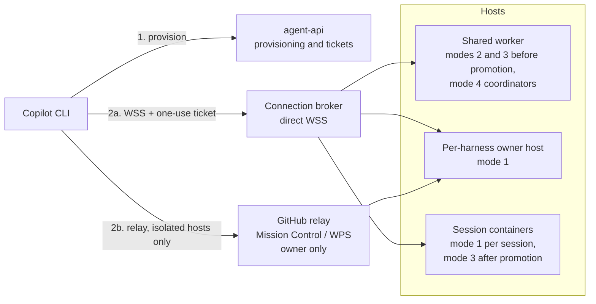
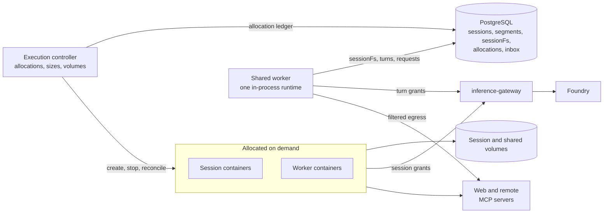
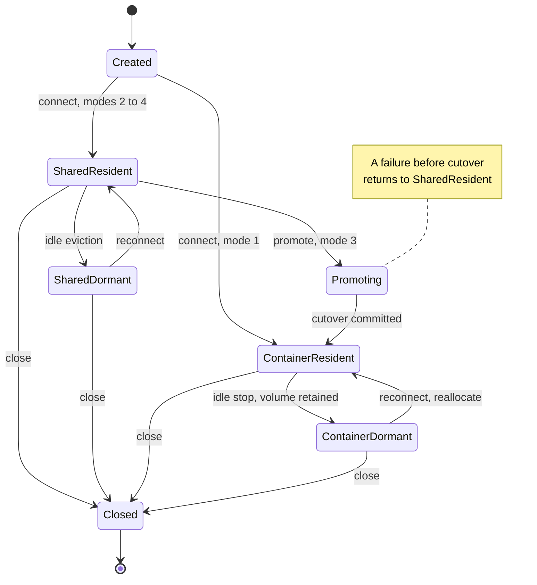
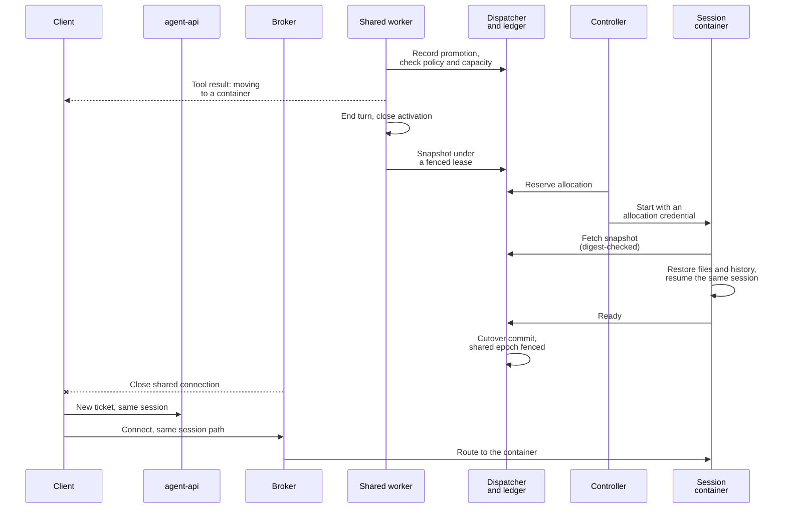

# Per-harness hosting modes plan

[Documentation hub](README.md) | [Current architecture](ARCHITECTURE.md) | [Security](SECURITY.md) | [Hybrid hosting record](HYBRID-HOSTING-PLAN.md)

Date: 2026-10-15

**Status: proposal, recorded before implementation.** This document owns the proposed four-mode, per-harness
hosting design, its client connection matrix, the comparison with OpenAI's Agents API, and the gates for
delivering it. It adds no supported hosting mode, harness field, API route, launcher option, or security
guarantee. [Architecture](ARCHITECTURE.md), [deployment](DEPLOYMENT.md), [API](API.md), and
[security](SECURITY.md) remain authoritative for current behavior until a slice lands with evidence.

## 1. Purpose and agreed decisions

Let each conversation harness choose where its agent loop runs, from a dedicated container to a shared
multi-tenant runtime, and reach every choice from Copilot CLI over AHP. Hosting becomes a deliberate cost,
latency, and isolation decision per harness instead of one deployment-wide shape. The first delivery uses direct
WSS for every mode and keeps the GitHub relay for isolated harness hosts; the GitHub Copilot app and relay for
shared modes are later steps.

The repository already contains the building blocks, each fixed to one deployment-wide configuration:

| Existing building block | What it proves | What it does not provide yet |
| --- | --- | --- |
| Batch executor ([job execution](ARCHITECTURE.md#job-execution)) | The whole agent loop in a uid-isolated Linux container | Conversations or AHP attachment |
| Experimental `agent-host` ([architecture](ARCHITECTURE.md#optional-demo-agent-host)) | Container-hosted conversations over direct WSS and GitHub relay | More than one harness or owner per deployment; [`HostStore`](../src/job-store/src/host-store.ts) is a singleton |
| Local hybrid `session-host` ([architecture](ARCHITECTURE.md#local-hybrid-hosting)) | Many principals on one in-process runtime with PostgreSQL-backed `sessionFs`, attached over direct WSS with one-use tickets | Harness-driven sessions (it runs one coordinator definition built from AppHost parameters), relay, Azure |
| `delegate_job` and `execution-controller` | Model-directed one-shot child jobs in on-demand Docker containers with retained outputs | Long-lived workers, per-task sizes, shared storage, agent-managed lifecycle |

Decisions agreed on 2026-10-15, including answers from two review rounds on the first draft:

| Decision | Agreed direction |
| --- | --- |
| Sequencing | Record this plan before implementation. Build and verify every mode locally before any Azure work |
| Granularity | Hosting is selected per harness, within operator policy |
| Clients | Copilot CLI first. The GitHub Copilot app is deferred |
| Transports | Direct WSS for every mode. GitHub relay for isolated harness hosts only, with one Mission Control environment per relay-enabled harness |
| GitHub relay for shared modes | Not in the first delivery. An owner-scoped relay was agreed and then withdrawn the same day: with relay, GitHub identity rather than the integrator's own principals decides who can attach, which does not suit integrator-managed multi-tenancy. Per-tenant relay in the runtime is parked |
| Shared-mode tools | Basic workspace and utility tools, web access, and remote MCP servers. How skills are defined and mounted for harnesses will be designed later |
| Permissions | Developers choose each harness's approval mode: manual, assisted (the Copilot runtime's safety judge), allow-all, or a custom handler written in code, within policy. A coordinator harness can opt in to letting its workers' judges use the session's human messages as authority |
| What a mode-4 container runs | An agent worker: its own child agent session from an approved harness, which the main agent creates, messages, monitors, and archives, as the GitHub Copilot app manages sessions. One-shot `delegate_job` remains the simple case |
| Promotion | Resume the same session inside the container, transparently to the CLI user where possible |
| Handoffs | Predefined handoff-target harnesses, plus an optional, policy-bounded ability for the main agent to craft a harness at runtime, comparable to OpenAI Agents SDK handoffs |
| Measurement | Get it working first; no performance targets until the local prototype works |
| Connection broker | A separate service, so live CLI sessions survive API restarts |
| Runtime artifacts | Local stages use the locally built, patched runtime and SDK; released artifacts are needed only for Azure and release claims |
| External comparison | Compare the design with OpenAI's Agents API ([section 12](#12-comparison-with-openais-agents-api)) |

The [decision register](#15-non-goals-and-decision-register) records every answer from the review and the items
that remain open.

The proposal introduces six pieces: a per-harness `hosting` contract and policy ceilings, a harness-driven
shared worker, a resumable **session container**, a direct-WSS **connection broker**, per-harness relay
environments for isolated hosts, and coordinator tools for workers, promotion, and handoffs.

## 2. The four modes

| # | Mode (`hosting.mode`, proposed) | Where the main loop runs | Files | Containers | Intended use |
| --- | --- | --- | --- | --- | --- |
| 1 | `isolated`: isolated container (default) | Entirely inside a dedicated Linux container | Real filesystem in the container | One per host or session | Coding, shell, untrusted or long-running work; the most isolated choice |
| 2 | `shared`: shared runtime | One in-process runtime shared by many sessions and principals | `sessionFs` only (PostgreSQL); no shell or host filesystem | None | Chat and utility agents that work through web access, remote MCP servers, and virtual files |
| 3 | `promotable`: shared with one-way promotion | Starts as mode 2; on promotion the loop moves into a dedicated container | `sessionFs`, then a real filesystem seeded from it | One, after promotion | A cheap start with an escape hatch for real-filesystem or longer work |
| 4 | `orchestrator`: shared brain, container workers | Coordinator on the shared runtime; each worker runs its own loop in a container | Coordinator: `sessionFs`; workers: real filesystem plus an optional shared session volume | Many, sized and managed by the coordinator | Parallel or heterogeneous work with low-cost coordination |

`isolated` is the default: a harness without a `hosting` block keeps today's behavior and digest.
Modes 2 to 4 trade isolation for density and startup latency. Shared placement is application-level isolation
inside one process, not an operating-system or hostile-code boundary; see
[security boundaries](#10-security-boundaries-and-claims). "Isolated" describes where the loop runs, not
complete confinement: egress is not enforced in any mode today ([known gaps](SECURITY.md#known-gaps)).

A harness has one mode. Promotion and handoff change where a **session** runs, never the harness's declared
mode. The platform never moves a session between placements on its own initiative.

### Vocabulary

| Term | Meaning |
| --- | --- |
| Placement | Where a session's loop runs now: `shared` (in-process on a shared worker) or `container` |
| Application session | The durable conversation identity owned by the application; it survives promotion and handoff |
| Segment | A period of one session with one harness snapshot at one placement; promotion and handoff start a new segment |
| Session container | A dedicated, resumable container that runs one session's loop on a real filesystem with a retained volume |
| Worker | A session container started by a mode-4 coordinator for a child agent session; no client ingress initially |
| Promotion | The one-way move of a mode-3 session from shared to container placement |
| Handoff | A transfer of conversation control to another harness |
| Crafted harness | A harness definition an agent composes at runtime from an operator template; validated like a published harness and never published automatically |
| Transport | **GitHub relay** (Mission Control and WPS; the "GitHub-managed path") or **direct WSS** (the "Azure WSS path" in Azure, loopback locally) |
| Inference route | **Managed** (application gateway to Foundry) or **GitHub-native** (Copilot inference, permissions, and billing) |

Transport and inference route are independent. Shared placement uses the managed route: the shared runtime runs
with the managed factory profile so that AHP identity does not replace the application's inference settings
([hybrid runtime qualification](DEVELOPER-GUIDE.md#hybrid-runtime-qualification)). Per-user Copilot inference on a
shared runtime is outside this plan. GitHub-native inference remains an isolated container profile, with the
harness and budget limitations described in [experimental host boundaries](SECURITY.md#experimental-host-boundaries).

One new primitive serves three modes: the **session container**. Mode 1 can start a session in one, mode 3
moves a session into one, and mode 4 starts workers in them. It generalizes the controller's one-shot job
allocation into a resumable per-session allocation with a retained volume.

## 3. Per-harness configuration (proposed contract)

The harness requests a mode, the effective operator policy grants it, and the deployment must provide the
required hosts and transports. A mode that policy does not allow is rejected during validation and admission.
A mode that is allowed but not deployed is reported as unavailable with its concrete prerequisite. There is no
fallback to another mode.

Illustrative harness block; final names, bounds, and defaults belong in `contracts` when implemented:

```jsonc
{
  "interaction": "conversation",
  "builtinTools": ["files", "web"],
  "mcpServers": [{ "server": "docs-search", "tools": ["search", "fetch_page"] }],
  "permissions": { "default": "ask", "kinds": { "url": "allow" }, "approvalMode": "assisted" },
  "hosting": {
    "mode": "orchestrator",
    "workers": {
      "harnesses": ["repo-analyst", "test-runner"],
      "sizes": ["small", "medium"],
      "maxConcurrent": 4,
      "maxPerSession": 12,
      "sharedStorage": "session",
      "humanAuthority": "inherit",
      "crafting": { "template": "general-worker" }
    },
    "handoffs": [
      { "harness": "coding-agent", "description": "Changes that need a real checkout", "history": "summary" }
    ]
  }
}
```

| Field | Modes | Meaning |
| --- | --- | --- |
| `hosting.mode` | All | `isolated` (default), `shared`, `promotable`, or `orchestrator` |
| `hosting.promotion.size`, `hosting.promotion.approval` | `promotable` | Container size after promotion; whether a model-initiated promotion needs a person (`ask`) or is automatic (`allow`) |
| `hosting.workers.harnesses` | `orchestrator` | Published conversation harnesses, each with effective mode `isolated`, that may run as workers |
| `hosting.workers.sizes`, `maxConcurrent`, `maxPerSession` | `orchestrator` | Requested subset of operator sizes and concurrency, narrowed by policy |
| `hosting.workers.sharedStorage` | `orchestrator` | `none` or `session` (one volume shared by that session's workers) |
| `hosting.workers.humanAuthority` | `orchestrator` | `none` (default) or `inherit`: whether workers' assisted-approval judges may use this session's human messages as authority ([details](#inherited-human-authority)) |
| `hosting.workers.crafting.template` | `orchestrator` | Optional operator crafting template; omitting it disables crafted workers |
| `hosting.handoffs[]` | All conversation modes | Predefined targets, each with a description, a history policy (`full`, `summary`, or `none`), and an optional `approval` (`ask` or `allow`) |
| `mcpServers[]` (new) | All | Remote MCP servers from the operator's catalog, with the tools this harness requests |
| `permissions.approvalMode`, `judgeModel`, `handler` (new) | All | The session's [approval mode](#approval-modes), an optional judge model for `assisted`, and the registered handler for `custom` |

Validation rules:

- Modes 2 to 4 require `interaction: "conversation"`. Batch harnesses keep executor semantics; running batch
  jobs on shared placement is outside this plan.
- Shared placement cannot run `shell`, `python`, or local (stdio) MCP tools, which need a process and real files.
  `shared` rejects them, `promotable` activates them only after promotion, and `orchestrator` reaches them
  through workers. A `kind: "host"` binding runs in the shared worker only if its execution profile marks it
  safe for in-process use (a new profile field). Remote MCP servers work in every placement.
- The `files` group maps first to provider-backed workspace tools. SDK built-in file tools over `sessionFs` need
  separate qualification.
- `web` is available in shared placement when the harness requests it and policy allows it; the default policy
  allows it. Requests leave from the shared worker, which can reach PostgreSQL, internal services, and cloud
  metadata endpoints. The worker therefore refuses loopback, private, link-local (including metadata), and
  internal service addresses and rechecks every redirect. Locally this is an in-process filter; in Azure an
  egress proxy sits in front of the worker. The runtime's managed `limitTo` host allowlist is a candidate addition.
- Remote MCP servers use one service credential each, held as an operator secret reference and resolved by the host
  process. The model never sees it, and a harness can request only servers and tools in the operator's catalog.
  Per-user sign-in (OAuth on behalf of each caller) is needed for some servers and comes in a later phase.
- How skills are defined and mounted for harnesses, including in shared placement, will be designed later. This
  plan does not change today's inline `skills`.
- `promotion` is valid only with `promotable`, and `workers` only with `orchestrator`. A handoff target must be
  a published conversation harness whose own mode is allowed; it cannot be the source harness.
- New fields are part of the digest when present. Omitting them keeps existing digests, following the
  optional-field convention in [`harness.ts`](../contracts/src/harness.ts).

### Approval modes

Developers choose the approval mode in each harness or in the application's configuration, and operator policy
decides which modes are allowed. The modes follow the Copilot runtime's session permission modes, plus a handler
written in code. Today's per-kind `deny`, `ask`, and `allow` rules in
[`PermissionsConfig`](../contracts/src/harness.ts) still run first, and `deny` always wins. The approval mode
decides what happens to a request that would otherwise prompt a person:

| Mode | Behavior | Runtime mapping |
| --- | --- | --- |
| `manual` (default) | A person decides, through the attached client or an API request queue | `manual` |
| `assisted` | The runtime's Assisted Permissions: an LLM safety judge either approves the request or requires approval. Only human messages grant authority; errors and mandatory confirmations require approval. When nobody can be asked, the action does not run | `assisted`, with an optional `assistedApprovalModel` |
| `allow-all` | Requests are approved automatically | `allow-all` |
| `custom` | The integrator's handler, written in code and registered by name like a tool binding, approves, denies, or asks a person | The host's `onPermissionRequest` calls the handler |

Evidence (runtime revision `0a32c39595f`): the SDK's `session.permissions.setMode` accepts `manual`, `assisted`, or
`allow-all` with an optional judge model. Managed session permissions can disable assisted mode or allow-all, and an
AHP host can advertise `availableApprovalModes`, which the CLI respects when a user switches modes. The runtime's
assisted-permissions contract describes the judge as "probabilistic guidance that reduces prompts, not a hard
security boundary."

Consequences for this plan:

- Policy maps to the runtime's managed settings and to the modes each host advertises. An attached CLI user can
  switch only among the modes the harness and policy allow, as in the normal Copilot CLI.
- In managed sessions the judge model defaults to the session's model, so judge calls go through the gateway and
  count against the session's budget. A `judgeModel` must be an allowed model.
- For workers, the judge's authority rule matters: a worker's instructions come from its coordinator, a model, so
  they carry no human authority. Unless the coordinator harness opts in to
  [inherited human authority](#inherited-human-authority), assisted workers send most requests to a person. The
  coordinator never approves a worker's permissions.
- Custom handlers are integrator code, reviewed and packaged like tool implementations; a harness selects one by
  name and cannot embed code. Hosted conversations are TypeScript-only, so extending custom handlers to batch jobs
  would also require a Python implementation.

### Inherited human authority

A coordinator harness can let its workers' assisted-approval judges treat the session's human messages as
authority by setting `hosting.workers.humanAuthority: "inherit"`. Effective policy must also allow it. The harness
author decides whether workers may act on the person's instructions without prompting; the operator sets the
ceiling. It is off by default.

When enabled:

- The platform, not the coordinator, supplies the authority: the human messages recorded in the coordinator
  session, exactly as sent and attributed to that session's principal. Text in `create_worker` or `send_to_worker`
  arguments stays data, so the coordinator cannot invent or paraphrase authority.
- The worker's judge evaluates each request against those messages. A request covered by what the person asked for
  can run without a prompt; a request that only the coordinator asked for still goes to a person.
- Per-kind rules, `deny`, mandatory confirmations, and the runtime's limits on authority-message size apply as
  usual. A human message above the judge's size limit sends the request down the ordinary approval path.
- The inherited messages are recorded alongside the worker's judge outcomes for audit.
- Only `assisted` workers are affected; `manual`, `allow-all`, and `custom` workers behave as configured.

This needs a runtime capability: accepting platform-supplied human authority for a session's judge, marked as
inherited. The stage-4 gate verifies it. If the runtime cannot provide it, a harness that sets `inherit` fails
validation rather than silently running without it. Inheritance widens what workers may do without asking, but
only within the person's own words, and the judge remains guidance rather than a security boundary.

Illustrative operator policy additions, overridable per harness through the existing
[`HarnessPolicyOverride`](../contracts/src/profile.ts) mechanism:

```jsonc
{
  "approvalModes": ["manual", "assisted", "allow-all", "custom"],
  "permissionHandlers": ["acme-approvals"],
  "mcpServers": {
    "docs-search": {
      "url": "https://mcp.example.com/docs",
      "auth": { "secret": "docs-search-token" },
      "tools": ["search", "fetch_page"]
    }
  },
  "hosting": {
    "modes": ["isolated", "shared", "promotable", "orchestrator"],
    "transports": ["direct", "github"],
    "sizes": {
      "small":  { "cpus": 0.5, "memoryMiB": 1024 },
      "medium": { "cpus": 1,   "memoryMiB": 2048 },
      "large":  { "cpus": 2,   "memoryMiB": 4096 }
    },
    "workers": { "maxConcurrentPerSession": 4, "maxPerSession": 16, "maxPerPrincipal": 8, "idleSeconds": 900, "maxLifetimeSeconds": 3600, "allowInheritedAuthority": true },
    "promotion": { "approval": ["ask"] },
    "crafting": {
      "templates": {
        "general-worker": {
          "toolBindings": [], "builtinTools": ["files", "shell"], "models": ["<approved model>"],
          "approvalModes": ["manual"], "maxDurationSeconds": 1800, "sizes": ["small"]
        }
      }
    }
  }
}
```

The `github` transport applies only to isolated harness hosts in the first delivery.

Sizes map to Docker CPU and memory locally, within the existing
[`ExecutionContainerSettings`](../contracts/src/artifacts.ts) bounds, and to combinations the selected Azure
backend accepts. The model chooses a size by name only. It never supplies images, commands, mounts, or
infrastructure arguments. A session keeps its admitted snapshot; promotion, worker creation, and handoff recheck
the current effective policy, so narrowing policy blocks new containers without stopping existing ones.

The configurator would gain a **Hosting** section in the harness editor (mode cards, mode-specific fields,
validation against effective policy), hosting ceilings on the **Policy** page, and per-harness rows on the
existing [Hosting page](CONFIGURATOR.md#hosting-and-topology) showing the host, available transports, and
connection actions. Unavailable combinations stay disabled and name their prerequisite, as they do today.

## 4. Proposed topology

The first diagram shows how clients reach a session; the second shows where shared and on-demand sessions run and
keep state.





The diagrams show every proposed component; a deployment includes only the hosts its harnesses' modes need.
Arrows are application traffic, not a network allowlist. The per-harness owner host keeps the existing host's
retained volume and its managed or GitHub-native inference routes, shown in the
[optional demo agent host](ARCHITECTURE.md#optional-demo-agent-host) diagram.

| Host shape | Serves | Tenancy | Client transports | Status |
| --- | --- | --- | --- | --- |
| Per-harness owner host (container) | Mode 1 for one owner and one harness | One GitHub owner | Relay, direct, or both | One deployment-wide `agent-host` exists; one host per isolated harness is proposed |
| Session container | Mode 1 per session; mode 3 after promotion | One application session | Direct through the broker | Proposed |
| Shared worker | Mode 2, mode 3 before promotion, mode-4 coordinators | Many principals | Direct through the broker | Local direct path implemented for the fixed coordinator; harness-driven hosting proposed |
| Worker container | Mode-4 workers | One coordinator session | None initially; the coordinator mediates control | Proposed; one-shot job containers exist locally |

The **connection broker** gives direct-WSS clients one stable endpoint and path per application session
(`/sessions/{id}`). It consumes one-use tickets and routes bytes to the session's current placement without
interpreting AHP, reusing the existing [proxy pattern](../src/service-defaults/src/ahp-proxy.ts). Today the
container host and the shared worker each terminate their own direct connections; a broker is what lets a
promoted session keep its URL. In Azure it also receives the outbound tunnels from session containers.

Where the broker runs, compared:

| Concern | Inside `agent-api` | Separate broker service |
| --- | --- | --- |
| Restarts and deployments | Every API restart, including the configurator's **Reload harnesses**, drops every attached CLI | API restarts and harness reloads leave CLI connections up |
| Container tunnels | Long-lived tunnels and the client streams paired with them must land on the same API replica | Can stay single-replica, or add tunnel-aware routing, without changing the API |
| Privilege | Shares a process with caller API keys, admission, and database access | Verifies tickets and resolves placement through an internal dispatcher route, as today's host proxy does, without caller keys or database credentials |
| Moving parts and cost | No new service | One more small, always-on service and ingress endpoint |
| Client setup | Same host name as the API | Unchanged: the API returns the broker URL in the connection response |

**Decision: a separate broker service** (confirmed in the second review round). Live CLI sessions should not depend
on the API process, which the configurator restarts on every harness reload. The cost is one small service.

## 5. Client connections

The first delivery targets Copilot CLI. The GitHub Copilot app is deferred and will be qualified separately.

| Mode | CLI, direct WSS, local | CLI, direct WSS, Azure | CLI, GitHub relay |
| --- | --- | --- | --- |
| `isolated` | Exists for the one configured harness; managed profile behind its [compatibility gate](DEPLOYMENT.md#demo-host-compatibility-gate) | Exists, behind the same gate | Exists for the GitHub-native profile, with [client eligibility](DEPLOYMENT.md#github-native-client-eligibility); proposed per relay-enabled harness |
| `shared` | Implemented for the fixed coordinator; proposed per harness | Proposed, after local stages | Not in the first delivery |
| `promotable` | Proposed; the broker reroutes after promotion | Proposed; needs Azure container reachability | Not in the first delivery |
| `orchestrator` | Coordinator as `shared`; workers not attachable initially | As `shared` | Not in the first delivery |

Proposed client flows:

- **CLI over direct WSS.** `pnpm host:connect --harness <name> --transport direct --target local|azure [--resume <session>]`
  creates or resumes the session through the API, receives `{ url, token, expiresAt, serverKey, ahpSessionId }`,
  pins the server key with `COPILOT_AHP_SERVER_KEY`, and starts
  `copilot --experimental --ahp <url> --resume <ahpSessionId>`, with GitHub authentication consent where the host
  requires it. This generalizes today's [`--destination`](../configurator/server/connect-host.ts) launcher.
  Tickets stay one-use and short-lived.
- **CLI over GitHub relay (isolated harnesses).** The same launcher returns the harness host's environment ID and
  runs `copilot --experimental --relay --environment-id <id> [--resume <ahpSessionId>]`. Each relay-enabled
  harness registers one environment, and its sessions appear in that environment's catalog.

Proposed API changes extend the existing [shared conversation routes](API.md#experimental-shared-conversations)
instead of adding a parallel family:

| Route | Proposed change |
| --- | --- |
| `POST /v1/sessions` | Accept `{ harness, label }`; respond with mode, placement, and current segment |
| `POST /v1/sessions/{id}/connection` | Accept `{ transport }`; return direct material or, for isolated hosts, a relay environment ID, plus the current `ahpSessionId` |
| `POST /v1/sessions/{id}/promote` | Caller-initiated promotion of a `promotable` session; idempotent |
| `GET /v1/sessions/{id}/workers` | Mode-4 workers with state, size, usage, and timestamps |
| `POST /v1/sessions/{id}/close` | Existing; additionally stops workers and retires session containers |

Unsupported combinations return explicit errors, such as `hosting_mode_not_allowed`, `hosting_unavailable`
(naming the missing host or transport), `transport_unsupported` when a shared-family session requests the GitHub
path, and `relay_owner_only` when a principal other than an isolated host's owner requests it.

### GitHub relay identity

Relay registration uses the hosting runtime's own GitHub identity. In reviewed runtime source (revision
`0a32c39595f`, `supervised_host.rs`), the host resolves environment credentials from its owning runtime context
before registering, and `HostGitHubEnvironmentOptions` carries only a name, a compute ID, and a binding flag.
One runtime can therefore register environments for one account, and GitHub identity, not the integrator's
principals, decides who can attach through them. That fits a single-owner host but not a multi-tenant one:

- **Isolated harness hosts** keep relay: each relay-enabled harness host registers one environment under its owner's
  account, extending the existing `demo-host-owner` settings and owner verification.
- **Shared-runtime modes** (`shared`, `promotable`, `orchestrator`) use direct WSS only in the first delivery,
  where the application's own principals and one-use tickets control access.
- **Per-tenant relay** would need per-host relay credentials in the runtime. It is parked until there is a concrete
  need, and it is not a reason to run one runtime per user.

If relay for shared modes returns, two questions recorded in the review reopen: whether the owner credential on the
shared runtime changes tenant authentication or managed inference, and whether one relay host can publish many
sessions while routing each file request to the right session's storage.

## 6. Session lifecycle



No transition leaves container placement for shared placement. Idle eviction and idle stop retain state.
Closing prevents new turns and, for mode 4, stops workers. Disconnecting a client changes none of these states.

A handoff starts a new segment instead of changing placement in place. The target harness's mode decides the
new placement: a `shared` triage harness that hands off to an `isolated` coding harness moves the conversation
into a session container with the target's instructions and tools.

## 7. Mode details

### 7.1 Mode 1: isolated container

Keep the existing container host as the qualified starting point, then remove its deployment-wide singletons:

- Key host ownership, leases, and connection tickets by harness and owner instead of the single `demo_host` row.
  Each isolated harness a deployment exposes gets its own host resource, data root, and, when relay is enabled for
  it, one Mission Control environment. Each such host is always-on compute, and the configurator must show that
  cost per harness.
- Add per-session containers for multi-tenant direct use. The controller allocates a session container when a
  session connects, stops it after the idle period, and reallocates it from the retained volume on reconnect.
  This is the strongest separation between sessions and has no idle compute, at the price of cold starts.
  Per-session containers are reachable over direct WSS through the broker only.
- Keep the managed and GitHub-native inference routes distinct. GitHub-native mode applies neither harness
  restrictions nor Foundry budgets, so a harness's mode never selects it implicitly.
- Existing gates still apply to released artifacts: the managed
  [compatibility gate](DEPLOYMENT.md#demo-host-compatibility-gate), Azure Files
  [storage and revision requirements](DEPLOYMENT.md#storage-and-revision-requirements), and relay client eligibility.
- Local stages use the locally built, patched runtime instead of waiting for a release, as the hybrid path already
  does. The host's `agent-host-runtime` image stage already accepts local `copilot-runtime` and `runtime.node`
  artifacts. Two changes remain: the host package must link the matching local SDK instead of the published
  `1.0.16`, and the AppHost must stop forcing amd64 for that stage when the local bundle is native ARM64. Record
  the runtime revision and artifact hashes with every result. Azure and any release claim still need released,
  qualified artifacts.

### 7.2 Mode 2: shared runtime

Make the existing shared worker harness-driven:

- Replace the AppHost-defined `SharedSessionDefinition` ([`shared.ts`](../contracts/src/shared.ts)) with the
  admitted harness snapshot and effective policy. Instructions, prompt mode, model options, skills, sub-agents,
  limits, and permissions come from the harness. The existing turn scheduler, token reservations, idle eviction,
  and lease fencing remain.
- Apply the tool rules in [section 3](#3-per-harness-configuration-proposed-contract). A shared session gets a base
  set for utility and chat work: read, write, edit, list, and search files in `sessionFs`; web fetch through the
  filtered egress path; remote MCP tools from the operator's catalog; a task list kept in session storage; questions
  to the user when the harness enables them; and in-runtime sub-agents. Final tool names belong in the contracts.
  Shared hosting is TypeScript-only because it uses the in-process Node SDK; batch runner parity is unaffected.
- Apply the harness's [approval mode](#approval-modes). With `manual`, approvals and questions go to the attached
  AHP client, as the managed container host does today
  ([`hostPermissionHandler`](../src/agent-host/src/policy.ts) returns no result so the participant owns the
  prompt). The application never fabricates approval. The current coordinator rejects every permission request.
- Serve many harnesses from one worker, with per-harness resident-session and active-turn limits so one harness
  cannot starve the others.

### 7.3 Mode 3: promotable ("page fault" to a container)

The agent calls `promote_session` when it needs a real filesystem, a shell, packaged tools, or more time.
A caller can also promote through the API. With `approval: "ask"`, the attached person approves first.
Promotion is idempotent per tool call and one-way.



Cutover rules:

1. **Before cutover**, the shared placement remains authoritative and admits no new turns while promotion is in
   progress. Any failure in policy, capacity, snapshot, allocation, startup, or resume leaves the session shared
   and accepting turns again, releases the allocation, and returns an error to the agent or caller.
2. **The cutover commit** changes the placement to `container` and fences the shared storage lease epoch in one
   transaction. The shared runtime can no longer write the session. No route demotes it.
3. **After cutover**, the container is authoritative. If it fails, the controller reallocates from the retained
   volume. Interrupted turns are not replayed automatically (`continuePendingWork: false`); the agent receives a
   system continuation that explains the move.

The snapshot contains runtime history and workspace files from the session's `sessionFs` namespace, read under a
fenced lease after the turn ends, and bounded by the existing session storage limits. The container receives an
allocation-scoped credential that can fetch only that snapshot and request inference grants for that session.
It holds no database, Docker, signing, or Foundry credential. After cutover the shared namespace stays read-only
for the configured retention period, then the operator's retention process deletes it.

The decisive technical gate is **history transplant**: resuming the same runtime session ID on a
real-filesystem runtime from history written through `sessionFs`. The review expects this to work; the stage-5
spike must show it on the pinned runtime. The runtime fences resume on the workspace path (see the Windows
path-spelling fix in the [qualification record](HYBRID-HOSTING-PLAN.md#13-qualification-record)), so the session
container must use the shared anchor's absolute workspace path, or the runtime needs an explicit workspace-rebase
option on resume. A Windows-hosted shared worker cannot promote into a Linux container until that is resolved; the
Linux shared-worker image avoids the mismatch. If the transplant cannot be qualified, the alternative is an
explicit handoff to a fresh session seeded with the transcript and files. That would be a recorded design change,
never a silent fallback.

**Client continuity.** The review asked for promotion to be transparent to the CLI user. Today it is not: the
reconnect qualification ([`shared-cli.test.ts`](../tests/integration/shared-cli.test.ts)) starts a new CLI process
with a fresh ticket and the new host's server key. A seamless move needs three things:

1. The CLI reconnects on its own when the broker closes the connection with a "moved" reason, instead of exiting.
2. It gets fresh connection material without the user rerunning the launcher, through a CLI provisioning hook or
   a session-bound reconnect credential that the broker accepts once per placement change.
3. Its server-key pin stays valid. The promoted container's runtime has a different key, so either the application
   issues a per-session host key that moves with the session (a runtime change to accept an application-provided
   key), or the CLI accepts a key update delivered through trusted provisioning.

Until those exist, the launcher can supervise the CLI: on a "moved" close it provisions the new placement and
restarts the CLI with `--resume`, so the conversation replays in the same terminal. Promotable sessions are
direct-WSS only, so relay continuity does not arise in the first delivery.

### 7.4 Mode 4: orchestrator (shared brain, container workers)

The coordinator is a mode-2 session with worker tools. Workers are child application sessions, each running a
listed worker harness or a crafted harness in its own session container. The coordinator decides how many
workers to start, which sizes to use, what each does, and when to clean up. The platform enforces ceilings and
backstops rather than scheduling the work itself.

| Coordinator tool | Behavior | GitHub Copilot app analogue | OpenAI Agents API analogue |
| --- | --- | --- | --- |
| `create_worker` | Start a worker from a listed harness or crafting template with a size, name, mounts, and first task; returns immediately | Create a session | `create_subagent_call` |
| `send_to_worker` | Durable message: `immediate` steers at the next turn boundary; `enqueue` waits for current work | Send a session message | `send_subagent_input_call` |
| `get_worker`, `list_workers` | State (`starting`, `working`, `idle`, `needs_input`, `stopped`), latest result, usage, and container time | Session status | Session event stream |
| `interrupt_worker` | Abort the worker's current turn | Abort a turn | `interrupt_subagent_call` |
| `archive_worker` | Stop the container and release capacity; keep or discard its private volume per policy | Archive a session | None documented |
| `list_shared_files`, `read_shared_file`, `write_shared_file` | Bounded access to the session's shared volume | None | Shared environment filesystem |
| `delegate_job` | Existing one-shot batch child with input snapshot and output artifacts | None | None |

Rules:

- **No polling inside turns.** Worker completion, idle, failure, and input requests go to the coordinator's
  durable inbox and are delivered as bounded continuations, reusing the existing completion pump. A
  `wait_for_workers` tool, if added, ends the turn instead of holding it open.
- **Sizes and concurrency.** The coordinator chooses a size per worker from the effective subset. Admission counts
  starting, running, and retiring allocations per session, principal, and deployment, as the
  [allocation ledger](../src/job-store/src/allocations.ts) already does for one-shot jobs.
- **Shared storage.** With `sharedStorage: "session"`, workers mount one per-session volume read-write or
  read-only, and each worker also has a private volume. The coordinator has no real filesystem and reaches the
  shared volume only through bounded application tools. Concurrent writers get no locking beyond filesystem
  semantics, so instructions should assign separate directories.
- **Approvals.** Each worker harness's [approval mode](#approval-modes) decides its requests, and the coordinator
  never approves a worker's permissions. With `manual`, requests go to a person: through the coordinator session's
  attached client or, when nobody is attached, through a principal-scoped API request queue modeled on the job
  [approvals and questions](API.md#approvals-and-questions) routes. With `assisted`, the runtime's judge decides
  first, but the coordinator's instructions are not human authority, so most requests still reach a person unless
  the coordinator harness enables [inherited human authority](#inherited-human-authority). `allow-all` and `custom`
  behave as in any other harness. Policy may let the coordinator answer a worker's questions.
- **Backstops.** Idle timeout, maximum lifetime, per-session caps, an aggregate token budget across the
  coordinator and its workers, workers stopping when the coordinator closes, and controller orphan
  reconciliation. Container time is recorded per worker for cost attribution.
- **Depth one.** Workers cannot create workers, delegate jobs, or hand off in the first delivery.
- **No client attachment to workers initially.** Observing or steering a worker directly from the CLI needs worker
  ingress or a tunnel and is future work.

### 7.5 Handoffs and crafted harnesses

A handoff transfers conversation control to another harness; a worker leaves the coordinator in control.
Promotion is equivalent to a handoff to the same harness at container placement with full history.

| Mechanism | Who responds afterward | History | Placement afterward | Reversible |
| --- | --- | --- | --- | --- |
| Promotion (mode 3) | The same harness | Full runtime history | Container | No |
| Handoff | The target harness | `full`, `summary`, or `none`, per target | The target harness's mode | Only if the target lists the source as a handoff |
| Worker (mode 4) | The coordinator; workers report back | Task and messages only | Worker container | Not applicable |

Handoffs follow the shape of OpenAI Agents SDK handoffs:

- Each predefined target appears to the model as a `transfer_to_<harness>` tool with the target's description.
  Its arguments are a small structured payload, such as a reason and a summary, validated before any effect.
- Authorization happens before transfer. The target must be allowed by current policy and available in the
  deployment, and with `approval: "ask"` a person confirms. A failed check leaves the source in control.
- The new segment receives history according to the target's policy: `full` (resume the same runtime session under
  the target's instructions and tools, which the review expects the runtime to allow; the stage-6 spike verifies
  it), `summary` (a bounded summary written by the source), or `none` (the payload only). Filters can remove
  content; they never add authority. Only `full` keeps the person's messages as assisted-approval authority; a
  summary is written by a model and carries none.
- The application session ID stays the same. Clients reconnect to the new segment's `ahpSessionId`, which the
  launcher resolves from the API.

Crafted harnesses let a coordinator define a worker when no listed harness fits:

- An operator template sets the ceiling: tool bindings, built-in groups, models, approval modes, limits, and sizes.
  The coordinator supplies a name, bounded instructions, and a subset of the template.
- The result goes through the same `HarnessDefinition` schema, [hosted-harness admission](../src/service-defaults/src/host-policy.ts),
  and policy intersection as a published harness, and is recorded with its digest, template, parent session,
  and tool call.
- Crafted definitions are never published to the registry automatically. A person can export one to the
  configurator as an unsaved draft.
- Crafted instructions are model-authored, untrusted input. They cannot widen the template, select an image or
  command, or become handoff targets in the first delivery.

## 8. Storage by mode

| Data | Mode 1 | Mode 2 | Mode 3 | Mode 4 |
| --- | --- | --- | --- | --- |
| Runtime history | Host or session volume | `sessionFs` in PostgreSQL | `sessionFs`, then the session volume | Coordinator: `sessionFs`; workers: their volumes |
| Workspace files | Real filesystem on the volume | Bounded `sessionFs` namespace | Seeded from `sessionFs` at cutover | Coordinator: `sessionFs`; workers: private and optional shared volumes |
| Admitted snapshot, budgets, turns | PostgreSQL | PostgreSQL | PostgreSQL; one record across segments | PostgreSQL; linked parent and child sessions |
| Outputs | Container files | `sessionFs` | Container files | Shared volume and existing job artifacts |
| Retention | Operator-managed volumes | Operator-managed rows | Both, including the read-only pre-promotion namespace | Volumes per worker and session |

Locally, session and shared volumes are Docker named volumes labeled with the controller namespace. The Azure
candidate is Azure Files, whose [storage gate](DEPLOYMENT.md#storage-and-revision-requirements) remains open.

## 9. Identity, inference, and credentials

| Component | Holds | Never holds |
| --- | --- | --- |
| Connection broker | Ticket verification and routing state | Session content, inference grants, provider credentials |
| Shared worker | PostgreSQL access, its dispatcher grant key, and resolved secrets for approved remote MCP servers | Docker authority, the allocation-signing key, provider or relay credentials |
| Per-harness owner host | The owner's GitHub credential when relay is enabled, and session inference grants | Database, signing, or Foundry credentials |
| Execution controller | Docker authority locally or Azure provisioning authority; allocation signing | Session content, inference grants |
| Session container or worker | An allocation-scoped credential, session inference grants, and remote MCP secrets its harness is approved for | Database, Docker, signing, Foundry, or relay credentials |
| Inference gateway | Foundry identity | Client or session credentials |

Every model call in modes 2 to 4, and in managed mode 1, uses a session or turn capability issued against the
session's aggregate budget, as hosted sessions and shared turns do today. These are admission and accounting
controls, not exact spending caps; see [local hybrid boundaries](SECURITY.md#local-hybrid-boundaries).

## 10. Security boundaries and claims

| Mode | Boundary between sessions | Do not claim |
| --- | --- | --- |
| `isolated`, per session | Separate container, runner uid, and private volume | Network isolation (egress is unenforced) or hostile-tenant VM isolation |
| `isolated`, per-harness host | One container shared by one owner's sessions | Isolation between that owner's sessions |
| `shared` | Application checks inside one process: principal and lease-fenced storage, tool allowlists | Operating-system isolation, or safety for untrusted code (none runs there) |
| `promotable` | Shared before cutover, container after | That the shared phase had container isolation |
| `orchestrator` | Shared coordinator; workers in containers; one session's workers share its volume | Isolation between workers of one session that share a volume |

Additional risks to design for:

- **Server-side request forgery from the shared worker.** Web access and remote MCP calls in shared placement leave
  from a process that can reach PostgreSQL, internal services, and cloud metadata endpoints. Filtering loopback,
  private, link-local, and internal addresses and rechecking redirects are requirements, not hardening extras: an
  in-process filter locally, and an egress proxy in Azure.
- **Untrusted content.** Web pages, remote MCP results, worker results, crafted instructions, and handoff summaries
  are all model input that can carry prompt injection; treat them as data, never as policy.
- **Assisted Permissions is not a security boundary.** The runtime's own contract calls the judge probabilistic
  guidance that reduces prompts. Keep deny rules, credentials, container placement, and egress controls as the
  enforceable limits; policy can disable assisted mode, and the judge's outcomes are recorded as session events.
- **Inherited human authority** lets workers act on a person's instructions without prompting. Keep it off by
  default, allow it per harness through policy, source it only from recorded human messages, and audit it.
- **Custom permission handlers** are integrator code with the same trust as tool implementations; review and
  package them the same way.
- **Remote MCP credentials** stay in the host process; the model and the harness definition see only server names.
- **Promotion snapshots** are integrity-sensitive transfers, digest-checked and allocation-bound.
- **Cost amplification** through worker creation and judge calls is bounded by ceilings and budgets, not by an
  exact dollar cap.

Update [Security](SECURITY.md) with verified controls as each slice lands. Until then its current statements apply.

## 11. Effective controls

| Control | Modes | Enforced at |
| --- | --- | --- |
| Allowed modes and transports | All | Validation, admission, connection provisioning |
| Approval modes, judge model, and approved custom handlers | All | Validation, admission, the runtime's managed permission settings, and the host's permission handler |
| Inherited human authority for workers | 4 | Harness opt-in, policy ceiling, and the platform's authority source |
| Web egress filtering in shared placement | 2, 3, 4 | In-process filter locally; egress proxy in Azure |
| Remote MCP server catalog, tool lists, and secret references | All | Validation, admission, and the host's MCP client |
| Size catalog and per-harness subset | 1, 3, 4 | Allocation admission |
| Shared active turns, resident sessions, and queue | 2, 3, 4 | Shared worker scheduler (existing) |
| Session, turn, and aggregate token budgets | All managed | Turn and grant admission (existing), extended to workers |
| Worker concurrency, totals, idle time, and lifetime | 4 | Allocation ledger and controller |
| Promotion approval and capacity | 3 | Promotion admission |
| Handoff targets, approval, and history policy | All conversation modes | Handoff admission |
| Crafting template ceilings | 4 | Crafted-definition validation |
| Retention of volumes and namespaces | All | The operator's retention process; nothing is deleted automatically |

Controls are validated server-side, and the UI reads the same effective values. Lowering a ceiling blocks new
allocations and drains existing work; it does not silently stop containers.

## 12. Comparison with OpenAI's Agents API

Reviewed on 2026-10-15 from OpenAI's documentation for the Agents API, which is in beta and can change. The
statements below describe OpenAI's documented behavior, not measurements, and should be rechecked before they
are relied on.

### Concept mapping

| OpenAI Agents API | This plan | Notes |
| --- | --- | --- |
| Agent: model, instructions, tools, MCP servers; saved agents reused across sessions | Harness: versioned, digest-identified, bounded by operator policy | Both snapshot configuration when a session starts |
| Environment `none` | Mode 2 `shared` | OpenAI's `none` has no workspace files or built-in shell, but the harness can still call remote MCP servers, and applications supply function tools. Shared mode likewise allows remote MCP and web access, and adds durable virtual files in `sessionFs` |
| Environment `openai_hosted`, with `small` (1 vCPU, 1 GB), `medium` (2 vCPU, 4 GB), or `large` (4 vCPU, 16 GB) chosen per session | Mode 1 session containers, promoted containers, and workers, with an operator size catalog | Ours run on the customer's compute |
| Environment `self_hosted`: customer compute runs an executor that connects outbound over WebSocket and performs commands, file operations, and local MCP calls for the hosted harness | No equivalent; the closest is remote "hands-only" execution, which this plan did not choose for mode 4 | Its outbound-only connection informs the Azure container reachability decision |
| Session: durable, steerable during a turn, continued later; OpenAI manages context compaction | Application session with segments, attached live through AHP | |
| `multi_agent`: harness-supplied tools to create, message, wait for, and interrupt subagents; 6 concurrent by default; subagents share the coordinator's environment and filesystem; no function tools | Mode 4 workers in separate sized containers with an optional shared volume; in-runtime sub-agents still exist within one runtime | |
| Agents SDK handoffs: `transfer_to_<agent>` tools, input filters, structured handoff input | Predefined handoffs with per-target history policy | OpenAI documents handoffs in the SDK, not as an Agents API feature |
| REST, server-sent events, and signed webhooks; required actions for function calls and approvals | AHP attachment from Copilot CLI (the GitHub Copilot app later), plus the existing REST and SSE job APIs | We found no documented direct CLI or IDE attachment to a running OpenAI session |
| Vaults for secrets used by MCP servers and sandbox-originated requests | Secret references for approved remote MCP servers, resolved by the host (proposed); no general vault | |

### Where the agent loop runs

With the Agents API, OpenAI always runs the managed Codex harness, including when the environment is
self-hosted; only the execution environment moves. To run the loop in your own infrastructure, OpenAI directs
you to the Agents SDK, which runs inside your application. In this plan the Copilot runtime harness always runs
inside the customer deployment, and the four modes choose between a shared process and a container for it.

### Differences that affect this design

| Topic | OpenAI Agents API (documented) | This plan | Implication |
| --- | --- | --- | --- |
| Changing environment mid-session | The session update route changes model, reasoning effort, service tier, and metadata; tools, instructions, and multi-agent settings need a new session; no environment change is documented | Mode 3 promotes a running session, one way | Promotion has no documented OpenAI counterpart; its cutover and continuity are the riskiest part of this plan |
| Subagent compute | Subagents share one environment and its size | Each worker gets its own sized container; sharing is an explicit volume | Better isolation and mixed sizes; higher per-worker startup time and cost |
| Subagent tools | Subagents inherit MCP and web search settings; no function tools | Workers use their own harness's tools under policy | Workers are full agents rather than reduced subagents |
| Handoffs | An SDK concept; the receiving agent sees full history unless an input filter changes it | Platform-level, policy-checked, with a history policy per target, across placements | A handoff across placements requires the client to reconnect |
| Client access | Application-mediated REST, SSE, and webhooks | Direct AHP from Copilot CLI over WSS, and over relay for isolated hosts | Live attachment is a differentiator, with more authentication surface: tickets, key pins, expected owner |
| Approvals | Required actions (function calls, environment connections, computer-use approvals) answered by the application | Approval modes: `manual`, `assisted` (the Copilot runtime's safety judge), `allow-all`, or a `custom` handler in code | Similar intent; `assisted` and `custom` cut routine prompts without making the judge a security boundary |
| Network control | Hosted sandboxes allow network access to be enabled, disabled, or restricted to up to 100 exact hostnames | Egress is not enforced; shared-placement web access adds address filtering (proposed) | A real gap for isolated and worker containers |
| Warm capacity and idle | Free pre-warmed environments that expire after five minutes unattached; hosted sandboxes expire after about an hour idle, not configurable | Zero warm capacity by default; operator-configured idle time and lifetime | Our latency depends on cold container starts until warm capacity exists |
| Data controls | US data residency only; not eligible for Zero Data Retention, even with a self-hosted environment | Deployed in the customer's Azure subscription; relay traffic and GitHub-native inference use GitHub infrastructure | Customer placement is a differentiator, with documented GitHub-path exceptions |
| Pricing | Model usage at API rates, plus container rates for hosted sandboxes | The customer's Azure compute and Foundry usage | Compare total cost only with measured data |

### What to adopt and what to keep distinct

- Adopt the coordinator vocabulary (create, message, interrupt, inspect), so mode 4 is familiar to developers who
  know OpenAI's multi-agent tools or the GitHub Copilot app.
- Adopt outbound-only connectivity for ephemeral containers, as OpenAI's self-hosted executor does, to avoid
  per-container ingress in Azure.
- Adopt explicit network modes (disabled, restricted, enabled) as the target for container egress. Azure session
  pools can disable egress per pool, but nothing in this repository enforces egress today.
- Keep promotion explicit and one-way; OpenAI documents no in-session environment change to copy.
- Keep separate containers for workers instead of one shared environment, and offer a shared volume explicitly.

A side-by-side run compares different harnesses (Codex and the Copilot runtime), possibly different models, and
different infrastructure. Report such a run as a product comparison on named workloads, not as evidence about the
hosting architecture alone, and use the definitions in [section 13](#13-measurements-and-demonstration).

Sources, reviewed 2026-10-15: Agents API [overview](https://developers.openai.com/api/docs/guides/agents-api/overview),
[architecture](https://developers.openai.com/api/docs/guides/agents-api/architecture),
[configuration](https://developers.openai.com/api/docs/guides/agents-api/configuration),
[multi-agent](https://developers.openai.com/api/docs/guides/agents-api/multi-agent),
[OpenAI-hosted sandboxes](https://developers.openai.com/api/docs/guides/agents-api/environments/openai-hosted),
[self-hosted sandboxes](https://developers.openai.com/api/docs/guides/agents-api/environments/self-hosted),
[sandbox lifecycle](https://developers.openai.com/api/docs/guides/agents-api/environments/lifecycle),
[pre-warmed sandboxes](https://developers.openai.com/api/docs/guides/agents-api/environments/prewarmed), and
[sessions](https://developers.openai.com/api/docs/guides/agents-api/sessions); the
[runtime comparison](https://developers.openai.com/api/docs/guides/agents); and the Agents SDK
[orchestration](https://developers.openai.com/api/docs/guides/agents/orchestration) and
[handoffs](https://openai.github.io/openai-agents-python/handoffs/) guides.

## 13. Measurements and demonstration

Measurement waits until the local prototype works (review answer P1). The metrics below are candidates for later,
reusing the definitions in the [hybrid plan](HYBRID-HOSTING-PLAN.md#9-measurements-and-demonstration-protocol):

| Metric | Definition |
| --- | --- |
| Promotion latency | Promotion request to cutover commit, and cutover to the client's first successful turn |
| Worker startup | `create_worker` acceptance to the worker's first turn, split into allocation and runtime readiness |
| Worker concurrency | Achieved concurrent workers against configured ceilings, with queueing time |
| Idle cost by mode | Container-seconds multiplied by configured size while no turn is active, per harness |
| Coordinator overhead | Coordinator tokens per worker task |

The functional demonstration, which doubles as the local acceptance path:

1. Connect from the CLI to one harness in each mode over direct WSS, and to an isolated harness over the GitHub
   relay.
2. Show that a `shared` conversation allocates no containers while using its base tools, web access, and a remote
   MCP tool.
3. In a `promotable` session, ask for work that needs a shell. Observe approval, cutover, and continued work in the
   same terminal, and confirm that no demotion is possible.
4. In an `orchestrator` session, start two workers of different sizes on a shared volume, one of them in `assisted`
   mode. Message one, interrupt one, archive both, and observe capacity return to zero. Confirm that requests the
   judge declines reach a person and that the coordinator cannot approve them.
5. In a `shared` session, switch between the approval modes the policy allows from the CLI, and confirm that a
   disallowed mode cannot be selected.
6. Hand off from a shared triage harness to an isolated coding harness with summary history.

When comparisons start, predeclare workloads, trial counts, and pass criteria, and report negative results.

## 14. Delivery sequence and acceptance gates

| Stage | Deliverable | Exit evidence |
| --- | --- | --- |
| 0. Plan | This document and documentation-hub links | Modes, contract direction, connection matrix, comparison, gates, and agreed decisions recorded before code |
| 1. Contract and policy | `hosting` harness block, `mcpServers`, approval modes, policy ceilings and per-harness overrides, validation and admission errors, configurator editing, and a read-only per-harness hosting view | Existing harnesses keep their digests; invalid combinations and disallowed modes fail with field-scoped errors; unavailable modes name their prerequisite; runtime behavior is unchanged |
| 2. Harness-driven shared mode | The shared worker hosts `shared` harnesses with the base tool set, filtered web access, remote MCP, and approval modes; `/v1/sessions` accepts a harness; a separate broker service; launcher `--harness` | Two shared harnesses serve two API principals on one worker over direct WSS from the CLI; a shared harness uses web access and a remote MCP tool; loopback, private, link-local, and internal addresses are refused; the CLI can switch only to allowed approval modes; a GitHub relay request for a shared harness fails with `transport_unsupported`; no containers are allocated |
| 3. Session containers | Resumable allocations with per-session volumes, idle stop and reallocation, broker routing to containers, per-session mode 1, and per-harness owner hosts with one relay environment each, built from the local runtime and SDK | A mode-1 session runs in its own container, stops when idle, and resumes from its volume; an isolated harness host registers its own environment and the CLI attaches over relay and direct WSS; orphan reconciliation and capacity accounting cover the new allocation kinds |
| 4. Orchestrator workers | Worker tools, the durable coordinator inbox, sizes, the shared volume, backstops, worker approval modes, and listed and crafted workers | A coordinator runs two differently sized workers concurrently on a shared volume, messages and interrupts them, receives their completions without polling, and archives them; worker requests that need approval reach a person, never the coordinator; with inherited human authority enabled, a request covered by the person's own words runs without a prompt while one only the coordinator asked for still reaches a person; capacity returns to zero; a crafted definition cannot exceed its template |
| 5. Promotion | A transplant spike, then `promote_session`, API promotion, cutover fencing, and client continuity (launcher-supervised first) | A shared conversation promotes mid-task and continues with shell and files under the same application session, in the same terminal, without the user rerunning the launcher; failures before cutover leave it shared; no demotion route exists |
| 6. Handoffs | Predefined targets, approval, history policies, and cross-placement handoff | A shared triage harness hands off to an isolated coding harness with summary history; a disallowed or unavailable target fails without transferring control |
| 7. Azure | After stages 1 to 6 work locally: a spike of both container backends, then shared-worker image deployment, broker ingress, the chosen backend adapter with volumes, and relay for isolated hosts | Sessions and workers scale from zero to many to zero in Azure; the CLI attaches over direct WSS, and over relay for isolated hosts; observed costs are recorded |
| 8. Comparison | Deferred until the prototype works: a mode comparison and an OpenAI Agents API product comparison on synthetic workloads | Predeclared workloads and thresholds, raw data, and stated caveats |

Stages 2 and 3 can proceed in parallel after stage 1. Stages 4 and 5 depend on stages 2 and 3, and stage 6 reuses
the segment mechanism from stage 5. Azure work, including the backend spike, starts only after stages 1 to 6 work
end to end locally. Every stage keeps the default `isolated` behavior, batch jobs, the existing host, and the
local hybrid path working. Local evidence does not qualify Azure, and a source patch is not qualification of a
runtime capability.

Required failure coverage, in addition to existing suites:

- A disallowed mode, an unavailable mode, and a disallowed transport, each with an explicit error.
- A GitHub relay request for a shared-family harness, and one for an isolated host by a principal other than its
  owner.
- Web access and remote MCP from the shared worker: loopback, private, link-local, metadata, and internal service
  addresses, including through redirects; an unapproved server or tool; and credentials that must never reach the
  model or logs.
- Approval modes: a request the judge declines, a judge error (fails closed), an unattended `assisted` request
  (does not run), a failing or slow custom handler (deny), and `allow-all` disabled by policy.
- Inherited human authority: a coordinator that puts claimed human instructions in tool arguments, inheritance
  requested by a harness when policy forbids it, and a human message too large for the judge.
- Promotion: duplicate tool calls, failure at each step before cutover, a crash after cutover, stale shared
  writes after fencing, and demotion attempts.
- Workers: limits under concurrent creation, coordinator closure with running workers, orphaned containers,
  shared-volume conflicts, and worker permission requests with and without an attached client.
- Handoffs: disallowed or unavailable targets, approval denial, history filtering, and repeated handoff calls.
- Crafted harnesses: an attempt to exceed each template ceiling.
- Cross-principal access to sessions, workers, snapshots, and volumes.

## 15. Non-goals and decision register

Non-goals: transparent live migration; demotion from container to shared placement; the platform choosing or
changing a session's placement on its own; GitHub relay for shared-runtime modes and the GitHub Copilot app in the
first delivery; per-tenant relay from one shared runtime; hostile multi-tenant isolation claims for shared
placement; model-selected images, commands, mounts, or infrastructure arguments; workers that create workers;
client attachment to workers; Python-hosted conversations; changes to batch job semantics; exact spending
enforcement; and production-hardening claims.

The IDs match the two review questionnaires answered on 2026-10-15. N-items are questions raised by the answers.

| ID | Decision | Direction | Status |
| --- | --- | --- | --- |
| D1 | Mode identifiers | `isolated`, `shared`, `promotable`, `orchestrator` | Agreed |
| D2 | Shared-runtime tools | The base tool set in [section 7.2](#72-mode-2-shared-runtime), web access, and remote MCP servers; `host` bindings by profile allowlist; no Python or local MCP | Agreed |
| D3 | Files in shared placement | Application workspace tools first; SDK built-in file tools after qualification over `sessionFs` | Agreed |
| D4 | Web in shared placement | Allowed by the default policy, with address filtering | Agreed |
| D5 | Broker placement | A separate broker service ([trade-offs](#4-proposed-topology)) | Agreed |
| D6 | Relay environment granularity | One environment per relay-enabled isolated harness | Agreed |
| D7 | GitHub Copilot app | Deferred; Copilot CLI first | Agreed |
| D8 | Mode 1 host shape | Both per-harness owner hosts and per-session containers | Agreed |
| D9 | Approval modes | `manual`, `assisted` (the runtime's safety judge), `allow-all`, or a `custom` handler in code, chosen by the developer per harness or in application configuration, within policy | Agreed |
| D10 | Coordinator access to the shared volume | Bounded tools through a controller-side file service | Agreed |
| D11 | Promotion mechanism | Resume the same session in the container | Agreed; verify in the stage-5 spike (T2) |
| D12 | Handoff history default | `summary` across placements; `full` within the same placement | Agreed |
| D13 | Azure container backend | Spike Container Apps jobs and dynamic session pools only after the local prototype works | Sequencing agreed; choice open |
| D14 | Azure container reachability | Outbound tunnel from containers to the broker | Agreed direction; verify in the spike |
| D15 | Per-tenant relay | Per-host relay credentials in the runtime | Parked |
| T1 | Copilot app transports | None until the app work starts | Deferred with D7 |
| T2 | History transplant | Expected to work; same absolute workspace path or a rebase option | Verify in the stage-5 spike |
| T3 | Owner credential on the shared runtime | Relay for shared modes is out of the first delivery | Agreed; moot until shared-mode relay returns |
| T4 | One relay host, many sessions | Desired if shared-mode relay returns | Parked |
| T5 | Promotion continuity | Transparent to the CLI user ([requirements](#73-mode-3-promotable-page-fault-to-a-container)) | Required; mechanism in N5 |
| T6 | Configuration change on resume | Expected to work: the runtime can resume with different instructions and tools | Verify in the stage-6 spike |
| T7 | Azure storage and connectivity | Session-pool WebSocket and volume support undocumented; job volume support unchecked; Azure Files storage gate open | Open; stage-7 spike |
| T8 | Existing mode 1 gates | Unchanged for released artifacts. Local stages use the locally built runtime and SDK ([section 7.1](#71-mode-1-isolated-container)) | Agreed for local stages |
| P1 | Performance targets | Get it working first | Deferred |
| N1 | Skill store | How skills are defined and mounted for harnesses will be designed later | Deferred |
| N2 | Remote MCP credentials | One service credential per server: Aspire secrets locally, Key Vault in Azure. Per-user OAuth is needed for some servers | Agreed; per-user OAuth in a later phase |
| N3 | Web filtering | In-process address filter locally, egress proxy in Azure; evaluate the runtime's `limitTo` host allowlist as an addition | Agreed |
| N4 | `assisted` approver outside workers | The runtime's judge serves any session, so no reviewer harness is needed; the developer sets the mode and judge model | Agreed |
| N5 | Promotion continuity mechanism | Launcher-supervised restart first; later a CLI reconnect hook with either a per-session host key or a CLI key update | First step agreed; long-term option open |
| N6 | Base tool set for shared mode | Files, web fetch, remote MCP, task list, questions, and in-runtime sub-agents ([section 7.2](#72-mode-2-shared-runtime)) | Agreed in principle; names in stage 1 |
| N7 | Human authority for assisted workers | Harness opt-in (`hosting.workers.humanAuthority: "inherit"`) within a policy ceiling; the platform supplies the coordinator session's recorded human messages ([details](#inherited-human-authority)) | Agreed; runtime support verified in stage 4 |

Azure evidence reviewed on 2026-10-15: `az containerapp job start` accepts per-execution `--cpu`, `--memory`,
`--image`, and environment overrides, and Container Apps jobs are documented as finite-duration tasks
([jobs](https://learn.microsoft.com/azure/container-apps/jobs), [CLI](https://learn.microsoft.com/cli/azure/containerapp/job)).
Session pools set CPU and memory per pool, can disable egress, and support `Timed` (idle cooldown) or
`OnContainerExit` lifecycles ([session pools](https://learn.microsoft.com/azure/container-apps/session-pool)). The
reviewed pages document neither WebSocket attachment nor volume mounts for session pools; treat both as unverified.

## 16. Documentation impact as slices land

| Slice | Canonical pages to update |
| --- | --- |
| Contract and policy | [Configurator](CONFIGURATOR.md), [developer feature checklist](DEVELOPER-GUIDE.md#add-a-harness-feature), [runner protocol](RUNNER-PROTOCOL.md) if session mapping changes, [product scope](PRODUCT.md#supported-today) |
| Shared mode and provisioning | [API](API.md), [architecture](ARCHITECTURE.md) and its diagrams, [deployment](DEPLOYMENT.md), [security](SECURITY.md), [user guide](USER-GUIDE.md) |
| Session containers, workers, and promotion | Architecture state flows, security boundaries, deployment controls, API |
| Handoffs and crafted harnesses | API, configurator, security, product scope |
| Azure | Deployment, [topology image](images/local-and-azure.svg), security, costs |

Record dated evidence for each stage in the [qualification record](#17-qualification-record), as the
[hybrid record](HYBRID-HOSTING-PLAN.md#13-qualification-record) does, and move supported behavior into its owning
reference page rather than duplicating it here.

## 17. Qualification record

Dated evidence for each slice, recorded as it lands: the commits, the commands run and their results, the runtime
revision and artifact hashes where a native runtime was used, and the limitations that remain. Supported behavior
moves to its owning reference page; this record keeps the evidence.

### Stage 1: contracts, policy, validation, and admission

Recorded 2026-10-15 on branch `patniko-stage-1-contracts-and-policy`: commits `b1695a3` (contract shapes), `cf0c789`
(MCP `allowPrivateNetwork`, requested by the egress slice), `ea9ee58` (admission, API view, configurator checks),
`e49f7ba` (shared deployment builder, documentation), and the commit that adds this record. Configurator editing is
the separate slice below.

Delivered:

- **Harness contract** ([`harness.ts`](../contracts/src/harness.ts)): optional `hosting` (`mode`, `promotion`,
  `workers`, `handoffs`), `mcpServers`, and `permissions.approvalMode`, `judgeModel`, and `handler`, with every
  harness-only rule of [section 3](#3-per-harness-configuration-proposed-contract) as a field-scoped schema error.
  `mode` is required inside the block; omitted settings resolve at evaluation time (`ask` approvals, the catalog's
  default size, `none` for shared storage and human authority), so parsed definitions never gain defaults. Batch
  harnesses reject `hosting`, `mcpServers`, and approval modes other than `manual`, because neither batch runner
  implements them.
- **Policy and profile** ([`profile.ts`](../contracts/src/profile.ts)): `approvalModes`, `permissionHandlers`, the
  `mcpServers` catalog (`url`, `auth.secret` and optional `header`, `tools`, `allowPrivateNetwork`), and `hosting`
  ceilings (`modes`, `transports`, `sizes` within the `ExecutionContainerSettings` bounds, `defaultSize`, `workers`
  including `allowInheritedAuthority`, `promotion.approval`, `crafting.templates`), all overridable per harness by
  whole-field replacement. Omitted fields keep today's behavior: isolated only, both transports, `manual` only, no
  servers or handlers, a small/medium/large catalog, and `ask` for promotion. Profiles gain `inProcessBindings` and
  `permissionHandlers`; the shipped profiles declare neither.
- **Deployment capability and admission** ([`hosting.ts`](../contracts/src/hosting.ts)): `HostingDeployment` lists
  the executor, isolated hosts per harness with their owner principal, session containers, the shared worker, and
  worker containers, each with transports and implemented features. `evaluateHosting` reports, in order,
  `hosting_mode_not_allowed`, `transport_not_allowed`, `policy_rejected`, and `hosting_unavailable` naming the
  missing host, transport, or feature; per transport it also reports `transport_unsupported` and `relay_owner_only`.
  [`hostingDeployment`](../src/agent-api/src/hosting-deployment.ts) describes today's deployment: the executor, the
  managed demo host as the isolated host for its harness (direct or both; GitHub-native adds none), and the local
  hybrid worker as the shared worker. No host implements any harness feature yet (`DEMO_HOST_FEATURES`,
  `SHARED_WORKER_FEATURES`).
- **Runtime**: the demo host's admission now refuses a non-isolated mode, isolated hosting its policy disallows, and
  features it does not implement, instead of running without them. Runners, the shared worker, batch admission for
  existing harnesses, and the existing host and session routes are unchanged.
- **API**: read-only `GET /v1/hosting` and `GET /v1/hosting/{harness}` ([API](API.md#hosting-views)).
- **Configurator server**: validation reports the new rules at their field paths, warns about policy settings that
  cannot take effect, and the Policy page keeps an override's values for fields it has no card for yet.

| Exit evidence | Result |
| --- | --- |
| Existing harnesses keep their digests | [`harness-digests.test.ts`](../tests/unit/harness-digests.test.ts) pins the five shipped digests computed on `0ad742e`; it passes on that commit and on this branch. [`hosting-contracts.test.ts`](../tests/unit/hosting-contracts.test.ts) shows omitted fields add no defaults and present fields change the digest |
| Invalid combinations and disallowed modes fail with field-scoped errors | Schema rules in `hosting-contracts.test.ts`; policy, override, and profile rules in [`hosting-policy.test.ts`](../tests/unit/hosting-policy.test.ts); configurator issues in [`hosting-validation.test.ts`](../configurator/test/hosting-validation.test.ts); `hosting_mode_not_allowed` at `hosting.mode` in [`hosting-admission.test.ts`](../tests/unit/hosting-admission.test.ts) |
| Unavailable modes name their prerequisite | `hosting-admission.test.ts`: `shared` names host `shared-worker`; `promotable` names feature `promotion` and host `session-containers`; `orchestrator` names host `worker-containers` and its feature needs; an isolated harness without a host names `isolated-host`; requested MCP, approval-mode, custom-handler, and handoff features name the feature. Transports name `session-containers` for non-owners, `relay_owner_only`, and `transport_unsupported` for the relay on shared modes |
| Runtime behavior is unchanged | The full suites below pass. [`host-admission.test.ts`](../tests/integration/host-admission.test.ts) drives the dispatcher's demo host routes against PostgreSQL: the shipped harness and its session are admitted as before, and refused requests acquire no host lease |

Commands and results, Windows ARM64 with Node 24.19, pnpm 10.34.5, and Docker Desktop:

| Command | Result |
| --- | --- |
| `pnpm install`, `pnpm build`, `pnpm --filter @copilot-agent/configurator build` | Passed |
| `pnpm typecheck`, `pnpm typecheck:tests`, `pnpm --filter @copilot-agent/configurator typecheck`, `pnpm lint` | Passed |
| `pnpm test:unit` | 351 passed, 1 skipped (base `0ad742e`: 285 passed, 1 skipped) |
| `pnpm test:integration` | 58 passed, 8 opt-in skipped (base: 56 passed) |
| `HYBRID_SESSION_RUNTIME_TESTS=1` with `COPILOT_AHP_FACTORY_PROFILE=managed`: `shared-service.test.ts`, `shared-session-runtime.test.ts` | 2 passed |
| `HYBRID_CLI_TESTS=1`, `HYBRID_USE_GH_ACCOUNT=1`: `shared-cli.test.ts` | Passed |
| `HYBRID_DEPLOYMENT_TESTS=1`, `HYBRID_USE_GH_ACCOUNT=1`: `hybrid-deployment.test.ts`, executor image `copilot-hybrid-executor:local` | Passed |

The opt-in suites used synthetic loopback inference and the runtime at revision `0a32c39595f`: launcher
`copilot-runtime.exe` (SHA-256 `d843b17a242886e4504bebdd39c1563cece0eec248fc3dcbfe921d209cf88c4d`) and
`runtime.node` (`ed6e2dda07580c86845b9edc30c59a03f584a4ef6651de6712cc34fedb3f357b`), the win32-arm64 build with the
Windows workspace-path fix, with `HYBRID_CLI_PATH` at that checkout's `dist-cli\index.js`. With the older
`dist-cli\prebuilds\win32-arm64` pair, `shared-cli.test.ts` fails identically on `0ad742e` and on this branch
(`application session resume failed`), and `hybrid-deployment.test.ts` fails the same way on this branch. The demo
host suites (`DEMO_HOST_RUNTIME_TESTS`, `DEMO_GITHUB_HOST_TESTS`) were not run: they need a rebuilt host image, and
the dispatcher admission path they exercise is covered above.

Limitations:

- The editor and Policy page have no controls for the new fields; the configurator slice adds them. The Permissions
  tab's presets still replace `permissions` without its approval-mode fields.
- `ready` for `shared` reflects only that the local hybrid worker is deployed; it still runs its fixed coordinator
  until stage 2 makes it harness-driven.
- No host implements remote MCP, non-manual approval modes, custom handlers, handoffs, promotion, or workers, so
  harnesses that request them evaluate as `hosting_unavailable`. No profile provides a permission handler.
- Inherited human authority is a contract and policy ceiling only; the runtime capability is checked in stage 4.
- Omitted handoff history (`summary` across placements, `full` within one) is resolved by stage 6, which may also
  add policy ceilings for handoff approval and history.
- The hosting views show every authenticated principal the harness names, mode problems, and effective ceilings,
  including MCP server and tool names; server URLs, secret references, and owner principals are not returned.

### Stage 1: configurator hosting editor and views

Pending.

### Stage 2: connection broker

Recorded 2026-10-15 on branch `patniko-connection-broker` (commits `b0cc328`, `4c9cad5`, `6bdc70c`, `af03bae`), then
merged with the integration branch at `9c6b918` (harness-driven shared mode) in `f18c658` and re-verified. The
results below are from the merged tree unless noted.

Delivered, all local and opt-in through `Parameters:hybrid-hosting`:

- A separate `connection-broker` service ([source](../src/connection-broker/src/broker.ts)) gives each session one
  stable WebSocket path, `/sessions/{id}`. It consumes one-use tickets through the internal dispatcher route
  `POST /internal/broker/connection`, then forwards bytes unchanged to the session's placement. Its only credential
  is `CONNECTION_BROKER_KEY`; it holds no caller API key, database credential, inference grant, or provider
  credential. `POST /v1/sessions/{id}/connection` returns the broker URL with the harness-driven `transport` and
  `ahpSessionId` fields.
- The shared worker accepts only connections forwarded with the broker key, for the activation epoch the consumed
  ticket was issued for, and refuses public tickets. Tickets keep their 60-second, one-use semantics and the CLI's
  server-key pin flow. The singleton demo `agent-host` direct path is unchanged.
- Placement abstraction ([contract](../contracts/src/placement.ts)): `PlacementKind` (`shared` only),
  `SessionPlacement`, and `PlacementRoute`; ledger columns `shared_sessions.placement` and `placement_generation`
  (migration `009`); tickets bound to the generation; `PlacementStore`; and `POST /internal/broker/placements` for
  live-route checks.
- A distinguishable close: WebSocket code `4301`, reason `moved`, injected at a frame boundary when a live route's
  placement kind or generation changes. The broker checks live routes every second and re-checks when an upstream
  closes, replacing that close with `moved` if the placement changed.
- Local AppHost wiring: a `connection-broker` Node resource and a generated `connection-broker-key` in the hybrid
  branch. `pnpm host:connect --destination shared` works unchanged through the returned URL and now also verifies
  the URL's session path.

| Gate | Command | Result |
| --- | --- | --- |
| Baseline | `pnpm install`, `pnpm build`, `pnpm --filter @copilot-agent/configurator build`, `pnpm typecheck`, `pnpm typecheck:tests`, `pnpm --filter @copilot-agent/configurator typecheck`, `pnpm lint` | All exit 0 |
| Unit | `pnpm test:unit` | 508 passed, 1 skipped. Before the merge: 299 passed, 1 skipped (baseline 286; 14 new broker, frame, proxy, and placement cases) |
| Integration | `pnpm test:integration` | 64 passed, 10 opt-in skipped (62 and 8 before the merge). New: ticket consumption and placement lookup, live connections across an `agent-api` restart, forwarded-only worker ingress, and `moved` after a test-only generation change |
| Native runtime | `HYBRID_SESSION_RUNTIME_TESTS=1 COPILOT_AHP_FACTORY_PROFILE=managed`, `shared-service.test.ts`, `shared-session-runtime.test.ts`, and `shared-egress-runtime.test.ts` | 4 passed; an AHP handshake through the broker reached the runtime and returned its pinned key |
| Real CLI | `HYBRID_CLI_TESTS=1 HYBRID_USE_GH_ACCOUNT=1`, `shared-cli.test.ts` | Passed with a harness-driven session: API, broker, dispatcher ticket consumption, shared worker; the CLI kept answering while `agent-api` was stopped and restarted; a replacement worker behind the same broker resumed the conversation for a fresh CLI |
| Real containers | `HYBRID_DEPLOYMENT_TESTS=1 HYBRID_EXECUTOR_IMAGE=copilot-hybrid-executor:connection-broker`, `hybrid-deployment.test.ts` | Passed (57.9 s; 59.5 s before the merge), with `agent-api` replaced while the CLI stayed attached |
| Packaged images | `HYBRID_CONTAINER_TESTS=1 HYBRID_SESSION_IMAGE=copilot-hybrid-session-host:connection-broker`, `shared-image.test.ts` and `artifact-safety.test.ts` | 2 passed |
| Local AppHost | `aspire start --isolated` with hybrid parameters and a non-routable Foundry endpoint | All seven services healthy; a `hybrid-coordinator` session's connection returned the broker URL, `transport: "direct"`, and `ahpSessionId`; a brokered AHP session stayed open and answered across `aspire resource agent-api restart` (the configurator's **Reload harnesses**); the used ticket was refused; `pnpm host:connect --destination shared --resume <id>` attached the CLI through the broker |

Runtime and artifacts: the Windows in-process pair `.runtime-artifacts/cli-workspace-fix` (`copilot-runtime.exe`
`d843b17a242886e4504bebdd39c1563cece0eec248fc3dcbfe921d209cf88c4d`, `runtime.node`
`ed6e2dda07580c86845b9edc30c59a03f584a4ef6651de6712cc34fedb3f357b`) and the CLI `dist-cli/index.js`
(`e520ae56fc901a56dc821bcf9795255a489bff05e9a606b5d4fa526c586ccdf9`) from the runtime checkout at `0a32c39595f`.
The `dist-cli/prebuilds/win32-arm64` launcher (`20791e27…`) predates that revision's Windows workspace
path-spelling fix and refuses every CLI attachment with `application session resume failed`. The unmodified base
gate reproduces this. The Linux bundle `hybrid-linux-arm64-verified` (runtime `0a32c39595f`, hosting `b20e188`)
built `copilot-hybrid-session-host:connection-broker` (merged tree `sha256:910603c3…`; earlier `sha256:5278e5b9…`). The
executor image `copilot-hybrid-executor:connection-broker` (merged tree `sha256:85b2f5a3…`; earlier `sha256:e677df02…`)
was built from `deploy/Dockerfile`, which now installs the broker package. Inference was synthetic throughout.

The merge kept harness-driven sessions on the broker path: the shared worker returns ticket material with
`ahpSessionId`, the API adds the broker URL and `transport`, and `ConnectionTicket` lives in `shared.ts` to avoid a
contracts import cycle. The worker's egress filter previously took its own address from `SHARED_PUBLIC_URL`, which
no longer exists; it now refuses its own listener and the broker's through `SHARED_WORKER_URL` and
`CONNECTION_BROKER_URL`.

Extension points for later stages: add a placement kind to `PlacementKind`, the `shared_sessions_placement_kind`
constraint, `PlacementRoute`, a `CASE` branch in `PlacementStore.consumeTicket`, and the broker's per-kind upstream
table. Add another path family, such as `/hosts/{harness}`, as a `RouteFamily` with its own dispatcher route and an
optional route check. A placement change updates `placement` and increments `placement_generation` in one transaction.

Limitations: no production operation changes a placement yet, so `moved` has been exercised only by test-only
generation changes, and clients do not reconnect on their own (stage 5). A move is noticed within about a second,
or at once when the old placement closes. The broker is one local process with plain loopback WebSocket ingress; TLS,
Azure resources, multi-replica routing, and container tunnels are not implemented, and restarting the broker or the
shared worker disconnects clients. The broker can read the AHP traffic it forwards, except the sealed GitHub
authentication. The configurator's hosting view does not show the broker yet. The demo host image gates were not
rerun; its ticket-mode proxy path is covered by a unit test. This is not paid-model, two-account, or Azure evidence.

### Stage 2: shared-placement egress and remote MCP

Pending.

### Stage 2: harness-driven shared mode

Pending.

### Stage 3: session containers

Pending.

### Stage 3: per-harness owner hosts and relay

Pending.

### Stage 4: orchestrator workers

Pending.

### Stage 5: promotion

Pending.

### Stage 6: handoffs

Pending.

### Runtime capabilities

Pending.
