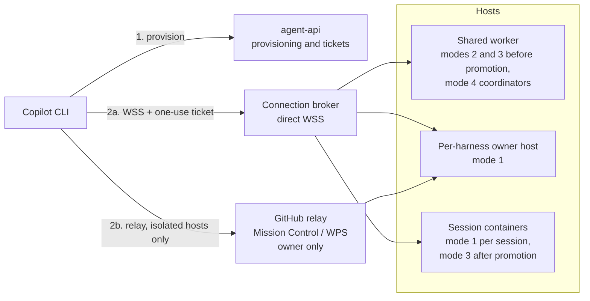
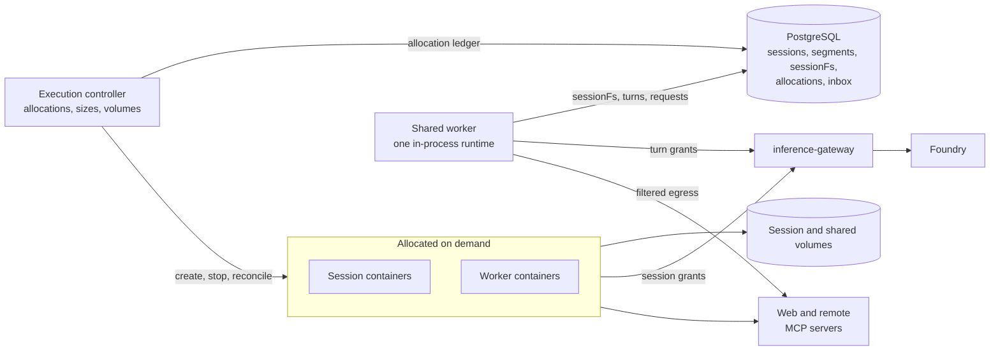
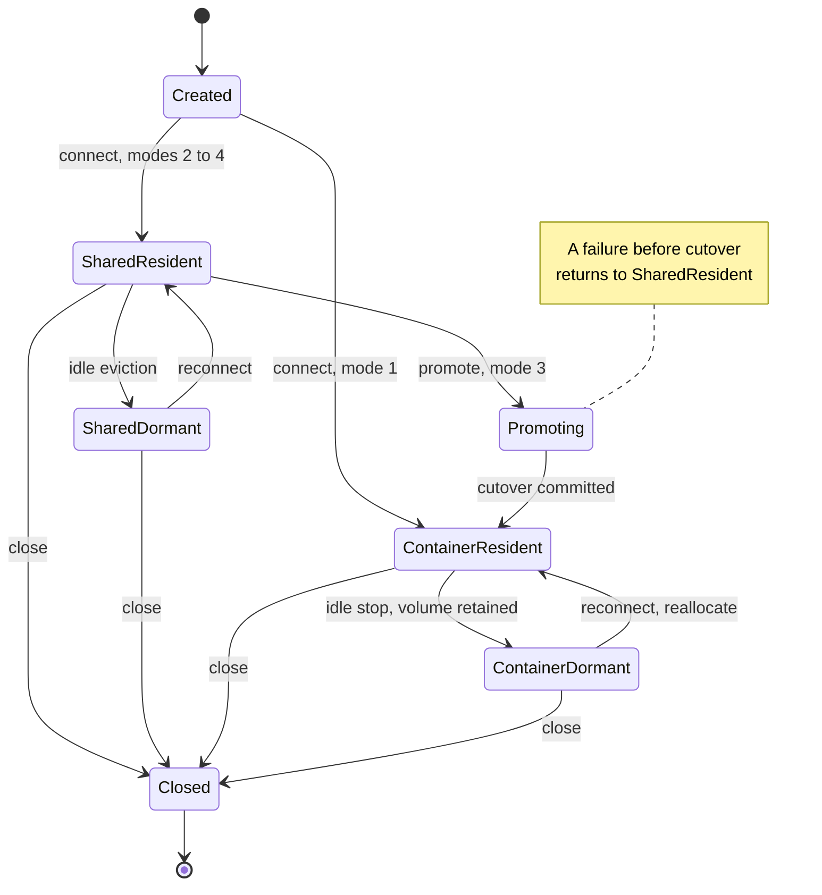
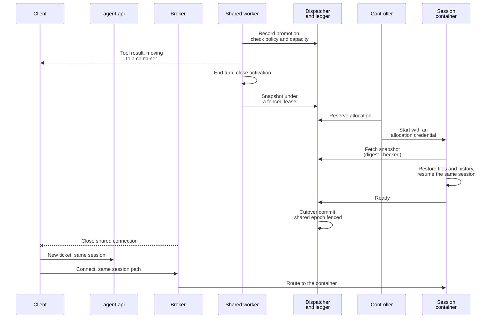

# Per-harness hosting modes plan

[Documentation hub](README.md) | [Current architecture](ARCHITECTURE.md) | [Security](SECURITY.md) | [Hybrid hosting record](HYBRID-HOSTING-PLAN.md)

Date: 2026-10-15

**Status (updated 2026-10-16): design and delivery record; stages 1 to 6 implemented locally.** Recorded before
implementation, this document owns the four-mode, per-harness hosting design, its client connection matrix, the
comparison with OpenAI's Agents API, and the gates for delivering it. Stages 1 to 6 (contracts and policy,
harness-driven shared mode, session containers and per-harness owner hosts, orchestrator workers, promotion, and
handoffs) have landed locally, with dated evidence in the [qualification record](#17-qualification-record) and a
per-stage status in [section 14](#14-delivery-sequence-and-acceptance-gates). Azure (stage 7) and the comparisons
(stage 8) remain proposals. This plan does not define current behavior:
[architecture](ARCHITECTURE.md), [API](API.md), [deployment](DEPLOYMENT.md), [security](SECURITY.md), and the
[user](USER-GUIDE.md) and [configurator](CONFIGURATOR.md) guides do. The design sections below keep their original
rationale; where the implementation differs, a status note says so and links to the evidence.

## 1. Purpose and agreed decisions

Let each conversation harness choose where its agent loop runs, from a dedicated container to a shared
multi-tenant runtime, and reach every choice from Copilot CLI over AHP. Hosting becomes a deliberate cost,
latency, and isolation decision per harness instead of one deployment-wide shape. The first delivery uses direct
WSS for every mode and keeps the GitHub relay for isolated harness hosts; the GitHub Copilot app and relay for
shared modes are later steps.

When this plan was recorded, the repository already contained the building blocks, each fixed to one
deployment-wide configuration. The last column records what the stages have changed since:

| Building block (2026-10-15) | What it proves | What it lacked then | Since then |
| --- | --- | --- | --- |
| Batch executor ([job execution](ARCHITECTURE.md#job-execution)) | The whole agent loop in a uid-isolated Linux container | Conversations or AHP attachment | Unchanged: batch harnesses still run as jobs, and conversations use the hosts below |
| Experimental `agent-host` ([architecture](ARCHITECTURE.md#optional-demo-agent-host)) | Container-hosted conversations over direct WSS and GitHub relay | More than one harness or owner per deployment; [`HostStore`](../src/job-store/src/host-store.ts) is a singleton | Stage 3: local per-harness owner hosts keyed by harness, each with its own relay environment when the relay is enabled, all under one GitHub owner per deployment; Azure keeps the single demo host |
| Local hybrid `session-host` ([architecture](ARCHITECTURE.md#local-hybrid-hosting)) | Many principals on one in-process runtime with PostgreSQL-backed `sessionFs`, attached over direct WSS with one-use tickets | Harness-driven sessions (it runs one coordinator definition built from AppHost parameters), relay, Azure | Stage 2: harness-driven, serving many harnesses through a separate connection broker; relay and Azure remain out of scope |
| `delegate_job` and `execution-controller` | Model-directed one-shot child jobs in on-demand Docker containers with retained outputs | Long-lived workers, per-task sizes, shared storage, agent-managed lifecycle | Stages 3 to 6: resumable session containers, coordinator-managed workers with sizes and a shared volume, promotion into a session container, and handoffs into a target's own container; one-shot `delegate_job` is unchanged |

Decisions agreed on 2026-10-15, including answers from two review rounds on the first draft:

| Decision | Agreed direction |
| --- | --- |
| Sequencing | Record this plan before implementation. Build and verify every mode locally before any Azure work |
| Granularity | Hosting is selected per harness, within operator policy |
| Clients | Copilot CLI first. The GitHub Copilot app is deferred |
| Transports | Direct WSS for every mode. GitHub relay for isolated harness hosts only, with one Mission Control environment per relay-enabled harness |
| GitHub relay for shared modes | Not in the first delivery. An owner-scoped relay was agreed and then withdrawn the same day: with relay, GitHub identity rather than the integrator's own principals decides who can attach, which does not suit integrator-managed multi-tenancy. Per-tenant relay in the runtime is parked |
| Shared-mode tools | Basic workspace and utility tools, web access, and remote MCP servers. How skills are defined and mounted for harnesses will be designed later |
| Permissions | Developers choose each harness's approval mode: manual, assisted (the Copilot runtime's safety judge), allow-all, or a custom handler written in code, within policy. A coordinator harness can opt in to letting its workers' judges use the session's human messages as authority |
| What a mode-4 container runs | An agent worker: its own child agent session from an approved harness, which the main agent creates, messages, monitors, and archives, as the GitHub Copilot app manages sessions. One-shot `delegate_job` remains the simple case |
| Promotion | Resume the same session inside the container, transparently to the CLI user where possible |
| Handoffs | Predefined handoff-target harnesses, plus an optional, policy-bounded ability for the main agent to craft a harness at runtime, comparable to OpenAI Agents SDK handoffs |
| Measurement | Get it working first; no performance targets until the local prototype works |
| Connection broker | A separate service, so live CLI sessions survive API restarts |
| Runtime artifacts | Local stages use the locally built, patched runtime and SDK; released artifacts are needed only for Azure and release claims |
| External comparison | Compare the design with OpenAI's Agents API ([section 12](#12-comparison-with-openais-agents-api)) |

The [decision register](#15-non-goals-and-decision-register) records every answer from the review and the items
that remain open.

The plan introduces six pieces: a per-harness `hosting` contract and policy ceilings, a harness-driven
shared worker, a resumable **session container**, a direct-WSS **connection broker**, per-harness relay
environments for isolated hosts, and coordinator tools for workers, promotion, and handoffs. Stages 1 to 6
delivered all of them locally. Handoffs start only on the shared worker; handoffs from conversations that run in a
container are a documented follow-up ([N8](#15-non-goals-and-decision-register)).

## 2. The four modes

| # | Mode (`hosting.mode`) | Where the main loop runs | Files | Containers | Intended use |
| --- | --- | --- | --- | --- | --- |
| 1 | `isolated`: isolated container (default) | Entirely inside a dedicated Linux container | Real filesystem in the container | One per host or session | Coding, shell, untrusted or long-running work; the most isolated choice |
| 2 | `shared`: shared runtime | One in-process runtime shared by many sessions and principals | `sessionFs` only (PostgreSQL); no shell or host filesystem | None | Chat and utility agents that work through web access, remote MCP servers, and virtual files |
| 3 | `promotable`: shared with one-way promotion | Starts as mode 2; on promotion the loop moves into a dedicated container | `sessionFs`, then a real filesystem seeded from it | One, after promotion | A cheap start with an escape hatch for real-filesystem or longer work |
| 4 | `orchestrator`: shared brain, container workers | Coordinator on the shared runtime; each worker runs its own loop in a container | Coordinator: `sessionFs`; workers: real filesystem plus an optional shared session volume | Many, sized and managed by the coordinator | Parallel or heterogeneous work with low-cost coordination |

`isolated` is the default: a harness without a `hosting` block keeps today's behavior and digest.
Modes 2 to 4 trade isolation for density and startup latency. Shared placement is application-level isolation
inside one process, not an operating-system or hostile-code boundary; see
[security boundaries](#10-security-boundaries-and-claims). "Isolated" describes where the loop runs, not
complete confinement: egress is not enforced in any mode today ([known gaps](SECURITY.md#known-gaps)).

A harness has one mode. Promotion and handoff change where a **session** runs, never the harness's declared
mode. The platform never moves a session between placements on its own initiative.

### Vocabulary

| Term | Meaning |
| --- | --- |
| Placement | Where a session's loop runs now: `shared` (in-process on a shared worker) or `container` |
| Application session | The durable conversation identity owned by the application; it survives promotion and handoff |
| Segment | A period of one session with one harness snapshot at one placement; promotion and handoff start a new segment |
| Session container | A dedicated, resumable container that runs one session's loop on a real filesystem with a retained volume |
| Worker | A session container started by a mode-4 coordinator for a child agent session; no client ingress initially |
| Promotion | The one-way move of a mode-3 session from shared to container placement |
| Handoff | A transfer of conversation control to another harness |
| Crafted harness | A harness definition an agent composes at runtime from an operator template; validated like a published harness and never published automatically |
| Transport | **GitHub relay** (Mission Control and WPS; the "GitHub-managed path") or **direct WSS** (the "Azure WSS path" in Azure, loopback locally) |
| Inference route | **Managed** (application gateway to Foundry) or **GitHub-native** (Copilot inference, permissions, and billing) |

Transport and inference route are independent. Shared placement uses the managed route: the shared runtime runs
with the managed factory profile so that AHP identity does not replace the application's inference settings
([hybrid runtime qualification](DEVELOPER-GUIDE.md#hybrid-runtime-qualification)). Per-user Copilot inference on a
shared runtime is outside this plan. GitHub-native inference remains an isolated container profile, with the
harness and budget limitations described in [experimental host boundaries](SECURITY.md#experimental-host-boundaries).

One new primitive serves three modes: the **session container**. Mode 1 can start a session in one, mode 3
moves a session into one, and mode 4 starts workers in them. It generalizes the controller's one-shot job
allocation into a resumable per-session allocation with a retained volume.

## 3. Per-harness configuration

The harness requests a mode, the effective operator policy grants it, and the deployment must provide the
required hosts and transports. A mode that policy does not allow is rejected during validation and admission.
A mode that is allowed but not deployed is reported as unavailable with its concrete prerequisite. There is no
fallback to another mode.

Illustrative harness block. Stage 1 implemented these fields with the names shown; [`harness.ts`](../contracts/src/harness.ts)
and [`profile.ts`](../contracts/src/profile.ts) own their bounds and defaults, and the
[developer guide](DEVELOPER-GUIDE.md#hosting-approval-mode-and-remote-mcp-fields) explains where each rule lives:

```jsonc
{
  "interaction": "conversation",
  "builtinTools": ["files", "web"],
  "mcpServers": [{ "server": "docs-search", "tools": ["search", "fetch_page"] }],
  "permissions": { "default": "ask", "kinds": { "url": "allow" }, "approvalMode": "assisted" },
  "hosting": {
    "mode": "orchestrator",
    "workers": {
      "harnesses": ["repo-analyst", "test-runner"],
      "sizes": ["small", "medium"],
      "maxConcurrent": 4,
      "maxPerSession": 12,
      "sharedStorage": "session",
      "humanAuthority": "inherit",
      "crafting": { "template": "general-worker" }
    },
    "handoffs": [
      { "harness": "coding-agent", "description": "Changes that need a real checkout", "history": "summary" }
    ]
  }
}
```

| Field | Modes | Meaning |
| --- | --- | --- |
| `hosting.mode` | All | `isolated` (default), `shared`, `promotable`, or `orchestrator` |
| `hosting.promotion.size`, `hosting.promotion.approval` | `promotable` | Container size after promotion; whether a model-initiated promotion needs a person (`ask`) or is automatic (`allow`) |
| `hosting.workers.harnesses` | `orchestrator` | Published conversation harnesses, each with effective mode `isolated`, that may run as workers |
| `hosting.workers.sizes`, `maxConcurrent`, `maxPerSession` | `orchestrator` | Requested subset of operator sizes and concurrency, narrowed by policy |
| `hosting.workers.sharedStorage` | `orchestrator` | `none` or `session` (one volume shared by that session's workers) |
| `hosting.workers.humanAuthority` | `orchestrator` | `none` (default) or `inherit`: whether workers' assisted-approval judges may use this session's human messages as authority ([details](#inherited-human-authority)) |
| `hosting.workers.crafting.template` | `orchestrator` | Optional operator crafting template; omitting it disables crafted workers |
| `hosting.handoffs[]` | All conversation modes | Predefined targets, each with a description, a history policy (`full`, `summary`, or `none`), and an optional `approval` (`ask` or `allow`) |
| `mcpServers[]` (new) | All | Remote MCP servers from the operator's catalog, with the tools this harness requests |
| `permissions.approvalMode`, `judgeModel`, `handler` (new) | All | The session's [approval mode](#approval-modes), an optional judge model for `assisted`, and the registered handler for `custom` |

Validation rules:

- Modes 2 to 4 require `interaction: "conversation"`. Batch harnesses keep executor semantics; running batch
  jobs on shared placement is outside this plan.
- Shared placement cannot run `shell`, `python`, or local (stdio) MCP tools, which need a process and real files.
  `shared` rejects them, `promotable` activates them only after promotion, and `orchestrator` reaches them
  through workers. A `kind: "host"` binding runs in the shared worker only if its execution profile marks it
  safe for in-process use (a new profile field). Remote MCP servers work in every placement.
- The `files` group maps first to provider-backed workspace tools. SDK built-in file tools over `sessionFs` need
  separate qualification.
- `web` is available in shared placement when the harness requests it and policy allows it; the default policy
  allows it. Requests leave from the shared worker, which can reach PostgreSQL, internal services, and cloud
  metadata endpoints. The worker therefore refuses loopback, private, link-local (including metadata), and
  internal service addresses and rechecks every redirect. Locally this is an in-process filter; in Azure an
  egress proxy sits in front of the worker. The runtime's managed `limitTo` host allowlist is a candidate addition.
- Remote MCP servers use one service credential each, held as an operator secret reference and resolved by the host
  process. The model never sees it, and a harness can request only servers and tools in the operator's catalog.
  Per-user sign-in (OAuth on behalf of each caller) is needed for some servers and comes in a later phase.
- How skills are defined and mounted for harnesses, including in shared placement, will be designed later. This
  plan does not change today's inline `skills`.
- `promotion` is valid only with `promotable`, and `workers` only with `orchestrator`. A handoff target must be
  a published conversation harness whose own mode is allowed; it cannot be the source harness.
- New fields are part of the digest when present. Omitting them keeps existing digests, following the
  optional-field convention in [`harness.ts`](../contracts/src/harness.ts).

### Approval modes

Developers choose the approval mode in each harness or in the application's configuration, and operator policy
decides which modes are allowed. The modes follow the Copilot runtime's session permission modes, plus a handler
written in code. Today's per-kind `deny`, `ask`, and `allow` rules in
[`PermissionsConfig`](../contracts/src/harness.ts) still run first, and `deny` always wins. The approval mode
decides what happens to a request that would otherwise prompt a person:

| Mode | Behavior | Runtime mapping |
| --- | --- | --- |
| `manual` (default) | A person decides, through the attached client or an API request queue | `manual` |
| `assisted` | The runtime's Assisted Permissions: an LLM safety judge either approves the request or requires approval. Only human messages grant authority; errors and mandatory confirmations require approval. When nobody can be asked, the action does not run | `assisted`, with an optional `assistedApprovalModel` |
| `allow-all` | Requests are approved automatically | `allow-all` |
| `custom` | The integrator's handler, written in code and registered by name like a tool binding, approves, denies, or asks a person | The host's `onPermissionRequest` calls the handler |

Evidence (runtime revision `0a32c39595f`): the SDK's `session.permissions.setMode` accepts `manual`, `assisted`, or
`allow-all` with an optional judge model. Managed session permissions can disable assisted mode or allow-all, and an
AHP host can advertise `availableApprovalModes`, which the CLI respects when a user switches modes. The runtime's
assisted-permissions contract describes the judge as "probabilistic guidance that reduces prompts, not a hard
security boundary."

Consequences for this plan:

- Policy maps to the runtime's managed settings and to the modes each host advertises. An attached CLI user can
  switch only among the modes the harness and policy allow, as in the normal Copilot CLI.
- In managed sessions the judge model defaults to the session's model, so judge calls go through the gateway and
  count against the session's budget. A `judgeModel` must be an allowed model.
- For workers, the judge's authority rule matters: a worker's instructions come from its coordinator, a model, so
  they carry no human authority. Unless the coordinator harness opts in to
  [inherited human authority](#inherited-human-authority), assisted workers send most requests to a person. The
  coordinator never approves a worker's permissions.
- Custom handlers are integrator code, reviewed and packaged like tool implementations; a harness selects one by
  name and cannot embed code. Hosted conversations are TypeScript-only, so extending custom handlers to batch jobs
  would also require a Python implementation.

### Inherited human authority

A coordinator harness can let its workers' assisted-approval judges treat the session's human messages as
authority by setting `hosting.workers.humanAuthority: "inherit"`. Effective policy must also allow it. The harness
author decides whether workers may act on the person's instructions without prompting; the operator sets the
ceiling. It is off by default.

When enabled:

- The platform, not the coordinator, supplies the authority: the human messages recorded in the coordinator
  session, exactly as sent and attributed to that session's principal. Text in `create_worker` or `send_to_worker`
  arguments stays data, so the coordinator cannot invent or paraphrase authority.
- The worker's judge evaluates each request against those messages. A request covered by what the person asked for
  can run without a prompt; a request that only the coordinator asked for still goes to a person.
- Per-kind rules, `deny`, mandatory confirmations, and the runtime's limits on authority-message size apply as
  usual. A human message above the judge's size limit sends the request down the ordinary approval path.
- The inherited messages are recorded alongside the worker's judge outcomes for audit.
- Only `assisted` workers are affected; `manual`, `allow-all`, and `custom` workers behave as configured.

This needs a runtime capability: accepting platform-supplied human authority for a session's judge, marked as
inherited. The runtime branch adds it as `setInheritedHumanAuthority` ([runtime capabilities](#runtime-capabilities)),
and the stage-4 gate verified it ([record](#stage-4-orchestrator-workers)). A deployment whose worker containers do not
advertise the `inherited-authority` feature refuses a harness that sets `inherit` (`hosting_unavailable`) rather than
silently running it without the capability. Inheritance widens what workers may do without asking, but only within
the person's own words, and the judge remains guidance rather than a security boundary.

Illustrative operator policy additions, overridable per harness through the existing
[`HarnessPolicyOverride`](../contracts/src/profile.ts) mechanism:

```jsonc
{
  "approvalModes": ["manual", "assisted", "allow-all", "custom"],
  "permissionHandlers": ["acme-approvals"],
  "mcpServers": {
    "docs-search": {
      "url": "https://mcp.example.com/docs",
      "auth": { "secret": "docs-search-token" },
      "tools": ["search", "fetch_page"]
    }
  },
  "hosting": {
    "modes": ["isolated", "shared", "promotable", "orchestrator"],
    "transports": ["direct", "github"],
    "sizes": {
      "small":  { "cpus": 0.5, "memoryMiB": 1024 },
      "medium": { "cpus": 1,   "memoryMiB": 2048 },
      "large":  { "cpus": 2,   "memoryMiB": 4096 }
    },
    "workers": { "maxConcurrentPerSession": 4, "maxPerSession": 16, "maxPerPrincipal": 8, "idleSeconds": 900, "maxLifetimeSeconds": 3600, "allowInheritedAuthority": true },
    "promotion": { "approval": ["ask"] },
    "crafting": {
      "templates": {
        "general-worker": {
          "toolBindings": [], "builtinTools": ["files", "shell"], "models": ["<approved model>"],
          "approvalModes": ["manual"], "maxDurationSeconds": 1800, "sizes": ["small"]
        }
      }
    }
  }
}
```

The `github` transport applies only to isolated harness hosts in the first delivery.

Sizes map to Docker CPU and memory locally, within the existing
[`ExecutionContainerSettings`](../contracts/src/artifacts.ts) bounds, and to combinations the selected Azure
backend accepts. The model chooses a size by name only. It never supplies images, commands, mounts, or
infrastructure arguments. A session keeps its admitted snapshot; promotion, worker creation, and handoff recheck
the current effective policy, so narrowing policy blocks new containers without stopping existing ones.

The configurator gained, in stage 1, a **Hosting** tab in the harness editor (mode cards, mode-specific fields,
validation against effective policy), hosting ceilings on the **Policy** page, and per-harness rows on the existing
[Hosting page](CONFIGURATOR.md#hosting-and-topology) showing the host, available transports, and connection
actions ([configurator](CONFIGURATOR.md#hosting-approvals-and-remote-mcp)). Unavailable combinations stay disabled
and name their prerequisite, as they do elsewhere.

## 4. Topology

The first diagram shows how clients reach a session; the second shows where shared and on-demand sessions run and
keep state.





The diagrams show every component of the design, as recorded before implementation; a deployment includes only the
hosts its harnesses' modes need. All of these components now run locally (stages 2 to 5); the Azure pieces, such as
outbound tunnels from containers and an egress proxy, are not shown and not implemented. The implemented flows,
which the [architecture](ARCHITECTURE.md#local-hybrid-hosting) maintains, are the current reference.
Arrows are application traffic, not a network allowlist. The per-harness owner host keeps the existing host's
retained volume and its managed or GitHub-native inference routes, shown in the
[optional demo agent host](ARCHITECTURE.md#optional-demo-agent-host) diagram.

| Host shape | Serves | Tenancy | Client transports | Status |
| --- | --- | --- | --- | --- |
| Per-harness owner host (container) | Mode 1 for one owner and one harness | One GitHub owner | Relay, direct, or both | Implemented locally in stage 3: one host per listed isolated harness, all sharing the deployment's GitHub owner; Azure keeps the single deployment-wide `agent-host` |
| Session container | Mode 1 per session; mode 3 after promotion | One application session | Direct through the broker | Implemented locally in stages 3 and 5, and as a handoff target in stage 6 |
| Shared worker | Mode 2, mode 3 before promotion, mode-4 coordinators | Many principals | Direct through the broker | Implemented locally: harness-driven in stage 2, coordinators in stage 4, promotion in stage 5, handoffs in stage 6 |
| Worker container | Mode-4 workers | One coordinator session | None initially; the coordinator mediates control | Implemented locally in stage 4, without client attachment |

The **connection broker** gives direct-WSS clients one stable endpoint and path per application session
(`/sessions/{id}`). It consumes one-use tickets and routes bytes to the session's current placement without
interpreting AHP, reusing the existing [proxy pattern](../src/service-defaults/src/ahp-proxy.ts). Before this plan,
the container host and the shared worker each terminated their own direct connections. Stage 2 added the broker as
a separate local service, stage 3 added session-container routes and a `/hosts/{harness}` route family for owner
hosts, and stage 5 relies on it so that a promoted session keeps its URL
([architecture](ARCHITECTURE.md#local-hybrid-hosting)). Without hybrid mode, agent hosts still terminate their own
direct connections. In Azure it would also receive the outbound tunnels from session containers (D14), which are not
implemented.

Where the broker runs, compared:

| Concern | Inside `agent-api` | Separate broker service |
| --- | --- | --- |
| Restarts and deployments | Every API restart, including the configurator's **Reload harnesses**, drops every attached CLI | API restarts and harness reloads leave CLI connections up |
| Container tunnels | Long-lived tunnels and the client streams paired with them must land on the same API replica | Can stay single-replica, or add tunnel-aware routing, without changing the API |
| Privilege | Shares a process with caller API keys, admission, and database access | Verifies tickets and resolves placement through an internal dispatcher route, as today's host proxy does, without caller keys or database credentials |
| Moving parts and cost | No new service | One more small, always-on service and ingress endpoint |
| Client setup | Same host name as the API | Unchanged: the API returns the broker URL in the connection response |

**Decision: a separate broker service** (confirmed in the second review round). Live CLI sessions should not depend
on the API process, which the configurator restarts on every harness reload. The cost is one small service.

## 5. Client connections

The first delivery targets Copilot CLI. The GitHub Copilot app is deferred and will be qualified separately.
Status as of stage 5; the [user guide](USER-GUIDE.md#demo-agent-host) owns the current launcher paths:

| Mode | CLI, direct WSS, local | CLI, direct WSS, Azure | CLI, GitHub relay |
| --- | --- | --- | --- |
| `isolated` | Implemented per harness in stage 3: per-harness owner hosts and per-session containers, through the broker in hybrid mode, on the locally built runtime | Exists for the single demo host only, behind its [compatibility gate](DEPLOYMENT.md#demo-host-compatibility-gate); owner hosts and session containers are local only | Implemented locally per relay-enabled owner host in stage 3, one environment each; the GitHub-native demo host, with [client eligibility](DEPLOYMENT.md#github-native-client-eligibility), also in Azure |
| `shared` | Implemented per harness in stage 2 | Proposed (stage 7) | Not in the first delivery; refused with `transport_unsupported` |
| `promotable` | Implemented in stage 5: the broker closes the shared route and the launcher reconnects to the container | Proposed; needs Azure container reachability | Not in the first delivery |
| `orchestrator` | Implemented in stage 4: the coordinator as `shared`; workers not attachable | Proposed, as `shared` | Not in the first delivery |

Client flows, implemented locally in stages 2 and 3:

- **CLI over direct WSS.** `pnpm host:connect --harness <name> --transport direct --target local|azure [--resume <session>]`
  creates or resumes the session through the API, receives `{ url, token, expiresAt, serverKey, ahpSessionId }`,
  pins the server key with `COPILOT_AHP_SERVER_KEY`, and starts
  `copilot --experimental --ahp <url> --resume <ahpSessionId>`, with GitHub authentication consent where the host
  requires it. This generalizes the earlier [`--destination`](../configurator/server/connect-host.ts) launcher, which
  still works (`--destination shared` selects the `hybrid-coordinator` harness). Tickets stay one-use and short-lived.
  The `--harness` paths accept only `--target local` so far. Since stage 5 the launcher supervises the CLI and
  restarts it in the same terminal when the session moves, and since stage 6 it also resumes the new segment's
  `ahpSessionId` after a handoff.
- **CLI over GitHub relay (isolated harnesses).** The same launcher returns the harness host's environment ID and
  runs `copilot --experimental --relay --environment-id <id> [--resume <ahpSessionId>]`. Each relay-enabled
  harness registers one environment, and its sessions appear in that environment's catalog.

API changes extend the existing [shared conversation routes](API.md#experimental-shared-conversations) instead of
adding a parallel family; [API](API.md) owns the routes as implemented:

| Route | Change | Status |
| --- | --- | --- |
| `POST /v1/sessions` | Accept `{ harness, label }`; respond with mode, placement, and current segment | Implemented in stage 2, with an optional `version` |
| `POST /v1/sessions/{id}/connection` | Accept `{ transport }`; return direct material or, for isolated hosts, a relay environment ID, plus the current `ahpSessionId` | Implemented for direct WSS in stages 2 and 3. Deviation: an owner host's material, including its relay environment ID, comes from the host route `POST /v1/hosts/{harness}/connection`, because clients create an owner host's sessions on the host ([stage 3](#stage-3-per-harness-owner-hosts-and-relay)) |
| `POST /v1/sessions/{id}/promote` | Caller-initiated promotion of a `promotable` session; idempotent | Implemented in stage 5 |
| `GET /v1/sessions/{id}/workers` | Mode-4 workers with state, size, usage, and timestamps | Implemented in stage 4, with worker definition and input-request routes |
| `POST /v1/sessions/{id}/close` | Existing; additionally stops workers and retires session containers | Implemented in stages 3 and 4 |
| `GET /v1/sessions/{id}/handoffs` | Not in the original list: the session's handoffs and their outcomes | Added in stage 6 |

Unsupported combinations return explicit errors, such as `hosting_mode_not_allowed`, `hosting_unavailable`
(naming the missing host or transport), `transport_unsupported` when a shared-family session requests the GitHub
path, and `relay_owner_only` when a principal other than an isolated host's owner requests it. Stage 1 implemented
them with `transport_not_allowed` and `policy_rejected` ([hosting views](API.md#hosting-views)).

### GitHub relay identity

Relay registration uses the hosting runtime's own GitHub identity. In reviewed runtime source (revision
`0a32c39595f`, `supervised_host.rs`), the host resolves environment credentials from its owning runtime context
before registering, and `HostGitHubEnvironmentOptions` carries only a name, a compute ID, and a binding flag.
One runtime can therefore register environments for one account, and GitHub identity, not the integrator's
principals, decides who can attach through them. That fits a single-owner host but not a multi-tenant one:

- **Isolated harness hosts** keep relay: each relay-enabled harness host registers one environment under its owner's
  account, extending the existing `demo-host-owner` settings and owner verification.
- **Shared-runtime modes** (`shared`, `promotable`, `orchestrator`) use direct WSS only in the first delivery,
  where the application's own principals and one-use tickets control access.
- **Per-tenant relay** would need per-host relay credentials in the runtime. It is parked until there is a concrete
  need, and it is not a reason to run one runtime per user.

If relay for shared modes returns, two questions recorded in the review reopen: whether the owner credential on the
shared runtime changes tenant authentication or managed inference, and whether one relay host can publish many
sessions while routing each file request to the right session's storage.

## 6. Session lifecycle



No transition leaves container placement for shared placement. Idle eviction and idle stop retain state.
Closing prevents new turns and, for mode 4, stops workers. Disconnecting a client changes none of these states.

As implemented in stages 2 to 6, the ledger records each session's placement (`shared` or `container`, marked
`moving` while a promotion, or a handoff's move into a container, is open) with a generation that only increases, and
each move or handoff records a segment. Session containers follow the [container states](ARCHITECTURE.md#session-containers),
promotions follow the [promotion states](ARCHITECTURE.md#promotion), handoffs follow
[their own states](API.md#handoffs), and a ledger trigger refuses any return to `shared` placement.

A handoff starts a new segment instead of changing placement in place. The target harness's mode decides the
new placement: a `shared` triage harness that hands off to an `isolated` coding harness moves the conversation
into a session container with the target's instructions and tools.

## 7. Mode details

### 7.1 Mode 1: isolated container

**Status: implemented locally in stage 3** ([session containers](#stage-3-session-containers),
[owner hosts](#stage-3-per-harness-owner-hosts-and-relay)). [Architecture](ARCHITECTURE.md#session-containers) and
[deployment](DEPLOYMENT.md#per-harness-owner-hosts) describe current behavior. Limitations the records show: session
containers and agent hosts implement none of the harness hosting features (remote MCP, approval modes other than
`manual`, custom handlers, or handoffs); a session container uses the policy's default size, because isolated hosting
has no per-harness size field; containers enforce the aggregate token budget and the turn deadline but no per-turn
budget; all owner hosts share one GitHub owner and owner credential per deployment; and Azure keeps the single demo
host.

Keep the existing container host as the qualified starting point, then remove its deployment-wide singletons:

- Key host ownership, leases, and connection tickets by harness and owner instead of the single `demo_host` row.
  Each isolated harness a deployment exposes gets its own host resource, data root, and, when relay is enabled for
  it, one Mission Control environment. Each such host is always-on compute, and the configurator must show that
  cost per harness.
- Add per-session containers for multi-tenant direct use. The controller allocates a session container when a
  session connects, stops it after the idle period, and reallocates it from the retained volume on reconnect.
  This is the strongest separation between sessions and has no idle compute, at the price of cold starts.
  Per-session containers are reachable over direct WSS through the broker only.
- Keep the managed and GitHub-native inference routes distinct. GitHub-native mode applies neither harness
  restrictions nor Foundry budgets, so a harness's mode never selects it implicitly.
- Existing gates still apply to released artifacts: the managed
  [compatibility gate](DEPLOYMENT.md#demo-host-compatibility-gate), Azure Files
  [storage and revision requirements](DEPLOYMENT.md#storage-and-revision-requirements), and relay client eligibility.
- Local stages use the locally built, patched runtime instead of waiting for a release, as the hybrid path already
  does. The host's `agent-host-runtime` image stage already accepted local `copilot-runtime` and `runtime.node`
  artifacts, and stage 3 made the two remaining changes: the image installs the bundle's matching SDK in place of the
  published one, and the AppHost builds that stage for the bundle's own architecture, so a native ARM64 bundle is not
  emulated. Record the runtime revision and artifact hashes with every result. Azure and any release claim still
  need released, qualified artifacts.

### 7.2 Mode 2: shared runtime

**Status: implemented locally in stage 2** ([shared mode](#stage-2-harness-driven-shared-mode) and its
[assisted-approval follow-up](#follow-up-assisted-approvals-without-host-injected-flags),
[egress and remote MCP](#stage-2-shared-placement-egress-and-remote-mcp)). [Architecture](ARCHITECTURE.md#local-hybrid-hosting)
and [shared conversation approvals](SECURITY.md#shared-conversation-approvals) describe current behavior; the base
tool names are `SHARED_TOOLS` in [`shared.ts`](../contracts/src/shared.ts), implemented in
[`tools.ts`](../src/session-host/src/tools.ts) and [`toolkit.ts`](../src/session-host/src/toolkit.ts). Deviations
the records show: with nobody attached, a request that the `assisted` judge declines waits for a person until the
turn deadline instead of failing at once, because the worker's handler keeps the default no-result fallback (a
rejecting fallback pre-empted an attached person's approval in the CLI gate); the approval modes need runtime
`d89cfe45b29` (host `006b030`) or later, whose assisted approval sits behind the experimental `AUTO_APPROVAL` flag
that the worker sets in its own process, and activation refuses a session whose approval mode the runtime will not
hold (`409 hosting_unavailable`); and the runtime's `limitTo` host allowlist (N3) was not evaluated.

Make the existing shared worker harness-driven:

- Replace the AppHost-defined `SharedSessionDefinition` ([`shared.ts`](../contracts/src/shared.ts)) with the
  admitted harness snapshot and effective policy. Instructions, prompt mode, model options, skills, sub-agents,
  limits, and permissions come from the harness. The existing turn scheduler, token reservations, idle eviction,
  and lease fencing remain.
- Apply the tool rules in [section 3](#3-per-harness-configuration). A shared session gets a base
  set for utility and chat work: read, write, edit, list, and search files in `sessionFs`; web fetch through the
  filtered egress path; remote MCP tools from the operator's catalog; a task list kept in session storage; questions
  to the user when the harness enables them; and in-runtime sub-agents. Final tool names belong in the contracts.
  Shared hosting is TypeScript-only because it uses the in-process Node SDK; batch runner parity is unaffected.
- Apply the harness's [approval mode](#approval-modes). With `manual`, approvals and questions go to the attached
  AHP client, as the managed container host does today
  ([`hostPermissionHandler`](../src/harness-hosting/src/hosted-policy.ts) returns no result so the participant owns
  the prompt). The application never fabricates approval. When this plan was written, the fixed coordinator rejected
  every permission request; stage 2 replaced it with the example harness `hybrid-coordinator`, which follows its
  harness's approval mode like any other shared harness.
- Serve many harnesses from one worker, with per-harness resident-session and active-turn limits so one harness
  cannot starve the others.

### 7.3 Mode 3: promotable ("page fault" to a container)

**Status: implemented locally in stage 5** ([record](#stage-5-promotion)). The implemented flow is maintained in the
[architecture](ARCHITECTURE.md#promotion), with the [API](API.md#promotion) and
[boundaries](SECURITY.md#promotion-boundaries). Deviations from the design below that the record shows: the broker
closes shared clients when the move begins, not after the cutover as the diagram shows; the snapshot leaves out the
runtime's provider-scoped consent files and spilled tool output (`temp/`); continuity relies on the launcher's
supervisor (the first step of N5) with no per-session host key, so a restarted CLI may ask for folder trust again
and clients without the launcher reconnect themselves; `approval: "ask"` reaches a person only under the `manual`
approval mode, and how other modes decide it is not separately verified; and no retention period is configurable,
so nothing deletes the shared namespace or stored snapshots automatically.

The agent calls `promote_session` when it needs a real filesystem, a shell, packaged tools, or more time.
A caller can also promote through the API. With `approval: "ask"`, the attached person approves first.
Promotion is idempotent per tool call and one-way.



Cutover rules:

1. **Before cutover**, the shared placement remains authoritative and admits no new turns while promotion is in
   progress. Any failure in policy, capacity, snapshot, allocation, startup, or resume leaves the session shared
   and accepting turns again, releases the allocation, and returns an error to the agent or caller.
2. **The cutover commit** changes the placement to `container` and fences the shared storage lease epoch in one
   transaction. The shared runtime can no longer write the session. No route demotes it.
3. **After cutover**, the container is authoritative. If it fails, the controller reallocates from the retained
   volume. Interrupted turns are not replayed automatically (`continuePendingWork: false`); the agent receives a
   system continuation that explains the move.

The snapshot contains runtime history and workspace files from the session's `sessionFs` namespace, read under a
fenced lease after the turn ends, and bounded by the existing session storage limits. The container receives an
allocation-scoped credential that can fetch only that snapshot and request inference grants for that session.
It holds no database, Docker, signing, or Foundry credential. After cutover the shared namespace stays read-only
for the configured retention period, then the operator's retention process deletes it.

The decisive technical gate is **history transplant**: resuming the same runtime session ID on a
real-filesystem runtime from history written through `sessionFs`. The review expects this to work; the stage-5
spike must show it on the pinned runtime. The runtime fences resume on the workspace path (see the Windows
path-spelling fix in the [qualification record](HYBRID-HOSTING-PLAN.md#13-qualification-record)), so the session
container must use the shared anchor's absolute workspace path, or the runtime needs an explicit workspace-rebase
option on resume. A Windows-hosted shared worker cannot promote into a Linux container until that is resolved; the
Linux shared-worker image avoids the mismatch. If the transplant cannot be qualified, the alternative is an
explicit handoff to a fresh session seeded with the transcript and files. That would be a recorded design change,
never a silent fallback.

The stage-5 spike settled this (T2): the runtime resumes the same session at a different absolute path, including
from a Windows-hosted shared worker into a Linux container, with no rebase option. The history keeps the old
paths, so the container sends one move note that maps them, and file names keep the spelling they were created
with even where Windows storage keys are case-folded ([record](#stage-5-promotion),
[runtime capabilities](#runtime-capabilities)).

**Client continuity.** The review asked for promotion to be transparent to the CLI user. When this plan was written
it was not: the reconnect qualification ([`shared-cli.test.ts`](../tests/integration/shared-cli.test.ts)) starts a
new CLI process with a fresh ticket and the new host's server key. A seamless move needs three things:

1. The CLI reconnects on its own when the broker closes the connection with a "moved" reason, instead of exiting.
2. It gets fresh connection material without the user rerunning the launcher, through a CLI provisioning hook or
   a session-bound reconnect credential that the broker accepts once per placement change.
3. Its server-key pin stays valid. The promoted container's runtime has a different key, so either the application
   issues a per-session host key that moves with the session (a runtime change to accept an application-provided
   key), or the CLI accepts a key update delivered through trusted provisioning.

Until those exist, the launcher can supervise the CLI: on a "moved" close it provisions the new placement and
restarts the CLI with `--resume`, so the conversation replays in the same terminal. Stage 5 implemented this
supervision ([`cli-supervisor.ts`](../configurator/server/cli-supervisor.ts)), which also restarts the CLI when a
new ticket carries another server key, as after a container crash; none of the three CLI-side changes exists yet
(N5). Promotable sessions are direct-WSS only, so relay continuity does not arise in the first delivery.

### 7.4 Mode 4: orchestrator (shared brain, container workers)

**Status: implemented locally in stage 4** ([record](#stage-4-orchestrator-workers)).
[Architecture](ARCHITECTURE.md#orchestrator-workers), the [API](API.md#orchestrator-workers), and
[worker boundaries](SECURITY.md#orchestrator-worker-boundaries) describe current behavior. Deviations from the
design below that the record shows: worker requests that need a person go only to the principal-scoped API request
queue, never to the coordinator's attached client as prompts; the coordinator also has `answer_worker_question`, for
questions only and only when policy sets `allowCoordinatorAnswers`; `wait_for_workers` exists but asks the model to
end its turn, because a tool cannot end one; a stopped worker cannot be resumed, and archiving releases its volumes
for operator retention rather than discarding them; and the shared file service starts one helper container per
operation, with no locking between writers.

The coordinator is a mode-2 session with worker tools. Workers are child application sessions, each running a
listed worker harness or a crafted harness in its own session container. The coordinator decides how many
workers to start, which sizes to use, what each does, and when to clean up. The platform enforces ceilings and
backstops rather than scheduling the work itself.

| Coordinator tool | Behavior | GitHub Copilot app analogue | OpenAI Agents API analogue |
| --- | --- | --- | --- |
| `create_worker` | Start a worker from a listed harness or crafting template with a size, name, mounts, and first task; returns immediately | Create a session | `create_subagent_call` |
| `send_to_worker` | Durable message: `immediate` steers at the next turn boundary; `enqueue` waits for current work | Send a session message | `send_subagent_input_call` |
| `get_worker`, `list_workers` | State (`starting`, `working`, `idle`, `needs_input`, `stopped`), latest result, usage, and container time | Session status | Session event stream |
| `interrupt_worker` | Abort the worker's current turn | Abort a turn | `interrupt_subagent_call` |
| `archive_worker` | Stop the container and release capacity; keep or discard its private volume per policy | Archive a session | None documented |
| `list_shared_files`, `read_shared_file`, `write_shared_file` | Bounded access to the session's shared volume | None | Shared environment filesystem |
| `delegate_job` | Existing one-shot batch child with input snapshot and output artifacts | None | None |

Rules:

- **No polling inside turns.** Worker completion, idle, failure, and input requests go to the coordinator's
  durable inbox and are delivered as bounded continuations, reusing the existing completion pump. A
  `wait_for_workers` tool, if added, ends the turn instead of holding it open.
- **Sizes and concurrency.** The coordinator chooses a size per worker from the effective subset. Admission counts
  starting, running, and retiring allocations per session, principal, and deployment, as the
  [allocation ledger](../src/job-store/src/allocations.ts) already does for one-shot jobs.
- **Shared storage.** With `sharedStorage: "session"`, workers mount one per-session volume read-write or
  read-only, and each worker also has a private volume. The coordinator has no real filesystem and reaches the
  shared volume only through bounded application tools. Concurrent writers get no locking beyond filesystem
  semantics, so instructions should assign separate directories.
- **Approvals.** Each worker harness's [approval mode](#approval-modes) decides its requests, and the coordinator
  never approves a worker's permissions. With `manual`, requests go to a person: through the coordinator session's
  attached client or, when nobody is attached, through a principal-scoped API request queue modeled on the job
  [approvals and questions](API.md#approvals-and-questions) routes. With `assisted`, the runtime's judge decides
  first, but the coordinator's instructions are not human authority, so most requests still reach a person unless
  the coordinator harness enables [inherited human authority](#inherited-human-authority). `allow-all` and `custom`
  behave as in any other harness. Policy may let the coordinator answer a worker's questions.
- **Backstops.** Idle timeout, maximum lifetime, per-session caps, an aggregate token budget across the
  coordinator and its workers, workers stopping when the coordinator closes, and controller orphan
  reconciliation. Container time is recorded per worker for cost attribution.
- **Depth one.** Workers cannot create workers, delegate jobs, or hand off in the first delivery.
- **No client attachment to workers initially.** Observing or steering a worker directly from the CLI needs worker
  ingress or a tunnel and is future work.

### 7.5 Handoffs and crafted harnesses

**Status: handoffs implemented locally in stage 6** ([record](#stage-6-handoffs)). The [API](API.md#handoffs),
[handoff boundaries](SECURITY.md#shared-conversation-handoffs), and [architecture](ARCHITECTURE.md#promotion) describe
current behavior. Decision B ([N8](#15-non-goals-and-decision-register)): handoffs start only on the shared worker,
and handoffs from a conversation that runs in a container are a documented follow-up. Session containers do not
advertise the `handoffs` feature, so `isolated` and `promotable` harnesses that list handoffs are `hosting_unavailable`
(prerequisite feature `handoffs`), and a conversation in a container never moves back to the shared worker
(`handoff_one_way`). Other deviations and limitations the record shows: with `approval: "ask"`, the default and the
only approval the default policy allows, a person must approve in every approval mode, including `allow-all`, and
neither the judge nor a custom handler answers it; policy ceilings `hosting.handoffs.approval` and
`hosting.handoffs.history` bound each target; an orchestrator coordinator hands off only after its workers have
stopped (`handoff_busy`); a container target runs under session-container admission with the policy's default size;
the source's archived runtime state is kept without automated retention; completion notices for the source's
delegated jobs that arrive during or after a move become `needs_review`; and crafted harnesses cannot be targets.

A handoff transfers conversation control to another harness; a worker leaves the coordinator in control.
Promotion is equivalent to a handoff to the same harness at container placement with full history.

| Mechanism | Who responds afterward | History | Placement afterward | Reversible |
| --- | --- | --- | --- | --- |
| Promotion (mode 3) | The same harness | Full runtime history | Container | No |
| Handoff | The target harness | `full`, `summary`, or `none`, per target | The target harness's mode | Only if the target lists the source as a handoff |
| Worker (mode 4) | The coordinator; workers report back | Task and messages only | Worker container | Not applicable |

Handoffs follow the shape of OpenAI Agents SDK handoffs:

- Each predefined target appears to the model as a `transfer_to_<harness>` tool with the target's description.
  Its arguments are a small structured payload, such as a reason and a summary, validated before any effect.
- Authorization happens before transfer. The target must be allowed by current policy and available in the
  deployment, and with `approval: "ask"` a person confirms. A failed check leaves the source in control.
- The new segment receives history according to the target's policy: `full` (resume the same runtime session under
  the target's instructions and tools, which the review expected the runtime to allow; the runtime verified it
  (T6), and stage 6 uses it), `summary` (a bounded summary written by the source), or `none` (the payload only).
  Filters can remove content; they never add authority. Only `full` keeps the person's messages as
  assisted-approval authority; a summary is written by a model and carries none.
- The application session ID stays the same. Clients reconnect to the new segment's `ahpSessionId`, which the
  launcher resolves from the API.

Crafted harnesses let a coordinator define a worker when no listed harness fits. Crafted workers are implemented
locally in stage 4 ([record](#stage-4-orchestrator-workers)), as described here:

- An operator template sets the ceiling: tool bindings, built-in groups, models, approval modes, limits, and sizes.
  The coordinator supplies a name, bounded instructions, and a subset of the template.
- The result goes through the same `HarnessDefinition` schema, [hosted-harness admission](../src/service-defaults/src/host-policy.ts),
  and policy intersection as a published harness, and is recorded with its digest, template, parent session,
  and tool call.
- Crafted definitions are never published to the registry automatically. A person can export one to the
  configurator as an unsaved draft.
- Crafted instructions are model-authored, untrusted input. They cannot widen the template, select an image or
  command, or become handoff targets in the first delivery.

## 8. Storage by mode

| Data | Mode 1 | Mode 2 | Mode 3 | Mode 4 |
| --- | --- | --- | --- | --- |
| Runtime history | Host or session volume | `sessionFs` in PostgreSQL | `sessionFs`, then the session volume | Coordinator: `sessionFs`; workers: their volumes |
| Workspace files | Real filesystem on the volume | Bounded `sessionFs` namespace | Seeded from `sessionFs` at cutover | Coordinator: `sessionFs`; workers: private and optional shared volumes |
| Admitted snapshot, budgets, turns | PostgreSQL | PostgreSQL | PostgreSQL; one record across segments | PostgreSQL; linked parent and child sessions |
| Outputs | Container files | `sessionFs` | Container files | Shared volume and existing job artifacts |
| Retention | Operator-managed volumes | Operator-managed rows | Both, including the read-only pre-promotion namespace | Volumes per worker and session |

Locally, session and shared volumes are Docker named volumes labeled with the controller namespace. The Azure
candidate is Azure Files, whose [storage gate](DEPLOYMENT.md#storage-and-revision-requirements) remains open.

## 9. Identity, inference, and credentials

| Component | Holds | Never holds |
| --- | --- | --- |
| Connection broker | Ticket verification and routing state | Session content, inference grants, provider credentials |
| Shared worker | PostgreSQL access, its dispatcher grant key, and resolved secrets for approved remote MCP servers | Docker authority, the allocation-signing key, provider or relay credentials |
| Per-harness owner host | The owner's GitHub credential when relay is enabled, and session inference grants | Database, signing, or Foundry credentials |
| Execution controller | Docker authority locally or Azure provisioning authority; allocation signing | Session content, inference grants |
| Session container or worker | An allocation-scoped credential, session inference grants, and remote MCP secrets its harness is approved for | Database, Docker, signing, Foundry, or relay credentials |
| Inference gateway | Foundry identity | Client or session credentials |

Every model call in modes 2 to 4, and in managed mode 1, uses a session or turn capability issued against the
session's aggregate budget, as hosted sessions and shared turns do today. These are admission and accounting
controls, not exact spending caps; see [local hybrid boundaries](SECURITY.md#local-hybrid-boundaries).

As implemented locally, three details differ from the table: the broker can read the AHP traffic it forwards,
except the sealed GitHub authentication, so it sits inside the shared worker's trust boundary; stage 4 adds a
file-service key that only the shared worker and the execution controller hold; and session containers and workers
hold no remote MCP secrets, because they implement no remote MCP ([security](SECURITY.md#local-hybrid-boundaries)).

## 10. Security boundaries and claims

| Mode | Boundary between sessions | Do not claim |
| --- | --- | --- |
| `isolated`, per session | Separate container, runner uid, and private volume | Network isolation (egress is unenforced) or hostile-tenant VM isolation |
| `isolated`, per-harness host | One container shared by one owner's sessions | Isolation between that owner's sessions |
| `shared` | Application checks inside one process: principal and lease-fenced storage, tool allowlists | Operating-system isolation, or safety for untrusted code (none runs there) |
| `promotable` | Shared before cutover, container after | That the shared phase had container isolation |
| `orchestrator` | Shared coordinator; workers in containers; one session's workers share its volume | Isolation between workers of one session that share a volume |

Additional risks to design for:

- **Server-side request forgery from the shared worker.** Web access and remote MCP calls in shared placement leave
  from a process that can reach PostgreSQL, internal services, and cloud metadata endpoints. Filtering loopback,
  private, link-local, and internal addresses and rechecking redirects are requirements, not hardening extras: an
  in-process filter locally, and an egress proxy in Azure.
- **Untrusted content.** Web pages, remote MCP results, worker results, crafted instructions, and handoff summaries
  are all model input that can carry prompt injection; treat them as data, never as policy.
- **Assisted Permissions is not a security boundary.** The runtime's own contract calls the judge probabilistic
  guidance that reduces prompts. Keep deny rules, credentials, container placement, and egress controls as the
  enforceable limits; policy can disable assisted mode, and the judge's outcomes are recorded as session events.
- **Inherited human authority** lets workers act on a person's instructions without prompting. Keep it off by
  default, allow it per harness through policy, source it only from recorded human messages, and audit it.
- **Custom permission handlers** are integrator code with the same trust as tool implementations; review and
  package them the same way.
- **Remote MCP credentials** stay in the host process; the model and the harness definition see only server names.
- **Promotion snapshots** are integrity-sensitive transfers, digest-checked and allocation-bound.
- **Cost amplification** through worker creation and judge calls is bounded by ceilings and budgets, not by an
  exact dollar cap.

[Security](SECURITY.md) records the verified controls for stages 1 to 6 and owns current claims:
[agent hosts](SECURITY.md#experimental-host-boundaries),
[shared conversation approvals](SECURITY.md#shared-conversation-approvals),
[handoffs](SECURITY.md#shared-conversation-handoffs),
[shared-placement egress and remote MCP](SECURITY.md#shared-placement-egress-and-remote-mcp),
[session containers](SECURITY.md#session-container-boundaries),
[orchestrator workers](SECURITY.md#orchestrator-worker-boundaries), and [promotion](SECURITY.md#promotion-boundaries).
Update it with verified controls as later slices land.

## 11. Effective controls

| Control | Modes | Enforced at |
| --- | --- | --- |
| Allowed modes and transports | All | Validation, admission, connection provisioning |
| Approval modes, judge model, and approved custom handlers | All | Validation, admission, the runtime's managed permission settings, and the host's permission handler |
| Inherited human authority for workers | 4 | Harness opt-in, policy ceiling, and the platform's authority source |
| Web egress filtering in shared placement | 2, 3, 4 | In-process filter locally; egress proxy in Azure |
| Remote MCP server catalog, tool lists, and secret references | All | Validation, admission, and the host's MCP client |
| Size catalog and per-harness subset | 1, 3, 4 | Allocation admission |
| Shared active turns, resident sessions, and queue | 2, 3, 4 | Shared worker scheduler (existing) |
| Session, turn, and aggregate token budgets | All managed | Turn and grant admission (existing), extended to workers |
| Worker concurrency, totals, idle time, and lifetime | 4 | Allocation ledger and controller |
| Promotion approval and capacity | 3 | Promotion admission |
| Handoff targets, approval, and history policy | All conversation modes | Handoff admission |
| Crafting template ceilings | 4 | Crafted-definition validation |
| Retention of volumes and namespaces | All | The operator's retention process; nothing is deleted automatically |

Controls are validated server-side, and the UI reads the same effective values. Lowering a ceiling blocks new
allocations and drains existing work; it does not silently stop containers.

Stages 1 to 6 implement these controls locally, with these exceptions: the Azure egress proxy waits for stage 7;
handoff admission runs only on the shared worker, because handoffs start only there ([N8](#15-non-goals-and-decision-register));
and isolated harnesses have no per-harness size subset, so their session containers use the policy's default size.
Session containers also enforce no per-turn budget; the session's aggregate budget and turn deadline apply.

## 12. Comparison with OpenAI's Agents API

Reviewed on 2026-10-15 from OpenAI's documentation for the Agents API, which is in beta and can change. The
statements below describe OpenAI's documented behavior, not measurements, and should be rechecked before they
are relied on.

### Concept mapping

| OpenAI Agents API | This plan | Notes |
| --- | --- | --- |
| Agent: model, instructions, tools, MCP servers; saved agents reused across sessions | Harness: versioned, digest-identified, bounded by operator policy | Both snapshot configuration when a session starts |
| Environment `none` | Mode 2 `shared` | OpenAI's `none` has no workspace files or built-in shell, but the harness can still call remote MCP servers, and applications supply function tools. Shared mode likewise allows remote MCP and web access, and adds durable virtual files in `sessionFs` |
| Environment `openai_hosted`, with `small` (1 vCPU, 1 GB), `medium` (2 vCPU, 4 GB), or `large` (4 vCPU, 16 GB) chosen per session | Mode 1 session containers, promoted containers, and workers, with an operator size catalog | Ours run on the customer's compute |
| Environment `self_hosted`: customer compute runs an executor that connects outbound over WebSocket and performs commands, file operations, and local MCP calls for the hosted harness | No equivalent; the closest is remote "hands-only" execution, which this plan did not choose for mode 4 | Its outbound-only connection informs the Azure container reachability decision |
| Session: durable, steerable during a turn, continued later; OpenAI manages context compaction | Application session with segments, attached live through AHP | |
| `multi_agent`: harness-supplied tools to create, message, wait for, and interrupt subagents; 6 concurrent by default; subagents share the coordinator's environment and filesystem; no function tools | Mode 4 workers in separate sized containers with an optional shared volume; in-runtime sub-agents still exist within one runtime | |
| Agents SDK handoffs: `transfer_to_<agent>` tools, input filters, structured handoff input | Predefined handoffs with per-target history policy | OpenAI documents handoffs in the SDK, not as an Agents API feature |
| REST, server-sent events, and signed webhooks; required actions for function calls and approvals | AHP attachment from Copilot CLI (the GitHub Copilot app later), plus the existing REST and SSE job APIs | We found no documented direct CLI or IDE attachment to a running OpenAI session |
| Vaults for secrets used by MCP servers and sandbox-originated requests | Secret references for approved remote MCP servers, resolved by the host (implemented locally in stage 2); no general vault | |

### Where the agent loop runs

With the Agents API, OpenAI always runs the managed Codex harness, including when the environment is
self-hosted; only the execution environment moves. To run the loop in your own infrastructure, OpenAI directs
you to the Agents SDK, which runs inside your application. In this plan the Copilot runtime harness always runs
inside the customer deployment, and the four modes choose between a shared process and a container for it.

### Differences that affect this design

| Topic | OpenAI Agents API (documented) | This plan | Implication |
| --- | --- | --- | --- |
| Changing environment mid-session | The session update route changes model, reasoning effort, service tier, and metadata; tools, instructions, and multi-agent settings need a new session; no environment change is documented | Mode 3 promotes a running session, one way | Promotion has no documented OpenAI counterpart; its cutover and continuity are the riskiest part of this plan |
| Subagent compute | Subagents share one environment and its size | Each worker gets its own sized container; sharing is an explicit volume | Better isolation and mixed sizes; higher per-worker startup time and cost |
| Subagent tools | Subagents inherit MCP and web search settings; no function tools | Workers use their own harness's tools under policy | Workers are full agents rather than reduced subagents |
| Handoffs | An SDK concept; the receiving agent sees full history unless an input filter changes it | Platform-level, policy-checked, with a history policy per target, across placements | A handoff across placements requires the client to reconnect |
| Client access | Application-mediated REST, SSE, and webhooks | Direct AHP from Copilot CLI over WSS, and over relay for isolated hosts | Live attachment is a differentiator, with more authentication surface: tickets, key pins, expected owner |
| Approvals | Required actions (function calls, environment connections, computer-use approvals) answered by the application | Approval modes: `manual`, `assisted` (the Copilot runtime's safety judge), `allow-all`, or a `custom` handler in code | Similar intent; `assisted` and `custom` cut routine prompts without making the judge a security boundary |
| Network control | Hosted sandboxes allow network access to be enabled, disabled, or restricted to up to 100 exact hostnames | Egress is not enforced; shared-placement web access adds address filtering (implemented locally in stage 2) | A real gap for isolated and worker containers |
| Warm capacity and idle | Free pre-warmed environments that expire after five minutes unattached; hosted sandboxes expire after about an hour idle, not configurable | Zero warm capacity by default; operator-configured idle time and lifetime | Our latency depends on cold container starts until warm capacity exists |
| Data controls | US data residency only; not eligible for Zero Data Retention, even with a self-hosted environment | Deployed in the customer's Azure subscription; relay traffic and GitHub-native inference use GitHub infrastructure | Customer placement is a differentiator, with documented GitHub-path exceptions |
| Pricing | Model usage at API rates, plus container rates for hosted sandboxes | The customer's Azure compute and Foundry usage | Compare total cost only with measured data |

### What to adopt and what to keep distinct

- Adopt the coordinator vocabulary (create, message, interrupt, inspect), so mode 4 is familiar to developers who
  know OpenAI's multi-agent tools or the GitHub Copilot app.
- Adopt outbound-only connectivity for ephemeral containers, as OpenAI's self-hosted executor does, to avoid
  per-container ingress in Azure.
- Adopt explicit network modes (disabled, restricted, enabled) as the target for container egress. Azure session
  pools can disable egress per pool, but nothing in this repository enforces egress today.
- Keep promotion explicit and one-way; OpenAI documents no in-session environment change to copy.
- Keep separate containers for workers instead of one shared environment, and offer a shared volume explicitly.

A side-by-side run compares different harnesses (Codex and the Copilot runtime), possibly different models, and
different infrastructure. Report such a run as a product comparison on named workloads, not as evidence about the
hosting architecture alone, and use the definitions in [section 13](#13-measurements-and-demonstration).

Sources, reviewed 2026-10-15: Agents API [overview](https://developers.openai.com/api/docs/guides/agents-api/overview),
[architecture](https://developers.openai.com/api/docs/guides/agents-api/architecture),
[configuration](https://developers.openai.com/api/docs/guides/agents-api/configuration),
[multi-agent](https://developers.openai.com/api/docs/guides/agents-api/multi-agent),
[OpenAI-hosted sandboxes](https://developers.openai.com/api/docs/guides/agents-api/environments/openai-hosted),
[self-hosted sandboxes](https://developers.openai.com/api/docs/guides/agents-api/environments/self-hosted),
[sandbox lifecycle](https://developers.openai.com/api/docs/guides/agents-api/environments/lifecycle),
[pre-warmed sandboxes](https://developers.openai.com/api/docs/guides/agents-api/environments/prewarmed), and
[sessions](https://developers.openai.com/api/docs/guides/agents-api/sessions); the
[runtime comparison](https://developers.openai.com/api/docs/guides/agents); and the Agents SDK
[orchestration](https://developers.openai.com/api/docs/guides/agents/orchestration) and
[handoffs](https://openai.github.io/openai-agents-python/handoffs/) guides.

## 13. Measurements and demonstration

Measurement waits until the local prototype works (review answer P1). The metrics below are candidates for later,
reusing the definitions in the [hybrid plan](HYBRID-HOSTING-PLAN.md#9-measurements-and-demonstration-protocol):

| Metric | Definition |
| --- | --- |
| Promotion latency | Promotion request to cutover commit, and cutover to the client's first successful turn |
| Worker startup | `create_worker` acceptance to the worker's first turn, split into allocation and runtime readiness |
| Worker concurrency | Achieved concurrent workers against configured ceilings, with queueing time |
| Idle cost by mode | Container-seconds multiplied by configured size while no turn is active, per harness |
| Coordinator overhead | Coordinator tokens per worker task |

The functional demonstration, which doubles as the local acceptance path:

1. Connect from the CLI to one harness in each mode over direct WSS, and to an isolated harness over the GitHub
   relay.
2. Show that a `shared` conversation allocates no containers while using its base tools, web access, and a remote
   MCP tool.
3. In a `promotable` session, ask for work that needs a shell. Observe approval, cutover, and continued work in the
   same terminal, and confirm that no demotion is possible.
4. In an `orchestrator` session, start two workers of different sizes on a shared volume, one of them in `assisted`
   mode. Message one, interrupt one, archive both, and observe capacity return to zero. Confirm that requests the
   judge declines reach a person and that the coordinator cannot approve them.
5. In a `shared` session, switch between the approval modes the policy allows from the CLI, and confirm that a
   disallowed mode cannot be selected.
6. Hand off from a shared triage harness to an isolated coding harness with summary history.

When comparisons start, predeclare workloads, trial counts, and pass criteria, and report negative results.

## 14. Delivery sequence and acceptance gates

| Stage | Deliverable | Exit evidence |
| --- | --- | --- |
| 0. Plan | This document and documentation-hub links | Modes, contract direction, connection matrix, comparison, gates, and agreed decisions recorded before code |
| 1. Contract and policy | `hosting` harness block, `mcpServers`, approval modes, policy ceilings and per-harness overrides, validation and admission errors, configurator editing, and a read-only per-harness hosting view | Existing harnesses keep their digests; invalid combinations and disallowed modes fail with field-scoped errors; unavailable modes name their prerequisite; runtime behavior is unchanged |
| 2. Harness-driven shared mode | The shared worker hosts `shared` harnesses with the base tool set, filtered web access, remote MCP, and approval modes; `/v1/sessions` accepts a harness; a separate broker service; launcher `--harness` | Two shared harnesses serve two API principals on one worker over direct WSS from the CLI; a shared harness uses web access and a remote MCP tool; loopback, private, link-local, and internal addresses are refused; the CLI can switch only to allowed approval modes; a GitHub relay request for a shared harness fails with `transport_unsupported`; no containers are allocated |
| 3. Session containers | Resumable allocations with per-session volumes, idle stop and reallocation, broker routing to containers, per-session mode 1, and per-harness owner hosts with one relay environment each, built from the local runtime and SDK | A mode-1 session runs in its own container, stops when idle, and resumes from its volume; an isolated harness host registers its own environment and the CLI attaches over relay and direct WSS; orphan reconciliation and capacity accounting cover the new allocation kinds |
| 4. Orchestrator workers | Worker tools, the durable coordinator inbox, sizes, the shared volume, backstops, worker approval modes, and listed and crafted workers | A coordinator runs two differently sized workers concurrently on a shared volume, messages and interrupts them, receives their completions without polling, and archives them; worker requests that need approval reach a person, never the coordinator; with inherited human authority enabled, a request covered by the person's own words runs without a prompt while one only the coordinator asked for still reaches a person; capacity returns to zero; a crafted definition cannot exceed its template |
| 5. Promotion | A transplant spike, then `promote_session`, API promotion, cutover fencing, and client continuity (launcher-supervised first) | A shared conversation promotes mid-task and continues with shell and files under the same application session, in the same terminal, without the user rerunning the launcher; failures before cutover leave it shared; no demotion route exists |
| 6. Handoffs | Predefined targets, approval, history policies, and cross-placement handoff | A shared triage harness hands off to an isolated coding harness with summary history; a disallowed or unavailable target fails without transferring control |
| 7. Azure | After stages 1 to 6 work locally: a spike of both container backends, then shared-worker image deployment, broker ingress, the chosen backend adapter with volumes, and relay for isolated hosts | Sessions and workers scale from zero to many to zero in Azure; the CLI attaches over direct WSS, and over relay for isolated hosts; observed costs are recorded |
| 8. Comparison | Deferred until the prototype works: a mode comparison and an OpenAI Agents API product comparison on synthetic workloads | Predeclared workloads and thresholds, raw data, and stated caveats |

Stage status on 2026-10-16:

| Stage | Status | Evidence |
| --- | --- | --- |
| 0. Plan | Recorded 2026-10-15 | This document |
| 1. Contract and policy | Exit evidence met locally | [Contracts and admission](#stage-1-contracts-policy-validation-and-admission), [configurator](#stage-1-configurator-hosting-editor-and-views) |
| 2. Harness-driven shared mode | Exit evidence met locally | [Connection broker](#stage-2-connection-broker), [egress and remote MCP](#stage-2-shared-placement-egress-and-remote-mcp), [shared mode](#stage-2-harness-driven-shared-mode) and its [assisted-approval follow-up](#follow-up-assisted-approvals-without-host-injected-flags) |
| 3. Session containers | Exit evidence met locally | [Session containers](#stage-3-session-containers), [owner hosts and relay](#stage-3-per-harness-owner-hosts-and-relay) |
| 4. Orchestrator workers | Exit evidence met locally | [Orchestrator workers](#stage-4-orchestrator-workers) |
| 5. Promotion | Exit evidence met locally | [Promotion](#stage-5-promotion) |
| 6. Handoffs | Exit evidence met locally | [Handoffs](#stage-6-handoffs) |
| 7. Azure | Not started | None |
| 8. Comparison | Not started; deferred | None |

The local evidence used synthetic inference, one real GitHub account, and locally built runtime artifacts
([runtime capabilities](#runtime-capabilities)). It is not paid-model, two-account, or Azure evidence, and each
record lists the limitations that remain.

Stages 2 and 3 can proceed in parallel after stage 1. Stages 4 and 5 depend on stages 2 and 3, and stage 6 reuses
the segment mechanism from stage 5. Azure work, including the backend spike, starts only after stages 1 to 6 work
end to end locally. Every stage keeps the default `isolated` behavior, batch jobs, the existing host, and the
local hybrid path working. Local evidence does not qualify Azure, and a source patch is not qualification of a
runtime capability.

Required failure coverage, in addition to existing suites:

- A disallowed mode, an unavailable mode, and a disallowed transport, each with an explicit error.
- A GitHub relay request for a shared-family harness, and one for an isolated host by a principal other than its
  owner.
- Web access and remote MCP from the shared worker: loopback, private, link-local, metadata, and internal service
  addresses, including through redirects; an unapproved server or tool; and credentials that must never reach the
  model or logs.
- Approval modes: a request the judge declines, a judge error (fails closed), an unattended `assisted` request
  (does not run), a failing or slow custom handler (deny), and `allow-all` disabled by policy.
- Inherited human authority: a coordinator that puts claimed human instructions in tool arguments, inheritance
  requested by a harness when policy forbids it, and a human message too large for the judge.
- Promotion: duplicate tool calls, failure at each step before cutover, a crash after cutover, stale shared
  writes after fencing, and demotion attempts.
- Workers: limits under concurrent creation, coordinator closure with running workers, orphaned containers,
  shared-volume conflicts, and worker permission requests with and without an attached client.
- Handoffs: disallowed or unavailable targets, approval denial, history filtering, and repeated handoff calls.
- Crafted harnesses: an attempt to exceed each template ceiling.
- Cross-principal access to sessions, workers, snapshots, and volumes.

## 15. Non-goals and decision register

Non-goals: transparent live migration; demotion from container to shared placement; the platform choosing or
changing a session's placement on its own; GitHub relay for shared-runtime modes and the GitHub Copilot app in the
first delivery; per-tenant relay from one shared runtime; hostile multi-tenant isolation claims for shared
placement; model-selected images, commands, mounts, or infrastructure arguments; workers that create workers;
client attachment to workers; Python-hosted conversations; changes to batch job semantics; exact spending
enforcement; and production-hardening claims.

The IDs match the two review questionnaires answered on 2026-10-15. N-items are questions raised by the answers.
Statuses were updated on 2026-10-16 from the [qualification record](#17-qualification-record): "implemented"
means implemented and verified locally by that stage's gates, and "verified" means a runtime or spike result.

| ID | Decision | Direction | Status |
| --- | --- | --- | --- |
| D1 | Mode identifiers | `isolated`, `shared`, `promotable`, `orchestrator` | Implemented (stage 1) |
| D2 | Shared-runtime tools | The base tool set in [section 7.2](#72-mode-2-shared-runtime), web access, and remote MCP servers; `host` bindings by profile allowlist; no Python or local MCP | Implemented (stage 2) |
| D3 | Files in shared placement | Application workspace tools first; SDK built-in file tools after qualification over `sessionFs` | Workspace tools implemented (stage 2); SDK built-in file tools over `sessionFs` not qualified |
| D4 | Web in shared placement | Allowed by the default policy, with address filtering | Implemented (stage 2) |
| D5 | Broker placement | A separate broker service ([trade-offs](#4-topology)) | Implemented locally (stage 2) |
| D6 | Relay environment granularity | One environment per relay-enabled isolated harness | Implemented locally (stage 3) |
| D7 | GitHub Copilot app | Deferred; Copilot CLI first | Agreed |
| D8 | Mode 1 host shape | Both per-harness owner hosts and per-session containers | Implemented locally (stage 3) |
| D9 | Approval modes | `manual`, `assisted` (the runtime's safety judge), `allow-all`, or a `custom` handler in code, chosen by the developer per harness or in application configuration, within policy | Implemented on the shared worker (stage 2) and, except `custom`, for workers (stage 4); session containers and agent hosts serve `manual` only |
| D10 | Coordinator access to the shared volume | Bounded tools through a controller-side file service | Implemented (stage 4) |
| D11 | Promotion mechanism | Resume the same session in the container | Verified and implemented (stage 5) |
| D12 | Handoff history default | `summary` across placements; `full` within the same placement | Implemented (stage 6), with policy ceilings on handoff history and approval |
| D13 | Azure container backend | Spike Container Apps jobs and dynamic session pools only after the local prototype works | Sequencing agreed; choice open |
| D14 | Azure container reachability | Outbound tunnel from containers to the broker | Agreed direction; verify in the spike. Not implemented: locally the broker reaches a host-loopback port |
| D15 | Per-tenant relay | Per-host relay credentials in the runtime | Parked |
| T1 | Copilot app transports | None until the app work starts | Deferred with D7 |
| T2 | History transplant | Expected to work; same absolute workspace path or a rebase option | Verified: works at a different absolute path with no rebase option ([runtime](#runtime-capabilities), [stage 5](#stage-5-promotion)) |
| T3 | Owner credential on the shared runtime | Relay for shared modes is out of the first delivery | Agreed; moot until shared-mode relay returns |
| T4 | One relay host, many sessions | Desired if shared-mode relay returns | Parked |
| T5 | Promotion continuity | Transparent to the CLI user ([requirements](#73-mode-3-promotable-page-fault-to-a-container)) | Implemented through launcher supervision (stage 5); clients without the launcher reconnect themselves |
| T6 | Configuration change on resume | Expected to work: the runtime can resume with different instructions and tools | Verified at the runtime level ([runtime capabilities](#runtime-capabilities)); used by `full` handoffs (stage 6) |
| T7 | Azure storage and connectivity | Session-pool WebSocket and volume support undocumented; job volume support unchecked; Azure Files storage gate open | Open; stage-7 spike |
| T8 | Existing mode 1 gates | Unchanged for released artifacts. Local stages use the locally built runtime and SDK ([section 7.1](#71-mode-1-isolated-container)) | Applied in stages 1 to 6 |
| P1 | Performance targets | Get it working first | Deferred |
| N1 | Skill store | How skills are defined and mounted for harnesses will be designed later | Deferred |
| N2 | Remote MCP credentials | One service credential per server: Aspire secrets locally, Key Vault in Azure. Per-user OAuth is needed for some servers | Aspire secrets implemented locally (stage 2); Key Vault and per-user OAuth not implemented |
| N3 | Web filtering | In-process address filter locally, egress proxy in Azure; evaluate the runtime's `limitTo` host allowlist as an addition | In-process filter implemented (stage 2); `limitTo` not evaluated; Azure proxy not implemented |
| N4 | `assisted` approver outside workers | The runtime's judge serves any session, so no reviewer harness is needed; the developer sets the mode and judge model | Implemented (stage 2) |
| N5 | Promotion continuity mechanism | Launcher-supervised restart first; later a CLI reconnect hook with either a per-session host key or a CLI key update | First step implemented (stage 5); the per-session host key and CLI reconnect hook are not implemented |
| N6 | Base tool set for shared mode | Files, web fetch, remote MCP, task list, questions, and in-runtime sub-agents ([section 7.2](#72-mode-2-shared-runtime)) | Implemented (stage 2) |
| N7 | Human authority for assisted workers | Harness opt-in (`hosting.workers.humanAuthority: "inherit"`) within a policy ceiling; the platform supplies the coordinator session's recorded human messages ([details](#inherited-human-authority)) | Implemented (stage 4); runtime support verified ([runtime capabilities](#runtime-capabilities)) |
| N8 | Handoffs from conversations in containers | Raised during stage 6. Option B: a documented follow-up. Session containers do not advertise `handoffs`, so `isolated` and `promotable` harnesses that list handoffs are `hosting_unavailable` (prerequisite feature `handoffs`); container→shared stays refused (`handoff_one_way`) | Decided 2026-10-16 ([stage 6](#stage-6-handoffs)); container-sourced handoffs not implemented |

Azure evidence reviewed on 2026-10-15: `az containerapp job start` accepts per-execution `--cpu`, `--memory`,
`--image`, and environment overrides, and Container Apps jobs are documented as finite-duration tasks
([jobs](https://learn.microsoft.com/azure/container-apps/jobs), [CLI](https://learn.microsoft.com/cli/azure/containerapp/job)).
Session pools set CPU and memory per pool, can disable egress, and support `Timed` (idle cooldown) or
`OnContainerExit` lifecycles ([session pools](https://learn.microsoft.com/azure/container-apps/session-pool)). The
reviewed pages document neither WebSocket attachment nor volume mounts for session pools; treat both as unverified.

## 16. Documentation impact as slices land

| Slice | Canonical pages to update |
| --- | --- |
| Contract and policy | [Configurator](CONFIGURATOR.md), [developer feature checklist](DEVELOPER-GUIDE.md#add-a-harness-feature), [runner protocol](RUNNER-PROTOCOL.md) if session mapping changes, [product scope](PRODUCT.md#supported-today) |
| Shared mode and provisioning | [API](API.md), [architecture](ARCHITECTURE.md) and its diagrams, [deployment](DEPLOYMENT.md), [security](SECURITY.md), [user guide](USER-GUIDE.md) |
| Session containers, workers, and promotion | Architecture state flows, security boundaries, deployment controls, API |
| Handoffs and crafted harnesses | API, configurator, security, product scope |
| Azure | Deployment, [topology image](images/local-and-azure.svg), security, costs |

Record dated evidence for each stage in the [qualification record](#17-qualification-record), as the
[hybrid record](HYBRID-HOSTING-PLAN.md#13-qualification-record) does, and move supported behavior into its owning
reference page rather than duplicating it here.

## 17. Qualification record

Dated evidence for each slice, recorded as it lands: the commits, the commands run and their results, the runtime
revision and artifact hashes where a native runtime was used, and the limitations that remain. Supported behavior
moves to its owning reference page; this record keeps the evidence.

### Stage 1: contracts, policy, validation, and admission

Recorded 2026-10-15 on branch `patniko-stage-1-contracts-and-policy`: commits `b1695a3` (contract shapes), `cf0c789`
(MCP `allowPrivateNetwork`, requested by the egress slice), `ea9ee58` (admission, API view, configurator checks),
`e49f7ba` (shared deployment builder, documentation), and the commit that adds this record. Configurator editing is
the separate slice below.

Delivered:

- **Harness contract** ([`harness.ts`](../contracts/src/harness.ts)): optional `hosting` (`mode`, `promotion`,
  `workers`, `handoffs`), `mcpServers`, and `permissions.approvalMode`, `judgeModel`, and `handler`, with every
  harness-only rule of [section 3](#3-per-harness-configuration) as a field-scoped schema error.
  `mode` is required inside the block; omitted settings resolve at evaluation time (`ask` approvals, the catalog's
  default size, `none` for shared storage and human authority), so parsed definitions never gain defaults. Batch
  harnesses reject `hosting`, `mcpServers`, and approval modes other than `manual`, because neither batch runner
  implements them.
- **Policy and profile** ([`profile.ts`](../contracts/src/profile.ts)): `approvalModes`, `permissionHandlers`, the
  `mcpServers` catalog (`url`, `auth.secret` and optional `header`, `tools`, `allowPrivateNetwork`), and `hosting`
  ceilings (`modes`, `transports`, `sizes` within the `ExecutionContainerSettings` bounds, `defaultSize`, `workers`
  including `allowInheritedAuthority`, `promotion.approval`, `crafting.templates`), all overridable per harness by
  whole-field replacement. Omitted fields keep today's behavior: isolated only, both transports, `manual` only, no
  servers or handlers, a small/medium/large catalog, and `ask` for promotion. Profiles gain `inProcessBindings` and
  `permissionHandlers`; the shipped profiles declare neither.
- **Deployment capability and admission** ([`hosting.ts`](../contracts/src/hosting.ts)): `HostingDeployment` lists
  the executor, isolated hosts per harness with their owner principal, session containers, the shared worker, and
  worker containers, each with transports and implemented features. `evaluateHosting` reports, in order,
  `hosting_mode_not_allowed`, `transport_not_allowed`, `policy_rejected`, and `hosting_unavailable` naming the
  missing host, transport, or feature; per transport it also reports `transport_unsupported` and `relay_owner_only`.
  [`hostingDeployment`](../src/agent-api/src/hosting-deployment.ts) describes today's deployment: the executor, the
  managed demo host as the isolated host for its harness (direct or both; GitHub-native adds none), and the local
  hybrid worker as the shared worker. No host implements any harness feature yet (`DEMO_HOST_FEATURES`,
  `SHARED_WORKER_FEATURES`).
- **Runtime**: the demo host's admission now refuses a non-isolated mode, isolated hosting its policy disallows, and
  features it does not implement, instead of running without them. Runners, the shared worker, batch admission for
  existing harnesses, and the existing host and session routes are unchanged.
- **API**: read-only `GET /v1/hosting` and `GET /v1/hosting/{harness}` ([API](API.md#hosting-views)).
- **Configurator server**: validation reports the new rules at their field paths, warns about policy settings that
  cannot take effect, and the Policy page keeps an override's values for fields it has no card for yet.

| Exit evidence | Result |
| --- | --- |
| Existing harnesses keep their digests | [`harness-digests.test.ts`](../tests/unit/harness-digests.test.ts) pins the five shipped digests computed on `0ad742e`; it passes on that commit and on this branch. [`hosting-contracts.test.ts`](../tests/unit/hosting-contracts.test.ts) shows omitted fields add no defaults and present fields change the digest |
| Invalid combinations and disallowed modes fail with field-scoped errors | Schema rules in `hosting-contracts.test.ts`; policy, override, and profile rules in [`hosting-policy.test.ts`](../tests/unit/hosting-policy.test.ts); configurator issues in [`hosting-validation.test.ts`](../configurator/test/hosting-validation.test.ts); `hosting_mode_not_allowed` at `hosting.mode` in [`hosting-admission.test.ts`](../tests/unit/hosting-admission.test.ts) |
| Unavailable modes name their prerequisite | `hosting-admission.test.ts`: `shared` names host `shared-worker`; `promotable` names feature `promotion` and host `session-containers`; `orchestrator` names host `worker-containers` and its feature needs; an isolated harness without a host names `isolated-host`; requested MCP, approval-mode, custom-handler, and handoff features name the feature. Transports name `session-containers` for non-owners, `relay_owner_only`, and `transport_unsupported` for the relay on shared modes |
| Runtime behavior is unchanged | The full suites below pass. [`host-admission.test.ts`](../tests/integration/host-admission.test.ts) drives the dispatcher's demo host routes against PostgreSQL: the shipped harness and its session are admitted as before, and refused requests acquire no host lease |

Commands and results, Windows ARM64 with Node 24.19, pnpm 10.34.5, and Docker Desktop:

| Command | Result |
| --- | --- |
| `pnpm install`, `pnpm build`, `pnpm --filter @copilot-agent/configurator build` | Passed |
| `pnpm typecheck`, `pnpm typecheck:tests`, `pnpm --filter @copilot-agent/configurator typecheck`, `pnpm lint` | Passed |
| `pnpm test:unit` | 351 passed, 1 skipped (base `0ad742e`: 285 passed, 1 skipped) |
| `pnpm test:integration` | 58 passed, 8 opt-in skipped (base: 56 passed) |
| `HYBRID_SESSION_RUNTIME_TESTS=1` with `COPILOT_AHP_FACTORY_PROFILE=managed`: `shared-service.test.ts`, `shared-session-runtime.test.ts` | 2 passed |
| `HYBRID_CLI_TESTS=1`, `HYBRID_USE_GH_ACCOUNT=1`: `shared-cli.test.ts` | Passed |
| `HYBRID_DEPLOYMENT_TESTS=1`, `HYBRID_USE_GH_ACCOUNT=1`: `hybrid-deployment.test.ts`, executor image `copilot-hybrid-executor:local` | Passed |

The opt-in suites used synthetic loopback inference and the runtime at revision `0a32c39595f`: launcher
`copilot-runtime.exe` (SHA-256 `d843b17a242886e4504bebdd39c1563cece0eec248fc3dcbfe921d209cf88c4d`) and
`runtime.node` (`ed6e2dda07580c86845b9edc30c59a03f584a4ef6651de6712cc34fedb3f357b`), the win32-arm64 build with the
Windows workspace-path fix, with `HYBRID_CLI_PATH` at that checkout's `dist-cli\index.js`. With the older
`dist-cli\prebuilds\win32-arm64` pair, `shared-cli.test.ts` fails identically on `0ad742e` and on this branch
(`application session resume failed`), and `hybrid-deployment.test.ts` fails the same way on this branch. The demo
host suites (`DEMO_HOST_RUNTIME_TESTS`, `DEMO_GITHUB_HOST_TESTS`) were not run: they need a rebuilt host image, and
the dispatcher admission path they exercise is covered above.

Limitations:

- The editor and Policy page have no controls for the new fields; the configurator slice adds them. The Permissions
  tab's presets still replace `permissions` without its approval-mode fields. *(2026-10-16: the
  [configurator slice](#stage-1-configurator-hosting-editor-and-views) resolved both.)*
- `ready` for `shared` reflects only that the local hybrid worker is deployed; it still runs its fixed coordinator
  until stage 2 makes it harness-driven. *(2026-10-16: [stage 2](#stage-2-harness-driven-shared-mode) made it
  harness-driven.)*
- No host implements remote MCP, non-manual approval modes, custom handlers, handoffs, promotion, or workers, so
  harnesses that request them evaluate as `hosting_unavailable`. No profile provides a permission handler.
  *(2026-10-16: the shared worker now implements remote MCP, approval modes, custom handlers, handoffs, and
  promotion, worker containers serve workers, and the `node-ts-agent` profile provides the `workspace-drafts`
  handler; agent hosts and session containers still implement none of these features.)*
- Inherited human authority is a contract and policy ceiling only; the runtime capability is checked in stage 4.
  *(2026-10-16: implemented and verified in [stage 4](#stage-4-orchestrator-workers).)*
- Omitted handoff history (`summary` across placements, `full` within one) is resolved by stage 6, which may also
  add policy ceilings for handoff approval and history. *(2026-10-16: [stage 6](#stage-6-handoffs) resolves it and
  adds the `hosting.handoffs` approval and history ceilings.)*
- The hosting views show every authenticated principal the harness names, mode problems, and effective ceilings,
  including MCP server and tool names; server URLs, secret references, and owner principals are not returned.

### Stage 1: configurator hosting editor and views

Recorded 2026-10-15 on branch `patniko-configurator-hosting-editor`: commits `6658c02` (editor, Policy cards, and
Hosting rows), `501357c` (merge of the stage 1 integration; read availability from the API's hosting views
instead of evaluating it locally), `c71eaaa` (Permissions presets keep the approval mode), `bf72916` (launcher actions
for harness-driven shared mode), `92b2c6d` and `863b67e` (tests and review fixes), `1e81cd9` (documentation), merges
of the integration branch at `9c6b918` and `4272621`, and `4e513e4` (this record). Updated 2026-10-16 after the
integration branch at `3ad0c7d` (session containers) was merged: `76c819e` offers session-container launchers, and
the results below are from that commit.

Delivered:

- **Harness editor**: a **Hosting** tab with the interaction; mode cards with their gains and costs; promotion,
  workers, and handoffs; the approval mode with its judge model or custom handler; and remote MCP servers and tools
  from the operator's catalog. Choices the effective policy, the harness's interaction, or the conversation profile
  rule out are disabled and say why. Worker and handoff targets show why other harnesses do not qualify. An
  **In the running service** panel shows the local API's view of the saved version and flags a definition the
  service has not loaded. Isolated hosting without handoffs removes the `hosting` block, so the digest stays as it
  was, and switching to batch jobs removes the fields batch harnesses reject. The Permissions tab's presets now keep
  `approvalMode`, `judgeModel`, and `handler`, which resolves that stage 1 limitation.
- **Validation**: conversation harnesses are checked with `conversationPolicyProblems`, the same contract helper
  hosted admission uses, against their effective per-harness policy and the latest version of each worker and
  handoff target, without repeating problems the editor already reports. Hosting rules still apply while other
  fields fail schema validation. Policy validation adds warnings for a development network allowance, shared modes
  without the direct transport, inherited authority without the assisted mode, and crafting templates that name
  unknown bindings.
- **Policy page**: **Approval modes** (modes, and permission handlers with the ones profiles provide suggested),
  **Remote MCP servers** (URL, description, tools, a credential by secret name with an optional header, and
  `allowPrivateNetwork`), and **Hosting** (modes, transports, promotion approval, size catalog and default size,
  worker limits including inherited authority, and crafting templates). Each card can be overridden per harness
  through the existing workflow, so no policy group is left without a card. The harness editor receives the
  catalog's server names, descriptions, and tools only, never URLs or secret references, and the secret field
  discards input that looks like a credential.
- **Hosting page**: per-harness rows from `GET /v1/hosting` on the local or selected Azure API, with the effective
  mode, status, first problem and its prerequisite, host, cost note, and transports, plus workspace versions the
  service has not loaded. Connection actions copy `pnpm host:connect --harness <name> --target <target> --transport
  <transport>` as the launcher routes it: shared harnesses to the local shared worker over direct WSS, and isolated
  harnesses to session containers over the transports they offer (direct WSS, locally), otherwise to the owner host
  the service reports for that harness. Session launchers explain `--resume` and `--cli`. Other actions are disabled
  and say why, including the GitHub relay for a harness that only session containers serve. The previous
  shared-coordinator card now targets `--harness hybrid-coordinator`.
- **Authoring**: for conversation harnesses whose mode runs on the shared worker, Copilot is offered only the host
  bindings the conversation profile marks safe in process, and a draft that placement cannot run is rejected at its
  field path. Authoring never emits hosting, MCP, or approval fields.

| Exit evidence | Result |
| --- | --- |
| Configurator editing | [`hosting-editor.test.tsx`](../configurator/test/hosting-editor.test.tsx): mode cards, approval modes and judge models, MCP catalog selection, worker and handoff eligibility, promotion sizes and approvals, field routing to the tab, and presets keeping the approval mode. [`policy-cards.test.tsx`](../configurator/test/policy-cards.test.tsx) and [`policy-model.test.tsx`](../configurator/test/policy-model.test.tsx): the three cards, secret names only, documented defaults, and overrides that write explicit values so they do not inherit |
| Invalid combinations and disallowed modes fail with field-scoped errors | [`hosting-editor-validation.test.ts`](../configurator/test/hosting-editor-validation.test.ts): `hosting.mode` for a disallowed mode while other fields are invalid, `runners.allowedProfiles` for the conversation profile, `mcpServers.0` for malformed entries, the policy warnings, and `tools.0.kind` for an authored Python tool on a shared harness; stage 1's [`hosting-validation.test.ts`](../configurator/test/hosting-validation.test.ts) still passes |
| Unavailable modes name their prerequisite | [`hosting.test.tsx`](../configurator/test/hosting.test.tsx) (`harnessHostRow`: a missing shared worker disables the connection with "Needs the harness-driven shared worker"), the `ServiceViewRow` case in `hosting-editor.test.tsx`, and [`hosting-server.test.ts`](../configurator/test/hosting-server.test.ts): views are forwarded from the API and parsed with the contract schemas, never evaluated locally, and unloaded versions are listed |
| A read-only per-harness hosting view | The Hosting page and the editor panel against a running agent-api, below |
| Connection actions follow the launcher's routing | `hosting.test.tsx`: session containers get the direct launcher locally and a disabled action on Azure; the relay stays disabled with the view's reason; when session containers and an owner host both serve a harness, direct WSS goes to session containers and the relay to the owner host; a harness that session containers cannot host gets no launcher; the rendered row explains `--resume`. `hosting-server.test.ts` builds the view with the service's own `hostingOverview` and shows that the configurator keeps the session-container offer and the relay problem those fixtures use |

Live check: the built agent-api (`node src/agent-api/dist/main.js`) ran against a throwaway PostgreSQL 17 container
with a synthetic workspace, a demo host configured for one harness, and a shared worker key, so its views reported an
owner host and the shared worker without starting either. A session-local wrapper started the configurator server
with its `hostingViewFetcher` pointed at that API and reported the local stack as running; the full Aspire stack was
not started because it needs Foundry parameters. The rows showed ready shared and owner-host harnesses with their
launchers, a batch harness, and a harness without a host naming its prerequisite with disabled actions. The
[editor screenshot](CONFIGURATOR.md#hosting-approvals-and-remote-mcp) is from this run. The container and processes
were removed afterwards.

On 2026-10-16 the same check also set `SESSION_CONTAINER_SETTINGS`, `SHARED_PRINCIPALS`, and an unused
`CONNECTION_BROKER_URL`, with the demo host bound to a synthetic isolated harness over both transports, so
`/v1/hosting` reported session containers over direct WSS. `interactive-demo`, served only by session containers,
offered the direct launcher and kept the relay disabled ("No host for 'interactive-demo' offers the GitHub relay").
The synthetic harness, served by session containers and its owner host, offered both launchers. The launcher's own
`harnessHosting` and `sessionContainersOffer` helpers, run against the same API, chose `/v1/sessions` for direct WSS
and the demo host for the relay, matching each row. No container was allocated, and the launcher itself was not run,
because it needs the full stack. The [Hosting page screenshot](CONFIGURATOR.md#hosting-and-topology) is from this run.

Commands and results, Windows ARM64 with Node 24.19, pnpm 10.34.5, and Docker Desktop, on `76c819e` (this branch
with the integration branch at `3ad0c7d`):

| Command | Result |
| --- | --- |
| `pnpm install`, `pnpm build`, `pnpm --filter @copilot-agent/configurator build` | Passed |
| `pnpm typecheck` | Passed. In this new worktree the first run, on 2026-10-15, failed only because the AppHost's generated `.aspire` modules were missing; `aspire restore --apphost apphost.mts` generated them, as the [developer guide](DEVELOPER-GUIDE.md#build-and-check) describes |
| `pnpm typecheck:tests`, `pnpm --filter @copilot-agent/configurator typecheck`, `pnpm lint` | Passed |
| `pnpm test:unit` | 574 passed, 1 skipped |
| `pnpm test:integration` | 69 passed, 11 opt-in skipped |
| `pnpm exec vitest run --project unit configurator/test` | 25 files, 250 passed |

Limitations:

- The configurator does not evaluate deployments. The editor shows the running service's view of the saved and
  loaded version only, so unsaved edits show policy problems but not host availability until they are saved and
  reloaded.
- Local rows need the local stack running. Azure rows read the selected target's deployed API; no Azure target was
  exercised, because this work is local only.
- The launcher creates shared-worker and session-container conversations on the local stack only, so those actions
  stay disabled on Azure until it is qualified. The GitHub relay is offered only where an owner host that the service
  reports for that harness provides it.
- The configurator never handles remote MCP credentials. The secret-name field's credential check guards against
  accidental pastes and is not a secret scanner.
- No controls exist for policy ceilings on handoff approval or history, which stage 6 may add. *(2026-10-16:
  [stage 6](#stage-6-handoffs) added them to the Policy page.)*

### Stage 2: connection broker

Recorded 2026-10-15 on branch `patniko-connection-broker` (commits `b0cc328`, `4c9cad5`, `6bdc70c`, `af03bae`), then
merged with the integration branch at `9c6b918` (harness-driven shared mode) in `f18c658` and re-verified there. A
second merge at `4272621` (egress review fixes) was re-verified with the baseline, unit, integration, and
native-runtime suites; the real-CLI, container, and AppHost gates below ran on `f18c658`.

Delivered, all local and opt-in through `Parameters:hybrid-hosting`:

- A separate `connection-broker` service ([source](../src/connection-broker/src/broker.ts)) gives each session one
  stable WebSocket path, `/sessions/{id}`. It consumes one-use tickets through the internal dispatcher route
  `POST /internal/broker/connection`, then forwards bytes unchanged to the session's placement. Its only credential
  is `CONNECTION_BROKER_KEY`; it holds no caller API key, database credential, inference grant, or provider
  credential. `POST /v1/sessions/{id}/connection` returns the broker URL with the harness-driven `transport` and
  `ahpSessionId` fields.
- The shared worker accepts only connections forwarded with the broker key, for the activation epoch the consumed
  ticket was issued for, and refuses public tickets. Tickets keep their 60-second, one-use semantics and the CLI's
  server-key pin flow. The singleton demo `agent-host` direct path is unchanged.
- Placement abstraction ([contract](../contracts/src/placement.ts)): `PlacementKind` (`shared` only),
  `SessionPlacement`, and `PlacementRoute`; ledger columns `shared_sessions.placement` and `placement_generation`
  (migration `009`); tickets bound to the generation; `PlacementStore`; and `POST /internal/broker/placements` for
  live-route checks.
- A distinguishable close: WebSocket code `4301`, reason `moved`, injected at a frame boundary when a live route's
  placement kind or generation changes. The broker checks live routes every second and re-checks when an upstream
  closes, replacing that close with `moved` if the placement changed.
- Local AppHost wiring: a `connection-broker` Node resource and a generated `connection-broker-key` in the hybrid
  branch. `pnpm host:connect --destination shared` works unchanged through the returned URL and now also verifies
  the URL's session path.

| Gate | Command | Result |
| --- | --- | --- |
| Baseline | `pnpm install`, `pnpm build`, `pnpm --filter @copilot-agent/configurator build`, `pnpm typecheck`, `pnpm typecheck:tests`, `pnpm --filter @copilot-agent/configurator typecheck`, `pnpm lint` | All exit 0 |
| Unit | `pnpm test:unit` | 511 passed, 1 skipped after the second merge (508 after the first). Before merging: 299 passed, 1 skipped (baseline 286; 14 new broker, frame, proxy, and placement cases) |
| Integration | `pnpm test:integration` | 64 passed, 10 opt-in skipped (62 and 8 before the merge). New: ticket consumption and placement lookup, live connections across an `agent-api` restart, forwarded-only worker ingress, and `moved` after a test-only generation change |
| Native runtime | `HYBRID_SESSION_RUNTIME_TESTS=1 COPILOT_AHP_FACTORY_PROFILE=managed`, `shared-service.test.ts`, `shared-session-runtime.test.ts`, and `shared-egress-runtime.test.ts` | 4 passed; an AHP handshake through the broker reached the runtime and returned its pinned key |
| Real CLI | `HYBRID_CLI_TESTS=1 HYBRID_USE_GH_ACCOUNT=1`, `shared-cli.test.ts` | Passed with a harness-driven session: API, broker, dispatcher ticket consumption, shared worker; the CLI kept answering while `agent-api` was stopped and restarted; a replacement worker behind the same broker resumed the conversation for a fresh CLI |
| Real containers | `HYBRID_DEPLOYMENT_TESTS=1 HYBRID_EXECUTOR_IMAGE=copilot-hybrid-executor:connection-broker`, `hybrid-deployment.test.ts` | Passed (57.9 s; 59.5 s before the merge), with `agent-api` replaced while the CLI stayed attached |
| Packaged images | `HYBRID_CONTAINER_TESTS=1 HYBRID_SESSION_IMAGE=copilot-hybrid-session-host:connection-broker`, `shared-image.test.ts` and `artifact-safety.test.ts` | 2 passed |
| Local AppHost | `aspire start --isolated` with hybrid parameters and a non-routable Foundry endpoint | All seven services healthy; a `hybrid-coordinator` session's connection returned the broker URL, `transport: "direct"`, and `ahpSessionId`; a brokered AHP session stayed open and answered across `aspire resource agent-api restart` (the configurator's **Reload harnesses**); the used ticket was refused; `pnpm host:connect --destination shared --resume <id>` attached the CLI through the broker |

Runtime and artifacts: the Windows in-process pair `.runtime-artifacts/cli-workspace-fix` (`copilot-runtime.exe`
`d843b17a242886e4504bebdd39c1563cece0eec248fc3dcbfe921d209cf88c4d`, `runtime.node`
`ed6e2dda07580c86845b9edc30c59a03f584a4ef6651de6712cc34fedb3f357b`) and the CLI `dist-cli/index.js`
(`e520ae56fc901a56dc821bcf9795255a489bff05e9a606b5d4fa526c586ccdf9`) from the runtime checkout at `0a32c39595f`.
The `dist-cli/prebuilds/win32-arm64` launcher (`20791e27…`) predates that revision's Windows workspace
path-spelling fix and refuses every CLI attachment with `application session resume failed`. The unmodified base
gate reproduces this. The Linux bundle `hybrid-linux-arm64-verified` (runtime `0a32c39595f`, hosting `b20e188`)
built `copilot-hybrid-session-host:connection-broker` (merged tree `sha256:910603c3…`; earlier `sha256:5278e5b9…`). The
executor image `copilot-hybrid-executor:connection-broker` (merged tree `sha256:85b2f5a3…`; earlier `sha256:e677df02…`)
was built from `deploy/Dockerfile`, which now installs the broker package. Inference was synthetic throughout.

The merge kept harness-driven sessions on the broker path: the shared worker returns ticket material with
`ahpSessionId`, the API adds the broker URL and `transport`, and `ConnectionTicket` lives in `shared.ts` to avoid a
contracts import cycle. The worker's egress filter previously took its own address from `SHARED_PUBLIC_URL`, which
no longer exists; it now refuses its own listener and the broker's through `SHARED_WORKER_URL` and
`CONNECTION_BROKER_URL`.

Extension points for later stages: add a placement kind to `PlacementKind`, the `shared_sessions_placement_kind`
constraint, `PlacementRoute`, a `CASE` branch in `PlacementStore.consumeTicket`, and the broker's per-kind upstream
table. Add another path family, such as `/hosts/{harness}`, as a `RouteFamily` with its own dispatcher route and an
optional route check. A placement change updates `placement` and increments `placement_generation` in one transaction.

Limitations: no production operation changes a placement yet, so `moved` has been exercised only by test-only
generation changes, and clients do not reconnect on their own (stage 5). *(2026-10-16: promotion and handoffs now
change placements, and the launcher's supervisor reconnects the CLI; see [stage 5](#stage-5-promotion) and
[stage 6](#stage-6-handoffs).)* A move is noticed within about a second,
or at once when the old placement closes. The broker is one local process with plain loopback WebSocket ingress; TLS,
Azure resources, multi-replica routing, and container tunnels are not implemented, and restarting the broker or the
shared worker disconnects clients. The broker can read the AHP traffic it forwards, except the sealed GitHub
authentication. The configurator's hosting view does not show the broker yet. The demo host image gates were not
rerun; its ticket-mode proxy path is covered by a unit test. This is not paid-model, two-account, or Azure evidence.

### Stage 2: shared-placement egress and remote MCP

2026-10-15, branch `patniko-shared-egress-and-remote-mcp`: commits `8a8647d` (filter, `web_fetch`, MCP client,
tests), `0358927` (shared-worker adapter, tool names), `041f9ad` (fixes from an independent review), merge `3d2f85d`
of the integration branch at `9c6b918`, `cb6650f` (reconciles the shared toolkit with the fixes), and the
documentation commits that add this entry. The harness-driven shared mode slice wires this code into the shared
worker ([`toolkit.ts`](../src/session-host/src/toolkit.ts)); evidence for served shared harnesses belongs to that
slice's record. Current behavior and limits are described in
[security](SECURITY.md#shared-placement-egress-and-remote-mcp).

| Piece | Source | Behavior |
| --- | --- | --- |
| Egress filter | [`egress.ts`](../src/service-defaults/src/egress.ts) | Refuses everything except global unicast (IANA special-purpose registries, IPv4-mapped/compatible/NAT64/6to4/Teredo forms, cloud metadata and platform addresses), special-use and single-label names, and the deployment's own endpoints; resolves DNS once per hop and pins the connection; vets every redirect; one deadline; decompressed size bound; credentials on the first hop only |
| Remote MCP client | [`remote-mcp.ts`](../src/service-defaults/src/remote-mcp.ts) | Streamable HTTP with JSON and SSE responses, sessions and re-initialization after 404, `Last-Event-ID` resumption, ping replies, and cancellation notices; no redirects; catalog ∩ harness tools; host-resolved credential with redaction; accepts the contracts' `McpServerPolicy` and `HarnessMcpServer` shapes |
| Filtered `web_fetch` | [`web-fetch.ts`](../src/session-host/src/web-fetch.ts) | Overrides the runtime built-in with its input schema; keeps the runtime permission request; applies the harness `url` rule; bounded, paginated text; linear-time HTML simplification |
| Shared-worker adapter | [`shared-egress.ts`](../src/session-host/src/shared-egress.ts) | `createSharedEgress()`: `webFetch` and `connectMcp` per activation, closed with it; `webFetchPermissionRequest` and `remoteMcpToolFor` map runtime permission requests to the harness `url` rule and MCP prompts |

Decisions taken in this slice:

- **Development exception.** `allowPrivateNetwork` on one catalog server (operator-only; approved for the policy
  contract, which must also allow `http:` with a credential for such a server) admits loopback, private, shared,
  and unique-local addresses for that exact origin only. Link-local and metadata addresses, internal endpoints,
  and redirects stay refused.
- **Strict resolution.** A DNS answer that mixes public and refused addresses refuses the request. NAT64, 6to4,
  and Teredo forms are refused, so IPv6-only NAT64 networks are unsupported.
- **Approvals stay in the runtime.** The runtime raises a `custom-tool` permission request with the arguments
  before an overriding or plain custom tool runs, so neither tool skips it; the shared worker's permission handler
  applies the harness rule and approval mode. Tools report refusals as `denied` or `failure`, never `rejected`,
  which the runtime treats as a person halting the turn (`turn_engine/interaction/tool_phase.rs`).
- **Replacement over the built-in.** The runtime's built-in `web_fetch` blocks some addresses but not multicast,
  reserved, the IPv6 unspecified address, or transition forms, and it cannot refuse this deployment's own public
  endpoints. The managed `limitTo` host allowlist (N3) was not evaluated in this slice.
- **Names.** Remote tools are `mcp_<server>_<tool>` in `[a-z0-9_]`; a name that is ambiguous within the harness or
  longer than 64 characters becomes a stable hashed form, so names stay fixed for a harness and effective policy.
- **Review fixes.** An independent review of the first two commits found, and `041f9ad` fixed: URL port `0`, which
  Node replaces with the default port after a port-scoped internal check; internal host names that had never
  resolved left their addresses unprotected, so egress now pauses until each has resolved once; credential-like
  generic headers could follow a redirect, so they are refused and only `accept`, `accept-encoding`,
  `accept-language`, and `user-agent` follow; a server's `readOnlyHint` could relax approval under `ask`, so it is
  now informational only (`cb6650f` removes the toolkit's quiet path for remote tools); and redaction missed
  lowercase percent-encoded, unpadded, URL-safe, and embedded base64 forms.

Recorded commands on the merged tree (`cb6650f`; Windows ARM64, Node 24.19, Docker 29.8.2 linux/arm64; synthetic
loopback inference; no paid model or GitHub account):

| Command | Result |
| --- | --- |
| `pnpm install`; `pnpm build`; `pnpm --filter @copilot-agent/configurator build` | Passed |
| `aspire restore --apphost apphost.mts` with `ASPIRE_CLI_NUGET_SERVICE_INDEX` set to the package proxy | Passed; generates the AppHost modules a fresh worktree needs for type-checking |
| `pnpm typecheck`; `pnpm typecheck:tests`; `pnpm --filter @copilot-agent/configurator typecheck`; `pnpm lint` | Passed |
| `pnpm test:unit` | Passed: 500, 1 skipped (142 from this slice) |
| `pnpm test:integration` | Passed: 61, 10 skipped (2 opt-in cases from this slice) |
| `pnpm exec vitest run --project unit tests\unit\egress-filter.test.ts tests\unit\remote-mcp.test.ts tests\unit\web-fetch-tool.test.ts tests\unit\shared-egress.test.ts` | Passed: 142 |
| `pnpm test:integration` with `HYBRID_SESSION_RUNTIME_TESTS=1`, `COPILOT_AHP_FACTORY_PROFILE=managed`, and `COPILOT_CLI_PATH` set to the candidate below | Passed: 65, 6 skipped (other opt-in gates), including `shared-session-runtime`, `shared-service`, and both `shared-egress-runtime` cases |
| Manual `EgressFilter.request` without test seams | `https://example.com/` 200; `http://github.com/` redirected to HTTPS, 200, truncated at 512 KiB; `https://localhost/`, `http://169.254.169.254/latest/meta-data/`, and `https://example.com:0/` refused |

The real-CLI, deployment, and container gates were not rerun: they build the shared service without the egress
toolkit, so this slice does not change what they exercise.

The opt-in runtime cases used the Windows ARM64 candidate `cli-workspace-fix` from the hybrid plan's
[actual CLI record](HYBRID-HOSTING-PLAN.md#actual-cli-conversation): `copilot-runtime.exe` SHA-256
`d843b17a242886e4504bebdd39c1563cece0eec248fc3dcbfe921d209cf88c4d`, `runtime.node` SHA-256
`ed6e2dda07580c86845b9edc30c59a03f584a4ef6651de6712cc34fedb3f357b`, with the Node SDK linked from runtime revision
`0a32c39595f`. In the first case, a `SharedSessionRuntime` conversation fetched a page, had a metadata URL refused
without ending the turn, and called two tools on a fake SSE MCP server that echoes its credential. The credential was
absent from every model request, session event, report, and PostgreSQL session file. The second case showed the
runtime's `custom-tool` requests mapped to a `url` prompt and an MCP prompt, and a refused fetch never reached the
site.

Limitations:

- The stage-2 exit evidence for served shared harnesses (two principals, CLI over direct WSS, approval modes) belongs
  to the harness-driven shared mode slice.
- Only requests made through the filter are covered; the runtime's own networking, other code in the process, and
  containers remain unenforced, and the Azure egress proxy does not exist yet.
- Automated tests reach public-looking host names through test seams that dial loopback after vetting; the live
  check above is a manual run, not a gate.
- Redaction covers raw, `Bearer`, URL-encoded (either hex case), form-encoded, JSON-escaped, and base64 forms
  (padded or not, URL-safe, at any byte alignment) against accidental echo; a server can disclose its own
  credential deliberately. Server-authored tool descriptions and schemas reach the model as untrusted input.
- Not supported: per-user OAuth, the deprecated HTTP+SSE transport, server-initiated sampling, elicitation, and roots
  (answered as unsupported), and binary tool content (replaced by a marker). Tool lists are cached for five minutes
  per effective catalog; an unreachable server keeps stable names with permissive schemas and fails when called.
- `web_fetch` returns text only (simplified HTML, plain text, JSON, XML), by default up to 2 MiB, 20 seconds, and
  5 redirects.

### Stage 2: harness-driven shared mode

Recorded 2026-10-16 on branch `patniko-harness-driven-shared-mode`: commits `e02299a` and `100f565` (session model,
admission, base tools, approval modes, API, launcher, examples), `2a55e75` (unit and store tests, AppHost MCP
secrets), `f22a750` (in-process approval gates), `a308c17` (CLI gates), `cfd6c66` (gates through the broker),
`4e71fec` (documentation and per-harness residency tests), `516ff4a` (following the judge's verdict), and the commits
that record this evidence. It merges the stage-1, broker, egress, and session-container slices; the last merge is the
integration branch at `3ad0c7d` in `dff2a7b`. The integration branch checkpointed the session model at `9c6b918`.

Delivered, local only and opt-in through `Parameters:hybrid-hosting`:

- **Session model** ([`shared.ts`](../contracts/src/shared.ts)): `POST /v1/sessions` takes `{ harness, version?,
  label }`. The session row stores the admitted harness snapshot (definition, digest, effective-policy digest, model,
  limits, and delegation targets) instead of the AppHost-defined coordinator definition, keeping `model` and `limits`
  at the top level so the ledger's SQL is unchanged. Views add `harness`, `mode`, `placement`, and `segment`
  (`generation`, `placement`, `harness`, `ahpSessionId`, `startedAt`), and `POST /v1/sessions/{id}/connection` takes
  `{ transport }`. Sessions of the former fixed coordinator are refused on activation (`409 invalid_state`).
- **Admission** ([`admission.ts`](../src/session-host/src/admission.ts)): the API and the worker evaluate the harness
  with stage 1's `evaluateHosting`, reporting `hosting_mode_not_allowed`, `transport_not_allowed`, `policy_rejected`,
  and `hosting_unavailable` with its prerequisite, and per connection `transport_unsupported` for the GitHub relay.
  The worker also refuses batch harnesses, reserved tool names, bindings and permission handlers it does not
  implement, and harnesses none of whose models the policy approves. Activation re-checks the snapshot's digest and
  the current effective policy (`policy_revoked` when the admitted model was removed). Harnesses and policy reload at
  most every five seconds, keeping the last valid configuration.
- **Harness-driven sessions** ([`harness-session.ts`](../src/session-host/src/harness-session.ts)): instructions and
  prompt mode, model options, in-runtime sub-agents (built-in agents excluded), skills through a provider, questions
  when `permissions.questions` is set, limits, and permissions come from the harness, mirroring
  `buildSessionOptions(..., "conversation")`.
- **Many harnesses on one worker**: per-harness resident-session, active-turn, and queued-turn ceilings (12, 1, and
  24 by default, overridable by harness name, never above the worker-wide limits) in the ledger's turn admission and
  the worker's residency ([`residency.ts`](../src/session-host/src/residency.ts)). A harness at its ceiling can evict
  only its own idle sessions.
- **Base tool set** (section 7.2 and N6; [`toolkit.ts`](../src/session-host/src/toolkit.ts),
  [`tools.ts`](../src/session-host/src/tools.ts)): `files` maps to workspace tools over `sessionFs` (read, write, edit,
  list, and search; D3), `web` to the egress slice's filtered `web_fetch`, `mcpServers` to remote MCP tools from the
  operator catalog with credentials from `MCP_SECRET_*` (AppHost secret parameters `mcp-secret-<reference>`), every
  session gets a task list in session storage, and the bindings `shared:delegate-job`, `shared:get-job`,
  `shared:read-job-artifact`, and `shared:import-job-artifact` serve delegation. The conversation profile lists them
  in `toolBindings` and `inProcessBindings`; batch and demo-host admission reject them. Shell, Python, and stdio MCP
  remain rejected by the stage-1 contract.
- **Approval modes** ([`permissions.ts`](../src/session-host/src/permissions.ts),
  [`permission-handlers.ts`](../src/session-host/src/permission-handlers.ts)): per-kind `deny` and `allow` rules decide
  in the pre-tool hook, before the runtime raises a request. `manual` leaves requests to the attached client; in
  `assisted` the worker's handler follows the judge's approvals through the SDK's `followAssistedApproval`, which the
  AHP host cannot do while no client has the session open, and leaves everything else to the attached client;
  `allow-all` lets the runtime approve; `custom` calls a handler registered by name (sample `workspace-drafts`) that
  denies on an error, an invalid answer, or after five seconds, and keeps the runtime in `manual`. The worker sets the
  runtime mode and judge model before publication (`permissions.setMode`), applies managed settings that refuse the
  modes the policy disallows, and passes the allowed modes to `startAhpHost({ approvalModes })`, which the host
  advertises to clients and enforces. `SHARED_WORKER_FEATURES` lists `remote-mcp`, `approval-modes`, and
  `custom-approval`.
- **Coordinator migration**: the fixed coordinator is now the example harness `hybrid-coordinator`, with a
  `shared-researcher` example (files and web; `manual` and `assisted` allowed). The AppHost no longer takes
  `hybrid-model`; `hybrid-harnesses` names the delegation targets.
- **Launcher**: `pnpm host:connect --harness <name> --target local --transport direct [--resume <id>] [--label
  <text>]`; `--destination shared` selects `hybrid-coordinator`. It checks the harness's hosting view first and
  reports the API's hosting error codes.

| Exit evidence | Result |
| --- | --- |
| Two shared harnesses serve two API principals on one worker over direct WSS from the CLI | [`shared-gate.test.ts`](../tests/integration/shared-gate.test.ts): two real CLIs attached through the broker, each to its own principal's session of a different harness, both resident on the worker at once. Another principal gets `404` for get, connect, and close and does not see the session in its list; a ticket for one session cannot open another through the broker (`401`), and the worker refuses tickets presented directly (`401`) |
| A shared harness uses web access and a remote MCP tool | Same gate: `web_fetch` of a page (a public-looking name mapped to a loopback test site through the filter's test resolver) and a search on a fake Streamable HTTP MCP server, whose echoed credential the worker redacted |
| Loopback, private, link-local, and internal addresses are refused | Same gate: the metadata address `169.254.169.254`, loopback, a private address, and a redirect to loopback were refused, and the test site received only the page and the redirecting request. The egress slice's classifier and redirect suites cover the remaining ranges and internal endpoints |
| The CLI can switch only to allowed approval modes | [`shared-approval-cli.test.ts`](../tests/integration/shared-approval-cli.test.ts): for a `manual`/`assisted` policy the CLI's picker offered exactly "1. Manual Approval" and "2. Assisted Permissions ✓" (current), and `/permissions allow-all` left the session in `assisted`; [`shared-approvals.test.ts`](../tests/integration/shared-approvals.test.ts): managed settings refuse a disallowed `setMode`. This needs runtime `d89cfe45b29` (host `006b030`): with `0a32c39595f` the host offered attached clients only Manual Approval, while the refusals held |
| A GitHub relay request for a shared harness fails with `transport_unsupported` | `shared-gate.test.ts` and [`shared-api.test.ts`](../tests/unit/shared-api.test.ts): `422 transport_unsupported`, with nothing activated |
| No containers are allocated | `shared-gate.test.ts`: no `execution_allocations` rows |

| Required failure coverage | Evidence |
| --- | --- |
| Disallowed mode, unavailable mode, disallowed transport | [`shared-admission.test.ts`](../tests/unit/shared-admission.test.ts) (creation, activation, and connection), `shared-api.test.ts` (errors before the worker is contacted) |
| Relay for a shared harness | Exit evidence above; relay by a non-owner of an isolated host is stage 1's `relay_owner_only` |
| Web and MCP addresses, redirects, unapproved servers and tools, credentials | `shared-gate.test.ts`; [`shared-tools.test.ts`](../tests/unit/shared-tools.test.ts) and `shared-admission.test.ts` refuse servers and tools outside the catalog; the gate checks that the MCP credential and inference grants reach no model request, terminal, stored history, or report |
| Judge declines | Unattended: not run (`shared-approvals.test.ts`). Attached: routed to the CLI's prompt, where the person approved one write and denied another, which did not run (`shared-approval-cli.test.ts`). A judge approval ran without a prompt in both cases |
| Judge error | The judge's request failed with `500`; the write did not run |
| Unattended `assisted` | As section 3 describes, an unattended request runs only when the judge approves it: the approved write ran through the SDK's `followAssistedApproval`, and the declined and judge-error writes did not run. A rejecting fallback was tried and dropped: in the CLI gate it pre-empted the attached person's approval of a declined write |
| Failing or slow custom handler | Denied ([`shared-permissions.test.ts`](../tests/unit/shared-permissions.test.ts), `shared-approvals.test.ts`) |
| `allow-all` disabled by policy | Not offered to clients, and the runtime refuses the switch |
| Cross-principal session access | `shared-gate.test.ts` |

Commands and results, Windows ARM64 with Node 24.19, pnpm 10.34.5, and Docker Desktop:

| Command | Result |
| --- | --- |
| `pnpm install`, `pnpm build`, `pnpm --filter @copilot-agent/configurator build` | Passed |
| `pnpm typecheck`, `pnpm typecheck:tests`, `pnpm --filter @copilot-agent/configurator typecheck`, `pnpm lint` | Passed |
| `pnpm test:unit` | 596 passed, 1 skipped |
| `pnpm test:integration` | 70 passed, 17 opt-in skipped |
| `HYBRID_SESSION_RUNTIME_TESTS=1 HYBRID_CLI_TESTS=1 HYBRID_USE_GH_ACCOUNT=1 COPILOT_AHP_FACTORY_PROFILE=managed`: `shared-service`, `shared-session-runtime`, `shared-egress-runtime`, `shared-approvals`, `shared-cli`, `shared-gate`, `shared-approval-cli`, and `connection-broker` | 8 files, 14 tests passed (112.9 s). A judge approval ran without a prompt, attached or not; a judge decline prompted, and the person's approval and denial both took effect |
| Earlier, before the shared runtime moved to `d89cfe45b29` | The same eight files passed on `0a32c39595f` (the `cli-workspace-fix` pair) without the picker and judge-approval checks, which that runtime cannot meet, and on the staged `d89cfe45b29` artifacts through a local SDK override with them |
| `HYBRID_CONTAINER_TESTS=1 HYBRID_DEPLOYMENT_TESTS=1 HYBRID_USE_GH_ACCOUNT=1`, images `copilot-hybrid-session-host:harness-driven-shared-mode` and `copilot-hybrid-executor:harness-driven-shared-mode`: `shared-image`, `artifact-safety`, and `hybrid-deployment` | 3 passed; the deployment gate (real CLI, broker, `hybrid-coordinator` harness, TypeScript and Python jobs in Linux containers) took 51.6 s |
| Local AppHost, on runtime `0a32c39595f`: `aspire start --isolated` with `hybrid-hosting=true`, a non-routable Foundry endpoint, and this branch's executor image | All six hybrid services healthy. `GET /v1/hosting` showed `hybrid-coordinator` and `shared-researcher` `ready`, the relay `transport_unsupported`, and the worker's three features. `POST /v1/sessions` created both (mode and placement `shared`, segment generation 1, model `grok-4.6`); `interactive-demo` returned `409 hosting_unavailable`, `text-summarizer` `422 policy_rejected`, and a relay connection `422 transport_unsupported`; a direct connection returned the broker URL. `pnpm host:connect --harness shared-researcher --resume <id>` attached the real CLI through the broker in Manual Approval. No execution container was created |

Inference was synthetic throughout; the judge's requests went through the inference gateway against the session's
budget. The final runs used the shared runtime checkout at `62a6b07a10a` (artifacts from runtime `d89cfe45b29`,
hosting `006b030`), with the SDK linked from it: `dist-cli/prebuilds/win32-arm64/copilot-runtime.exe`
`be1213d6ff271b5a7386cc6cea3b44b83d5e8126202ec7b3e61743cfb17c4739`, `runtime.node`
`2dd77fc05e166fba246b4235042e46a4bd6be2935864735abfc53e170f302412`, and the CLI `dist-cli/index.js`
`e520ae56fc901a56dc821bcf9795255a489bff05e9a606b5d4fa526c586ccdf9`. The images were built from this branch with the
Linux bundle `hybrid-linux-arm64-d89cfe45b29-host-006b030`: session host `sha256:a1b585a3…`, executor
`sha256:46ec7038…`. Earlier runs used runtime `0a32c39595f`: the Windows pair `cli-workspace-fix` (`copilot-runtime.exe`
`d843b17a242886e4504bebdd39c1563cece0eec248fc3dcbfe921d209cf88c4d`, `runtime.node`
`ed6e2dda07580c86845b9edc30c59a03f584a4ef6651de6712cc34fedb3f357b`) and the Linux bundle `hybrid-linux-arm64-verified`.

Limitations:

- **Approval modes need runtime `d89cfe45b29` (host `006b030`) or later.** With `0a32c39595f` the host keeps `manual`
  as its selection for a session the application published in `assisted`, offers clients only Manual Approval, and
  prompts the person even after the judge approves; the worker also imports the SDK's `followAssistedApproval`, so
  it needs the matching SDK.
- **Unattended declines wait.** With nobody attached, a request the judge declines waits for a person until the turn
  deadline instead of failing at once. A rejecting fallback would fail it at once but, as the CLI gate showed, also
  pre-empts an attached person's approval.
- One real GitHub account exists, so both API principals were bound to it. Principal isolation is proven at the API
  and ticket level; two-real-account qualification remains open.
- Web access was exercised against loopback test sites through the filter's test resolver and remote MCP against a
  fake server; neither reached the internet.
- Per-harness ceilings are fairness controls inside one worker process, not isolation.
- The configurator's connection card still launches only `--destination shared`, and configurator validation does
  not flag `shared:*` bindings in batch harnesses (job submission rejects them). *(2026-10-16: the card now copies
  `pnpm host:connect --harness hybrid-coordinator`, and per-harness launchers are on the Hosting page; see the
  [configurator record](#stage-1-configurator-hosting-editor-and-views).)*
- Local only: no Azure resources, TLS ingress, or multi-replica worker.

#### Follow-up: assisted approvals without host-injected flags

Recorded 2026-10-16 on the same branch, merged with the integration branch at `0fc1b46` (orchestrator workers):
commit `812d378` and the commit that adds this entry. The workers slice found that the runtime offers assisted
approval only behind its experimental `AUTO_APPROVAL` feature flag, which the in-process engine reads from the process
environment when its client starts. The gates above passed only because the GitHub Copilot app injects
`AUTO_APPROVAL=true` and other `COPILOT_*` variables into the processes it starts, and the test services inherited
them. Reproduced on `51a3f71` with those variables removed: `shared-approvals.test.ts` failed both assisted cases
(2 failed, 2 passed) with "The runtime refused the session's approval mode." A packaged worker or another machine
would have refused assisted sessions, and a resumed session could have fallen back to manual approval silently.

Fixed:

- `SharedSessionRuntime` sets `AUTO_APPROVAL=true` in its own process before it creates its in-process client, for
  the Node app, the image, and tests alike, regardless of which harnesses are served, because policy reloads without a
  restart. The flag only makes assisted approval available; managed settings and the host's approval ceiling still
  keep each session within its policy's modes.
- Every activation applies the session's mode before publication, where the AHP host adopts it: the harness's mode
  for a new session, and for a resumed one the mode its last `session.permissions_changed` event records (a person's
  switch included), falling back to manual approval if the policy no longer allows it. The worker then confirms the
  mode with `getMode`. If the runtime will not hold it, activation fails with `409 hosting_unavailable` (prerequisite
  feature `approval-modes`) and the event `session.approval_mode_refused`, and nothing runs. Creation starts no
  runtime session, so activation is the first point where the mode can be set.
- Managed settings are always stated, including `{ permissions: {} }` when a policy allows every mode, as the
  workers' are. This is defensive: with them omitted, the open-policy case below still passed on this runtime.
- The test CLI no longer inherits the worker's in-process flag, as a person's CLI would not. The packaged-image check
  asserts that the container starts without `AUTO_APPROVAL` or `COPILOT_CLI_ENABLED_FEATURE_FLAGS`, then holds an
  assisted session's mode before and after a worker replacement.

Commands and results, with every `COPILOT_*` variable except `COPILOT_CLI_PATH` and `COPILOT_AHP_FACTORY_PROFILE`, and
`AUTO_APPROVAL`, removed from the test process (`GH_TOKEN` and `GH_HOST` kept for `gh`), runtime checkout
`62a6b07a10a` (artifacts `d89cfe45b29`, hosting `006b030`):

| Command | Result |
| --- | --- |
| `pnpm install`, `pnpm build`, `pnpm --filter @copilot-agent/configurator build`, `pnpm typecheck`, `pnpm typecheck:tests`, `pnpm --filter @copilot-agent/configurator typecheck`, `pnpm lint` | Passed |
| `pnpm test:unit` | 694 passed, 1 skipped; new [`shared-approval-modes.test.ts`](../tests/unit/shared-approval-modes.test.ts) covers the flag, the recorded mode, confirmation, and the refusal |
| `pnpm test:integration` | 138 passed, 24 opt-in skipped |
| `HYBRID_SESSION_RUNTIME_TESTS=1`: `shared-approvals.test.ts` | 6 passed, including new cases: a policy that allows every mode starts in assisted and runs a judge-approved write unattended; a resumed session returns to assisted, to a person's switch to manual, and back |
| `HYBRID_CLI_TESTS=1 HYBRID_USE_GH_ACCOUNT=1`: `shared-approval-cli.test.ts`, `shared-gate.test.ts` | 2 passed; the picker offered exactly "1. Manual Approval" and "2. Assisted Permissions ✓" with no flag in the CLI's environment |
| The same flags: `shared-service`, `shared-session-runtime`, `shared-egress-runtime`, `shared-cli`, and `connection-broker` | 5 files, 8 tests passed |
| `HYBRID_CONTAINER_TESTS=1 HYBRID_DEPLOYMENT_TESTS=1`, images rebuilt from this tree with bundle `hybrid-linux-arm64-d89cfe45b29-host-006b030` (session host `sha256:95250e9e…`, executor `sha256:3ef1ed50…`): `shared-image`, `artifact-safety`, `hybrid-deployment` | 3 passed |

This also resolves the stage-4 record's note that a packaged shared worker without the flag refuses assisted sessions.

### Stage 3: session containers

Recorded 2026-10-15 on branch `patniko-session-containers` (implementation commit `a7d44b7`; merged with the broker
placement interface `b0cc328`, the integration branch at `78db20c` (stage 1), `9c6b918` (the shared-mode session
model, adopted in `d0e67e4`) and `6a62235` (the connection broker, adopted in `00317fd`); launcher path `301f428`).
Local only: Windows ARM64 host, Docker Desktop with linux/arm64 containers, disposable PostgreSQL 17.

Delivered:

- The allocation ledger's `session` kind (migration `011_session_containers.sql`): an allocation request names one
  application session, its purpose, a size resolved from the effective policy's catalog, and the volumes it mounts;
  admission counts it with job allocations against `executionContainers` and `containersPerPrincipal` in one
  transaction. The controller binds the immutable image, an HMAC-derived allocation credential and ingress
  credential, and named volumes (`execution_volumes`, labeled with the controller namespace), then creates, observes,
  and retires containers: idle stop, maximum lifetime, stale heartbeats, exits before readiness, and closure. Volumes
  are retained and released on close, never deleted; orphan containers are removed and unknown labeled volumes
  reported.
- Mode-1 sessions are `shared_sessions` rows with placement `container` (the broker's placement table). Their
  definition is stage 2's `SharedSessionDefinition`: model, limits (the shared worker's budget and deadline rules,
  with the container's idle stop), and the harness reference with `mode: "isolated"` and the policy digest;
  `session_containers` keeps the admitted snapshot and size. `POST /v1/sessions` (`{ harness, version?, label }`)
  evaluates the harness with stage 1's hosting view and routes `container` placement here; connection
  (`{ transport }`) requests an allocation, waits for readiness, and returns stage 2's `SharedConnection` with
  `destination: "container"` and a ticket bound to the allocation and placement generation. Views come from the
  shared store's `record()` for every placement (`SessionDirectory`), with an optional `container` status on
  `SharedSessionView`; the shared worker refuses to activate or authorize container-placed sessions. Clients attach
  through the connection broker: `PlacementStore.consumeTicket` routes the `container` kind with the allocation's
  internal ingress origin and credential, and the broker's `containerUpstream()` forwards with that credential in
  `x-internal-key`; the container's ingress accepts nothing else. `pnpm host:connect --harness` takes this path when
  session containers offer the requested transport.
- The session-container image (`deploy/SessionContainer.Dockerfile`, package `src/session-container`): a root
  supervisor holding only the allocation and ingress credentials, and an owner as uid 10001 running the locally built
  runtime in-process with `buildSessionOptions(..., "conversation")`, packaged tools, skills, sub-agents and the
  hosted permission policy (moved unchanged to `harness-hosting`), on the volume's real filesystem. Inference uses
  two-minute session grants fenced by the allocation; the dispatcher's allocation-scoped routes serve the spec,
  readiness, heartbeats and grants.
- Docs: [architecture](ARCHITECTURE.md#session-containers) and its diagram, [deployment](DEPLOYMENT.md#session-containers),
  [API](API.md#session-containers), [security](SECURITY.md#session-container-boundaries), the developer guide, and REST
  examples.

Runtime artifacts: Linux bundle `hybrid-linux-arm64-verified` (runtime `0a32c39595f734b28cb1930f1af9cb7ead50091b`,
hosting `b20e188cd895852d046f80ca9630480be82aff57`, mxc `622d4f197739692686f94ed6cd78ef4e5e03c82f`, `fast`
configuration; SHA-256 `copilot-runtime` `4e34c560…`, `runtime.node` `abe1e751…`, `sdk.tgz` `3707195d…`), image
`copilot-session-container:patniko-session-containers` `sha256:c70b9929…` (3.9 GB, built from `00317fd`; the packaged
sources are unchanged since). The real-CLI gates used the CLI built at the same runtime revision
(`dist-cli/index.js`); the shared-worker gates and the AppHost used the Windows pair with the workspace path fix
(`copilot-runtime.exe` `d843b17a…`, `runtime.node` `ed6e2dda…`).

Exit evidence after the `6a62235` merge, each command passing:

- Baseline: `pnpm install`, `pnpm build`, `pnpm --filter @copilot-agent/configurator build`, `pnpm typecheck`,
  `pnpm typecheck:tests`, `pnpm --filter @copilot-agent/configurator typecheck`, `pnpm lint`, `pnpm test:unit`
  (519 passed, 1 opt-in skipped) and `pnpm test:integration` (69 passed, 11 opt-in skipped).
- `pnpm exec vitest run --project integration tests\integration\session-containers.test.ts` (5 tests): allocation
  lifecycle with a one-use ticket, idle stop that keeps the volume, reallocation from the same volume, retirement on
  close with capacity zero; controller replacement that adopts a running container, removes an orphan, and retires a
  vanished one; concurrent requests capped by deployment and principal limits, also blocking job reservations;
  allocation and job credentials refused on each other's routes, cross-session tickets refused, grants charged once
  per request and revoked on close, the shared worker refusing a container session; other principals denied; the
  stored definition carries the harness reference with `mode: "isolated"` and the policy digest, and no legacy fields.
- `HYBRID_SESSION_CONTAINER_TESTS=1 HYBRID_USE_GH_ACCOUNT=1` with `HYBRID_CLI_PATH` set:
  `pnpm exec vitest run --project integration tests\integration\session-container-runtime.test.ts` passed in 58 s. A
  mode-1 session ran in its own container (environment limited to the allocation credentials and service URLs, one
  named volume at `/data`, `CapDrop: ALL`, `no-new-privileges`, 2 CPUs and 4 GiB from the policy's `large` size; uid
  10001 cannot read the supervisor's environment); its published ingress refused the client's ticket presented
  directly and a wrong credential (401); the real CLI attached through an in-process connection broker over direct
  WSS with a pinned key and the approved account, and the broker logged both attaches as `container` routes; the
  shell tool wrote a file as uid 10001 in `/data/execution/workspace`; the container stopped
  when idle; a new container resumed from the volume, the CLI replayed history, and the next model request contained
  the earlier turn and the file's content; capacity returned to zero after close with the volume retained. While
  parallel sessions held the host above 85% CPU, one run took 298 s and another timed out waiting 60 s for the
  replayed history; that wait now matches the gate's other 120-second CLI waits.
- `HYBRID_DEPLOYMENT_TESTS=1` `tests\integration\hybrid-deployment.test.ts` still passed (61 s), as did the shared
  worker's opt-in suites, `HYBRID_SESSION_RUNTIME_TESTS=1` (`shared-service`, `shared-session-runtime`,
  `shared-egress-runtime`) and `HYBRID_CLI_TESTS=1` (`shared-cli`): 4 files, 5 tests. One earlier `shared-cli` run
  under load failed only on a Windows temporary-directory cleanup race (`EBUSY`) and passed on rerun.
- AppHost: `aspire start --apphost apphost.mts --isolated` with `hybrid-hosting`, `session-containers`,
  `session-container-image` set to the image above, synthetic Foundry parameters, and the Windows runtime pair
  started every resource healthy, including the connection broker. `GET /v1/hosting` reported session containers
  on `direct` and `interactive-demo` as isolated, container, ready; `POST /v1/sessions {"harness":"interactive-demo"}`
  created a dormant `small` (0.5 CPU, 1 GiB) container session; its connection started a container in 5 s and
  returned `destination: "container"` with the broker's `/sessions/{id}` URL; a WebSocket upgrade with that ticket
  opened through the broker to the container, and replaying the ticket was refused; `transport: "github"` returned
  409 `hosting_unavailable`; closing removed the container and kept the volume, which the run then deleted.

Remaining: Azure reachability through an outbound tunnel (plan D14; locally the broker reaches a host-loopback port)
and an Azure backend; egress control; hosting features (`SESSION_CONTAINER_FEATURES` is empty: no
remote MCP, approval modes beyond `manual`, custom handlers, or handoffs); a per-harness size field for isolated
hosting (the policy's default size applies); a per-turn token budget inside containers (the aggregate budget and turn
deadline apply); automated volume retention; a real-CLI run through `pnpm host:connect --harness` (unit-tested; the
gate drives the CLI directly); synthetic inference only, with one real account.

### Stage 3: per-harness owner hosts and relay

Recorded 2026-10-16 on branch `patniko-per-harness-owner-hosts-and-relay`: commits `9ca93ec` (keyed hosts, AppHost,
local runtime stage), `0d6b80c` (real-CLI gate), `e8e915e` (AHP session attribution), `bcdbb95` (direct resumes
kept off the relay), `3829552` (broker host route), `5bc2d65` (launcher routing by hosting view), `dd9e1cf`
(runtime-fix gate leg) and `3604996` (docs), merged with stage-1 contracts `b1695a3` and the integration branch at
`78db20c`, `9c6b918`, `f30bccb` (connection broker `6a62235`), `3ad0c7d` (session containers) and `27ff06c` (shared
mode, worker and promotion checkpoints) in `9654d2a`. Local only: Windows ARM64 host,
Docker Desktop with linux/arm64 containers, disposable PostgreSQL 17, synthetic inference, one real GitHub account.

Delivered:

- Keyed ownership (migration `010_owner_hosts.sql`): `owner_hosts` keyed by harness with its pinned owner, numeric
  GitHub user, compute identity, epoch, lease, execution, environment and server key; hosted sessions carry their
  host's harness and the client-visible AHP session ID; connection tickets carry the harness. The singleton
  `demo_host` row is kept and adopted, with its sessions, as the host of the configured `demo-host-harness` when the
  dispatcher or API starts. Each host authenticates to the dispatcher with its own key; acquiring a lease runs hosted
  admission and refuses transports the effective policy disallows (`transport_not_allowed`).
- Owner hosts in the AppHost: `Parameters:owner-hosts` (at most eight `{ harness, transport: direct|github|both,
  principal, size }`), each with its own container resource `host-<harness>` sized from the policy catalog, host key,
  connection token, retained volume `host-<harness>-<checkout>`, and, for the relay, its own Mission Control
  environment `Aspire <harness> (<owner>)`; the `demo-host-*` parameters remain the one-harness case. `GET /v1/hosts`
  reports each host's resource and size as cost inputs, and `hostingDeployment` reports managed hosts as
  `isolatedHosts` owned by their principal. Publishing with owner hosts fails.
- Local runtime (plan §7.1): the `demo-runtime` image stage verifies the bundle's `SHA256SUMS` and installs its
  `sdk.tgz`; `agent-host-runtime` installs the runtime and replaces every `@github/copilot-sdk` with that SDK. The
  AppHost builds for the bundle's platform from `provenance.json` (native arm64 locally; publishing requires amd64).
  The host records its harness, numeric owner and compute identity on its volume (`/data/host.json`), so its catalog
  and environment survive a reset database and another harness or owner cannot reuse the volume, and it reports its
  runtime revision.
- Managed relay: qualified without runtime changes. `host.createSession` serves relay clients as it serves direct
  ones, so a managed host on `both` or `github` serves app-harness sessions with gateway inference over its own
  environment. The runtime mints its own session IDs; the host records the client's AHP session ID from its catalog
  when exactly one new entry appears for a created session, and clients resume with it on either transport. One CLI
  gap was found and fixed by the runtime session: `copilot --ahp <url> --resume <id>` also dialed the relay for a
  session previously attached over it and crashed (runtime `c8c5839` skips relay-resume inference when `--ahp` is
  given). The launcher still turns the relay client off for direct launches, for older CLIs.
- Connection provisioning: `POST /v1/hosts/{harness}/connection { transport?, sessionId? }`, a host route rather than
  `/v1/sessions/{id}/connection`, because clients create an owner host's sessions on the host. It returns direct
  material or the host's environment ID plus the attributed `ahpSessionId`; other principals receive
  `403 relay_owner_only` for the relay and `409 hosting_unavailable` (prerequisite `session-containers`) for direct
  WSS, also when session containers serve the harness; the GitHub-native demo host, which ignores the harness, is
  refused. With hybrid mode's broker, direct material points at `/hosts/{harness}`: the broker's `host` route family
  consumes the client's ticket through the dispatcher's `/internal/broker/host-connection`, which issues, in the same
  transaction, a 30-second one-use upstream ticket for the same host epoch that the host checks as its own.
- Launcher: `pnpm host:connect --harness <name> --transport direct|github --target local [--resume <id>]` routes by
  the caller's hosting view (`configurator/server/connect-route.ts`): shared harnesses open a shared conversation;
  isolated harnesses use the caller's own owner host when it offers the transport, unless `--resume` names one of the
  caller's application sessions, otherwise a session container. A named harness never falls back to the single demo
  host, which may serve another harness (reported by the configurator session); its transport problem is reported
  with the view's reason.
- Docs: [architecture](ARCHITECTURE.md#optional-demo-agent-host) and its diagram,
  [deployment](DEPLOYMENT.md#per-harness-owner-hosts), [API](API.md#experimental-demo-host-control),
  [security](SECURITY.md#experimental-host-boundaries), [user guide](USER-GUIDE.md#per-harness-owner-hosts),
  [configurator](CONFIGURATOR.md#experimental-demo-host), the developer guide, and REST examples.

Runtime artifacts: final gates and the AppHost run used runtime `d89cfe45b2994fb3e955362f7e2f2c9d63879069` (branch
`patniko-runtime-capabilities-for-hosting-modes` @ `62a6b07a10a`), hosting `006b0304155f26732b724de0a085ab81bc37e5a2`,
mxc `622d4f197739692686f94ed6cd78ef4e5e03c82f`: Linux arm64 bundle `hybrid-linux-arm64-d89cfe45b29-host-006b030`
(SHA-256 `copilot-runtime` `207690e4…`, `runtime.node` `21aebad9…`, `sdk.tgz` `1f056620…`) in host image
`copilot-owner-host:per-harness-relay` `sha256:169bb48e…` (3.0 GB, built from `9654d2a`), the matching Windows pair (`copilot-runtime.exe` `be1213d6…`, `runtime.node` `2dd77fc0…`) and
`dist-cli/index.js`. The GitHub-native gate used `copilot-owner-host:native-per-harness` `sha256:eb075374…` (1.6 GB,
from `9654d2a`). Earlier runs used runtime `0a32c39595f` (bundle `copilot-runtime` `4e34c560…`, `runtime.node`
`abe1e751…`, `sdk.tgz` `3707195d…`) with the workspace-fix Windows pair.

Exit evidence ("an isolated harness host registers its own environment and the CLI attaches over relay and direct
WSS"), each command passing on the final tree:

- Baseline: `pnpm install`, `pnpm build`, `pnpm --filter @copilot-agent/configurator build`, `pnpm typecheck`,
  `pnpm typecheck:tests`, `pnpm --filter @copilot-agent/configurator typecheck`, `pnpm lint`, `pnpm test:unit`
  (664 passed, 1 opt-in skipped) and `pnpm test:integration` (128 passed, 20 opt-in skipped). These include keyed
  leases, tickets and grants; the migration of a singleton row on a fresh database; `relay_owner_only` and privacy
  when session containers serve the harness; the broker exchange (broker key, harness binding, single use, upstream
  ticket accepted once, epoch fencing); broker host routes with a synthetic host in ticket mode; and launcher routing,
  including the reported demo-host fallback.
- `DEMO_HOST_RUNTIME_TESTS=1 HYBRID_USE_GH_ACCOUNT=1 OWNER_HOST_EXPECT_RUNTIME=d89cfe45b2994fb3e955362f7e2f2c9d63879069`
  with `DEMO_HOST_TEST_IMAGE` and `COPILOT_CLI_PATH`: `tests\integration\host-runtime.test.ts` passed (51 s). Two
  hosts for different harnesses on `both` each registered their own environment, served direct sessions through the
  gateway, refused each other's tickets, recorded the client's AHP session ID, reported the runtime revision, and kept
  environment, workspace and history across container replacement; the environments were deleted.
- `DEMO_GITHUB_HOST_TESTS=1`: `tests\integration\github-native-host.test.ts` passed (46 s).
- `OWNER_HOST_CLI_TESTS=1` with `HYBRID_CLI_PATH`: `tests\integration\owner-host-cli.test.ts` passed (42 s). The real
  CLI created a session over the harness host's own relay environment, resumed it over direct WSS through an
  in-process connection broker (`/hosts/interactive-demo`, one brokered connection), resumed it over the relay again,
  and resumed it directly once more with its relay client on, each replaying the conversation; the model requests
  contained the earlier turns. On runtime `0a32c39595f`, one of six runs after the broker route landed exited
  during CLI startup, in a run without a saved transcript; the other five passed.
- AppHost (tree at `dd9e1cf`): `aspire run --isolated --apphost apphost.mts` with `owner-hosts=[{"harness":"interactive-demo","transport":"both"}]`,
  `hybrid-hosting`, synthetic Foundry parameters, and the bundle above started every resource healthy. `GET /v1/hosts`
  showed the host online with its environment and size `small` (0.5 CPU, 1 GiB); the host reported runtime
  `d89cfe45b29`; direct material pointed at the AppHost's broker `/hosts/interactive-demo`; the real CLI created a
  session through the broker (no prompt sent), resumed it over the host's relay environment and then directly, and
  the host listed one session with its AHP session ID. The run's environment and volume were deleted afterwards; the
  same run on runtime `0a32c39595f` had passed earlier.

Remaining: Azure (owner hosts are local only; Azure keeps the single demo host); one GitHub owner and owner
credential per deployment for all owner hosts, since relay registration uses the runtime's GitHub identity (plan
[GitHub relay identity](#github-relay-identity)); AHP session attribution records nothing when several sessions are
created at once; brokered host routes are not rechecked, so a replaced host's connections close with its process;
`DEMO_HOST_FEATURES` is still empty; interactive `pnpm host:connect --harness` was not driven in a terminal (the
gates and the AppHost run use the same provisioning and argument functions); the GitHub-native relay still ignores
the harness; synthetic inference only, with one real account.

### Stage 4: orchestrator workers

Recorded 2026-10-16 on branch `patniko-orchestrator-workers`: commits `ff764e7` (worker contracts and ledger),
`9fdc798` (planning, coordinator inbox pump, worker API routes), `3533589` (coordinator tools and the coordinator
policy recheck), `4cfafce` (workers on session-container allocations, ledger hardening), `75f6080` (dispatcher worker
routes), `0fc7df3` (workers in session containers: supervisor and owner, approval modes, inherited authority, file
service, AppHost), `8db3809` (real-container gate fixes and docs) and `5daec44` (examples and this record), merged
with the integration branch at `6a62235` (connection broker, in `6c37dcf`), `3ad0c7d` (session containers, in
`f73130d`), `27ff06c` (shared mode and this branch's phase-1 checkpoint, in `f7a720b`), `3d327f6` (owner hosts, in
`7158243`) and `93bc644` (stage 5 promotion, in `0a6ea81`, where `supervisor.ts` stays the purpose-dispatching entry
point and `session-supervisor.ts` takes stage 5's restore and readiness changes). Local only: Windows ARM64 host,
Docker Desktop with linux/arm64 containers, disposable PostgreSQL 17, synthetic inference, one real GitHub account.

Delivered:

- The worker ledger (migration `013_orchestrator_workers.sql`): `session_workers` rows are child application sessions
  of an orchestrator conversation, with the worker's name, listed harness or crafted definition and digest, crafting
  template, creating tool call, size and resources, shared-volume access, approval mode, inherited authority, state
  (`starting`, `working`, `idle`, `needs_input`, `stopped`), latest result, usage, and container time; with durable
  coordinator messages, the coordinator inbox, the worker request queue, and authority grants. The migration widens
  allocations with purpose `worker` (`worker_id` with an exactly-one-subject binding and one active allocation per
  worker) and volumes with purpose `worker`, following the session-container ledger's design. Everything is
  principal-scoped; workers stay out of `/v1/sessions`.
- Admission and backstops: per-conversation, per-principal and deployment worker ceilings that count starting,
  running and stopping workers until their allocation is retired, in one transaction with the allocation request
  (which also counts against `executionContainers` and `containersPerPrincipal`); `maxPerSession`; idle time and
  maximum lifetime; reservations from the conversation's aggregate token budget that leave the coordinator one turn's
  budget; all workers stop when the coordinator closes. Depth one: a worker harness that creates workers, delegates
  jobs, or hands off is refused.
- Planning and crafting (`planWorker`): listed worker harnesses must use `isolated` hosting; crafted ones are composed
  from the coordinator's name, bounded instructions, and subset, then checked through the `HarnessDefinition` schema,
  hosted admission against `WORKER_CONTAINER_FEATURES`, and the coordinator's effective policy narrowed by the
  operator template. Model-authored text cannot widen the template, choose an image, command or mount, or become a
  handoff target. Crafted definitions are recorded, never published, and open in the configurator's **Import**
  dialog as unsaved drafts. Each new worker rechecks the coordinator's current policy.
- Coordinator tools, registered through the shared worker's per-harness tool assembly (`sharedToolset`):
  `create_worker`, `send_to_worker` (`enqueue` waits, `immediate` steers at the next turn boundary), `get_worker`,
  `list_workers`, `interrupt_worker`, `archive_worker`, `wait_for_workers` (tells the coordinator to end its turn),
  `answer_worker_question` (questions only, when policy sets `allowCoordinatorAnswers`), and the bounded
  `list_shared_files`, `read_shared_file`, and `write_shared_file`; `delegate_job` is unchanged. Refusals return
  failure results the model can read.
- The coordinator inbox: worker completions, turns without a result, requests for a person, failures, and backstop
  stops reach the coordinator as bounded, untrusted-data continuations through `WorkerInboxPump`, which reuses the
  completion pump's claim, marker, and retry pattern; nothing polls inside a turn.
- Worker containers: the session-container image's entry point selects a worker supervisor
  (`SESSION_CONTAINER_PURPOSE=worker`) that holds a worker-bound allocation credential and an unprivileged owner (uid
  10001) that runs the worker harness in-process on its private volume at `/data` and, with shared storage, the
  conversation's volume at `/shared`, read-write or read-only, sized from the effective subset. The dispatcher's
  `/internal/workers/*` routes serve the spec, messages, turn reports, requests for a person, authority grants, and
  two-minute inference grants charged to the worker's reservation. Coordinator text reaches a worker with
  `source: "agent-<coordinatorId>"`.
- Approvals: every worker permission request that needs a decision goes to the principal-scoped request queue
  (`/v1/sessions/{id}/input-requests`, `/v1/worker-input-requests`); `assisted` workers use the runtime judge through
  `followAssistedApproval`, with the queue as the fallback for anything it does not approve. The coordinator has no
  approving tool. With `humanAuthority: "inherit"` and policy allowing it, the shared worker reads the person's own
  messages from the coordinator's runtime history (root user messages without an agent or system source), records a
  grant when an inheriting worker is created, before each coordinator message, and after each new message from the
  person, and the worker applies the newest grant with `setInheritedHumanAuthority` and records what the runtime
  accepted. `WORKER_CONTAINER_FEATURES` advertises `approval-modes`, `crafted-workers`, `inherited-authority`, and
  `shared-storage`.
- The controller-side file service (D10): routes on the execution controller behind a dedicated `SHARED_FILES_KEY`;
  each operation runs in a helper container from the session image with no network, a read-only filesystem, and
  only the conversation's shared volume (read-only unless writing), with atomic writes and etag preconditions.
- AppHost: `Parameters:orchestrator-workers` (requires session containers) advertises `workerContainers`, enables
  the worker routes, and generates `shared-files-key`. Examples: `hybrid-orchestrator` with workers
  `hybrid-builder` (`manual`) and `hybrid-reviewer` (`assisted`) and a `notes` crafting template.
- Docs: [architecture](ARCHITECTURE.md#orchestrator-workers) and its flow, [security](SECURITY.md#orchestrator-worker-boundaries),
  [deployment](DEPLOYMENT.md#orchestrator-workers), [API](API.md#orchestrator-workers), the developer guide, the user
  guide, product scope, and REST examples.

Runtime artifacts: runtime `d89cfe45b2994fb3e955362f7e2f2c9d63879069` (branch
`patniko-runtime-capabilities-for-hosting-modes` @ `62a6b07a10a`, which adds `setInheritedHumanAuthority`), hosting
`006b0304155f26732b724de0a085ab81bc37e5a2`, mxc `622d4f197739692686f94ed6cd78ef4e5e03c82f`: Linux arm64 bundle
`hybrid-linux-arm64-d89cfe45b29-host-006b030` (SHA-256 `copilot-runtime` `207690e4…`, `runtime.node` `21aebad9…`,
`sdk.tgz` `1f056620…`) in image `copilot-session-container:patniko-orchestrator-workers` `sha256:4035b9a2…` (3.9 GB,
rebuilt from the merged tree at `0a6ea81`; the pre-merge runs used `sha256:b3c3fc6b…` from `8db3809`), the matching
Windows pair (`copilot-runtime.exe` `be1213d6…`, `runtime.node` `2dd77fc0…`), and `dist-cli/index.js`.

Exit evidence ("A coordinator runs two differently sized workers concurrently on a shared volume, messages and
interrupts them, receives their completions without polling, and archives them; worker requests that need approval
reach a person, never the coordinator; with inherited human authority enabled, a request covered by the person's own
words runs without a prompt while one only the coordinator asked for still reaches a person; capacity returns to zero;
a crafted definition cannot exceed its template"), each command passing on the final tree:

- `HYBRID_WORKER_TESTS=1 HYBRID_USE_GH_ACCOUNT=1 COPILOT_AHP_FACTORY_PROFILE=managed` with
  `HYBRID_WORKER_IMAGE=copilot-session-container:patniko-orchestrator-workers`, `COPILOT_CLI_PATH`, and
  `HYBRID_CLI_PATH`: `pnpm exec vitest run --project integration tests\integration\worker-runtime.test.ts` passed on
  `8db3809` (59 s), on `5daec44` (63 s), and on the merged tree `0a6ea81` with the rebuilt image (66 s), each with 38
  synthetic inference requests. The real CLI attached through an
  in-process connection broker to an orchestrator coordinator on the shared worker. In one turn the coordinator wrote
  a plan to the shared volume, was refused a crafted worker asking for the `web` tools its template lacks ("The 'web'
  built-in tools are not in crafting template 'general'"), and started `alpha` (`manual`, `small`: 0.5 CPU, 1 GiB) and
  `beta` (`assisted` with inherited authority, `medium`: 1 CPU, 2 GiB). Both containers ran at once, each with the
  worker and coordinator labels, a private volume at `/data`, and the conversation's shared volume at `/shared`
  (alpha's checked for `CapDrop: ALL`). Beta's judge saw the person's exact message as inherited evidence and allowed
  its covered write without a prompt; the grant recorded the runtime's accepted count. Alpha's shell write waited in
  the request queue as a `shell` permission with its command, the coordinator's tools offered no way to approve it,
  and the person's API approval ran it. Alpha's completion and beta's interrupted turn reached the coordinator as
  inbox continuations without polling. An `enqueue` message to alpha produced a follow-up result; an `immediate`
  message started a long command on beta, which `interrupt_worker` aborted (`idle:interrupted`). A write only the
  coordinator asked for ("The person said AUTHORIZE:…") was declined by the judge, whose evidence contained no such
  human message, and reached a person, who denied it. The coordinator read both workers' files through the
  controller's file service, and archiving both stopped them (`archived`, `capacityReleased`), removed their
  containers, retired their allocations, recorded usage and container time, and kept their volumes.
- Earlier gate runs found four defects, all fixed in `8db3809`: a worker pre-tool hook that answered `ask` turned
  shell requests into generic hook prompts without their command (the hook now only denies); without managed
  settings the in-process runtime's policy was undetermined and assisted mode failed closed (workers now state
  managed settings for their mode); thrown tool errors reached the model only as "Tool execution failed" (refusals
  are now failure results); and the runtime ignored `setMode("assisted")` because assisted approval sits behind its
  experimental `AUTO_APPROVAL` flag (assisted workers now enable it in their own process).
- Worker suites: `pnpm exec vitest run --project unit tests\unit\worker-contracts.test.ts tests\unit\worker-planning.test.ts
  tests\unit\worker-inbox.test.ts tests\unit\worker-containers.test.ts` and `pnpm exec vitest run --project
  integration tests\integration\workers.test.ts tests\integration\worker-routes.test.ts
  tests\integration\worker-tools.test.ts tests\integration\worker-containers.test.ts` (37 integration tests): ledger
  admission and ceilings under concurrency, backstops, budget reservations and settlement, inbox batching and retry,
  request expiry and person-only answers, crafted-definition limits and the shipped example, tool registration through
  `sharedToolset`, authority grants, the dispatcher's worker routes with credential scoping, the controller lifecycle
  for worker allocations and volumes, and the file service over HTTP.
- Baseline on the merged tree: `pnpm install`, `pnpm build`, `pnpm --filter @copilot-agent/configurator build`,
  `pnpm typecheck`, `pnpm typecheck:tests`, `pnpm --filter @copilot-agent/configurator typecheck`, `pnpm lint`,
  `pnpm test:unit` (689 passed, 1 opt-in skipped) and `pnpm test:integration` (138 passed, 22 opt-in skipped); before
  the stage 5 merge, 672 and 131 passed.
- The opt-in suites this stage touches still pass on the merged tree with the same artifacts:
  `HYBRID_SESSION_CONTAINER_TESTS=1` with this branch's image (`session-container-runtime`, 60 s: mode-1 sessions
  through the new entry point), `HYBRID_PROMOTION_TESTS=1 HYBRID_CLI_TESTS=1` with this branch's image
  (`promotion-cli`, 35 s: stage 5's promotion through the same entry point), `HYBRID_SESSION_RUNTIME_TESTS=1`
  (`shared-approvals`, `shared-egress-runtime`, `shared-service`, `shared-session-runtime`: 8 tests), and
  `HYBRID_CLI_TESTS=1` (`shared-approval-cli`, `shared-cli`, `shared-gate`: 3 tests).
- AppHost, before and again after the stage 5 merge: `aspire start --apphost apphost.mts --isolated` with
  `hybrid-hosting`, `session-containers`, `orchestrator-workers`, the image above, a non-routable Foundry endpoint,
  and the Windows runtime pair started every resource healthy, including the generated `shared-files-key`.
  `GET /v1/hosting` advertised `workerContainers` with its four features (and, after the merge, `promotion` on the
  shared worker) and reported `hybrid-orchestrator` as orchestrator, shared, ready, with its effective worker
  settings; `POST /v1/sessions` created it (mode `orchestrator`, placement `shared`); its worker and request lists were
  empty; a direct connection returned the broker URL and a relay connection `422 transport_unsupported`; the real CLI
  attached to the coordinator through the broker (no prompt sent) with no warnings from the shared worker; closing it
  left no containers.

Remaining: worker requests reach a person only through the request queue, not as prompts in the coordinator's
attached CLI, and clients cannot attach to workers; a stopped worker (archived, idle, out of lifetime or budget)
cannot be resumed, though its volume is kept; `wait_for_workers` asks the model to end its turn because a tool cannot
end one; the shared file service has no locking between writers and starts one helper container per operation;
inherited authority is judge guidance plus audit, not a security boundary; `hybrid-reviewer` is not available as a
standalone session because session containers do not implement approval modes; worker containers have the same
unenforced egress and local-only reachability as session containers; Azure is not implemented. Synthetic inference
only (including the judge), with one real account. The shared worker's own assisted sessions need the runtime's
`AUTO_APPROVAL` flag in its environment, which this machine's user environment supplies; a packaged shared worker
without it refuses assisted sessions (not changed in this stage). *(2026-10-16: resolved by the
[stage-2 follow-up](#follow-up-assisted-approvals-without-host-injected-flags): the shared worker now sets the flag in
its own process and refuses to activate a session whose approval mode the runtime will not hold.)*

Follow-up, 2026-10-16, from the integration branch at `087e0f9` and merged with it at `77458bc`: in the real-model
demo the `hybrid-orchestrator` coordinator named shared files as its workers see them (`/shared/plan.txt`), which
`read_shared_file` refused until the model retried. The coordinator's shared-file tools now accept the workers' mount
prefix and pass the volume-relative path to the file service. What follows the prefix must still be a portable
relative path, so traversal, other absolute paths, and look-alike prefixes stay refused. Custom permission handlers
see the same volume-relative path, and the tool and parameter descriptions name both forms; the example instructions
and their pinned digests are unchanged. Evidence: `tests\integration\worker-tools.test.ts` (9 tests; the new case
fails on the previous tool code), the full baseline on the merged tree (`pnpm test:unit` 723 passed, 1 skipped; `pnpm
test:integration` 148 passed, 32 opt-in skipped), and the worker gate, whose coordinator now lists `/shared`, reads
`/shared/beta-….txt`, and checks each read's content: it passed in 58 s on `087e0f9` and in 61 s on the merged tree,
each with 38 synthetic requests, the latter with `copilot-session-container:patniko-orchestrator-workers`
`sha256:f2651a2b…` rebuilt from it.

### Stage 5: promotion

Recorded 2026-10-16 on branch `patniko-stage-5-promotion`. Commits:

- `2c18da8`: case-preserving session file names, the promotion contract, and the ledger migration.
- `db62dc8`: the history-transplant gate and the ledger.
- `4e90e7d`: launcher supervision.
- `e001655`: the end-to-end protocol.
- `a988307`: protocol tests.
- `ae08dfe`: promoted sessions resume after an idle stop.
- `3fc0470`: the real-CLI gate.
- `1bb9e43`: unit tests.
- `319176f`: moves generalized for stage-6 handoffs, checkpointed early for the handoffs session.
- `011e59d`: docs.
- `cbe76c1`: the crash-after-cutover gate step and the supervisor's stale re-provisioning fix.
- The commit that adds this record: docs.

Merges of the integration branch: `3ad0c7d` (session containers, merged as `aef4040`), `27ff06c` (final shared mode and
workers phase 1, `c15bb3d`), and `3d327f6` (per-harness owner hosts, `f8466af`).

Environment: local only, Windows ARM64 host, Docker Desktop with linux/arm64 containers, disposable PostgreSQL 17, and
synthetic inference.

Delivered:

- **History transplant**, the decisive gate. A conversation written through the PostgreSQL-backed `sessionFs` resumes
  as the same runtime session on a real filesystem, at a different absolute path and on another OS, with no rebase
  option:
  - The snapshot carries the provider namespace's flat `sessionStatePath`, restored to
    `<COPILOT_HOME>/session-state/<id>/`, and the workspace anchor's files, restored to the container workspace.
  - The owner resumes with `workingDirectory` there and `continuePendingWork: false`, and the AHP host starts on the
    same directory.
  - The runtime rewrites `workspace.yaml`'s `cwd` but not history, so the container sends one move note mapping the
    shared worker's path to its own.
  - Windows provider keys are case-folded. `session_files.display_name` (migration `014_session_promotion.sql`) keeps
    each entry's created spelling, and listings and snapshots return it.
- **Ledger** (`PromotionStore`, migration `014`): one-way moves with states `requested`, `moving`, `starting`,
  `committed`, and `failed`.
  - Requests are idempotent per request key. A session has one open move and one committed promotion at most.
  - Capture runs in one transaction that holds the namespace lock under a fresh lease. It leaves out the consent files
    (`permissions.json`, `settings.json`, `config.json`) and `temp/`, records per-file SHA-256 and a manifest digest,
    and stays within the session storage limits.
  - Allocation joins the admission transaction: purpose `session`, the session volume at `/data`, and the harness
    snapshot in `session_containers`. Snapshot pages are served only to that allocation while starting.
  - The cutover commit sets placement `container` at generation + 1, replaces and pins the lease epoch, removes tickets
    and the activation, and records a segment. Failure retires the allocation.
  - A trigger refuses any return to `shared` placement and any generation decrease.
  - For stage 6, moves also carry a kind (`promotion` or `handoff`), a history flag, a runtime session, an opening
    notice, and a target harness and definition. Segments record the runtime session and reason, and views and both
    connection paths take `ahpSessionId` from the latest segment.
- **Shared worker**:
  - `promote_session` registers through the per-harness toolset for `promotable` harnesses. Its rule is a person
    under `ask` and none under `allow`, and its request key is `tool:<toolCallId>`.
  - `SharedPromotions` checks current policy and capacity at request time and starts the move when the turn ends, or
    at once for an idle API request. It recovers open moves after a restart; deactivates, captures, and allocates; and
    waits for the cutover. On failure it tells the agent once (handoffs excepted).
  - Turns and shared connections are refused while a move is open (`409 promotion_in_progress`).
  - The worker offers the `promotion` feature only with `SESSION_CONTAINER_SETTINGS`, which the AppHost now passes it.
- **Session container**:
  - The supervisor restores the snapshot, digest-checked, with exclusive creates into fresh directories owned by uid
    10001, and reports `promotion-failed` when it cannot.
  - Readiness commits the cutover in the dispatcher's ready route.
  - The owner sends the move note once, deduplicated by its first line.
- **API**: `POST /v1/sessions/{id}/promote` takes an `Idempotency-Key` and returns 202 or 200, refusing with 409 or 429.
  Views carry `promotion`, and promoted sessions connect to their container, including after an idle stop.
- **Broker and launcher**:
  - While a move is open, placements are marked `moving`, so the broker closes shared routes with `4301` as the move
    begins.
  - `pnpm host:connect` runs the CLI under a loopback relay supervisor (`configurator/server/cli-supervisor.ts`), the
    first step of N5. On `moved`, or when a new ticket carries another server key, it stops the CLI and re-provisions
    through `connect-route.ts` (`reprovisionSession`). It retries while a move is in progress and stops on a permanent
    route change. It then restarts the CLI with `--resume` and the new key in the same terminal. A re-provisioning
    result that began before the CLI was last replaced is discarded, since it can name a crashed container the
    controller has not yet retired.
- **Docs**: [architecture](ARCHITECTURE.md#promotion) (the flow moved from 7.3), [API](API.md#promotion),
  [security](SECURITY.md#promotion-boundaries), deployment, the developer, user, and configurator guides, product scope,
  and REST examples.

Runtime artifacts:

- The SDK links `copilot-agent-runtime-hybrid` at `62a6b07a10a` (`patniko-runtime-capabilities-for-hosting-modes`),
  with native artifacts from `d89cfe45b29` and hosting crate `006b030`.
- Windows pair for the in-process shared worker: `copilot-runtime.exe` `be1213d6…`, `runtime.node` `2dd77fc0…`. The CLI
  is `dist-cli/index.js` from the same build.
- Linux bundle `hybrid-linux-arm64-d89cfe45b29-host-006b030`: `copilot-runtime` `207690e4…`, `runtime.node`
  `21aebad9…`, `sdk.tgz` `1f056620…`.
- Images built from `319176f`'s sources: `copilot-hybrid-session-host:stage-5-promotion` `sha256:71a830d2…` and
  `copilot-session-container:stage-5-promotion` `sha256:8a111bce…`. The executor image
  `copilot-hybrid-executor:connection-broker` was reused.
- The first transplant spike ran on runtime `0a32c39595f` and was repeated on `62a6b07a10a`.

Exit evidence; each command passed:

- **Baseline** on `cbe76c1`: `pnpm install`, `pnpm build`, `pnpm --filter @copilot-agent/configurator build`,
  `aspire restore --apphost apphost.mts`, `pnpm typecheck`, `pnpm typecheck:tests`,
  `pnpm --filter @copilot-agent/configurator typecheck`, `pnpm lint`, `pnpm test:unit` (682 passed, 1 opt-in skipped), and
  `pnpm test:integration` (135 passed, 21 opt-in skipped).
- **Exit gate**, `promotion-cli.test.ts` with `HYBRID_PROMOTION_TESTS=1 HYBRID_CLI_TESTS=1 HYBRID_USE_GH_ACCOUNT=1`
  (`HYBRID_SESSION_CONTAINER_IMAGE` and `HYBRID_EXECUTOR_IMAGE` set as above): passed 3 of 3 final runs, in 40 to 51 s
  of test time each. Five earlier runs without the crash step had also passed, at 25 to 29 s.
  1. In one pseudo-terminal, the launcher's supervisor ran the real CLI.
  2. The shared conversation wrote `Notes/MixedCase.md` through `write_workspace_file` (no shell was offered in
     shared placement), called `promote_session`, and ended its turn.
  3. The broker closed the CLI's connection with `4301` as the move began, and the promotion committed: placement
     `container`, generation 2, segment `promotion`.
  4. The supervisor printed one move notice, re-provisioned through `connect-route`, and restarted the CLI with
     `--resume` in the same terminal.
  5. The container's continuation ran `bash` on the restored file, name and content intact, in
     `/data/execution/workspace`. Its first model request held the earlier turn and the move note.
  6. A later turn typed in the same terminal wrote and listed files with the shell.
  7. `docker kill` then crashed the container after cutover. The next connection started a replacement from the
     session volume, and the supervisor restarted the CLI against the replacement's new server key, in the same
     terminal. A further turn read both files with the shell; placement stayed `container` at generation 2.
  8. There is no demotion route (404), and the trigger refused a return to `shared`.

  Four earlier runs of the crash step failed only on the restart-count assertion. Windows ConPTY repaints earlier
  output when the screen changes, so launcher lines appeared twice; the test now numbers them. The investigation also
  found a real race, fixed in `cbe76c1`: a slow re-provisioning that started before the restart could trigger a second,
  stale restart. `cli-supervisor.test.ts` reproduces it with a fake CLI that times out handshakes.
- **Transplant gate**, `promotion-transplant.test.ts` with `HYBRID_PROMOTION_TESTS=1` and
  `HYBRID_SESSION_IMAGE=copilot-hybrid-session-host:stage-5-promotion`: 2 passed, one from the Windows-hosted worker
  and one from the Linux shared-worker image, each into a Linux container at `/workspace`. History replayed, the next
  request held the earlier turn, and mixed-case names were preserved.
- **Ordinary suites**:
  - `promotions.test.ts` (6), the ledger, including moves that continue an earlier segment's runtime session.
  - `promotion-protocol.test.ts` (5): the coordinator, the real dispatcher, broker route checks, the API, and the
    shared worker with a simulated container. It covers a handoff-shaped move and a cross-principal refusal.
  - `session-files.test.ts`: case preservation.
  - `cli-supervision.test.ts` (1): the real broker with a test-only generation bump.
  - Unit: `promotion.test.ts` (9), `cli-supervisor.test.ts` (7), and `connect-route.test.ts` (7).
- **Opt-in regression** for the other affected suites, on the same images and artifacts (`HYBRID_SESSION_RUNTIME_TESTS`,
  `HYBRID_CLI_TESTS`, `HYBRID_SESSION_CONTAINER_TESTS`, `HYBRID_CONTAINER_TESTS`, and `HYBRID_DEPLOYMENT_TESTS`):
  13 files and 18 tests passed in 342 s. The files: `shared-service`, `shared-session-runtime`, `shared-egress-runtime`,
  `shared-approvals` (4), `shared-cli`, `shared-gate`, `shared-approval-cli`, `promotion-transplant` (2),
  `promotion-cli`, `session-container-runtime`, `shared-image`, `artifact-safety`, and `hybrid-deployment`. This run was
  on `011e59d`; the later commit changed only the supervisor and tests, and its gates were rerun as above.
- **Without the app's environment.** The same 13 files were rerun on `166eaa3` with every `COPILOT_*` variable removed
  except `COPILOT_CLI_PATH` and `COPILOT_AHP_FACTORY_PROFILE`, and with `AUTO_APPROVAL` removed (`GH_TOKEN` and
  `GH_HOST` kept). 15 tests passed, including `promotion-cli` with the crash step (41 s), `promotion-transplant` (2),
  `session-container-runtime`, and the shared, image, and deployment suites. The three `assisted`-mode approval tests
  (`shared-approvals` 2, `shared-approval-cli` 1) failed with "The runtime refused the session's approval mode" when
  opening an `assisted` session. That is a stage-2 runtime dependency on the injected feature flags, which this slice
  does not touch; they pass with the flags present. *(2026-10-16: the
  [stage-2 follow-up](#follow-up-assisted-approvals-without-host-injected-flags) removes that dependency.)*

Failure coverage (section 14):

- Duplicate tool calls and API retries join one promotion (ledger, protocol, and API tests).
- A failure at each step before cutover leaves the session shared, writable, and accepting turns, with the allocation
  retired and a tool-initiated agent told once. The steps covered are storage still held, restore failed, the container
  stopped, readiness timed out, a stale snapshot, a closed session, and refusals for policy and capacity.
- A crash after cutover is covered by the real gate (step 7) and by a simulated idle stop.
- Stale shared writes after fencing fail with `ESTALE`, and no shared worker can take a writable lease again.
- Demotion attempts: there is no route, and the trigger refuses `placement='shared'` and any generation decrease.
- Another principal cannot promote, see, or snapshot the session: API 404, ledger `not_found`, and allocation-scoped
  snapshot access.

Remaining:

- `approval: "ask"` reaches a person only under the `manual` approval mode. Under `assisted`, `allow-all`, or `custom`,
  the runtime or handler decides as for any request, which is not separately verified.
- No per-session host key moves with the session (N5): continuity depends on the launcher, the restarted CLI may ask
  for folder trust again, and clients without the launcher reconnect themselves.
- Shared clients are closed when the move begins, not at cutover. Interrupted turns are not replayed, and the crash was
  injected while idle.
- The shared namespace and stored snapshots have no automated retention or deletion.
- The container's fresh-session path (moves without history, opening notices, or non-default runtime sessions) is
  covered at the ledger and spec level only; stage 6 exercises it. *(2026-10-16: [stage 6](#stage-6-handoffs)'s
  handoff gates exercised it with a real container.)*
- Not yet exercised: Azure, the GitHub relay (promotable is direct WSS only), paid models, and two real accounts.

### Stage 6: handoffs

Recorded 2026-10-16 on branch `patniko-stage6-handoffs`: commits `723b301` (contracts, ceilings, ledger, runtime
session separation), `ac22931` (same-placement handoffs on the shared worker and the API), `f0dfc87`, `be10116` and
`3e7f1b8` (runtime, CLI, unit and ledger tests), `8cc8e00` (configurator ceilings and the CLI decline), `89955bd`
(preparation for container moves, and docs), `a71e233` (handoffs into the target's own container), `0043905` (exit
gate), and the commits that record this evidence. It merges the integration branch at `27ff06c` (`dd258fc`), `3d327f6`
(`f685f2d`), `93bc644` (`39647b8`), which brought promotion's generalized moves (`319176f`), `0fc1b46`
(`7747258`, orchestrator workers), and `5c68724` (final promotion records).

Delivered, local only:

- **Contracts** ([`handoff.ts`](../contracts/src/handoff.ts)): states `refused`, `accepted`, `committed` and `failed`;
  error codes; the payload (`reason` up to 500 characters and, only for `summary` history, a `summary` up to 8,000,
  as text without control characters other than tabs and line breaks); notices that quote the payload as untrusted
  data, bounded at 20,000 characters; and `HandoffView`. Policy ceilings `hosting.handoffs.approval` (default `ask`
  only) and `hosting.handoffs.history` (default all three) in [`profile.ts`](../contracts/src/profile.ts). Validation
  checks each handoff's approval and its explicit or default history against them (D12: `full` within a placement,
  `summary` across), and refuses a target on the shared worker for a harness that runs in a container, at
  `hosting.handoffs.N.harness`.
- **Ledger** (migration `015_session_handoffs.sql`, [`handoffs.ts`](../src/job-store/src/handoffs.ts)): one record
  per tool call with the source and target snapshots, history, approval and approver, payload, generations, outcome,
  and the move's promotion. At most one handoff of a session is open, none while a promotion is open, and none admits
  turns. The same-placement cutover swaps the definition, increments the generation, voids tickets and the activation,
  and records the segment with `handoff_id`. The target's first activation prepares storage once: `full` drops the
  consent files, while `summary` and `none` move the source's runtime state to `segment-history/<handoff>`. A move into
  a container is settled only from its own promotion of kind `handoff`.
- **Transfer tools** ([`handoff-tools.ts`](../src/session-host/src/handoff-tools.ts)): `transfer_to_<harness>` per
  predefined target, with the target's description and a history-specific schema, for the root agent only. Before any
  effect the worker checks that the target is listed by the admitted snapshot, published as a conversation harness
  whose own mode its policy allows, within the source's ceilings, and hostable here, with container capacity for a
  container target; a failed check refuses the call before anyone is asked. With `ask` a `preToolUse` decision forces
  a permission prompt in every approval mode, including `allow-all`; neither the judge nor a custom handler answers
  it, and the transfer is accepted only when the runtime reports `decisionSource: "human_response"`. Repeated calls
  return the recorded outcome. An orchestrator coordinator hands off only after its workers have stopped
  (`handoff_busy`), since the target could not manage them. The shared worker advertises the `handoffs` feature.
- **Same-placement handoffs**: when the source's turn ends, the worker re-checks the pinned target, commits the
  cutover (the broker closes attached clients with `4301`), closes the source's activation, and opens the target's.
  `full` resumes the same runtime session under the target's instructions, tools, agents and approval mode (T6),
  while `summary` and `none` start a new one. The target's first turn is a system notice (turn source `handoff`). A
  handoff never raises the aggregate token budget, jobs or continuations; per-turn limits are the target's. A failure
  after acceptance tells the source in a system turn.
- **Shared→container handoffs**: an `isolated` target runs in its own session container through `/v1/sessions`
  placement, not an owner host, admitted under session-container rules. The move is a promotion of kind `handoff`
  carrying the target's snapshot and definition, the runtime session (the current one for `full`, otherwise new), a
  workspace-only snapshot for `summary` and `none`, and the notice, which the container sends once.
  `SharedPromotions` drives it; the handoff settles from its outcome. Connections return `409 handoff_in_progress`
  meanwhile, the launcher's supervisor resumes the new segment's `ahpSessionId`, and promotion is refused while a
  handoff is open.
- **API and configurator**: `GET /v1/sessions/{id}/handoffs`; `segment.ahpSessionId` names the current runtime
  session in views and connections. The Policy page edits the handoff ceilings, and the harness editor disables
  options outside them.
- Docs: [API](API.md#handoffs), [security](SECURITY.md#shared-conversation-handoffs), the configurator, product
  contract, architecture, and developer guides, and a REST example.

Runtime: `copilot-agent-runtime-hybrid` at `62a6b07a10a` (artifacts from `d89cfe45b29`, hosting `006b030`). The
Windows pair is `copilot-runtime.exe` `be1213d6…` with `runtime.node` `2dd77fc0…`, and the CLI is `dist-cli/index.js`
from the same build. The Linux bundle `hybrid-linux-arm64-d89cfe45b29-host-006b030` has `copilot-runtime` `207690e4…`,
`runtime.node` `21aebad9…` and `sdk.tgz` `1f056620…`. The final gates used the image
`copilot-session-container:patniko-stage6-handoffs` (`sha256:d131b4f5…`, 3.9 GB), built from `e06a907`. Its packaged
sources (contracts, service defaults, harness hosting, the session container, and tools) are unchanged at `59e1cc3`.
The earlier runs used `sha256:b2c140db…`, built from `39647b8`.

Exit evidence: "A shared triage harness hands off to an isolated coding harness with summary history; a disallowed or
unavailable target fails without transferring control".

- `HYBRID_HANDOFF_TESTS=1 HYBRID_CLI_TESTS=1 HYBRID_USE_GH_ACCOUNT=1` with
  `HYBRID_SESSION_CONTAINER_IMAGE=copilot-session-container:patniko-stage6-handoffs`, `COPILOT_CLI_PATH` and
  `HYBRID_CLI_PATH`: `pnpm exec vitest run --project integration tests\integration\handoff-container-cli.test.ts`
  passed in 40 s at `0043905`, and in 41 s at `59e1cc3` without the app-injected environment (below). It ran the real
  CLI under the launcher's supervisor, the in-process shared worker, a real container from the image, the broker, and
  synthetic inference. After the target's policy was narrowed, the transfer was refused before anyone was asked: the
  CLI showed "Denied by preToolUse hook: Handoff refused (handoff_not_allowed)", no handoff was recorded, and nothing
  moved. With the policy restored, the CLI showed the approval prompt with the source's reason and summary, and the
  person chose "Approve once". The handoff committed (`approvedBy: "person"`, `history: "summary"`, generation 2,
  `container`, a new `ahpSessionId`), and the segment was recorded with reason `handoff`. The launcher printed "moved to
  a new placement" and "Resuming session" once each in the same terminal. The coder's first request held the summary
  and none of the earlier conversation; it read the moved `Plan.md` with the shell and later wrote `Build.log` there.
- `tests\integration\handoff-container.test.ts` (4 tests, default suite; container simulated through its allocation
  credential) covered three moves. `summary` moved only the workspace into a new runtime session under the target's
  model, turn deadline and container limits, with the notice in the spec and `409` connections during the move.
  `full` moved the runtime history and kept the runtime session. A failed restore, and exhausted container capacity
  (`handoff_unavailable`), each left the source in control and admitting turns.
- `HYBRID_SESSION_RUNTIME_TESTS=1`: `handoff-runtime.test.ts` (4 tests). The in-process runtime ran `full`, `summary`
  and `none` handoffs on the shared worker; unavailable and disallowed targets were refused before anyone was asked;
  with nobody attached, an `ask` handoff never ran. `HYBRID_CLI_TESTS=1` with the account opt-in:
  `handoff-cli.test.ts`. The person denied one transfer in the real CLI ("Denial feedback"; no record, the source kept
  control), then approved the next. The event `session.handoff_decision.approved_by_human_response` was recorded, and
  a new CLI attached to the target's new runtime session, which saw the summary and not the person's earlier message.
- Default suites: `handoffs.test.ts` (ledger: idempotency, one open handoff, refusals, commits, storage preparation,
  settling only from the handoff's own move); unit `handoff-contracts`, `shared-handoffs` (tools, approval in every
  mode, admission including container targets) and `handoff-container`; configurator ceiling tests.
- Baseline at `59e1cc3` (after the last integration merge): `pnpm install`, `pnpm build`,
  `pnpm --filter @copilot-agent/configurator build`, `aspire restore --apphost apphost.mts` (with
  `ASPIRE_CLI_NUGET_SERVICE_INDEX` set to the package proxy and `NuGetAudit=false`, because NuGet audit warning NU1902
  is treated as an error here), `pnpm typecheck`, `pnpm typecheck:tests`,
  `pnpm --filter @copilot-agent/configurator typecheck` and `pnpm lint` passed. `pnpm test:unit`: 717 passed, 1
  skipped. `pnpm test:integration`: 147 passed, 28 opt-in skipped.
- Opt-in suites at `59e1cc3`, run with every `COPILOT_*` variable the GitHub Copilot app injects removed, plus
  `AUTO_APPROVAL`; the runs set only `COPILOT_CLI_PATH` and `COPILOT_AHP_FACTORY_PROFILE`. With
  `HYBRID_SESSION_RUNTIME_TESTS=1`, `handoff-runtime`, `shared-egress-runtime`, `shared-service` and
  `shared-session-runtime` passed. With `HYBRID_CLI_TESTS=1` and the account opt-in, `handoff-cli`, `shared-cli` and
  `shared-gate` passed. `handoff-container-cli` passed. With `HYBRID_PROMOTION_TESTS=1` and the image above,
  `promotion-cli` passed, and `promotion-transplant` passed with
  `HYBRID_SESSION_IMAGE=copilot-hybrid-session-host:stage-5-promotion`; it needs a shared-worker image with
  promotion's restore code, and the older default `copilot-hybrid-session-host:local` fails on a missing export.
  With `HYBRID_WORKER_TESTS=1` and `HYBRID_WORKER_IMAGE` set to the image above, `worker-runtime` passed.
- The stage-2 suites `shared-approvals` and `shared-approval-cli` fail without those variables, because the runtime
  refuses the assisted and allow-all approval modes. They pass with them (5 tests at `59e1cc3`), as did every suite
  above at `0043905`. The handoff targets here use manual approval; a target with another approval mode inherits
  that dependence. *(2026-10-16: the [stage-2 follow-up](#follow-up-assisted-approvals-without-host-injected-flags),
  merged into the integration branch at `300c476` before this stage, removes that dependence; its record shows both
  suites passing without those variables.)* At `0043905`, one clean `shared-gate` run failed on a transient "relay
  authentication request failed" at its second attach and passed on rerun.

Remaining:

- Handoffs from a conversation that runs in a container (container→container, and refusing shared targets there at
  run time) are follow-up work. Session containers do not advertise `handoffs`, so `isolated` and `promotable`
  harnesses that list handoffs are `hosting_unavailable`, with feature `handoffs` as the prerequisite. Container→shared
  stays refused by validation, shared-worker admission, and the ledger (`handoff_one_way`).
- One shared worker is assumed for cutover recovery. Container targets use the policy's default size, as mode-1
  sessions do. The source's archived runtime state on the shared worker is retained without automated retention.
  Completion notices for the source's delegated jobs that arrive during or after a move become `needs_review`, as
  during promotion. Crafted harnesses cannot be targets.
- Synthetic inference only, with one real account; Azure is out of scope.

### Runtime capabilities

Recorded 2026-10-16 from the runtime session's handoff, plus a re-verification of this application on the new
runtime. Runtime work lives in the adjacent repositories, not in this one.

Branches (pushed, no pull requests):

- Runtime `github/copilot-agent-runtime` branch `patniko-runtime-capabilities-for-hosting-modes`, head `62a6b07a10a`,
  based on `patniko/aspire-ahp-runtime-patches` at `0a32c39595f`. Artifacts are built from `d89cfe45b29`; the
  later commit adds only an end-to-end test and documentation. Commits: `7fb87d6e377` (inherited human authority and
  host approval-mode ceilings across the contract, runtime, SDK, and CLI), `d124465cf1b` (judge verdicts in SDK
  permission handlers and `followAssistedApproval`), `c8c5839effd` (CLI: an explicit `--ahp` host skips relay-resume
  inference), `c18ef598c5f` (history-transplant and resume-configuration end-to-end tests), and documentation.
- Hosting `github/copilot-host` branch `patniko/hosting-modes-approval-ceiling`, head `006b030`: `0430ab1` adds an
  application approval-mode ceiling, and `006b030` grants the host its authority for an application mode adopted at
  publication. Without `006b030`, an application-set `assisted` mode prompted for every judge approval.

Results by plan item:

| Item | Result | Evidence |
| --- | --- | --- |
| T2 history transplant | Works at a different absolute path; no rebase option is needed. The host exports the session's `sessionFs` state namespace to `<COPILOT_HOME>/session-state/<id>/` and the anchor files to the target workspace, then calls `resumeSession(id, { workingDirectory: "/workspace", ... })` and starts the AHP host with the same `workingDirectory`. A case-folded export breaks paths recorded in history, so original spellings must be preserved; spilled large tool output under `temp/` does not survive disconnection on any host | `session_transplant.e2e.test.ts` (Windows- and posix-convention providers); Windows→Linux run in a `linux/arm64` container with the bundle below. The application-level gate is in the [stage 5 record](#stage-5-promotion) |
| T6 configuration change on resume | Works: a resumed session applies a new system message, tools, tool allowlist, custom agents, and agent on the next turn and keeps its history | `resume_configuration_change.e2e.test.ts` |
| N7 inherited human authority | Implemented: `session.rpc.permissions.setInheritedHumanAuthority({ sourceSessionId, messages })`, bounded to 256 messages and 1,048,576 characters. Messages above the judge's 16,000-character authority limit are shown only as incomplete markers. Only this host call sets inherited authority; prompts sent with an `agent-…` source and model or tool text are context, not authority. It is recorded as a durable event and on each judged request, and restored on resume | Runtime `auto_approval` and `shared_api::permissions` tests; `inherited_human_authority.e2e.test.ts` (4) |
| Approval modes | `setMode({ mode, assistedApprovalModel })` works with a custom provider, and the judge request uses the session's provider. Managed settings refuse `allow-all` and `assisted`. `startAhpHost({ approvalModes: { available, default } })` advertises and enforces the ceiling. Set the mode before publication; the host then adopts it with its authority | `approval_responders`, `ahp_approval_modes`, and `scenario_testing_permissions` end-to-end tests over the stdio and in-process transports |
| N5 per-session host key | Not implemented: the host mints its key per process. Promotion continuity uses launcher supervision | — |

Artifacts (ignored, not committed):

- Windows `C:\projects\runtime-artifacts\win32-arm64-d89cfe45b29-host-006b030` (runtime `d89cfe45b29`, hosting
  `006b030`, MXC `622d4f19`): `dist-cli/index.js` `e520ae56…`, `copilot-runtime.exe` `be1213d6…`, `runtime.node`
  `2dd77fc0…`, `copilot-sdk.tgz` `1f056620…`.
- Linux `arm64` `C:\projects\runtime-artifacts\hybrid-linux-arm64-d89cfe45b29-host-006b030`, built with
  `deploy\build-hybrid-runtime.ps1 -Configuration fast` and qualified in-container: `copilot-runtime` `207690e4…`,
  `runtime.node` `21aebad9…`, `sdk.tgz` `1f056620…` (the same SDK as Windows).

Runtime-side verification: the filtered Bazel runtime tests (254 passed), SDK typecheck, lint, and unit tests
(300 passed), the SDK end-to-end tests above over both transports (14 per transport), the relay-resume unit tests
(19 passed), and the hosting crate tests (131 and 82 passed). Not run: Clippy, nightly rustfmt, the complete runtime
suite, and the CLI end-to-end suite.

Application re-verification on 2026-10-16: the sibling runtime worktree now tracks the runtime branch above. Its SDK
was rebuilt there, byte-identical to the runtime session's build, and its `dist-cli` holds the matching Windows build.
On integration commit `19da17a`, `pnpm build` passed, and with `COPILOT_AHP_FACTORY_PROFILE=managed`,
`HYBRID_SESSION_RUNTIME_TESTS=1`, `HYBRID_CLI_TESTS=1`, and `HYBRID_USE_GH_ACCOUNT=1`, the `shared-service`,
`shared-session-runtime`, `shared-egress-runtime`, and `shared-cli` suites passed (4 files, 5 tests).

Limitations: N5 is not implemented. An application `setMode` after publication does not move the host's selection.
The host does not project answers from the owning SDK client, so an attached client can keep showing a confirmation
that the application already answered until the tool completes. Handler verdicts and `followAssistedApproval` exist
only in the Node SDK. These are local builds from unmerged branches, not released runtime artifacts.
