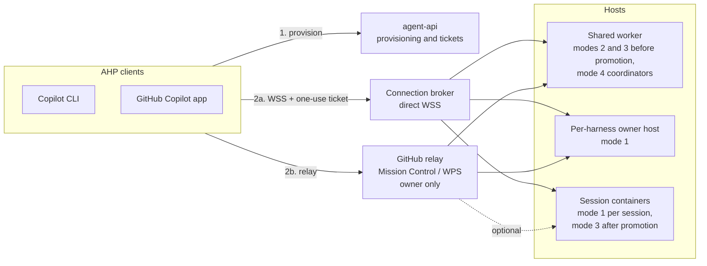
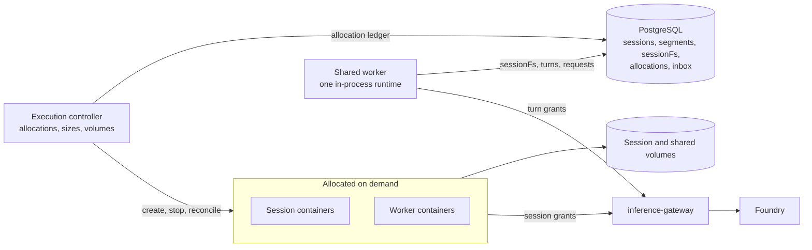
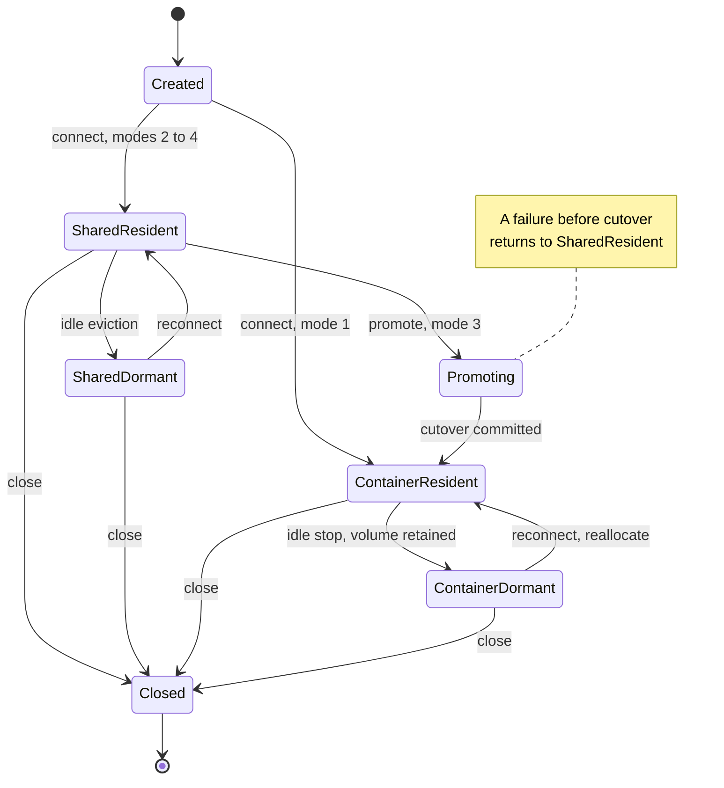
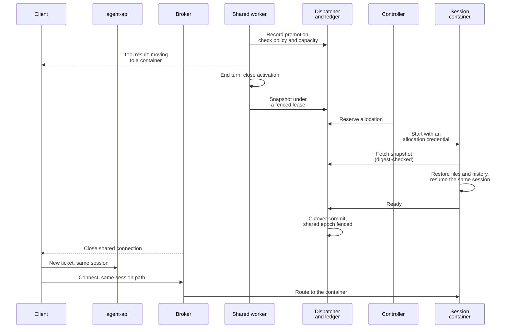

# Per-harness hosting modes plan

[Documentation hub](README.md) | [Current architecture](ARCHITECTURE.md) | [Security](SECURITY.md) | [Hybrid hosting record](HYBRID-HOSTING-PLAN.md)

Date: 2026-10-15

**Status: proposal, recorded before implementation.** This document owns the proposed four-mode, per-harness
hosting design, its client connection matrix, the comparison with OpenAI's Agents API, and the gates for
delivering it. It adds no supported hosting mode, harness field, API route, launcher option, or security
guarantee. [Architecture](ARCHITECTURE.md), [deployment](DEPLOYMENT.md), [API](API.md), and
[security](SECURITY.md) remain authoritative for current behavior until a slice lands with evidence.

## 1. Purpose and agreed decisions

Let each conversation harness choose where its agent loop runs, from a dedicated container to a shared
multi-tenant runtime, and reach every choice from Copilot CLI and the GitHub Copilot app over AHP through both
the GitHub relay and direct WSS paths. Hosting becomes a deliberate cost, latency, and isolation decision per
harness instead of one deployment-wide shape.

The repository already contains the building blocks, each fixed to one deployment-wide configuration:

| Existing building block | What it proves | What it does not provide yet |
| --- | --- | --- |
| Batch executor ([job execution](ARCHITECTURE.md#job-execution)) | The whole agent loop in a uid-isolated Linux container | Conversations or AHP attachment |
| Experimental `agent-host` ([architecture](ARCHITECTURE.md#optional-demo-agent-host)) | Container-hosted conversations over direct WSS and GitHub relay | More than one harness or owner per deployment; [`HostStore`](../src/job-store/src/host-store.ts) is a singleton |
| Local hybrid `session-host` ([architecture](ARCHITECTURE.md#local-hybrid-hosting)) | Many principals on one in-process runtime with PostgreSQL-backed `sessionFs`, attached over direct WSS with one-use tickets | Harness-driven sessions (it runs one coordinator definition built from AppHost parameters), relay, Azure |
| `delegate_job` and `execution-controller` | Model-directed one-shot child jobs in on-demand Docker containers with retained outputs | Long-lived workers, per-task sizes, shared storage, agent-managed lifecycle |

Decisions agreed on 2026-10-15:

| Decision | Agreed direction |
| --- | --- |
| Sequencing | Record this plan before implementation |
| Granularity | Hosting is selected per harness, within operator policy |
| GitHub relay for shared modes | Owner-scoped: shared hosts register Mission Control environments under one deployment-owner GitHub account. Direct WSS remains the multi-tenant path. Per-tenant relay is a runtime prerequisite |
| What a mode-4 container runs | An agent worker: its own child agent session from an approved harness, which the main agent creates, messages, monitors, and archives, as the GitHub Copilot app manages sessions. One-shot `delegate_job` remains the simple case |
| Handoffs | Predefined handoff-target harnesses, plus an optional, policy-bounded ability for the main agent to craft a harness at runtime, comparable to OpenAI Agents SDK handoffs |
| External comparison | Compare the design with OpenAI's Agents API ([section 12](#12-comparison-with-openais-agents-api)) |

The proposal introduces six pieces: a per-harness `hosting` contract and policy ceilings, a harness-driven
shared worker, a resumable **session container**, a direct-WSS **connection broker**, owner-scoped relay
environments, and coordinator tools for workers, promotion, and handoffs.

## 2. The four modes

| # | Mode (`hosting.mode`, proposed) | Where the main loop runs | Files | Containers | Intended use |
| --- | --- | --- | --- | --- | --- |
| 1 | `isolated`: isolated container (default) | Entirely inside a dedicated Linux container | Real filesystem in the container | One per host or session | Coding, shell, untrusted or long-running work; the most isolated choice |
| 2 | `shared`: shared runtime | One in-process runtime shared by many sessions and principals | `sessionFs` only (PostgreSQL); no shell or host filesystem | None | Chat, and agents that need only virtual files and application tools |
| 3 | `promotable`: shared with one-way promotion | Starts as mode 2; on promotion the loop moves into a dedicated container | `sessionFs`, then a real filesystem seeded from it | One, after promotion | A cheap start with an escape hatch for real-filesystem or longer work |
| 4 | `orchestrator`: shared brain, container workers | Coordinator on the shared runtime; each worker runs its own loop in a container | Coordinator: `sessionFs`; workers: real filesystem plus an optional shared session volume | Many, sized and managed by the coordinator | Parallel or heterogeneous work with low-cost coordination |

`isolated` is the default: a harness without a `hosting` block keeps today's behavior and digest.
Modes 2 to 4 trade isolation for density and startup latency. Shared placement is application-level isolation
inside one process, not an operating-system or hostile-code boundary; see
[security boundaries](#10-security-boundaries-and-claims). "Isolated" describes where the loop runs, not
complete confinement: egress is not enforced in any mode today ([known gaps](SECURITY.md#known-gaps)).

A harness has one mode. Promotion and handoff change where a **session** runs, never the harness's declared
mode. The platform never moves a session between placements on its own initiative.

### Vocabulary

| Term | Meaning |
| --- | --- |
| Placement | Where a session's loop runs now: `shared` (in-process on a shared worker) or `container` |
| Application session | The durable conversation identity owned by the application; it survives promotion and handoff |
| Segment | A period of one session with one harness snapshot at one placement; promotion and handoff start a new segment |
| Session container | A dedicated, resumable container that runs one session's loop on a real filesystem with a retained volume |
| Worker | A session container started by a mode-4 coordinator for a child agent session; no client ingress initially |
| Promotion | The one-way move of a mode-3 session from shared to container placement |
| Handoff | A transfer of conversation control to another harness |
| Crafted harness | A harness definition an agent composes at runtime from an operator template; validated like a published harness and never published automatically |
| Transport | **GitHub relay** (Mission Control and WPS; the "GitHub-managed path") or **direct WSS** (the "Azure WSS path" in Azure, loopback locally) |
| Inference route | **Managed** (application gateway to Foundry) or **GitHub-native** (Copilot inference, permissions, and billing) |

Transport and inference route are independent. Shared placement uses the managed route: the shared runtime runs
with the managed factory profile so that AHP identity does not replace the application's inference settings
([hybrid runtime qualification](DEVELOPER-GUIDE.md#hybrid-runtime-qualification)). Per-user Copilot inference on a
shared runtime is outside this plan. GitHub-native inference remains an isolated container profile, with the
harness and budget limitations described in [experimental host boundaries](SECURITY.md#experimental-host-boundaries).

One new primitive serves three modes: the **session container**. Mode 1 can start a session in one, mode 3
moves a session into one, and mode 4 starts workers in them. It generalizes the controller's one-shot job
allocation into a resumable per-session allocation with a retained volume.

## 3. Per-harness configuration (proposed contract)

The harness requests a mode, the effective operator policy grants it, and the deployment must provide the
required hosts and transports. A mode that policy does not allow is rejected during validation and admission.
A mode that is allowed but not deployed is reported as unavailable with its concrete prerequisite. There is no
fallback to another mode.

Illustrative harness block; final names, bounds, and defaults belong in `contracts` when implemented:

```jsonc
{
  "interaction": "conversation",
  "hosting": {
    "mode": "orchestrator",
    "workers": {
      "harnesses": ["repo-analyst", "test-runner"],
      "sizes": ["small", "medium"],
      "maxConcurrent": 4,
      "maxPerSession": 12,
      "sharedStorage": "session",
      "crafting": { "template": "general-worker" }
    },
    "handoffs": [
      { "harness": "coding-agent", "description": "Changes that need a real checkout", "history": "summary" }
    ]
  }
}
```

| Field | Modes | Meaning |
| --- | --- | --- |
| `mode` | All | `isolated` (default), `shared`, `promotable`, or `orchestrator` |
| `promotion.size`, `promotion.approval` | `promotable` | Container size after promotion; whether a model-initiated promotion needs a person (`ask`) or is automatic (`allow`) |
| `workers.harnesses` | `orchestrator` | Published conversation harnesses, each with effective mode `isolated`, that may run as workers |
| `workers.sizes`, `maxConcurrent`, `maxPerSession` | `orchestrator` | Requested subset of operator sizes and concurrency, narrowed by policy |
| `workers.sharedStorage` | `orchestrator` | `none` or `session` (one volume shared by that session's workers) |
| `workers.crafting.template` | `orchestrator` | Optional operator crafting template; omitting it disables crafted workers |
| `handoffs[]` | All conversation modes | Predefined targets, each with a description, a history policy (`full`, `summary`, or `none`), and an optional `approval` (`ask` or `allow`) |

Validation rules:

- Modes 2 to 4 require `interaction: "conversation"`. Batch harnesses keep executor semantics; running batch
  jobs on shared placement is outside this plan.
- Shared placement cannot run `shell`, `python`, or `mcp-local` tools, which need a process and real files.
  `shared` rejects them, `promotable` activates them only after promotion, and `orchestrator` reaches them
  through workers. A `kind: "host"` binding runs in the shared worker only if its execution profile marks it
  safe for in-process use (a new profile field).
- The `files` group maps first to provider-backed workspace tools. SDK built-in file tools over `sessionFs` need
  separate qualification. `web` is disabled in shared placement unless policy allows it, because its requests
  leave from the shared worker.
- `promotion` is valid only with `promotable`, and `workers` only with `orchestrator`. A handoff target must be
  a published conversation harness whose own mode is allowed; it cannot be the source harness.
- `hosting` is part of the digest when present. Omitting it keeps existing digests, following the optional-field
  convention in [`harness.ts`](../contracts/src/harness.ts).

Illustrative operator policy additions, overridable per harness through the existing
[`HarnessPolicyOverride`](../contracts/src/profile.ts) mechanism:

```jsonc
{
  "hosting": {
    "modes": ["isolated", "shared", "promotable", "orchestrator"],
    "transports": ["direct", "github"],
    "sizes": {
      "small":  { "cpus": 0.5, "memoryMiB": 1024 },
      "medium": { "cpus": 1,   "memoryMiB": 2048 },
      "large":  { "cpus": 2,   "memoryMiB": 4096 }
    },
    "workers": { "maxConcurrentPerSession": 4, "maxPerSession": 16, "maxPerPrincipal": 8, "idleSeconds": 900, "maxLifetimeSeconds": 3600 },
    "promotion": { "approval": ["ask"] },
    "crafting": {
      "templates": {
        "general-worker": {
          "toolBindings": [], "builtinTools": ["files", "shell"], "models": ["<approved model>"],
          "permissionModes": ["ask"], "maxDurationSeconds": 1800, "sizes": ["small"]
        }
      }
    }
  }
}
```

Sizes map to Docker CPU and memory locally, within the existing
[`ExecutionContainerSettings`](../contracts/src/artifacts.ts) bounds, and to combinations the selected Azure
backend accepts. The model chooses a size by name only. It never supplies images, commands, mounts, or
infrastructure arguments. A session keeps its admitted snapshot; promotion, worker creation, and handoff recheck
the current effective policy, so narrowing policy blocks new containers without stopping existing ones.

The configurator would gain a **Hosting** section in the harness editor (mode cards, mode-specific fields,
validation against effective policy), hosting ceilings on the **Policy** page, and per-harness rows on the
existing [Hosting page](CONFIGURATOR.md#hosting-and-topology) showing the host, available transports, and
connection actions. Unavailable combinations stay disabled and name their prerequisite, as they do today.

## 4. Proposed topology

The first diagram shows how clients reach a session; the second shows where shared and on-demand sessions run and
keep state.





The diagrams show every proposed component; a deployment includes only the hosts its harnesses' modes need.
Arrows are application traffic, not a network allowlist, and the dashed arrow is optional. Whether the GitHub
Copilot app can use direct WSS is still to be qualified ([section 5](#5-client-connections)). The per-harness owner
host keeps the existing host's retained volume and its managed or GitHub-native inference routes, shown in the
[optional demo agent host](ARCHITECTURE.md#optional-demo-agent-host) diagram.

| Host shape | Serves | Tenancy | Client transports | Status |
| --- | --- | --- | --- | --- |
| Per-harness owner host (container) | Mode 1 for one owner and one harness | One GitHub owner | Relay, direct, or both | One deployment-wide `agent-host` exists; one host per isolated harness is proposed |
| Session container | Mode 1 per session; mode 3 after promotion | One application session | Direct through the broker; relay only by registering its own owner environment | Proposed |
| Shared worker | Mode 2, mode 3 before promotion, mode-4 coordinators | Many principals over direct; the owner only over relay | Direct through the broker; relay through per-harness environments | Local direct path implemented for the fixed coordinator; harness-driven hosting proposed |
| Worker container | Mode-4 workers | One coordinator session | None initially; the coordinator mediates control | Proposed; one-shot job containers exist locally |

The **connection broker** gives direct-WSS clients one stable endpoint and path per application session
(`/sessions/{id}`). It consumes one-use tickets and routes bytes to the session's current placement without
interpreting AHP, reusing the existing [proxy pattern](../src/service-defaults/src/ahp-proxy.ts). Today the
container host and the shared worker each terminate their own direct connections; a broker is what lets a
promoted session keep its URL. Whether it belongs in `agent-api` or a separate service is an
[open decision](#15-non-goals-and-decision-register).

## 5. Client connections

| Mode | CLI, direct WSS, local | CLI, direct WSS, Azure | CLI, GitHub relay | Copilot app, relay | Copilot app, direct WSS |
| --- | --- | --- | --- | --- | --- |
| `isolated` | Exists for the one configured harness; managed profile behind its [compatibility gate](DEPLOYMENT.md#demo-host-compatibility-gate) | Exists, behind the same gate | Exists for the GitHub-native profile; [client eligibility](DEPLOYMENT.md#github-native-client-eligibility) applies | Host exists; app attachment not yet recorded | Unknown; qualify |
| `shared` | Implemented for the fixed coordinator; proposed per harness | Proposed | Proposed, owner only | Proposed, owner only; qualify | Unknown; qualify |
| `promotable` | Proposed; the broker reroutes after promotion | Proposed; needs Azure container reachability | Proposed; the client switches environments unless the runtime forwards sessions | As CLI relay; qualify | Unknown; qualify |
| `orchestrator` | Coordinator as `shared`; workers not attachable initially | As `shared` | Coordinator, owner only | As `shared` | Unknown; qualify |

Proposed client flows:

- **CLI over direct WSS.** `pnpm host:connect --harness <name> --transport direct --target local|azure [--resume <session>]`
  creates or resumes the session through the API, receives `{ url, token, expiresAt, serverKey, ahpSessionId }`,
  pins the server key with `COPILOT_AHP_SERVER_KEY`, and starts
  `copilot --experimental --ahp <url> --resume <ahpSessionId>`, with GitHub authentication consent where the host
  requires it. This generalizes today's [`--destination`](../configurator/server/connect-host.ts) launcher.
  Tickets stay one-use and short-lived.
- **CLI over GitHub relay.** The same launcher returns an environment ID and runs
  `copilot --experimental --relay --environment-id <id> [--resume <ahpSessionId>]`. One environment per
  relay-enabled harness keeps the owner's environment list readable; sessions appear in that environment's catalog.
- **GitHub Copilot app.** The app attaches as an AHP client to the same hosts. Its supported transports and its
  handling of key pins and one-use tickets must be verified and recorded per app version before the configurator
  offers an app connection action. If the app supports only relay, it is owner-scoped for shared modes.

Proposed API changes extend the existing [shared conversation routes](API.md#experimental-shared-conversations)
instead of adding a parallel family:

| Route | Proposed change |
| --- | --- |
| `POST /v1/sessions` | Accept `{ harness, label }`; respond with mode, placement, and current segment |
| `POST /v1/sessions/{id}/connection` | Accept `{ transport }`; return direct material or a relay environment ID, plus the current `ahpSessionId` |
| `POST /v1/sessions/{id}/promote` | Caller-initiated promotion of a `promotable` session; idempotent |
| `GET /v1/sessions/{id}/workers` | Mode-4 workers with state, size, usage, and timestamps |
| `POST /v1/sessions/{id}/close` | Existing; additionally stops workers and retires session containers |

Unsupported combinations return explicit errors, such as `hosting_mode_not_allowed`, `hosting_unavailable`
(naming the missing host or transport), and `relay_owner_only` when a principal other than the relay owner
requests the GitHub path.

### GitHub relay identity

Relay registration uses the hosting runtime's own GitHub identity. In reviewed runtime source (revision
`0a32c39595f`, `supervised_host.rs`), the host resolves environment credentials from its owning runtime context
before registering, and `HostGitHubEnvironmentOptions` carries only a name, a compute ID, and a binding flag.
One in-process runtime can therefore register environments for one account. Under the agreed owner-scoped model:

- The deployment configures a relay owner (GitHub login, verified numeric ID, and a credential stored as an
  Aspire secret), extending the existing `demo-host-owner` settings.
- The shared worker's runtime holds that credential for relay registration. Tenant hosts behind the broker keep
  their own expected-owner binding and sealed authentication. Showing that the owner credential changes neither
  tenant authentication nor managed inference is a qualification gate.
- Relay environments enforce the owner as expected owner. A session created from a relay client is admitted as
  the owner's mapped API principal, under the same budgets and policy as an API-created session.
- A per-harness relay host publishes several sessions, so its workspace boundary and resource callback must route
  each URI to the owning session's provider namespace. Today each shared session has its own host and anchor;
  that routing is part of the stage 2 gate.
- A session container that offers relay must hold the owner credential itself, which exposes it to that
  container's runtime account as today's host does. Direct WSS through the broker is the default for containers.
- Per-tenant relay needs per-host relay credentials in the runtime. That is a separate runtime workstream, not a
  reason to run one runtime per user.

## 6. Session lifecycle



No transition leaves container placement for shared placement. Idle eviction and idle stop retain state.
Closing prevents new turns and, for mode 4, stops workers. Disconnecting a client changes none of these states.

A handoff starts a new segment instead of changing placement in place. The target harness's mode decides the
new placement: a `shared` triage harness that hands off to an `isolated` coding harness moves the conversation
into a session container with the target's instructions and tools.

## 7. Mode details

### 7.1 Mode 1: isolated container

Keep the existing container host as the qualified starting point, then remove its deployment-wide singletons:

- Key host ownership, leases, and connection tickets by harness and owner instead of the single `demo_host` row.
  Each isolated harness a deployment exposes gets its own host resource, data root, and optional Mission Control
  environment. Each such host is always-on compute, and the configurator must show that cost per harness.
- Add per-session containers for multi-tenant direct use. The controller allocates a session container when a
  session connects, stops it after the idle period, and reallocates it from the retained volume on reconnect.
  This is the strongest separation between sessions and has no idle compute, at the price of cold starts.
- Keep the managed and GitHub-native inference routes distinct. GitHub-native mode applies neither harness
  restrictions nor Foundry budgets, so a harness's mode never selects it implicitly.
- Existing gates still apply: the managed [compatibility gate](DEPLOYMENT.md#demo-host-compatibility-gate),
  Azure Files [storage and revision requirements](DEPLOYMENT.md#storage-and-revision-requirements), and relay
  client eligibility.

### 7.2 Mode 2: shared runtime

Make the existing shared worker harness-driven:

- Replace the AppHost-defined `SharedSessionDefinition` ([`shared.ts`](../contracts/src/shared.ts)) with the
  admitted harness snapshot and effective policy. Instructions, prompt mode, model options, skills, sub-agents,
  limits, and permissions come from the harness. The existing turn scheduler, token reservations, idle eviction,
  and lease fencing remain.
- Apply the tool rules in [section 3](#3-per-harness-configuration-proposed-contract). Shared hosting is
  TypeScript-only because it uses the in-process Node SDK; batch runner parity is unaffected.
- Route `ask` approvals and questions to the attached AHP client, as the managed container host does today
  ([`hostPermissionHandler`](../src/agent-host/src/policy.ts) returns no result so the participant owns the
  prompt). The application never fabricates approval. The current coordinator rejects every permission request.
- Serve many harnesses from one worker, with per-harness resident-session and active-turn limits so one harness
  cannot starve the others.

### 7.3 Mode 3: promotable ("page fault" to a container)

The agent calls `promote_session` when it needs a real filesystem, a shell, packaged tools, or more time.
A caller can also promote through the API. With `approval: "ask"`, the attached person approves first.
Promotion is idempotent per tool call and one-way.



Cutover rules:

1. **Before cutover**, the shared placement remains authoritative and admits no new turns while promotion is in
   progress. Any failure in policy, capacity, snapshot, allocation, startup, or resume leaves the session shared
   and accepting turns again, releases the allocation, and returns an error to the agent or caller.
2. **The cutover commit** changes the placement to `container` and fences the shared storage lease epoch in one
   transaction. The shared runtime can no longer write the session. No route demotes it.
3. **After cutover**, the container is authoritative. If it fails, the controller reallocates from the retained
   volume. Interrupted turns are not replayed automatically (`continuePendingWork: false`); the agent receives a
   system continuation that explains the move.

The snapshot contains runtime history and workspace files from the session's `sessionFs` namespace, read under a
fenced lease after the turn ends, and bounded by the existing session storage limits. The container receives an
allocation-scoped credential that can fetch only that snapshot and request inference grants for that session.
It holds no database, Docker, signing, or Foundry credential. After cutover the shared namespace stays read-only
for the configured retention period, then the operator's retention process deletes it.

The decisive technical gate is **history transplant**: resuming the same runtime session ID on a
real-filesystem runtime from history written through `sessionFs`. The runtime fences resume on the workspace
path (see the Windows path-spelling fix in the [qualification record](HYBRID-HOSTING-PLAN.md#13-qualification-record)),
so the session container must use the shared anchor's absolute workspace path, or the runtime needs an explicit
workspace-rebase option on resume. A Windows-hosted shared worker cannot promote into a Linux container until
that is resolved; the Linux shared-worker image avoids the mismatch. If the transplant cannot be qualified, the
alternative is an explicit handoff to a fresh session seeded with the transcript and files. That would be a
recorded design change, never a silent fallback.

Client continuity: over direct WSS, the broker routes the same session path to the container once the client
presents a new ticket, and the launcher reconnects with `--resume`. Over relay, the session moves to a different
environment, so the client reconnects to the container's environment unless the runtime gains AHP session
forwarding.

### 7.4 Mode 4: orchestrator (shared brain, container workers)

The coordinator is a mode-2 session with worker tools. Workers are child application sessions, each running a
listed worker harness or a crafted harness in its own session container. The coordinator decides how many
workers to start, which sizes to use, what each does, and when to clean up. The platform enforces ceilings and
backstops rather than scheduling the work itself.

| Coordinator tool | Behavior | GitHub Copilot app analogue | OpenAI Agents API analogue |
| --- | --- | --- | --- |
| `create_worker` | Start a worker from a listed harness or crafting template with a size, name, mounts, and first task; returns immediately | Create a session | `create_subagent_call` |
| `send_to_worker` | Durable message: `immediate` steers at the next turn boundary; `enqueue` waits for current work | Send a session message | `send_subagent_input_call` |
| `get_worker`, `list_workers` | State (`starting`, `working`, `idle`, `needs_input`, `stopped`), latest result, usage, and container time | Session status | Session event stream |
| `interrupt_worker` | Abort the worker's current turn | Abort a turn | `interrupt_subagent_call` |
| `archive_worker` | Stop the container and release capacity; keep or discard its private volume per policy | Archive a session | None documented |
| `list_shared_files`, `read_shared_file`, `write_shared_file` | Bounded access to the session's shared volume | None | Shared environment filesystem |
| `delegate_job` | Existing one-shot batch child with input snapshot and output artifacts | None | None |

Rules:

- **No polling inside turns.** Worker completion, idle, failure, and input requests go to the coordinator's
  durable inbox and are delivered as bounded continuations, reusing the existing completion pump. A
  `wait_for_workers` tool, if added, ends the turn instead of holding it open.
- **Sizes and concurrency.** The coordinator chooses a size per worker from the effective subset. Admission counts
  starting, running, and retiring allocations per session, principal, and deployment, as the
  [allocation ledger](../src/job-store/src/allocations.ts) already does for one-shot jobs.
- **Shared storage.** With `sharedStorage: "session"`, workers mount one per-session volume read-write or
  read-only, and each worker also has a private volume. The coordinator has no real filesystem and reaches the
  shared volume only through bounded application tools. Concurrent writers get no locking beyond filesystem
  semantics, so instructions should assign separate directories.
- **Approvals.** A worker's `ask` permission requests go to a person: through the coordinator session's attached
  client or, when nobody is attached, through a principal-scoped API request queue modeled on the job
  [approvals and questions](API.md#approvals-and-questions) routes. Policy may let the coordinator answer a
  worker's questions. It never lets the coordinator approve permissions.
- **Backstops.** Idle timeout, maximum lifetime, per-session caps, an aggregate token budget across the
  coordinator and its workers, workers stopping when the coordinator closes, and controller orphan
  reconciliation. Container time is recorded per worker for cost attribution.
- **Depth one.** Workers cannot create workers, delegate jobs, or hand off in the first delivery.
- **No client attachment to workers initially.** Observing or steering a worker directly from the CLI or app
  needs worker ingress or a tunnel and is future work.

### 7.5 Handoffs and crafted harnesses

A handoff transfers conversation control to another harness; a worker leaves the coordinator in control.
Promotion is equivalent to a handoff to the same harness at container placement with full history.

| Mechanism | Who responds afterward | History | Placement afterward | Reversible |
| --- | --- | --- | --- | --- |
| Promotion (mode 3) | The same harness | Full runtime history | Container | No |
| Handoff | The target harness | `full`, `summary`, or `none`, per target | The target harness's mode | Only if the target lists the source as a handoff |
| Worker (mode 4) | The coordinator; workers report back | Task and messages only | Worker container | Not applicable |

Handoffs follow the shape of OpenAI Agents SDK handoffs:

- Each predefined target appears to the model as a `transfer_to_<harness>` tool with the target's description.
  Its arguments are a small structured payload, such as a reason and a summary, validated before any effect.
- Authorization happens before transfer. The target must be allowed by current policy and available in the
  deployment, and with `approval: "ask"` a person confirms. A failed check leaves the source in control.
- The new segment receives history according to the target's policy: `full` (resume under the target's
  configuration if the runtime permits a configuration change on resume, otherwise a transcript seed),
  `summary` (a bounded summary written by the source), or `none` (the payload only). Filters can remove content;
  they never add authority.
- The application session ID stays the same. Clients reconnect to the new segment's `ahpSessionId`, which the
  launcher resolves from the API.

Crafted harnesses let a coordinator define a worker when no listed harness fits:

- An operator template sets the ceiling: tool bindings, built-in groups, models, permission modes, skills, limits,
  and sizes. The coordinator supplies a name, bounded instructions, and a subset of the template.
- The result goes through the same `HarnessDefinition` schema, [hosted-harness admission](../src/service-defaults/src/host-policy.ts),
  and policy intersection as a published harness, and is recorded with its digest, template, parent session,
  and tool call.
- Crafted definitions are never published to the registry automatically. A person can export one to the
  configurator as an unsaved draft.
- Crafted instructions are model-authored, untrusted input. They cannot widen the template, select an image or
  command, or become handoff targets in the first delivery.

## 8. Storage by mode

| Data | Mode 1 | Mode 2 | Mode 3 | Mode 4 |
| --- | --- | --- | --- | --- |
| Runtime history | Host or session volume | `sessionFs` in PostgreSQL | `sessionFs`, then the session volume | Coordinator: `sessionFs`; workers: their volumes |
| Workspace files | Real filesystem on the volume | Bounded `sessionFs` namespace | Seeded from `sessionFs` at cutover | Coordinator: `sessionFs`; workers: private and optional shared volumes |
| Admitted snapshot, budgets, turns | PostgreSQL | PostgreSQL | PostgreSQL; one record across segments | PostgreSQL; linked parent and child sessions |
| Outputs | Container files | `sessionFs` | Container files | Shared volume and existing job artifacts |
| Retention | Operator-managed volumes | Operator-managed rows | Both, including the read-only pre-promotion namespace | Volumes per worker and session |

Locally, session and shared volumes are Docker named volumes labeled with the controller namespace. The Azure
candidate is Azure Files, whose [storage gate](DEPLOYMENT.md#storage-and-revision-requirements) remains open.

## 9. Identity, inference, and credentials

| Component | Holds | Never holds |
| --- | --- | --- |
| Connection broker | Ticket verification and routing state | Session content, inference grants, provider credentials |
| Shared worker | PostgreSQL access and its dispatcher grant key; the relay owner credential if relay is enabled | Docker authority, the allocation-signing key, provider credentials |
| Execution controller | Docker authority locally or Azure provisioning authority; allocation signing | Session content, inference grants |
| Session container or worker | An allocation-scoped credential and session inference grants; the owner credential only if it offers relay | Database, Docker, signing, or Foundry credentials |
| Inference gateway | Foundry identity | Client or session credentials |

Every model call in modes 2 to 4, and in managed mode 1, uses a session or turn capability issued against the
session's aggregate budget, as hosted sessions and shared turns do today. These are admission and accounting
controls, not exact spending caps; see [local hybrid boundaries](SECURITY.md#local-hybrid-boundaries).

## 10. Security boundaries and claims

| Mode | Boundary between sessions | Do not claim |
| --- | --- | --- |
| `isolated`, per session | Separate container, runner uid, and private volume | Network isolation (egress is unenforced) or hostile-tenant VM isolation |
| `isolated`, per-harness host | One container shared by one owner's sessions | Isolation between that owner's sessions |
| `shared` | Application checks inside one process: principal and lease-fenced storage, tool allowlists | Operating-system isolation, or safety for untrusted code (none runs there) |
| `promotable` | Shared before cutover, container after | That the shared phase had container isolation |
| `orchestrator` | Shared coordinator; workers in containers; one session's workers share its volume | Isolation between workers of one session that share a volume |

Additional risks to design for: prompt injection through worker results, crafted instructions, and handoff
summaries (treat all of them as untrusted data); promotion snapshots as integrity-sensitive transfers
(digest-checked and allocation-bound); relay owner credentials inside containers; and cost amplification through
worker creation (bounded by ceilings and budgets, not by an exact dollar cap). Update [Security](SECURITY.md)
with verified controls as each slice lands. Until then its current statements apply.

## 11. Effective controls

| Control | Modes | Enforced at |
| --- | --- | --- |
| Allowed modes and transports | All | Validation, admission, connection provisioning |
| Size catalog and per-harness subset | 1, 3, 4 | Allocation admission |
| Shared active turns, resident sessions, and queue | 2, 3, 4 | Shared worker scheduler (existing) |
| Session, turn, and aggregate token budgets | All managed | Turn and grant admission (existing), extended to workers |
| Worker concurrency, totals, idle time, and lifetime | 4 | Allocation ledger and controller |
| Promotion approval and capacity | 3 | Promotion admission |
| Handoff targets, approval, and history policy | All conversation modes | Handoff admission |
| Crafting template ceilings | 4 | Crafted-definition validation |
| Retention of volumes and namespaces | All | The operator's retention process; nothing is deleted automatically |

Controls are validated server-side, and the UI reads the same effective values. Lowering a ceiling blocks new
allocations and drains existing work; it does not silently stop containers.

## 12. Comparison with OpenAI's Agents API

Reviewed on 2026-10-15 from OpenAI's documentation for the Agents API, which is in beta and can change. The
statements below describe OpenAI's documented behavior, not measurements, and should be rechecked before they
are relied on.

### Concept mapping

| OpenAI Agents API | This plan | Notes |
| --- | --- | --- |
| Agent: model, instructions, tools, MCP servers; saved agents reused across sessions | Harness: versioned, digest-identified, bounded by operator policy | Both snapshot configuration when a session starts |
| Environment `none` | Mode 2 `shared` | OpenAI's `none` has no workspace files or built-in shell, and applications supply function tools. Shared mode keeps durable virtual files in `sessionFs` |
| Environment `openai_hosted`, with `small` (1 vCPU, 1 GB), `medium` (2 vCPU, 4 GB), or `large` (4 vCPU, 16 GB) chosen per session | Mode 1 session containers, promoted containers, and workers, with an operator size catalog | Ours run on the customer's compute |
| Environment `self_hosted`: customer compute runs an executor that connects outbound over WebSocket and performs commands, file operations, and local MCP calls for the hosted harness | No equivalent; the closest is remote "hands-only" execution, which this plan did not choose for mode 4 | Its outbound-only connection informs the Azure container reachability decision |
| Session: durable, steerable during a turn, continued later; OpenAI manages context compaction | Application session with segments, attached live through AHP | |
| `multi_agent`: harness-supplied tools to create, message, wait for, and interrupt subagents; 6 concurrent by default; subagents share the coordinator's environment and filesystem; no function tools | Mode 4 workers in separate sized containers with an optional shared volume; in-runtime sub-agents still exist within one runtime | |
| Agents SDK handoffs: `transfer_to_<agent>` tools, input filters, structured handoff input | Predefined handoffs with per-target history policy | OpenAI documents handoffs in the SDK, not as an Agents API feature |
| REST, server-sent events, and signed webhooks; required actions for function calls and approvals | AHP attachment from the CLI and app, plus the existing REST and SSE job APIs | We found no documented direct CLI or IDE attachment to a running OpenAI session |
| Vaults for secrets used by MCP servers and sandbox-originated requests | No equivalent; credentials stay within gateway and host boundaries | |

### Where the agent loop runs

With the Agents API, OpenAI always runs the managed Codex harness, including when the environment is
self-hosted; only the execution environment moves. To run the loop in your own infrastructure, OpenAI directs
you to the Agents SDK, which runs inside your application. In this plan the Copilot runtime harness always runs
inside the customer deployment, and the four modes choose between a shared process and a container for it.

### Differences that affect this design

| Topic | OpenAI Agents API (documented) | This plan | Implication |
| --- | --- | --- | --- |
| Changing environment mid-session | The session update route changes model, reasoning effort, service tier, and metadata; tools, instructions, and multi-agent settings need a new session; no environment change is documented | Mode 3 promotes a running session, one way | Promotion has no documented OpenAI counterpart; its cutover and continuity are the riskiest part of this plan |
| Subagent compute | Subagents share one environment and its size | Each worker gets its own sized container; sharing is an explicit volume | Better isolation and mixed sizes; higher per-worker startup time and cost |
| Subagent tools | Subagents inherit MCP and web search settings; no function tools | Workers use their own harness's tools under policy | Workers are full agents rather than reduced subagents |
| Handoffs | An SDK concept; the receiving agent sees full history unless an input filter changes it | Platform-level, policy-checked, with a history policy per target, across placements | A handoff across placements requires the client to reconnect |
| Client access | Application-mediated REST, SSE, and webhooks | Direct AHP from Copilot CLI and app over relay or WSS | Live attachment is a differentiator, with more authentication surface: tickets, key pins, expected owner |
| Network control | Hosted sandboxes allow network access to be enabled, disabled, or restricted to up to 100 exact hostnames | Egress is not enforced | A real gap for isolated and worker containers |
| Warm capacity and idle | Free pre-warmed environments that expire after five minutes unattached; hosted sandboxes expire after about an hour idle, not configurable | Zero warm capacity by default; operator-configured idle time and lifetime | Our latency depends on cold container starts until warm capacity exists |
| Data controls | US data residency only; not eligible for Zero Data Retention, even with a self-hosted environment | Deployed in the customer's Azure subscription; relay traffic and GitHub-native inference use GitHub infrastructure | Customer placement is a differentiator, with documented GitHub-path exceptions |
| Pricing | Model usage at API rates, plus container rates for hosted sandboxes | The customer's Azure compute and Foundry usage | Compare total cost only with measured data |

### What to adopt and what to keep distinct

- Adopt the coordinator vocabulary (create, message, interrupt, inspect), so mode 4 is familiar to developers who
  know OpenAI's multi-agent tools or the GitHub Copilot app.
- Adopt outbound-only connectivity for ephemeral containers, as OpenAI's self-hosted executor does, to avoid
  per-container ingress in Azure.
- Adopt explicit network modes (disabled, restricted, enabled) as the target for container egress. Azure session
  pools can disable egress per pool, but nothing in this repository enforces egress today.
- Keep promotion explicit and one-way; OpenAI documents no in-session environment change to copy.
- Keep separate containers for workers instead of one shared environment, and offer a shared volume explicitly.

A side-by-side run compares different harnesses (Codex and the Copilot runtime), possibly different models, and
different infrastructure. Report such a run as a product comparison on named workloads, not as evidence about the
hosting architecture alone, and use the definitions in [section 13](#13-measurements-and-demonstration).

Sources, reviewed 2026-10-15: Agents API [overview](https://developers.openai.com/api/docs/guides/agents-api/overview),
[architecture](https://developers.openai.com/api/docs/guides/agents-api/architecture),
[configuration](https://developers.openai.com/api/docs/guides/agents-api/configuration),
[multi-agent](https://developers.openai.com/api/docs/guides/agents-api/multi-agent),
[OpenAI-hosted sandboxes](https://developers.openai.com/api/docs/guides/agents-api/environments/openai-hosted),
[self-hosted sandboxes](https://developers.openai.com/api/docs/guides/agents-api/environments/self-hosted),
[sandbox lifecycle](https://developers.openai.com/api/docs/guides/agents-api/environments/lifecycle),
[pre-warmed sandboxes](https://developers.openai.com/api/docs/guides/agents-api/environments/prewarmed), and
[sessions](https://developers.openai.com/api/docs/guides/agents-api/sessions); the
[runtime comparison](https://developers.openai.com/api/docs/guides/agents); and the Agents SDK
[orchestration](https://developers.openai.com/api/docs/guides/agents/orchestration) and
[handoffs](https://openai.github.io/openai-agents-python/handoffs/) guides.

## 13. Measurements and demonstration

Reuse the metric definitions in the [hybrid plan](HYBRID-HOSTING-PLAN.md#9-measurements-and-demonstration-protocol)
and add:

| Metric | Definition |
| --- | --- |
| Promotion latency | Promotion request to cutover commit, and cutover to the client's first successful turn |
| Worker startup | `create_worker` acceptance to the worker's first turn, split into allocation and runtime readiness |
| Worker concurrency | Achieved concurrent workers against configured ceilings, with queueing time |
| Idle cost by mode | Container-seconds multiplied by configured size while no turn is active, per harness |
| Coordinator overhead | Coordinator tokens per worker task |

A representative demonstration:

1. Connect from the CLI to one harness in each mode over direct WSS, and as the relay owner over the GitHub path.
2. Show that a `shared` conversation allocates no containers.
3. In a `promotable` session, ask for work that needs a shell. Observe approval, cutover, reconnection, and
   continued work, and confirm that no demotion is possible.
4. In an `orchestrator` session, start two workers of different sizes on a shared volume. Message one, interrupt
   one, archive both, and observe capacity return to zero.
5. Hand off from a shared triage harness to an isolated coding harness with summary history.
6. Repeat a subset from the GitHub Copilot app over each transport it supports, recording the app version.

No performance target has been agreed. Predeclare workloads, trial counts, and pass criteria before collecting
comparative results, and report negative results.

## 14. Delivery sequence and acceptance gates

| Stage | Deliverable | Exit evidence |
| --- | --- | --- |
| 0. Plan | This document and documentation-hub links | Modes, contract direction, connection matrix, comparison, gates, and agreed decisions recorded before code |
| 1. Contract and policy | `hosting` harness block, policy ceilings and per-harness overrides, validation and admission errors, configurator editing, and a read-only per-harness hosting view | Existing harnesses keep their digests; invalid combinations and disallowed modes fail with field-scoped errors; unavailable modes name their prerequisite; runtime behavior is unchanged |
| 2. Harness-driven shared mode | The shared worker hosts `shared` harnesses; `/v1/sessions` accepts a harness; the broker; launcher `--harness`; owner-scoped relay environments | Two shared harnesses serve two API principals on one worker over direct WSS from the CLI; the owner attaches over relay; a non-owner relay request is refused; no containers are allocated; the Copilot app result is recorded |
| 3. Session containers | Resumable allocations with per-session volumes, idle stop and reallocation, broker routing to containers, per-session mode 1, per-harness owner hosts | A mode-1 session runs in its own container, stops when idle, and resumes from its volume; orphan reconciliation and capacity accounting cover the new allocation kinds |
| 4. Orchestrator workers | Worker tools, the durable coordinator inbox, sizes, the shared volume, backstops, and listed and crafted workers | A coordinator runs two differently sized workers concurrently on a shared volume, messages and interrupts them, receives their completions without polling, and archives them; capacity returns to zero; a crafted definition cannot exceed its template |
| 5. Promotion | A transplant spike, then `promote_session`, API promotion, cutover fencing, and client continuity | A shared conversation promotes mid-task and continues with shell and files under the same application session; failures before cutover leave it shared; no demotion route exists |
| 6. Handoffs | Predefined targets, approval, history policies, and cross-placement handoff | A shared triage harness hands off to an isolated coding harness with summary history; a disallowed or unavailable target fails without transferring control |
| 7. Azure | Shared-worker image deployment, broker ingress, a container backend adapter with volumes, and relay from Azure | Sessions and workers scale from zero to many to zero in Azure; the CLI attaches over direct WSS and relay; app evidence and observed costs are recorded |
| 8. Comparison | A mode comparison and an OpenAI Agents API product comparison on synthetic workloads | Predeclared workloads and thresholds, raw data, and stated caveats |

Stages 2 and 3 can proceed in parallel after stage 1. Stages 4 and 5 depend on stages 2 and 3, and stage 6 reuses
the segment mechanism from stage 5. Every stage keeps the default `isolated` behavior, batch jobs, the existing
host, and the local hybrid path working. Local evidence does not qualify Azure, and a source patch is not
qualification of a runtime capability.

Required failure coverage, in addition to existing suites:

- A disallowed mode, an unavailable mode, and a disallowed transport, each with an explicit error.
- A relay request by a principal other than the owner.
- Promotion: duplicate tool calls, failure at each step before cutover, a crash after cutover, stale shared
  writes after fencing, and demotion attempts.
- Workers: limits under concurrent creation, coordinator closure with running workers, orphaned containers,
  shared-volume conflicts, and worker permission requests with and without an attached client.
- Handoffs: disallowed or unavailable targets, approval denial, history filtering, and repeated handoff calls.
- Crafted harnesses: an attempt to exceed each template ceiling.
- Cross-principal access to sessions, workers, snapshots, and volumes.

## 15. Non-goals and decision register

Non-goals: transparent live migration; demotion from container to shared placement; the platform choosing or
changing a session's placement on its own; per-tenant relay from one shared runtime; hostile multi-tenant
isolation claims for shared placement; model-selected images, commands, mounts, or infrastructure arguments;
workers that create workers; client attachment to workers; Python-hosted conversations; changes to batch job
semantics; exact spending enforcement; and production-hardening claims.

| Decision | Current direction | Resolve by |
| --- | --- | --- |
| Mode identifiers | `isolated`, `shared`, `promotable`, `orchestrator` | Stage 1 |
| In-process `host` tool bindings | Profile-declared allowlist; `python` and `mcp-local` unavailable in shared placement | Stage 1 |
| `files` in shared placement | Application workspace tools first; SDK built-in file tools only after qualification over `sessionFs` | Stage 2 |
| `web` in shared placement | Off unless policy allows it, with shared-worker egress recorded | Stage 2 |
| Broker placement | Inside `agent-api` or a separate service; a stable `/sessions/{id}` path either way | Stage 2 |
| Relay environment granularity | One environment per relay-enabled harness per host | Stage 2 |
| Copilot app transports | Qualify relay and direct attachment; offer only verified actions | Stage 2 |
| Mode 1 host shape | Per-harness owner hosts for relay; per-session containers for multi-tenant direct use | Stage 3 |
| Worker approvals | People, through the coordinator's client or a principal-scoped API request queue; the coordinator answers questions only if policy allows | Stage 4 |
| Coordinator access to the shared volume | Bounded application tools through a controller-side file service | Stage 4 |
| History transplant for promotion | The same session ID at the same absolute workspace path; otherwise a recorded switch to handoff-to-self | Stage 5 spike |
| Handoff history default | `summary` across placements; `full` within the same placement | Stage 6 |
| Azure container backend | Container Apps jobs (per-execution CPU, memory, and image overrides) or dynamic session pools (Hyper-V isolation, per-pool size, egress disable, ready sessions) | Stage 7 spike |
| Azure container reachability | An outbound tunnel from containers to the broker; dynamic sessions only if WebSocket attachment is qualified | Stage 7 spike |
| Per-tenant relay | Per-host relay credentials in the runtime | Separate runtime workstream |

Azure evidence reviewed on 2026-10-15: `az containerapp job start` accepts per-execution `--cpu`, `--memory`,
`--image`, and environment overrides, and Container Apps jobs are documented as finite-duration tasks
([jobs](https://learn.microsoft.com/azure/container-apps/jobs), [CLI](https://learn.microsoft.com/cli/azure/containerapp/job)).
Session pools set CPU and memory per pool, can disable egress, and support `Timed` (idle cooldown) or
`OnContainerExit` lifecycles ([session pools](https://learn.microsoft.com/azure/container-apps/session-pool)). The
reviewed pages document neither WebSocket attachment nor volume mounts for session pools; treat both as unverified.

## 16. Documentation impact as slices land

| Slice | Canonical pages to update |
| --- | --- |
| Contract and policy | [Configurator](CONFIGURATOR.md), [developer feature checklist](DEVELOPER-GUIDE.md#add-a-harness-feature), [runner protocol](RUNNER-PROTOCOL.md) if session mapping changes, [product scope](PRODUCT.md#supported-today) |
| Shared mode and provisioning | [API](API.md), [architecture](ARCHITECTURE.md) and its diagrams, [deployment](DEPLOYMENT.md), [security](SECURITY.md), [user guide](USER-GUIDE.md) |
| Session containers, workers, and promotion | Architecture state flows, security boundaries, deployment controls, API |
| Handoffs and crafted harnesses | API, configurator, security, product scope |
| Azure | Deployment, [topology image](images/local-and-azure.svg), security, costs |

Record dated evidence for each stage in this document, as the [hybrid record](HYBRID-HOSTING-PLAN.md#13-qualification-record)
does, and move supported behavior into its owning reference page rather than duplicating it here.
